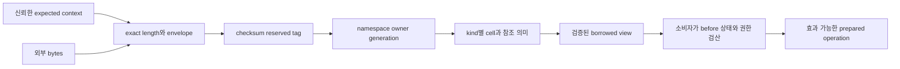

# DEV3 3.01 — 형식·정체성 개발 상세 명세와 설계도

2026-10-22 · **작업 상세 설계 / 기존 표현의 제한 검증 존재 / 신규 실행 없음**

[16개 작업 색인·공통 규칙](dev3-task-designs.md) · [현재 구현](../implementation/dev3-implementation.md#dev3-work-breakdown) · [표현 계약 색인](README.md) · [작업 순서](../plans/dev3-implementation-plan.md#remaining-work)

## 1. 목적·범위·기준

디스크 bytes를 안전한 typed view로 읽고, 다른 DB/timeline/객체/세대의 bytes를 소비하지 않도록 한다. page, reference/anchor, key, tree, row/index presence, overflow, undo/status, allocator, WAL/obligation, control/ownership의 **표현과 의미 검산 경계**를 담당한다. 파일 설치·pin·변경 권한·durability는 각 소비 작업의 책임이다.

현재 여러 codec와 M01–M06의 고정 모델 결과가 있으나 그 결과는 원래 source·입력 범위에만 적용된다. 기존 codec를 모두 다시 쓰거나 다시 시험하는 작업이 아니다. 실제 소비 경로의 누락 표현·검산을 추가한다.

## 2. 요구와 입력·출력

| 요구 ID | 명세·판정 |
| --- | --- |
| 3.01-R1 | persistent bytes에 Rust struct layout을 쓰지 않는다. 정수 endian·offset·reserved=0·exact length·digest 범위는 해당 F01 정본을 따른다 |
| 3.01-R2 | 입력은 bytes와 신뢰한 expected namespace/owner/profile/PageRef다. 검사할 input의 header를 expected로 되돌려 자기 검증하지 않는다 |
| 3.01-R3 | envelope 성공 뒤 kind별 cell·참조·level·정렬·중복·논리 상태를 검산한다. envelope만으로 opaque cell의 의미를 승인하지 않는다 |
| 3.01-R4 | FileId/PageRef/UndoRef/TxnRef/ObjectId-generation/RowUID/LSN/q의 의미를 구분한다. 발급 시 wrap을 거절하고 stale generation을 다른 현재 객체로 해석하지 않는다 |
| 3.01-R5 | 길이·offset·개수·산술 overflow, 모르는 tag/format, 잘림·trailing bytes, checksum 불일치를 무효과로 거절한다. caller output 보존 여부는 각 encoder의 계약을 따른다 |
| 3.01-R6 | round-trip에 더해 독립 literal·순서 비교·원래 오류·known-bad를 대조한다. 형식 수락과 적용 권한 발급을 분리한다 |

| 표현군 | 정본·출력 | 실제 소비자 |
| --- | --- | --- |
| page·reference·tree | [page](dev3-page-format.md), [참조](dev3-reference-format.md), [tree](dev3-tree-format.md): bounds/identity가 검증된 borrowed view | reader·buffer·tree·redo |
| key·row·overflow | [key](dev3-key-format.md), [row](dev3-row-format.md), [overflow](dev3-overflow-format.md): canonical 값·물리 full key·bounded chunk view | row/index·undo·audit |
| 거래·undo·catalog | [거래](dev3-transaction-format.md), [status home](dev3-status-home.md), [undo](dev3-undo-format.md), [catalog](dev3-catalog-format.md) | rollback·가시성·DDL |
| allocator·ownership | [allocation](dev3-allocation-format.md), [ownership](dev3-ownership-format.md): 상태/claimant와 inventory 합계 | 예약·INIT·복구 |
| WAL·control·DWB | [WAL](dev3-wal-format.md), [obligation](dev3-obligation-format.md), [control](dev3-control-format.md), [DWB](dev3-doublewrite-format.md) | stage/apply·flush·checkpoint/recovery |

## 3. 검사 파이프라인 설계도

1. 소유 decoder의 오류 우선순위를 유지하며 구조 길이와 checked 범위를 먼저 확보한다. digest 계산도 검증된 slice만 사용한다.
2. 기대 identity는 상위에서 검증된 profile/FILEMAP/anchor/owner에서 전달한다. 참조가 실제 존재하는지는 load/closure 소비자가 별도로 검사한다.
3. 공통 page view를 넘겨받은 tree decoder는 key 순서·cell 크기·child level을, undo decoder는 chain sequence·target·before 상태를 검사한다. 중복 검사를 없앤다는 이유로 이 의미 검사를 생략하지 않는다.
4. encode는 입력 전체를 preflight한 뒤 caller workspace에 canonical bytes를 만든다. 실패 시 output/authority 효과는 정본을 따른다. scratch는 durable 권한이 아니다.
5. semantic group은 descriptor 이전 SHA/LSN, native before/after, edge multiset·count, inventory delta, page redo를 서로 대조한 뒤 producer의 전용 prepared 값으로 넘긴다.

## 4. 데이터 크기와 자원

page16,384/header128/checksum32, slot4, escaped key≤1,024+RowId8, row≤131,072, inline≤2,048, WAL frame≤1,048,576을 사용한다. [실제 표현 계산](dev3-resource-bounds.md)이 bytes 산술의 정본이다. full INIT subrecord16,448과 frame overhead192이므로 63개는1,036,416, 64개는1,052,864로 거절한다. DWB64는 별도 한도다.

zero-copy view는 원래 bytes의 borrow를 넘지 못한다. heap에 전체 파일/undo chain을 적재하지 않는다. 크기 계산의 성공은 전체 opcode 자원 증명이 아니며, 이를 쓰는 3.03–3.15가 실제 동시 생존량을 F05에 합산한다.

## 5. 구현 단위·오류·인수

| 공급 단위 | 작업 내용 | 독립 인수 입력·기대 |
| --- | --- | --- |
| 소비 형식 수신 | 실제 codec/symbol과 기존 receipt 연결 | 동일 bytes를 새 의미로 재해석하지 않는지 검토; 무변경 완료 시험 재실행 없음 |
| 신규 표현 | 현재 consumer에 필요한 kind/body만 구현 | 최소/최대/±1, exact literal·reserved·hash·tag·identity·trailing·overflow 반례 |
| 교차 의미 | page/native/descriptor/edge/inventory 결합 | 외부 hash를 다시 맞춘 잘못된 내용도 거절; expected 자체 변조 방지 |
| 적용 연결 | typed producer→prepared→실제 owner의 경계 | raw bytes/shape-only view로 mutation authority 생성 불가, 수명 위반 compiler 사례 |

현재 source 진입점은 [page.rs](../../crates/engine/src/storage/page.rs), [wal_frame.rs](../../crates/engine/src/storage/wal_frame.rs), [semantic_group.rs](../../crates/engine/src/storage/semantic_group.rs), [storage 모듈](../../crates/engine/src/storage/mod.rs)이다. 실제 추가 파일은 구현이 생길 때 등록한다. 이들은 일반 효과 완료를 뜻하지 않는다.

## 6. 착수 전 추가 동결·완료 조건

checkpoint/CURRENT·recovery WRITER body, 일반 semantic opcode와 catalog occupied before의 미완료 표현은 각각의 owner에서 bytes·상태표·literal을 추가 동결한다. 미래 opaque body를 성공 처리하지 않는다. 표현 leaf 완료는 독립 vector와 관련 decoder/encoder 오류·수명 검증 및 별도 검토로 판정한다. DS의 실제 I/O·거래·복구 완료는 해당 소비 작업에서 별도로 닫는다.
