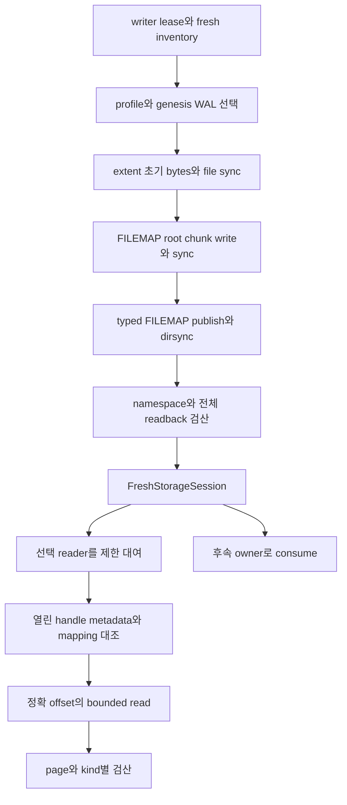

# DEV3 3.02 — 파일·읽기 기반 개발 상세 명세와 설계도

2026-10-22 · **작업 상세 설계 / 최초 세션·선택 읽기 제한 검증 / 일반 open 미완료**

[공통 규칙](dev3-task-designs.md) · [저장 세션](dev3-storage-session.md) · [page I/O](dev3-page-io.md) · [selector port](dev3-selector-port.md) · [control](dev3-control-format.md) · [현재 상태](../implementation/dev3-implementation.md#storage-session-results)

## 1. 책임·선행·산출물

exclusive writer lease, canonical namespace, profile·extent·FILEMAP 최초 설치, 선택된 mapping으로의 bounded page 읽기를 공급한다. 3.01의 관련 표현과 foundation port/Linux adapter를 수신한다. 일반 기존 DB open의 장벽·READY는 3.12, extent 확장은 3.03.3, dirty home 읽기 조정은 3.05가 소유한다.

최초 세션과 genesis WAL의 검증된 성공은 DB 전체 생성/재시작 성공이 아니다. 현재 실제 owner와 reader가 가진 공통 fence를 후속 allocator/buffer에 인계한다.

## 2. 기능 명세와 데이터 계약

| 요구 ID | 입력·처리·성공 보장 |
| --- | --- |
| 3.02-R1 | caller 소유 DB directory의 writer lease를 소비한다. canonical 직접 child 이름과 열린 handle metadata를 사용하고 symlink/hardlink 별칭·foreign file·지원하지 않는 기존 형식은 거절한다 |
| 3.02-R2 | Fresh 생성은 정확한 허용 inventory만 받는다. 중단 설치를 임의 청소/재개/덮어쓰기하지 않으며 생성 실패 파일은 소유 상태와 함께 보존한다 |
| 3.02-R3 | profile→extent/header→FILEMAP bytes를 정본 순서로 설치한다. 파일 sync·namespace sync·selector 선택과 readback이 끝나기 전 참조 capability를 반환하지 않는다 |
| 3.02-R4 | read는 신뢰한 FILEMAP의 FileId/길이/bootstrap 주소와 요청 PageRef·owner·kind를 받는다. bytes를 읽은 뒤 header를 expected로 삼지 않는다 |
| 3.02-R5 | FILEMAP root/chunk 전체의 identity·hash·canonical 정렬/중복·물리 길이를 bounded 순회로 검산한다. 일부 entry 발견만으로 전체 manifest를 수락하지 않는다 |
| 3.02-R6 | reader는 caller page/scratch에 값을 제공하며 handle/pin/borrow를 scope 밖으로 누출하지 않는다. 동일 세션 WAL·reader·후속 writer는 공통 fence를 따른다 |

읽기 결과에는 실제 요청 identity가 검증된 page bytes만 포함한다. cache hit도 물리 handle identity·page incarnation 검산을 우회할 권한이 아니다. 임의 directory scan으로 최신 control을 고르지 않는다.

## 3. 설치·읽기 설계도

그림은 소유와 영속 장벽을 나타낸다. 실제 최초 설치의 정확 효과 호출 순서·고정 bytes·오류 우선순위는 [저장 세션 정본](dev3-storage-session.md)을 유지한다. filename만 같은 handle을 재사용하지 않으며, 열기 후 identity/length 재검산에서 교체·alias가 발견되면 성공 reader를 만들지 않는다.

page offset은 checked `page_no × 16384`와 file header/예약 길이 규칙으로 계산한다. short read/Interrupted는 port 계약에 맞게 남은 범위를 이어 읽되 EOF/zero/invalid count는 원래 원인으로 반환한다. read scratch는 실패해도 authoritative dirty page로 등록하지 않는다.

## 4. 상태·오류와 복구 경계

| 상태·사건 | 결과·남는 소유 |
| --- | --- |
| lease 뒤 fresh preflight 실패 | 허용된 LOCK 효과와 DB 파일 무변경을 구분; 성공 세션 없음 |
| 파일 생성/write/sync 이후 실패 | 부분 namespace·파일 보존, consuming owner의 실패 효과 유지; 자동 동일 ID 재생성 금지 |
| selector publish/dirsync 불명 | old/new closure 보존·fence; 큰 generation을 골라 성공시키지 않음 |
| readback identity/length/bytes 불일치 | 기존 영속 선택을 되돌리지 않고 owner 실패/fence; lower cause 보존 |
| 정상 reader 대여 종료 | handles/borrow 반환; lease와 namespace 권한은 session에 유지 |
| dirty owner로 인계 | clean home을 최신 authority처럼 다시 읽는 우회 API 없음; 3.05가 authoritative frame을 연결 |

현재 genesis/Fresh는 일반 open 복구 권한을 발급하지 않는다. 3.12가 동일 profile·selected closure·bootstrap 장벽을 소비한 뒤만 기존 DB의 사용자 admission을 연다.

## 5. 자원·개발 단위·인수

FILEMAP은 root16KiB+128 chunk×16KiB의 고정 container 두 벌을 사용한다. 각 chunk 최대64 entry, root 최대128 chunk를 따른다. 전체 파일 목록을 메모리로 복제하지 않는다. 현재 reader·설치의 concrete File/W/locals와 caller scratch는 [제한 회계](dev3-resource-bounds.md)에 귀속하며 FD128 전체를 검증했다고 확대하지 않는다.

| 단위 | 공급 | 인수 사례 |
| --- | --- | --- |
| 기존 공급 확인 | Fresh·selected reader·common fence의 실제 API/receipt | 원래 source/범위 수신, 미변경 재시험 없음 |
| 후속 owner 수신 | consuming constructor·reader borrow 경계 | owner/slot/scratch 중복 사용 금지, Drop 뒤 자원 반환 |
| 변경 namespace 경계 | 새 실제 소비자가 필요한 port/handle 검산 | short/partial I/O, 원래 오류·fence, selector 불명, alias·length·digest 변조 |
| 실제 파일 연결 | Linux adapter와 격리 DB fixture | 각 호출 cut의 실제 bytes/namespace·FD peak, 성공 뒤 같은 handle로 검산 |

현재 진입점은 [bootstrap.rs](../../crates/engine/src/storage/wal_io/bootstrap.rs), [page_io.rs](../../crates/engine/src/storage/page_io.rs), [session_fence.rs](../../crates/engine/src/storage/session_fence.rs)다. source path 추가나 기존 DEV2 durable API의 의미 변경은 구현 착수에서 조정한다.

## 6. 착수 전 동결·완료 조건

일반 reopen용 authority, 성장 FILEMAP의 current/previous closure, 원자 DB 생성 완료 marker는 각각 3.12/3.03의 후속 계약으로 동결한다. 최초 파일/reader 공급 완료와 READY 미완료를 따로 기록한다. DS02/03/05의 변경 연결에 대해 실제 namespace·읽기·자원·오류를 검증하고 독립 검토한 범위만 소비자에게 넘긴다.
