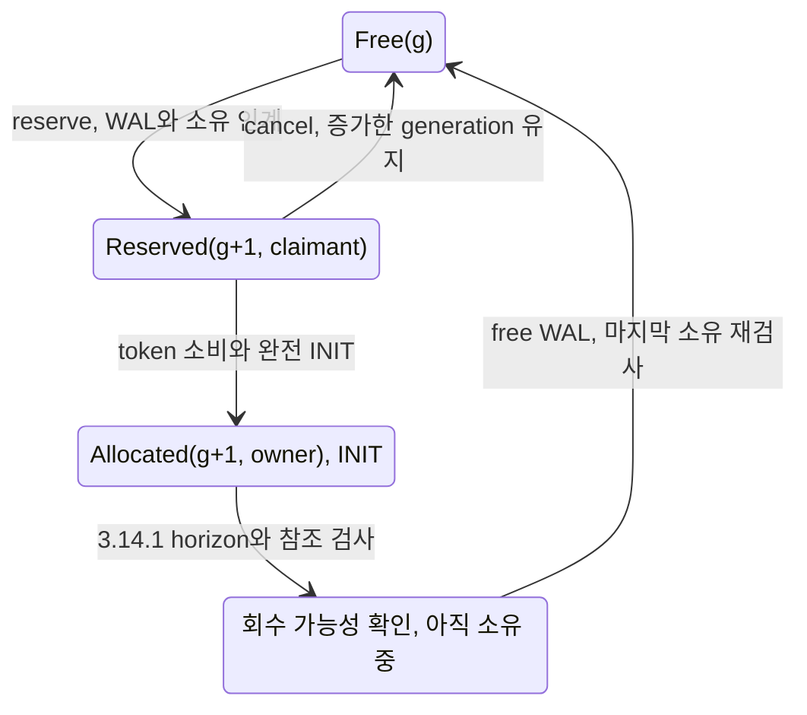

# DEV3 3.03 — 공간 할당 개발 상세 명세와 설계도

2026-10-22 · **작업 상세 설계 / 예약·취소 메모리 포트 부분 검증 / INIT·growth·reuse 미구현**

[공통 규칙](dev3-task-designs.md) · [예약·취소 정본](dev3-allocation-reservation.md) · [할당 표현](dev3-allocation-format.md) · [ownership](dev3-ownership-format.md) · [잔여 의무](../plans/dev3-implementation-plan.md#allocation-remaining)

## 1. 목적과 상태

64-page extent의 page0 metadata와 payload63개를 이용해 공간의 세대·claimant·예약·할당·회수 소유를 일관되게 유지한다. 물리 파일 bytes, 기존 extent 안의 page token, 아직 실현하지 않은 growth 예약은 서로 다른 자원이다. 선택되지 않은 파일이나 해제되지 않은 DWB 주소를 allocation 후보로 쓰지 않는다.

현재 [부분 구현](../implementation/dev3-implementation.md#allocation-reservation-partial)은 reserve/cancel만 제공한다. dirty metadata는 RAM authority이며 payload INIT·home flush·recovery·ACK가 없다. 다음 작업은 그 미완료 native/compiler/자원 증명부터다.

## 2. 요구와 전이

| 요구 ID | 명세 |
| --- | --- |
| 3.03-R1 | reserve는 eligible Free(g)를 선택하여 Reserved(g+1, claimant)로 전이. MAX generation은 제외하고 충분한 후보가 없으면 첫 effect 전 거절 |
| 3.03-R2 | cancel은 자기 active batch만 Reserved(g)→Free(g). generation·work high-water·retained WAL·첫 recLSN을 되감지 않음 |
| 3.03-R3 | INIT 소비는 실제 token·generation·예상 owner/kind를 검산하고 allocation 상태·완전 INIT·descriptor/inventory를 같은 복구 가능한 그룹으로 인계 |
| 3.03-R4 | growth는 실제 파일 길이/header/namespace와 FILEMAP 영속 선택 뒤만 새 주소를 WAL/DWB에서 참조. 부분 성장 bytes와 미소비 예약을 따로 보존 |
| 3.03-R5 | free/reuse는 3.14.1의 판정에 더해 마지막 pin·영속 edge·prepared/in-flight flush claim·pending DWB 부재를 적용 시 재검사. claim은 image copy 전부터 보호하며 Pending 선택 전도 재사용 불가. 새 incarnation INIT 없이 과거 payload를 새 page로 공개하지 않음 |
| 3.03-R6 | owner별 inventory와 descriptor의 item count/digest·previous LSN을 대조. token 중복 예약·다른 claimant 취소·stale home allocator 사용 금지 |

그림의 Free 복귀는 숫자 g의 원상복구가 아니다. 다음 reserve 때 현재 generation을 다시 증가시킨다. 구조 unlink와 실제 free 사이에는 retirement 소유가 남는다.

## 3. API·적용 설계

| 논리 연산 | 입력과 반환 | 소유·불변식 |
| --- | --- | --- |
| 기존 reserve_pages/cancel_reserved | count1..63 / 내부 active batch | consuming AllocationSession과 `&mut self`; caller raw item으로 취소 불가 |
| INIT 소비 | opaque 예약 token, 기대 page kind/owner, 준비된 완전 image | raw PageRef만으로 소비 불가. stage 성공 뒤 token을 재사용하지 못함 |
| extent 성장 | 성장 intent·고유 FileId/길이·예약량 | 선택 전 staging owner, 선택 뒤 FILEMAP closure가 소유. 불명 구간은 반환 금지 |
| eligible free/reuse | 대상 generation과 회수 판정, 관련 guard | 판정을 오래 보관해 권한처럼 재사용하지 않고 적용 gate 안 최신 참조·flush claim 재검사. claim 등록과 free 적용을 같은 주소의 경쟁 없는 경계에서 직렬화 |

reserve/cancel은 fence→count/state→metadata/descriptor/inventory→generation/counter headroom→WAL/protected capacity→prepared bytes→동일 prefix stage→live metadata/descriptor/recLSN→write/sync→terminal token 반환 순서다. stage 이후에는 fallible 준비를 하지 않는다. terminal sync 전 P(page-token bytes)는 남으며, Finished descriptor의 잔여0을 조기 반환 신호로 쓰지 않는다.

INIT/growth/free는 3.04의 의미 적용 경계와 3.05의 dirty frame 소유를 소비한다. 별도 allocator만 먼저 써 두고 WAL로 나중 보정하는 전이는 금지한다. split/rollback이 받은 page token은 일반 foreground에 빌려주지 않는다.

flush image의 보호는 DWB Pending 선택보다 먼저 시작한다. 같은 물리 주소의 claim을 image copy 전에 등록하고, 선택된 batch의 전체 retirement 영속화와 RAM finalize가 모두 끝난 뒤 반환한다. copy(g) 뒤 아직 Pending이 없다는 이유로 g를 free/reuse하면 늦게 도착한 old-g image가 g+1 home을 덮을 수 있다. 따라서 마지막 reader pin이0이어도 이 claim이 있으면 free/reuse를 진행하지 않는다. claim 획득과 free 전이 중 하나만 먼저 성공하도록 조정하며 정확 guard/rank·무효과 취소는 3.05의 F02에서 동결한다. 실패/fence는 claim의 보호를 정상 반환으로 지우지 않는다.

## 4. 하위 개발 단위와 직접 선행

| ID | 선행·구현 산출물 | 완료 경계 |
| --- | --- | --- |
| 3.03.1.a | 기존 부분 source → native adapter/runner | 2그룹/13 Linux DB의 실제 bytes·원인·fence, home/DWB 무변경 |
| 3.03.1.b | 실제 consuming API → compiler runner | baseline+6 probes; owner/frame/operation/flush/WAL slot 재사용 금지5·종료 후 반환1 |
| 3.03.1.c | concrete owner/File와 nested helpers | component64KiB의 동시 생존 locals·중첩 codec/SHA·수명 증명. `size_of(owner)`만으로 완료 불가 |
| 3.03.1.d | 실제 수정한 WAL stage helper | 남은 관련4시험·관련 Clippy·원본 runtime 결과와 결과 취합·독립 검토 |
| 3.03.2 | 3.03.1+3.04.1+3.05.1 | Reserved→INIT, before/after/token/descriptor·pageLSN 원자 인계 |
| 3.03.3 | 3.03.2+3.05.3+3.02 | 성장·FILEMAP 선택·충돌/부분 I/O·charged bytes |
| 3.03.4 | 3.14.1+3.03.2+3.04.1+3.05.3 | 실제 free와 새 incarnation INIT, stale reference 거절 |

## 5. 자원·오류·복구

현재 reserve/cancel의 exact frame은 `F(N)=20992+208N`; N=1/8/63이면21200/22656/34096 bytes다. terminal 한 단계까지 `2F(N)`를 첫 effect 전에 확보한다. [정본](dev3-allocation-reservation.md)의 `B+R+T+P+M≤1GiB` 및 WAL cap을 함께 검사한다. caller frame16KiB·operation80KiB·flush4MiB·WAL1MiB·component64KiB를 중복하거나 누락하지 않는다.

예상 count/상태/후보/용량 부족만 건강한 owner의 stage 전 Unchanged다. 내부 metadata 손상·poison은 stage 전에도 fence다. stage/apply/sync 오류·unwind는 token과 uncertain charge를 보존하고 공통 fence를 세운다. Drop은 취소 성공을 만들지 않는다. 일반 복구는 checkpoint+WAL의 같은 prefix에서 예약을 복원하며 home allocator의 오래된 Free 상태로 token을 재발급하지 않는다.

## 6. 인수 사례와 남은 동결

기존 runtime8과 r3/r4의 실제 결과·FAIL은 보존한다. 무변경 완료 사례를 다시 돌리지 않는다. 남은 native는 정상3DB(profile1/2/3)와 reserve/cancel×write-before/half/after·sync-before/after의10DB다. 원래 제한인 각30초, 총13DB≤312MiB 등은 [고정 입력](dev3-allocation-reservation.md)을 따른다.

INIT에는 잘못된 claimant/generation·중복 소비·부분 stage·torn zero home의 완전 INIT 복원을, growth에는 file/FILEMAP 선택 cut와 실제 bytes 회계를, reuse에는 마지막 pin/flush claim/DWB retirement 경합·stale reference·generation MAX를 고정한다. 특히 [3.05-C16](dev3-task-05-buffer-flush.md#acceptance)의 copy 전 claim·Pending 전·retirement 뒤 RAM finalize 전 경합에서 free/reuse가 차단되고 완전 종료 뒤만 진행하는지 검산한다. DS02/03/04/05·RC-T14로 연결한다.

일반 INIT/growth/free의 semantic opcode, extent/FILEMAP 인계 body, exact F05와 fault vector는 해당 leaf 전에 추가 동결한다. 현재 진입점은 [allocation_reservation.rs](../../crates/engine/src/storage/wal_io/allocation_reservation.rs), [allocation_reservation/operation.rs](../../crates/engine/src/storage/wal_io/allocation_reservation/operation.rs), [allocation_page.rs](../../crates/engine/src/storage/allocation_page.rs)다. 제한 예약 단위와 전체 allocator 완료를 구분한다.
