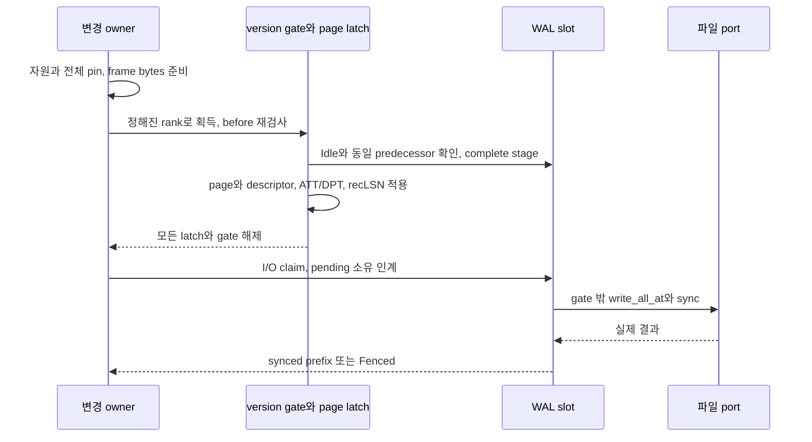

# DEV3 3.04 — WAL 변경 경로 개발 상세 명세와 설계도

2026-10-22 · **작업 상세 설계 / genesis·일부 producer 연결 / 일반 opcode·CLR·commit 미완료**

[공통 규칙](dev3-task-designs.md) · [WAL I/O](dev3-wal-io.md) · [frame](dev3-wal-format.md) · [의미 그룹](dev3-obligation-format.md) · [공통 변경 순서](disk-storage-design.md#mutation-protocol)

## 1. 목적·선행·책임

하나의 ordered WAL에 여러 거래/system owner의 완결 그룹을 순서대로 stage하고 authoritative page/descriptor 상태와 연결한다. 3.01의 관련 표현, existing genesis/fence, 3.10.1의 변경 guard를 수신한다. CLR의 논리 생산은 3.09, commit certainty와 공개는 3.11, epoch rotation/recovery continuation은 3.12가 소유한다.

현재 GenesisWalSession은 fresh epoch의 물리 write/sync만 제공한다. physical prefix를 semantic apply/flush/ACK 권한으로 바꾸지 않는다. RollbackStart producer와 allocation 전용 stage의 제한 구현을 범용 dispatcher 완료로 표시하지 않는다.

## 2. 요구와 API 계약

| 요구 ID | 명세 |
| --- | --- |
| 3.04-R1 | LSN은 DB 전체 epoch 사이에도 증가하는 논리 위치이며 file offset/q와 다르다. 실제 신뢰 predecessor·offset을 검산하고 wrap/재사용을 거절 |
| 3.04-R2 | caller 준비 bytes는 전체 envelope와 opcode 의미를 검산한 전용 prepared 값만 stage에 전달. raw legacy 경로가 미지원 semantic tag를 승인하지 않음 |
| 3.04-R3 | 완결 그룹에는 effect·head/edge/count·progress·remaining obligation·ownership delta를 해당 opcode대로 결합. owner predecessor/hash·generation·그룹 누계를 검산 |
| 3.04-R4 | update/CLR/system 변경은 고정 slot에 bounded copy한 뒤 authoritative page/descriptor/recLSN 등록을 같은 변경 구간에서 마침. Commit의 Committed status·terminal 공개 설치는 sync 뒤 3.11의 별도 경계에서 수행. append 뒤 허용된 적용의 부분 실패는 Fenced |
| 3.04-R5 | I/O claim이 pending bytes를 독점한 뒤 gate를 놓고 write_all_at/sync. 완료 전 slot overwrite·중복 sync·동일 불명 frame 재전송 금지 |
| 3.04-R6 | 성공 sync는 실제 완결 LSN/offset prefix만 전진. 실패/unwind/poison에서는 원래 effect/cause를 보존하며 synced로 추측하지 않음 |

| 연산 경계 | 입력 | 출력·수명 |
| --- | --- | --- |
| prepare semantic | before snapshot, expected owner chain, 예약, target pages | caller workspace의 immutable prepared group; authority 아님 |
| stage/apply | consuming prepared+guard+authoritative frame 집합 | update/CLR/system의 완결 그룹과 적용 등록 완료; first recLSN·owner chain 전진. Commit은 준비 상태를 보존하고 공개 가능한 status 설치를 sync 뒤로 넘김 |
| sync through | 실제 소유한 staged prefix | 확인된 durable prefix 또는 fence; 임의 숫자 LSN만으로 flush 권한 생성 불가 |
| prefix 관측 | 건강한 session | stream/file·complete/synced LSN/offset; 거래 결과와 구분 |

## 3. 두 경계의 설계도

아래 sequence는 update/CLR/system page 변경 경로다. Commit은 같은 frame 검산·stage·physical sync를 소비하지만 **Committed status·terminal 공개 설치를 stage 직후 수행하지 않는다**. 준비한 Commit 의미와 자원 소유를 유지한 채 durable prefix를 확인하고, [3.11의 sync→status→frontier 순서](dev3-task-11-commit.md)로 지연 설치한다. generic dispatcher가 Commit을 일반 update처럼 적용하지 못하도록 F02에서 별도 권한·진행 상태를 동결한다.

slot의 물리 상태는 `Idle → Complete → IoOwned → Idle`, 오류/poison은 `Fenced`다. Complete가 되었다고 해당 거래가 commit된 것은 아니다. semantic 적용 중 실패하면 page 일부를 계속 사용하거나 뒤 그룹을 stage하지 않는다.

prepare snapshot과 실제 stage 사이에 다른 producer가 진행할 수 있으므로 재검사한다. Busy이면 slot bytes를 덮지 않는다. 같은 LSN이라도 offset/owner before SHA가 달라진 요청은 stale다. input frame에서 expected predecessor를 가져오지 않는다. stage/apply 성공 뒤 I/O 대기를 위해 page/tree/version/append lock을 유지하지 않는다.

## 4. 프레임·예약·오류 처리

frame 상한1MiB와 header/trailer192, PageRedo header64·INIT page16KiB, semantic envelope/descriptor/native/edge/inventory의 실제 크기를 합한다. 논리 payload1MiB를 physical WAL/CLR 상한으로 복사하지 않는다. 한 frame에 못 들어가는 작업은 **각 중간 상태가 자체 복구 가능하도록** 그룹을 나누고 obligation을 인계한다.

WAL slot1MiB와 component64KiB는 metadata8MiB 안의 기존 배정이다. caller prepared buffer는 private 또는 maintenance에서 따로 센다. physical attempt 구간은 `미시도 예약 → attempted/uncertain charge → 확인된 prefix`로 한 번만 이동한다. 이미 쓴 bytes는 owner의 remaining 감소와 관계없이 회수 전까지 retained다.

| 실패 | 판정 |
| --- | --- |
| 준비 중 입력/범위/용량 오류 | healthy authority 불변; 예약 반환 범위 명시 |
| stage 재검사 실패 | 새 group 미적용, caller 상태에 따른 재준비; 기존 fence/poison은 축소하지 않음 |
| stage 뒤 apply 불완전 | 공통 fence, slot/예약/dirty 소유 보존, recovery 요구 |
| short/Interrupted | port 규약으로 남은 bytes 진행; zero/invalid count·오류는 fence |
| sync 뒤 prefix 공개 실패 | durable 가능성을 취소하지 않음; fence·상위 certainty 판정으로 인계 |

## 5. 구현 단위·인수

3.04.1은 typed stage/apply·authoritative 소유와 stage 직후 unwind 경계를 닫는다. 3.04.2는 일반 interleaved append/sync·owner chain을 닫는다. 각 row/index/catalog/SMO/CLR/terminal producer는 소비 leaf가 추가하고 동일 소비 경로의 의미·fault를 함께 검증한다. terminal producer마다 허용된 설치 장벽을 따르며 특히 Commit은 sync 전 공개 가능한 Committed 상태로 전이하지 않는다.

독립 입력은 정상 interleaving, wrong predecessor/hash·owner generation·중복/누락 그룹, hash를 다시 맞춘 native/redo 불일치, stale snapshot/Busy, apply 전후 unwind, 각 write/sync before/partial/after, durable 후 공개 실패다. 외부 관측으로 complete와 synced prefix를 구분한다. DS02/05·KU10·RC-T12/14의 해당 변경 경로에 연결하고 무변경 genesis/codec 시험은 반복하지 않는다.

## 6. 착수 전 동결·완료 조건

일반 opcode별 native effect와 descriptor transition, API의 정확 오류 우선순위·guard 수명, owner inventory 인계, frame 분할 중간 상태와 F05를 구현 전에 동결한다. 현재 [wal_io.rs](../../crates/engine/src/storage/wal_io.rs), [semantic_group.rs](../../crates/engine/src/storage/semantic_group.rs), [obligation.rs](../../crates/engine/src/storage/obligation.rs)의 실제 지원 범위를 기준으로 확장한다. append/sync 공급 완료는 commit/rollback/recovery의 상위 인수를 대신하지 않는다.
