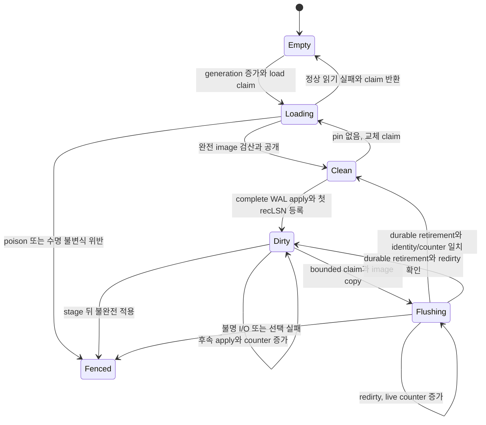
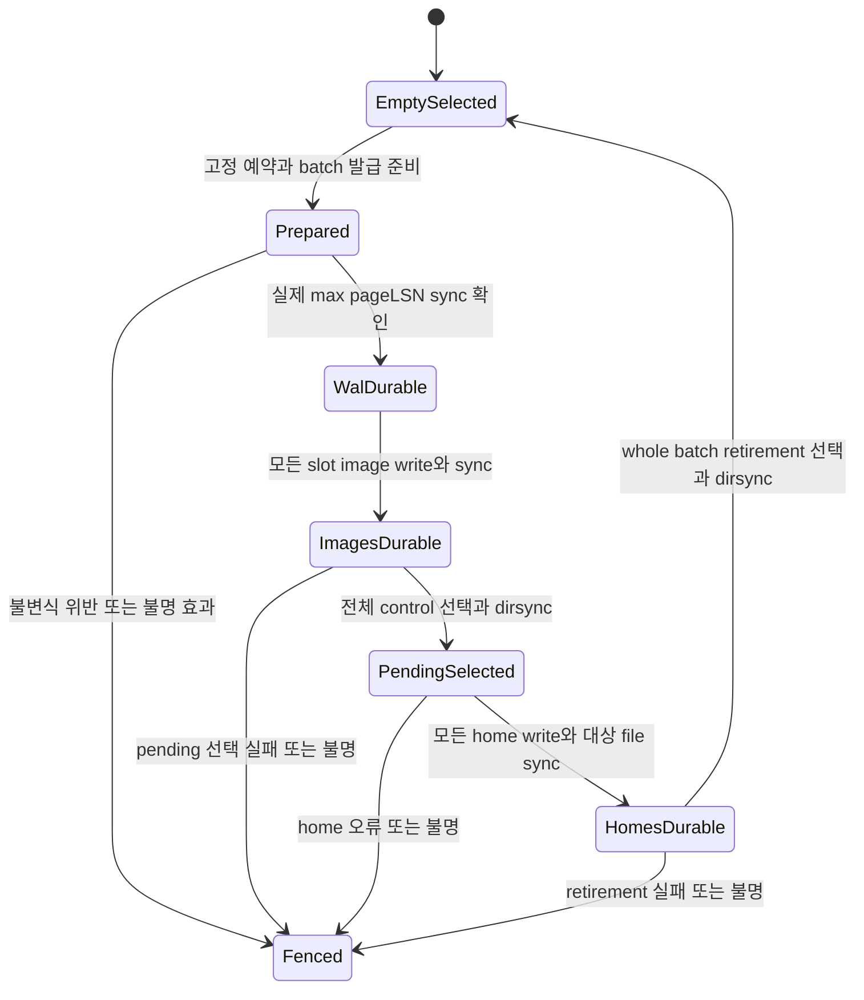
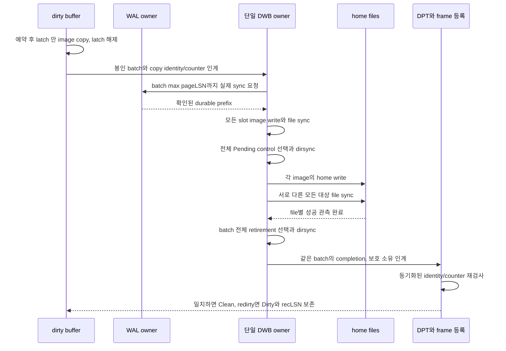

# DEV3 3.05 — dirty buffer·flush 개발 상세 명세와 설계도

2026-10-22 · **작업 상세 설계 / D2 상세화 수용 / 제한 dirty·allocator/Status flush 공급 / 일반 pool·batch8/64·복구 인수 미완료**

[공통 규칙](dev3-task-designs.md) · [구현 계획 3.05.1–3](../plans/dev3-implementation-plan.md#remaining-work) · [buffer 정본](disk-storage-design.md#buffer) · [batch 정본](disk-storage-design.md#doublewrite-batch) · [진행 정본](disk-storage-design.md#flush-progress) · [실제 구현](../implementation/dev3-implementation.md)

이 문서는 XADB의 같은 저장 owner 안에서 clean page 읽기를 authoritative dirty frame과 영속 flush로 확장할 개발 명세다. bytes·형식·자원 수치의 정본을 바꾸지 않는다. 아래 논리 연산·상태는 설계 표기이며 새 Rust API가 이미 존재하거나 DWB 운영 권한이 채택되었다는 뜻이 아니다.

## 1. 목적·선행·소유 경계

목표는 완결 WAL 변경 그룹의 page 효과를 dirty/DPT 등록까지 연결하고, WAL→DWB→home→retirement 장벽을 거친 image만 교체 가능하게 만드는 것이다. uncommitted page도 undo/redo 보호 아래 flush하는 steal, commit마다 data flush를 요구하지 않는 no-force를 유지한다. dirty page 수 감소, image의 home sync, recLSN 해소, 거래 commit은 각각 다른 결과다.

| 단위 | 직접 선행 | 공급할 결과·남길 경계 |
| --- | --- | --- |
| 3.05.1 dirty 등록·pin/latch·recLSN | 3.04.1 stage/apply, 3.10.1 guard/turn, 기존 selected clean buffer | authoritative frame dirty 전환·첫 recLSN·redirty·pin 수명·오류 후 소유 보존. home flush 완료는 후속 |
| 3.05.2 WAL→DWB→home flush | 3.05.1, 3.04.2 일반 append/sync, 기존 Empty DWB 설치 | batch1/8/64의 WAL durable 경계·image sync·pending 선택·다중 file home write/sync. retirement 완료는 3.05.3 |
| 3.05.3 retirement·eviction·압력하 진행 | 3.05.2, 3.10.1 progress turn | whole-batch retirement·pin 없는 frame 교체·bounded service·pressure drain. repair/recrash 통합 인수는 3.12.2/8 |

3.03.2는 3.05.1을 받아 Reserved→INIT를 연결한다. INIT 구현 전체를 3.05.1의 새 선행으로 되돌리지 않는다. 3.05.2/3의 최소 fixture는 해당 page 표현과 완결 변경 그룹으로 구성하고, row/index/catalog 전체 구현을 기다리지 않는다. 3.06.1·3.09.1은 3.05.3의 공급을 소비하며, 3.13은 dirty/DPT capture와 flush 완료를 사용하여 WAL floor를 판정한다. WAL 삭제·페이지 free/reuse·READY·commit ACK는 각각의 상위 owner가 소유한다.

현재 [clean buffer](dev3-read-buffer.md)는 Empty/Loading/Clean, caller frame·pin·clock과 고정 selected namespace 읽기만 구현했다. [최초 DWB 설치](dev3-doublewrite-install.md)는 FreshStorageSession을 소비하여 Empty selector와 고정 파일을 설치하고 clean reader를 제공한다. 두 공급 모두 mutable home, dirty/DPT, pending batch 발급·retirement·일반 reopen/repair 권한을 제공하지 않는다. 기존 제한 시험 결과나 중단된 통합 결과를 이 작업의 PASS로 승격하지 않는다.

구체 제한 공급은 [dirty stage](dev3-dirty-stage.md), [allocator 한 페이지 flush](dev3-allocator-flush.md), [폐쇄 Status INIT](dev3-status-init.md)의 소유 계약과 원 실행 기록을 따른다. [Status home flush](dev3-status-home-flush.md)는3.03.2.b의 별도 소비형 owner·두 target 순차 batch1의 [제한 선택 인수](../evidence/dev3-status-home-flush-20261022.md)를 마쳤다. 원 FAIL과 S5 추가 NOT_RUN은 보존한다. 아래 일반 batch8/64·다중 file·eviction/pressure와 recovery 의무를 이 제한 단위로 완료 처리하지 않는다.

### 1.1 tree·live Status가 소비할 일반 page 수명

[방향 리뷰 후속 결정](../plans/dev3-implementation-plan.md#direction-review-adoption)에 따라 다음 공급은 제한 target 수의 증액이 아니라 실제 page 수명 전체다. 기존 두 target/최초 Status home predicate를 완화한 것만으로 일반 pool 완료를 선언하지 않는다.

| 경계 | 소비 전에 고정할 계약과 완료 조건 |
| --- | --- |
| 단일 권한 | DB/FileId/page_no마다 load·변경·flush를 조정하는 하나의 authoritative 등록을 사용한다. incarnation/generation은 주소 권한 안에서 검산한다. 기존 불변 selected clean reader와 mutable pool을 동시에 같은 home의 독립 권한으로 사용하지 않도록 consuming 전환·실패 반환·live pin 처리와 접근 배제를 F02에 고정한다 |
| 등록·퇴출·재읽기 | 실제 quota 안에서 page를 등록하고 load→dirty→flush→clean→evict→reload를 연결한다. dirty/flush/pin 소유가 남으면 퇴출하지 않으며, 재읽기는 최신 선택 namespace·allocator identity와 durable pageLSN을 검산한다. unbounded map이나 모든 page 상주로 확장하지 않음 |
| 반복 변경 | 최초 zero/동일 image 검사와 일반 live Status의 합법적 이전 image→새 image 전이를 구분한다. 이전 pageLSN·정체성·완결 WAL 보호를 검산하고 stale completion·redirty·주소 claim/free 경쟁으로 최신 dirty 상태를 지우지 않는다 |
| 실제 공급 | 첫 tree/live undo가 요구하는 page 종류·전체 pin 집합·동시 작업을 F05에 대입한다. 최소한 실제 frame 수를 넘는 작은 작업 집합의 eviction/reload, 반복 Status 변경, writer/flush와 clean-reader 배제를 새 구현의 필수 사례로 확인한다. batch8/64·대형 압력의 전체 조합은 S5로 유지 |

기존 제한 owner는 원 공급 증거로 보존하되 일반 소비자가 병행 우회 경로로 사용하지 못하게 한다. 정확 전환 API·지원 page 종류·capacity·오류는 해당 구현의 F01/F02/F05에서 독립 검토하며 이 절로 새 제품 API를 이미 공급했다고 하지 않는다.

## 2. 요구 ID와 불변식

| 요구 ID | 구현할 명세 | 직접 연결 |
| --- | --- | --- |
| 3.05-R1 | 동일 DB/FileId/page_no의 load·dirty frame·flush claim을 조정한다. 예상 incarnation/owner/generation/kind/level이 다른 같은 주소를 alias로 반환하지 않으며 frame generation과 page incarnation을 구별한다 | 3.05.1, DS03/05 |
| 3.05-R2 | page 변경은 완결 WAL stage 뒤 pageLSN·modification counter·dirty/DPT를 같은 적용 경계에서 등록한다. 첫 dirty의 recLSN을 보존하며 capture가 미등록 적용 prefix를 선택하지 못한다 | 3.05.1, DS02/05 |
| 3.05-R3 | 전체 pin/자원은 latch 밖에서 준비한다. 부분 pin을 붙잡은 frame 대기, map/state mutex 아래 I/O/checksum, content latch 아래 I/O·allocation·transaction 대기를 금지한다 | 전 단위, DS03 |
| 3.05-R4 | flush image는 content latch 아래 identity·pageLSN·counter와 함께 복사한다. 실제 batch 최대 pageLSN까지 WAL sync를 확인하기 전 DWB/home 쓰기 장벽을 넘지 않는다 | 3.05.2, DS02 |
| 3.05-R5 | 모든 image write/sync 뒤 전체 Pending control의 선택+dirsync를 완료하고 home write한다. incomplete image subset은 선택하지 않으며 raw 슬롯 존재만으로 권한을 만들지 않는다 | 3.05.2, DS02/05 |
| 3.05-R6 | 모든 대상 file sync 뒤 batch 전체 retirement 선택을 영속화한다. 일부 file 성공으로 슬롯 일부를 먼저 반환하지 않는다. selector 불명은 fence와 보수적 보존으로 처리한다 | 3.05.3, DS02/05 |
| 3.05-R7 | retirement 이후 현재 identity/counter가 복사 시점과 같은 frame만 clean/DPT 제거한다. redirty면 Dirty와 기존 보수적 recLSN을 유지한다 | 3.05.1/3, DS05 |
| 3.05-R8 | 같은 물리 주소는 batch 안에 한 번. image copy 전 주소 claim 등록부터 전체 retirement 영속화와 RAM finalize까지 후속 flush·free/reuse를 금지한다. Pending 선택 전도 보호하며 claim 등록과 allocator 적용은 경쟁 없이 직렬화한다. control coordinator는 하나이며 I/O 동안 상태 mutex를 보유하지 않는다 | 3.05.2/3, DS03/05 |
| 3.05-R9 | 교체 flush와 오래된 recLSN 해소를 각각 유한 service 간격으로 선택한다. 불가능 후보의 반복 busy loop를 막고 full batch를 기다리지 않는 deadline을 둔다 | 3.05.3, PF09 |
| 3.05-R10 | 압력 때 새 forward effect admission을 닫고 기존 유한 작업·rollback·전용 flusher를 진행시킨다. live retention owner를 제거하거나 client의 다음 COMMIT을 기다려 진행을 주장하지 않는다 | 3.05.3, DS03/05 |
| 3.05-R11 | shared session fence·poison·불명 I/O의 원래 cause/effect/certainty를 보존한다. Drop은 sync·retirement·성공 rollback을 수행하지 않는다 | 전 단위, DS02 |
| 3.05-R12 | frame·DPT·batch·control·FD·고정 workspace를 실제 동시 생존량으로 합산한다. 미동결 bound와 checked overflow는 첫 effect 전에 거절한다 | 전 단위, F05 |

## 3. 입력·출력·수명과 조립

아래 연산은 F02에서 구체화할 내부 경계다. 외부 caller에 raw mutable frame, DWB slot offset 또는 임의 LSN을 주고 올바른 호출 순서를 기대하는 API를 만들지 않는다.

| 논리 연산 | 검증된 입력·소유 | 출력·성공 보장 | 실패·수명 |
| --- | --- | --- | --- |
| dirty owner 구성 | 기존 단독 storage session, 실제 profile, caller frames·load scratch·전용 flush4MiB, metadata 예약 | 같은 writer/WAL/fence 아래 유일한 dirty buffer owner | live reader/별도 pool과 충돌하는 전환 금지. 정확 consuming 전환·실패 반환은 F02 동결 |
| 변경 집합 준비 | 3.04 prepared group, full identity 집합, 자원 token·pin 예약 | 전체 pin과 검산된 before 상태 | 준비 실패는 새 authority 변경 없음. 부분 pin은 반환하고 재준비 |
| stage/apply와 dirty 등록 | 변경 guard, ordered content latch, WAL stage 권한 | 모든 pageLSN/counter·DPT·owner 등록까지 완결 | stage 후 일부 적용·unwind는 공통 fence. 예약/dirty 소유를 정상 반환으로 지우지 않음 |
| flush 후보/봉인 | bounded 후보, 기존 DPT identity, frame claim, slot/control/FD 예약 | immutable image 집합·복사 identity/counter·max pageLSN | image에는 commit 의미 없음. 봉인 전 실패의 claim 반환과 generation 소비 규칙을 F02로 동결 |
| batch 실행 | 봉인 image, 실제 WAL prefix, DWB 단독 실행 소유 | Pending 선택과 모든 home file sync 관측 | raw 숫자 LSN 또는 codec 성공만으로 내구성 capability 생성 금지 |
| retirement/finalize | 같은 batch의 모든 home sync, 현재 선택 control | 영속 retirement 뒤 slot 반환, 조건부 clean/DPT 제거 | redirty는 Dirty 유지. 선택 불명은 slot·주소 보호 해제 금지 |
| bounded 상태 관측 | 건강한 owner의 한정 snapshot | dirty/selected/completed/redirtied 수·oldest recLSN·service gap·pressure 원인 | 진단은 회수/ACK 권한이 아니며 기존 오류를 가리지 않음 |

frame pin은 교체 방지 수명이다. transaction visibility나 undo/status 영속 edge의 수명을 대신하지 않는다. flush claim은 image copy 전부터 frame identity와 물리 주소를 보호하여 중복 flush·allocator free/reuse를 막는 소유이며 reader pin과 구별한다. reader pin0이나 DWB Pending 부재는 이 claim을 무시할 근거가 아니다. claim 등록과 allocator의 최종 free/reuse 검사를 같은 주소의 경쟁 없는 경계에서 직렬화하고, 전체 retirement 영속화 후 RAM finalize까지 완료해야 주소 보호를 반환한다. 영속 효과 전 무효과 취소가 확인된 경우의 claim 반환과 실패/fence 뒤 보호 인계, claim·pin의 구체 결합은 F02에서 검증하되 content latch를 I/O까지 연장하지 않는다. 같은 incarnation의 redirty는 기존 규약대로 허용한다.

## 4. frame과 batch 상태 설계도

frame 상태와 batch의 영속 상태는 별도로 관리한다. `Flushing` 동안 image는 불변이고 live frame은 후속 WAL 적용으로 수정될 수 있다. 이때 두 번째 batch를 시작하지 않고 counter 차이로 clean 여부를 판정한다. `Fenced`는 모든 상태에 걸친 session 경계다.

이 그림은 전체 guard/오류 enum을 확정하지 않는다. 특히 Dirty→Flushing을 위한 map/claim 준비와 content image copy를 별도 짧은 구간으로 수행하고, 경쟁 중 stale 후보는 before 재검사로 처리한다. frame generation·counter를 wrap하여 오래된 completion을 현재 frame으로 인정할 수 없다. counter 폭·소진의 정확 오류와 적용 전 검산은 F02 의무다.

`Prepared`는 RAM 소유 상태이며 영속 selected state를 뜻하지 않는다. 영속 형식은 [XDW1 Empty/Pending·XDS1](dev3-doublewrite-format.md) 그대로다. generation·batch id는 다른 단조 counter이고, retirement 뒤 Empty에도 마지막 batch id가 남는다. 신규 batch id의 영속 high-water, crash 뒤 재발급, 비선택 bank와 XDI1 stage 재사용 절차는 아직 동결이 필요하다. 위 그림만으로 운영을 시작하지 않는다.

## 5. 단계별 처리 알고리즘

### 5.1 dirty 등록과 image 준비

1. 변경 owner가 row/key lock 대기·WAL/undo/space 예약·전체 page load/pin을 끝낸다. 기존 buffer의 고립된 최대 frame 수 허용을 다중 작업 admission으로 사용하지 않는다.
2. [공통 rank](disk-storage-design.md#mutation-protocol)에 따라 version-edit gate, 필요한 tree gate, 정렬한 page content latch를 획득한다. try-latch 실패나 before identity/version 불일치는 이번 적용의 gate/latch를 모두 놓고 재준비한다. buffer map/예약 mutex를 함께 보유하지 않는다.
3. 3.04.1의 완결 stage 뒤 page bytes·pageLSN·counter와 해당 owner의 descriptor/ATT/DPT를 등록한다. Clean→Dirty의 recLSN은 그 page를 처음 dirty로 만든 complete WAL 그룹에 결합하고, Dirty/Flushing 재수정은 기존 recLSN을 보존한다. 논리 record LSN과 physical offset의 정확 변환은 WAL owner의 F01/F02에 연결한다.
4. 모든 등록이 끝나야 gate를 놓는다. 등록 공간 부족을 이 시점에 처음 발견하지 않도록 사전 예약한다. stage 뒤 오류는 부분 페이지를 이전 상태로 간주하지 않고 공통 fence한다.
5. flusher는 gate 밖에서 목적별 bounded 후보를 선정한다. 주소 중복·기존 claim/pending·stale generation을 제외하고 실제 slot/control/FD·4MiB workspace와 frame/주소 claim을 확보한다. claim 등록과 allocator 최종 free/reuse 적용을 직렬화하고 before identity를 재검사한 뒤에만 content latch 아래 identity/incarnation/pageLSN/counter와 완전 image를 복사하고 즉시 latch를 해제한다. claim은 Pending 선택까지의 대기와 모든 I/O에도 유지한다. checksum·codec 작업의 잠금 밖 수행과 snapshot 안정성을 F02에 연결한다.
6. 봉인 전 각 image와 descriptor의 일치, pageLSN nonzero, 목록의 물리 주소 정렬·slot 유일성을 검산한다. 1–64개 안의 현재 모인 batch를 deadline까지 봉인하며 transaction snapshot으로 해석하지 않는다. eligible page가 없으면 이유와 wake/deadline을 남기고 무진행 round를 끝낸다.

### 5.2 WAL→DWB→home와 retirement

복사된 pageLSN은 그 page의 선행 효과에 미설치 공백이 없음을 전제로 한다. [Commit 설치 장벽](disk-storage-design.md#commit-installation-order)이 후속 page 변경의 추월을 막으며, flusher가 높은 WAL synced prefix만 보고 아직 설치되지 않은 Commit을 page image에 반영된 것으로 간주하지 않는다. 장벽 중 이전 image의 flush는 허용하고, 이후 Commit 설치는 기존 redirty/counter 규약을 따른다.

1. WAL owner의 실제 prefix로 `durable_lsn >= max_image_page_lsn`을 확인한다. staging 완료 또는 임의로 제공된 LSN은 이 증거가 아니다. WAL sync 실패이면 home write를 하지 않고 fence한다.
2. XDS1 slot을 전부 write한 뒤 images file sync를 확인한다. 일부 slot만 완성된 상태는 Pending으로 선택하지 않는다. 물리 short/Interrupted 처리는 foundation 규약에 따르고 실제 subcall과 logical effect를 구분한다.
3. 기존 선택 control·profile·FILEMAP에 결합한 새 Pending control을 설치하고 atomic replace+dirsync를 완료한다. control/selector의 실제 write/sync/publish cut, generation·high-water와 XDI1 재사용은 leaf에서 동결한 절차만 사용한다.
4. FILEMAP으로 검산한 home 주소에 image를 write한다. 대상 종류가 data/index/undo/status/allocator라고 해서 장벽을 생략하지 않는다. 주소/길이·namespace owner 확인을 raw image의 자기 선언으로 대체하지 않는다.
5. batch의 서로 다른 모든 대상 file을 sync하고 file별 결과를 남긴다. 하나라도 실패/불명이면 전체 batch를 pending으로 보존하며 fence한다. 성공한 file의 슬롯도 재사용하지 않는다.
6. 전체 retirement control의 영속 선택 뒤 슬롯을 반환할 수 있다. 물리 주소의 claim은 다음 RAM finalize가 끝날 때까지 유지하여 이 사이 후속 flush·free/reuse를 허용하지 않는다. 일반적인 이전 control fallback이나 raw 슬롯 scan은 하지 않는다.
7. 현재 frame identity/generation/counter와 복사 관측을 **경쟁 없는 등록 경계에서** 재검사한다. 일치하면 Clean 전환과 DPT 제거를 함께 완료한다. 불일치한 counter는 redirty로 남기고 최초 recLSN을 유지한다. 비교와 DPT 제거 사이의 writer 경합으로 새 dirty 등록을 지우는 구현을 금지한다. 이 finalize 뒤 주소 claim을 반환하고 다음 owner가 최신 frame/allocator 상태를 재검사한다. 정확 guard/rank는 F02에서 동결한다.

### 5.3 교체와 압력하 진행

clock 교체는 pinned·Loading·I/O/flush 소유 frame을 건너뛴다. Dirty victim을 발견했다고 즉시 재사용하지 않으며, clean이 된 뒤에도 마지막 pin과 claim 종료를 확인해야 교체할 수 있다. 기존 clean reader의 최대2N sweep는 그 leaf의 이미 동결된 정책이다. dirty scheduling의 scan bound·deadline·최대 service gap에 그대로 복사하여 완료로 선언하지 않는다.

각 round는 교체용 frame 확보와 오래된 eligible recLSN 해소에 별도 진행 기회를 준다. 적격 후보의 선택/완료/redirty, pin·pending·latch 경쟁 등의 제외 이유, 무진행 round를 고정 크기로 관측한다. 후보가 없으면 bounded 다른 작업 또는 깨움/deadline 대기로 전환하며 clean 후보나 불가능 후보를 계속 고르는 busy loop를 만들지 않는다.

유한 try 횟수 K 뒤 필요한 유지보수는 3.10.1 FIFO progress turn을 사용한다. turn 대기에는 page pin과 공유12MiB workspace를 반환하고 논리 작업·예약 token만 유지한다. head의 준비 단계에서는 reader와 별도4MiB flusher를 허용하고, 적용/copy 단계에서만 content admission을 잠시 닫아 기존 구간을 drain한다. 한 bounded apply/image copy 뒤 turn을 넘기고 sync/I/O는 admission을 다시 연 뒤 수행한다. 전용 flusher workspace를 일반12MiB workspace 획득 순서에 종속시켜 준비 단계의 flush를 막지 않는다.

WAL 보존/dirty backlog 압력에서는 새 forward effect admission을 닫고 이미 admitted된 유한 작업의 완료/rollback과 flush를 계속한다. 이는 dirty image가 더 이상 재수정되지 않아 DPT에서 제거될 수 있는 구간을 만드는 장치다. uncommitted page도 flush 가능하므로 client COMMIT을 기다릴 필요가 없다. 다른 live retention owner가 남으면 WAL floor는 유지하고 새 write 거절을 계속할 수 있다. post-copy LSN으로 recLSN을 조기 전진시키는 최적화는 이 작업에 포함하지 않는다.

## 6. 오류·취소·복구 인계

| 경계·실패 | 유지할 상태·금지할 효과 | 후속 소유 |
| --- | --- | --- |
| 준비 중 입력/용량/Busy·stale 후보 | 새 WAL/page 효과 없음. 기존 dirty/pending 불변. 예약·pin/claim 반환 범위를 명시 | 요청 owner가 재준비 또는 첫 effect 전 오류 |
| WAL stage 뒤 적용/등록 불완전·unwind | 공통 fence. dirty/DPT/예약 일부를 정상 완료·Unchanged로 표시하지 않음 | 3.04와 recovery |
| WAL sync 실패 | home write 금지, 원래 I/O certainty 보존 | session fence, 3.12 |
| image write/sync 일부 실패 | 새 pending 선택·home write 금지, 불명 슬롯 덮어쓰기/즉시 재시도 금지 | session fence, 선택 상태 판정 |
| Pending 선택/dirsync 실패·불명 | home 진행 중단. old/new 가능한 선택의 보호 합집합과 슬롯 예약 보존 | reopen의 selector 검증, 3.12.2 |
| home 부분 write·file sync 일부 실패 | whole batch pending 보존. 일부 성공 슬롯 retirement 금지 | 3.12.2 repair |
| retirement 선택 실패·불명 | pending일 수 있는 전체 batch 보호. frame clean·DPT 제거·slot 재사용 금지 | 3.12.2/8 repair·recrash |
| retirement 성공 후 RAM finalize 중 오류 | 영속 retirement 사실을 되돌리지 않음. 주소 claim을 정상 반환으로 지우지 않고 stale completion·registry 불변식 위반이면 fence | reopen의 선택 상태와 WAL/redo |
| pin/claim Drop·poison | Drop에 영속 효과 없음. 정상 참조 반환과 불변식 fence를 구별하고 poison을 지우지 않음 | owner 수명 종료 |
| 취소·종료 요청 | client 취소가 이미 선택된 batch를 폐기하는 권한이 아님. 완료·예약 보존·fence의 정확 경계를 F02로 동결 | buffer/DWB 단독 owner |

3.12.2는 FILEMAP과 **현재 선택된** Pending만 검증하여 전체 batch home 복원·모든 file sync·retirement를 수행한 뒤 후속 redo write/새 flush/재사용을 허용한다. 이 사이 두 번째 crash도 pending을 다시 적용할 수 있어야 한다. healthy home이 더 높은 LSN/incarnation이면 오래된 image로 덮지 않고 불변식 위반으로 거절한다. retired raw `@10` 슬롯이 남고 home이 `@20`인 fixture는 raw scan 금지를 검증한다.

유효 pending 없는 initialized home 손상은 원칙적으로 REJECT_CORRUPTION이다. FILEMAP/allocation generation과 일치하는 완전 INIT 및 채택 끝까지의 연속 WAL이 모두 보존된 경우만 redo에서 재구성한다. zero/uninitialized no-force home도 이 INIT 경로를 따른다. delta만으로 checksum 오류를 숨기거나 arbitrary cold-page 수리를 주장하지 않는다. 이 복구 소비자 인수는 3.05의 제한 flush 관측과 별도 증거로 남긴다.

## 7. 자원 계산과 진행 증명

[F05 입력](dev3-resource-bounds.md)과 [소유 회계](disk-storage-design.md#reserve-accounting)의 기존 수치를 사용한다. 다음 산술은 설계 입력이며 전체 동시 생존량의 증명이나 실행 결과가 아니다.

| 소유 몫 | 현재 고정 입력 | 이 leaf의 증명 의무 |
| --- | --- | --- |
| frame payload | page16,384 bytes; buffer4/16/64MiB의256/1,024/4,096 frame | clean+dirty+I/O·foreground/rollback 예약 합계. 단일 pool 소유·중복 payload 차감 금지 |
| frame/DPT metadata | clean leaf의 frame overhead≤256, concrete pool≤4,096은 기존 clean 크기 범위 | dirty counter·recLSN·claim·DPT 증가분을 실제 타입·동시 생존으로 다시 계산. 기존 assertion을 dirty 증명으로 재사용 금지 |
| flush workspace | system16MiB 중 전용4,194,304 bytes | 64 images는1,048,576; 64 slot envelopes까지 별도 보관하면1,058,816; control 최대5,792. copy·codec·descriptor·정렬·hash·진행 정보와 실제 중첩 생존량을 모두 포함 |
| maintenance workspace | 별도12MiB, 선택된 한 작업 | flusher4MiB와 중복 대여 금지. 기다리는 turn이12MiB를 점유해 진행을 막지 않음 |
| metadata 전체 | 8MiB 중 WAL slot1MiB·component64KiB·locator1MiB; 나머지6,225,920 bytes | buffer map/DPT·추가 control state·FD registry와 기존 사용을 합산. nested local·retained owner도 포함 |
| 영속 DWB | 전체16,777,216; control/selector/staging65,536; slot1,010×16,544; 비대여 잔여2,240 | 한 pending batch≤64. 물리 슬롯 수를 동시64보다 큰 batch/여러 coordinator 허용으로 해석하지 않음 |
| canonical 파일 | images16,711,680; bank0/bank1/stage 각16,384; selector current/staging8,192; reserved8,192 | 기존 최초 설치의 future selector4,096 예약 포함. stage reuse·old/new 선택 peak가 기존 총량 안에 듦을 증명 |
| disk/WAL/FD | owned8GiB 안 protected1GiB, retained+outstanding WAL≤256MiB, FD≤128 | DWB를 한 번 charge. home file별 sync 집합·열고 닫기·namespace/WAL/reader handle을 실제 global FD와 합산 |

page64개의 DWB batch와 WAL full INIT63개의 frame 한도는 다르다. 한 batch에 여러 완결 WAL 그룹의 image가 들어갈 수 있으며, DWB64를 근거로 oversized WAL frame을 허용하지 않는다. bytes 또는 page 수의 합·곱·offset·counter는 checked 산술로 검산한다.

F05는 4/16/64MiB 각각에서 `charged + outstanding_reserved <= capacity`를 유지하는 동시 admission을 산출한다. pinned 모든 frame, dirty backlog, old recLSN, 이미 admitted된 rollback, pending batch·selector staging을 함께 놓고도 전용 flush의 완료 자원이 남는지 확인한다. 최대32거래를 모두 최악 크기로 동시 허용한다는 뜻은 아니다. 실제 FD·page 전체 집합·batch deadline·scan/service 상한이 미정이면 해당 effect의 F05는 미완료다.

## 8. 구현 하위 작업과 실제 source 진입점

| 단위 내 작업 | 구현 산출물 | 완료 판정 |
| --- | --- | --- |
| 3.05.1-A owner·guard | 단독 session 소비·기존 frames 확장·common fence·pin/claim 수명 | raw writer/Dirty 우회 불가, 실제 F02 수명·rank 확인 |
| 3.05.1-B stage 등록 | complete WAL apply·pageLSN/counter·first recLSN·DPT 등록의 공통 경계 | 정상·stale before·stage 직후 오류/poison에서 소유 보존 |
| 3.05.1-C concurrent copy | image copy와 redirty·stale completion·frame ABA 경합 | bytes와 capture 상태가 일치, 첫 recLSN 유실 없음 |
| 3.05.2-A 운영 전환 | Empty 이후 batch high-water·control/selector 교체·XDI1 stage 인계 | F01/F02/F05 독립 동결 뒤만 효과 구현 |
| 3.05.2-B batch I/O | bounded 봉인·WAL sync·모든 image sync·pending 선택·home file sync | batch1/8/64, 여러 file, 모든 변경 I/O cut의 관측 |
| 3.05.3-A retirement | whole-batch durable retirement·slot 반환·조건부 clean/DPT 제거 | redirty/identity 경쟁에서 안전, premature reuse 반례 거절 |
| 3.05.3-B scheduler | 교체/recLSN service·bounded 탐색·wake/deadline·FIFO turn | adversarial reader/hot-page schedule와 압력 drain 진행 |
| 3.05.3-C 소비 인계 | checkpoint DPT capture·allocator reuse 보호·repair 입력 | 3.12.2/8과 해당 통합 인수, PF09 관측 제공 |

현재 읽기 전용으로 확인한 실제 진입점은 다음과 같다. 후속 module/file 분리는 구현과 함께 결정하며 이 목록은 계획된 파일 존재를 주장하지 않는다.

| 실제 source | 현행 역할·확장 경계 |
| --- | --- |
| [read_buffer.rs](../../crates/engine/src/storage/read_buffer.rs) | `ReadFrame`, `ReadBuffer::new/pin`, `PagePin::read`, `LoadClaim`, Empty/Loading/Clean. dirty 상태·DPT는 아직 없음 |
| [page_io.rs](../../crates/engine/src/storage/page_io.rs) | `PageFileReader`, selected FILEMAP·page 기대값 검산. dirty owner의 mutable namespace와 같은 frame 정체성 연결은 별도 설계 |
| [session_fence.rs](../../crates/engine/src/storage/session_fence.rs) | reader/WAL 공통 fence와 unwind 경계. 새 dirty/flush owner도 같은 실패 경계를 소비 |
| [wal_io.rs](../../crates/engine/src/storage/wal_io.rs) | `GenesisWalSession`, `WalPrefix`, stage·`sync_pending`. 일반 semantic apply와 dirty 권한 연결은 3.04 공급 |
| [bootstrap.rs](../../crates/engine/src/storage/wal_io/bootstrap.rs) | `FreshStorageSession`과 borrowed reader. 별도 cloned writer로 dirty owner 분할 금지 |
| [doublewrite_install.rs](../../crates/engine/src/storage/wal_io/doublewrite_install.rs) | `install_doublewrite`, `DoublewriteStorageSession::open_reader/is_fenced`, 기존4MiB borrow·설치 plan. Pending/flush API 없음 |
| [doublewrite_control.rs](../../crates/engine/src/storage/doublewrite_control.rs) | XDW1/XDS1 encode/decode·`PendingImage`·`validate_image`. codec 검산은 선택·sync·repair 증거가 아님 |
| [semantic_group.rs](../../crates/engine/src/storage/semantic_group.rs) | 완결 semantic group 검산. page 효과/DPT/예약의 실제 stage 인계는 생산 opcode와 함께 검증 |
| [read_buffer_tests.rs](../../crates/engine/src/storage/read_buffer_tests.rs), [doublewrite_install_tests.rs](../../crates/engine/src/storage/wal_io/doublewrite_install_tests.rs) | 기존 제한 fixture·수명·I/O witness 진입점. 기존 무변경 사례를 새 dirty 실행 분모로 복제하지 않음 |

## 9. 독립 인수 case와 증거

다음은 앞으로 동결·구현할 case다. **모두 이 문서의 제품 실행 결과는 NOT_RUN**이다. 독립 expected image/metadata·event order·file별 sync 집합·DPT 집합을 계약 bytes와 명시 이력으로 만든다. production flush/encoder/replay를 정답 계산기로 쓰지 않는다. seed·시간·모든 fault cut·cell 분모는 해당 leaf 구현 전에 고정한다.

| case ID | 독립 입력·반례 | 기대 결과·관측 | 연결 |
| --- | --- | --- | --- |
| 3.05-C01 | Clean에서 첫 apply, 같은 page 두 번째 apply, 여러 page 완결 group | 첫 recLSN 유지, pageLSN/counter 전진, page/descriptor/DPT 등록 누락 없음 | 3.05.1, DS02/05 |
| 3.05-C02 | stale before·different incarnation/owner·counter/generation 소진·전체 pin 부족 | 첫 effect 전 거절 또는 준비 재시도, 다른 live pin bytes 불변, wrap 없음 | 3.05.1, DS03 |
| 3.05-C03 | stage 직후·page 적용 사이·DPT 등록 전 unwind/poison | 공통 fence와 원래 효과, 뒤 stage/flush 금지, 예약 보존 | 3.05.1, DS02 |
| 3.05-C04 | copy 직전/직후/retirement finalize와 writer의 실제 thread 경합 | 완전 image만 write, redirty는 Dirty·기존 recLSN 유지, compare/remove 사이 새 DPT 유실 없음 | 3.05.1/3, DS05 |
| 3.05-C05 | batch1/8/64, 중복 주소·기존 pending·같은 page의 다른 incarnation·부분 batch deadline | 정상 정렬/봉인과 max LSN, 중복 거절, deadline 진행, batch snapshot 의미 부여 없음 | 3.05.2, DS03/PF09 |
| 3.05-C06 | WAL sync 이전 home write를 허용하는 mutant, staged만 된 prefix, sync 실패 | 실제 event trace에서 WAL→image sync→Pending 선택→home 순서, 실패 뒤 home0 | 3.05.2, DS02 |
| 3.05-C07 | 각 image write/sync·control/selector replace/dirsync before/partial/after | 미완성 subset 선택 없음, 불명 시 fence·보호 보존, stale raw image 부활 없음 | 3.05.2, DS02/05 |
| 3.05-C08 | 여러 home file 중 마지막 write/sync 실패, 일부 성공 슬롯 조기 retirement mutant | 모든 slot pending·예약 보존, 성공 file의 slot도 재사용0 | 3.05.2/3, DS02/05 |
| 3.05-C09 | retirement 선택 전후 오류/crash, 다음 batch 시도, 오래된 completion | 영속 retirement 이전 reuse0; 완료 뒤 해당 identity/counter만 clean, 다음 sequence 재사용/wrap 없음 | 3.05.3, DS05 |
| 3.05-C10 | pin 두 개·read guard·flush claim·dirty victim과 clock 경쟁 | 마지막 수명 종료·clean 이후만 교체, claimed frame ABA 없음, bounded Busy | 3.05.3, DS03 |
| 3.05-C11 | hot page·새 교체 요청·old recLSN·계속 도착하는 reader, 불가능 후보 | 두 목적 유한 service, FIFO drain 뒤 예약 작업 진행, no-progress busy loop 없음 | 3.05.3, PF09 |
| 3.05-C12 | 각 buffer profile의 경계−1/동일/+1, WAL/owned/protected/FD 압력, active uncommitted page | 첫 effect 전 admission 거절, 기존 flush/rollback 진행, client COMMIT 없이 drain, live owner가 남으면 floor 보존 | 3.05.3, DS03/05·F05 |
| 3.05-C13 | selected pending+손상 home, allocator/status home torn, repair 중 두 번째 crash, retired raw @10/home @20 | 선택 batch만 repair·전체 sync/retire, old raw 부활0, READY는 3.12의 나머지 장벽까지 금지 | 3.12.2/8, DS05 |
| 3.05-C14 | Pending 없는 torn home의 완전 INIT+연속 WAL, INIT 누락·중간 WAL gap, higher home LSN/incarnation | 허용된 INIT redo만 재구성, 그 밖 손상 거절·오래된 image 덮어쓰기0 | 3.12.2/4, DS02/05 |
| 3.05-C15 | active transaction steal, commit 뒤 아직 dirty인 data, capture와 dirty/remove 경쟁 | flush가 commit을 만들지 않고 commit에 data force 없음, capture에서 필요한 recLSN 누락 없음 | 소비자 통합, DS02/05 |
| 3.05-C16 | reader pin0인 g의 claim 등록과 free 경쟁, copy 뒤 Pending 전 정지, retirement 뒤 RAM finalize 전 정지, 각 구간의 g+1 재할당·후속 flush 시도 | claim과 free 중 하나만 먼저 성공. claim 보유 중 free/reuse·후속 flush0, old-g home write가 g+1을 덮는 mutant 거절. 무효과 취소 또는 retirement+finalize 뒤만 최신 상태 재검사·진행 | 3.03.4·3.05.3·3.14.2, DS03/05 |

메모리 포트의 effect trace, 실제 Linux write/sync·namespace 관측, 실제 thread schedule, crash 뒤 reopen/repair는 각각 별도 증거다. 강제 종료 관측을 실제 전원 장애로 표시하지 않는다. PF09는 WAL/DWB/home bytes와 sync 수, 선택/완료/redirty, oldest recLSN lag, 목적별 최대 service gap, 무진행 round·admission 원인, RSS/FD·예약 peak를 기록한다. 1/8/64의 성능 차이는 같은 의미·내구성·fixture로 측정한 뒤만 주장한다.

실행 선택은 마지막 관련 검증 이후 실제 source diff와 새 연결 경로에 대응한다. 기존 clean/codec/install의 같은 코드 시험을 반복하거나 전체 workspace·전체 leaf·하위 wrapper를 실행해 새 PASS를 만들지 않는다. 생략·중단·실패 원본은 그대로 보존하고 미실행 소비자 의무를 완료로 합산하지 않는다.

## 10. leaf 착수 전 추가 동결과 완료 조건

| 항목 | 추가로 고정할 내용 | 해당 효과의 착수 경계 |
| --- | --- | --- |
| F01 운영 제어 | batch id의 durable high-water·재장애 발급, control generation·selector bank 교체, XDI1→운영 stage 인계, exact lengths·잔여물/손상 판정 | 최초 Pending 선택 전 |
| F02 owner·guard | consuming dirty session 전환, live reader/frames 수명, dirty header·DPT entry 표현, 전체 pin 예약·copy 전 주소 claim과 allocator free의 원자 경계·retirement/finalize 보호 인계·cancel/Drop·poison 규칙 | 3.05.1 구현 전 |
| F02 등록 원자성 | recLSN의 WAL 위치 대응, counter 폭/소진, stage→DPT 등록, copy와 clean/DPT 제거의 rank·경쟁 방지 | 첫 dirty apply 전 |
| F04 효과·복구 | operation별 실제 I/O 순서·before/partial/after cut, torn/control 불명·재사용·repair/recrash, 독립 expected와 고정 분모 | 새 효과 시험 구현 전 |
| F05 메모리·FD | concrete owner·nested local·64 image/slot/control 동시 peak, metadata/DPT·file별 sync 집합·전체 pin 수·각 profile 동시 admission | 첫 해당 effect 전 |
| F05 진행 | K·batch deadline·round scan/선택 상한·두 목적 service gap·pressure threshold·wake 조건·turn drain 종료 조건 | scheduler/pressure 구현 전 |
| 소비자 경계 | checkpoint capture/retention, allocator reuse 보호, 3.12.2/8 repair의 소유 인계·완료 판정 | 해당 연결 코드 구현 전 |

이 수치/API·제어 절차는 문서 작성자가 임의로 채택하지 않는다. 기존 owner 계약과 조정하고 D2 독립 검토를 거쳐 leaf에 동결한다. source 관측으로 미동결 의미를 역으로 확정하지 않는다.

완료는 3.05.1의 dirty 등록·수명, 3.05.2의 batch I/O, 3.05.3의 retirement·교체·진행을 각각 실제 변경 source와 독립 인수에 대응시켜 판정한다. 3.05.2의 home sync 성공을 retirement 완료로 표시하지 않으며, 3.05.3 완료도 repair/recrash·checkpoint·다중 객체 commit·전체 DEV3/S1 인수를 대신하지 않는다. 문서군의 D2 상태와 독립 검토 기록은 [공통 결정](dev3-task-designs.md#decision)이 소유한다.

## 9. D3-REGISTRATION-001 — 고정 등록 코어와 세대 pin

2026-10-23 · **D2 수용 / 기존 fixed pool의 선행 구현 / 일반 lifecycle 미공급**.
기준 HEAD `4c1fa5b`, 시작 worktree clean. 계약·제품·통합은 `/root`, 작성자 외 설계·실행 gate·최종 D1 검토는 `/root/pool_design_review`(요청 모델 `gpt-6-astra`, high)다. [실행 증거](../evidence/dev3-registration-core-20261023.md)는 새 runtime11과 관련 소비10, source별 정적 회계·native/compiler를 구별한다.

`dirty_frame/registration.rs`의 `RegistrationDirectory`가 기존64개 fixed entry·closed index·Status `OnceLock` publication의 유일한 lookup을 소유한다. `DirtyFrame.registration`은 초기 binder의 불변 provenance로 검산하며 별도 runtime 검색 경로가 아니다. 조회와 `target_request`는 Copy 값을 반환한다. fixed bootstrap·Status 공개의 generation1 제한과 caller alias의 `MissingTarget/Unchanged` 의미를 유지한다.

pin은 pool borrow와 `(slot index, registration generation)`을 보유한다. 같은 slot/generation의 full request는 현재 owner 수명 내 불변이므로 이 쌍은 충돌 없는 정체성 token이다. exact full request lookup·token 기록·두 pin 증가는 기존 pin mutex 안에서 처리한다. 역순 입력의 index와 generation은 함께 정렬한다. read/write 획득·관측·요청 반환·permit 검산·retirement 뒤 finalize 획득은 token의 범위·nonzero generation·현재 등록 equality와 fixed directory 구조를 확인한다. release는 **모든 token 검산 뒤에만** count를 감소한다. stale 내부 token은 `Invariant/CallerMustResolve`와 공통 fence이며 기존 pin 소유를 성공 반환으로 지우지 않는다.

새 mutex·형식·저장 owner·실제 I/O 순서·프레임/target 한도는 추가하지 않는다. content/DPT/pin의 기존 lock 순서를 유지하고 lookup 중 I/O·allocation·content latch 획득을 하지 않는다. INIT는 단독 writer의 미공개 precheck를 유지하며 공개 시 기존 값과의 equality도 확인한다. 예상과 다른 값이면 fence하고 성공 publication을 기록하지 않는다.

### F05와 실행 전 변경

full Registration 두 개를 pin에 상주시키는 대안은 Status 동시 reader 비용을 늘리므로 채택하지 않았다. compact token은 두-target PinSet당16bytes(세대2×8)만 추가한다. 실제 Directory4704bytes는 이전 entry/closed/publication 소계4704와 같고, PinSet56≤64·ReadTargets104≤256·WriteTargets128≤256이다. finalize의 기존192/256 ceiling도 유지한다.

이 절은 [dirty stage 자원 계약](dev3-dirty-stage.md#registration-core-followup)의 reference lookup·일반 nested3072와 [Status INIT 자원 계약](dev3-status-init.md#registration-core-followup)의 J3648·해당 generic 항을 대체한다. 최초 수치·원 실행 결과는 원 source의 기록으로 보존한다.

Copy `Result<Registration>`의 ceiling은32→128이다. 기존 carrier 회계2048의 registration6개를6×128로 대체하고 token/이동 여유64를 추가한2688을 **일반 nested 예약3072** 안에 둔다. 해당 예약은 원래 source-value 호출 chain의 몫이며 helper마다 중복 합산하지 않는다. allocator shared hot165472/cold154944≤196608, 구체 mock deep24824≤65536이다. move2048·constructor·hash 예약은 별도 기존 몫으로 유지한다.

Status hash 호출 중 caller의 expected identity2개와 pin token16bytes를 기존 callee 입력/decoder 복사와 별도로 포함한다. J는3608이며 READ_CALL을3584→3648로 실행 전에 동결했다. dirty hot193600/cold157408≤196608, 전용 flush65536과 합계259136≤262144다. 단순 layout 출력에서 빠졌던 caller identity 회계는 r6에서 보완했으며 r5의3496은 당시 누락식의 원 관측으로만 보존한다. OS stack/RSS·일반 OOM·전체 engine F05를 인증하지 않는다.

### 검토·선택·후속

독립 검토는 full snapshot 상주 비용, caller identity 수명 누락, invalid fixed publication을 Copy 요청으로 반환하는 경로, 독립 read entry 반례를 지적했고 r6에 반영했다. source와 exact selector를 동결하고 자원 gate를 확인한 뒤 제품 실행했으며 최종 제품 D1 PASS를 수용했다. 기존 하위 wrapper·무변경 모델·완료 시험을 반복하지 않았다. 문서 검사는 push 전용이다.

후속 consuming 전환은 초기 provenance를 일반 mutable 등록으로 오인하지 않도록 정리해야 한다. 동적 교체를 추가할 때 slot generation의 checked 증가·소진 거절·pin0/dirty0/claim0와 등록 전환 원자성을 별도 동결한다. 현재 두 generation이 모두1인 역순 시험은 미래의 서로 다른 세대 정렬을 검증하지 않는다. 실제 load→dirty→flush→evict→reload, live Status 반복 변경, N+1 작업 집합과 일반 pool·DEV3/S5 인수는 남아 있다. 이번 refactor의 검증을 그 capability의 공급으로 승격하지 않는다.
