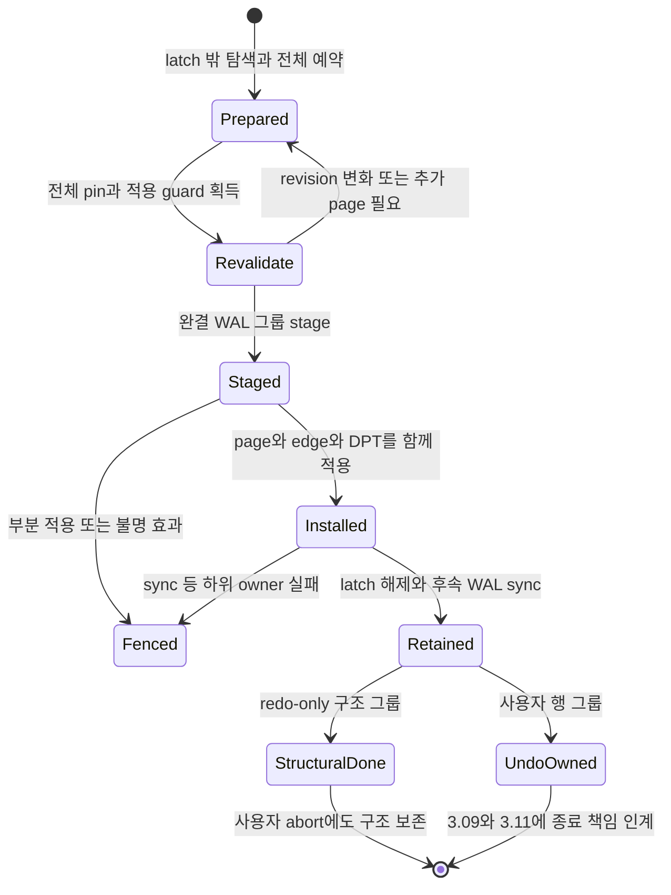
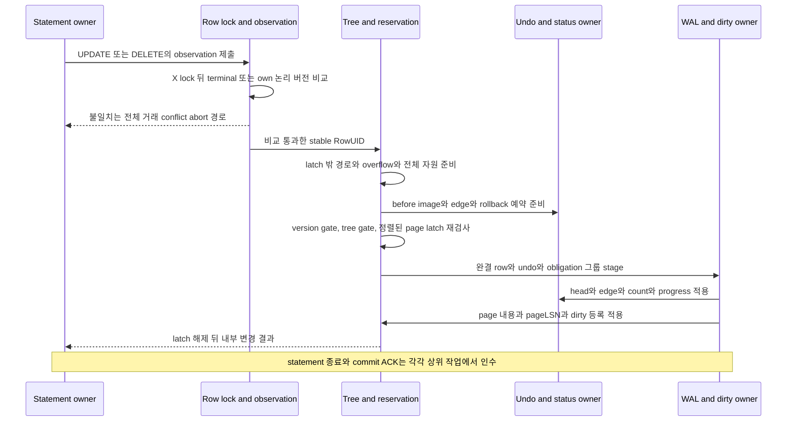

# DEV3 3.06 — 트리·행 개발 상세 명세와 설계도

2026-10-22 · **작업 상세 설계 / D2 상세화 수용 / 표현·모델의 기존 검증 보존 / 실제 mutable tree·행 거래 미완료**

2026-10-26의 [첫 모듈 전환 statement/cursor F02](#module-statement-cursor)는 별도 D2 PROPOSED이며 기존 채택 범위와 구분한다.

[공통 규칙](dev3-task-designs.md) · [개발 순서](../plans/dev3-implementation-plan.md#tree-undo-remaining) · [tree 소유 계약](disk-storage-design.md#tree) · [관측 행 버전](disk-storage-design.md#observed-row-version) · [변경 순서](disk-storage-design.md#mutation-protocol) · [참조 수명](disk-storage-design.md#undo-lifecycle)

## 1. 목적·현재 상태·책임

안정 anchor에서 현재 B+tree 구조를 찾고, RowUID를 물리 위치와 분리하여 행과 과거 버전을 읽고 변경하는 경로를 만든다. row/index/catalog가 공유하는 tree 구조는 3.06.1, row와 overflow의 내부 변경은 3.06.2, 재탐색 cursor와 locator는 3.06.3으로 공급한다. index presence·UNIQUE는 3.07, catalog 의미는 3.08, 논리 rollback과 종료는 3.09, snapshot·잠금 통합은 3.10, commit 공개는 3.11이 소유한다.

현재 [tree 표현](dev3-tree-format.md), [row 표현](dev3-row-format.md), [overflow 표현](dev3-overflow-format.md), [참조·anchor 표현](dev3-reference-format.md)은 bytes와 국소 검산을 제공한다. split 계획 계산도 page를 변경하지 않는다. [기존 구현 기록](../implementation/dev3-implementation.md#tree-overflow-transaction)의 표현·모델 결과를 실제 탐색·SMO·row CRUD·거래 완료나 새 실행 결과로 확대하지 않는다.

상태명과 논리 연산명은 설계 표기다. 아래 알고리즘은 채택된 소유 계약의 실행 의무를 구체화하며, 아직 없는 공개 API·semantic opcode·추가 page field·수치 예약표를 확정하지 않는다. 그 항목은 [착수 전 동결](#freeze) 뒤 해당 effect를 구현한다.

## 2. 요구 ID와 불변식

| 요구 ID | 개발 명세 | 소유·인수 연결 |
| --- | --- | --- |
| 3.06-R1 | tree의 DB·ObjectId/Generation·anchor identity를 안정화한 문맥에서 얻고, root/child를 exact PageRef·family·level·arity로 검산. 저장 header를 그 자신의 기대값으로 사용하지 않음 | page/reference/tree 정본; DS01/03 |
| 3.06-R2 | anchor identity를 유지하며 root 변경과 structural revision을 검산. row identity·논리 버전은 split·이동·compaction·commit-q stamp로 바꾸지 않음 | tree·관측 행 버전; DS01·KU09 |
| 3.06-R3 | 분할은 entry 개수 대신 실제 cell+slot bytes로 결정. separator 전파·새 root·allocator INIT·retirement를 완결 system 그룹으로 연결하고 사용자 abort로 완료 SMO를 되돌리지 않음 | mutation protocol; DS01/03 |
| 3.06-R4 | row tree는 table 안 RowId의 영속 locator. RowId를 재사용하지 않고 INSERT의 신규성, UPDATE/DELETE의 opaque observation과 X lock 후 논리 버전 비교를 구별 | observed-row-version; DS01/06·KU09/10 |
| 3.06-R5 | 행 변경의 before/after·LogicalRowVersion·UndoRef·transaction head·참조 count·잔여 obligation을 해당 WAL 그룹으로 인계. 논리 undo는 현재 tree에서 대상을 재검색 | undo-lifecycle; 3.09 소비 |
| 3.06-R6 | 큰 row는 별도 immutable overflow chain으로 교체. 이전 chain·undo before-image chunks의 소유를 구분하고 필요한 snapshot/rollback 수명까지 보존 | row/overflow·undo; DS03/04 |
| 3.06-R7 | 읽기는 고정 snapshot q와 own writes를 적용하고, latch 밖 참조 이동에는 source latch 해제 전 transient pin을 확보. caller-owned 결과로 복사한 뒤만 임시 pin 반환 | visibility·undo-lifecycle; 3.10 공급 |
| 3.06-R8 | cursor는 마지막 full key 다음을 현재 anchor에서 재탐색. 소유 transaction/statement/private revision을 검사하고 후속 own mutation이면 CursorInvalidated | tree; DS01·KU09 |
| 3.06-R9 | locator는 한정된 물리 hint. hit의 page incarnation·owner·slot RowId 확인과 version/undo 판정을 생략하지 않으며 이동이면 tree로 재조회 | tree; DS03·KU09 |
| 3.06-R10 | 첫 effect 전 forward와 예약 rollback에 필요한 page·WAL·undo·frame·scratch·pin을 계산. 재시도·공간 부족·불명 I/O를 정상 성공이나 회계 복귀로 숨기지 않음 | F05·mutation protocol; DS03 |

## 3. 입력·출력·소유권

| 논리 경계 | 입력 | 반환·인계 | 소유와 금지 사항 |
| --- | --- | --- | --- |
| tree 문맥 획득 | 열린 DB/timeline/open identity, 안정화된 객체 generation·schema, anchor PageRef | 기대 family/arity와 anchor/root 관측값 | catalog/객체 guard를 유지. old snapshot이 과거 structural root를 정본으로 소유하지 않음 |
| point/next 탐색 | 문맥, canonical query 또는 마지막 full key, 준비된 frame/pin 예산 | 일치 entry 또는 successor의 검증된 관측·값 복사 | frame pin만으로 content 불변을 보장하지 않음. `PageReadGuard`가 소유한 shared content latch의 수명을 넘는 borrowed cell slice 반환 금지 |
| 구조 준비·적용 | 검증 경로, 예상 revision/page version, 예약 token, split/unlink 계획 | 새 구조와 pageLSN/DPT 등록, retirement 소유 | 단순 PageRef·SplitPlan은 write capability가 아님. 실제 owner가 예약과 적용 구간을 소비 |
| row 읽기 | statement view, table/RowId, caller 출력 공간 | visible row 또는 정당한 부재, engine 발급 observation | observation은 DB/open/table/RowId/statement/논리 버전에 결합. caller가 RecordVersion을 조립해 대체할 수 없음 |
| row 변경 | statement 소유, INSERT 신규 RowId 또는 UPDATE/DELETE observation, canonical after | 내부 row 효과·새 logical identity·undo head 인계 | row X lock은 거래 종료까지. 반환은 commit ACK나 전체 statement 성공을 뜻하지 않음 |
| overflow 읽기·교체 | 안정화된 head와 owner, materialization/신규 chain 예약 | 검증 row bytes 또는 완성된 새 chain·보존할 old 소유 | chain의 head 검산만으로 실제 payload/schema 유효성을 주장하지 않음 |
| cursor/locator | cursor 소유 token·마지막 key 또는 cache key | bounded 다음 결과·갱신된 hint | 호출 간 tree stack/page pointer에 정답 의존 금지. cache eviction은 논리 데이터 삭제가 아님 |

`RowId`의 BE tree key와 row header의 LE RowId를 각각 decoder로 해석한다. index 소비자가 사용하는 full key는 composite 비교와 RowId suffix를 따른다. raw physical bytes의 단순 사전식 비교로 바꾸지 않는다. local codec의 공개 가능한 값과 실제 session/lock/observation 권한은 별개다.

## 4. 구조·행 변경 상태와 처리 순서

위 `Retained`는 내구 commit 상태가 아니다. group별 WAL sync 요구는 3.04, home 반영은 3.05, durable ACK는 3.11이 판정한다. 완결 SMO가 먼저 수행된 뒤 사용자 변경이 거절되면 SMO와 그 charge는 남을 수 있으며 row의 논리 효과가 없다는 결과와 구분한다.

sequence의 conflict 경로는 성공 경로와 양립하지 않는다. 즉시 X lock 획득과 이미 보유한 X lock에도 비교를 수행한다. physical page version·undo head 재검사는 논리 observation 비교를 대체하지 않는다.

## 5. 단계별 알고리즘

### 5.1 안정 anchor에서 탐색

1. 객체 수명 guard와 statement snapshot을 받고 query의 canonical 형식·범위를 확인한다. locator가 있으면 아래 hit 검산을 먼저 시도할 수 있다.
2. page load는 tree/page latch 밖에서 수행한다. anchor의 기대 identity로 envelope와 anchor cell을 해석하고, 그 root로 기대 kind/level을 만든다. root를 읽을 때 anchor revision과 소유가 여전히 유효한지 다시 확인한다.
3. internal의 `route_child`와 `child_expectation`으로 다음 edge와 level−1을 얻는다. separator와 같은 query는 right child다. child load를 위해 latch를 놓았다면 원래 edge와 generation/version을 다시 확인한다. partial pin을 가진 채 추가 frame을 기다리지 않는다.
4. leaf에서 lower_bound로 후보를 찾는다. page-local strict order 외에 parent가 허용한 subtree key 범위와 자식 관계를 실행 경로에서 검증한다. 잘못된 owner/level/범위는 부재가 아니라 손상이다.
5. 재탐색 가능한 경로 descriptor와 예약은 제한된 workspace 안에 둔다. shared→exclusive 전환은 latch를 해제하고 다시 준비한다. 적용 시 필요한 전체 page 집합을 확보할 수 없으면 모두 반환하고 재시도한다.

일반 탐색의 shared tree gate와 content latch를 I/O 동안 유지하지 않는다. 구조가 바뀐 관측값은 hint일 뿐이며, 정확한 경로 검증 방식·구조 edge의 대여와 pin 수명·재시도 한도는 F02에서 동결한다. level0..15의 표현 한도가 재시도·RAM 무제한을 허용하지 않는다.

### 5.2 split·root 변경·빈 leaf 처리

1. 신규/대체 entry의 canonical bytes와 실제 비용을 계산한다. 정상 page의 entry 예산은 `C=16,188`, entry당 최대는 `H=8,094`다. 후보 sequence는 정렬·중복·합계 `T≤C+H`를 검산한다. 값 교체는 old entry 제거 뒤의 실제 후보를 계산한다.
2. leaf는 두 nonempty 구간의 최대 bytes를 최소화하고 동률이면 작은 boundary를 선택한다. right 첫 key는 right에도 남는다. internal은 pivot을 parent로 승격하고 right의 leftmost를 pivot의 right child로 옮긴다. [정본 split 규칙](dev3-tree-format.md)을 다시 정의하지 않는다.
3. parent까지 전파될 수 있는 경로·신규 sibling·root·anchor·allocator·retirement page를 사전 산정하고 INIT token과 WAL 공간을 확보한다. 높이 16을 넘기거나 revision/generation 산술이 불가능하면 해당 effect 전 거절한다.
4. version-edit gate → tree gate → 정렬된 page latch 아래 expected identity/version·separator·예약을 재검사한다. 달라졌으면 변경 없이 모두 놓고 다시 준비한다. latch 안에서 추가 경로를 읽거나 quota를 기다리지 않는다.
5. 완결 system 그룹을 stage한 뒤 INIT·separator/child·root/anchor·관련 pageLSN·DPT/owner 진행을 함께 적용한다. 한 frame의 한도를 넘는 전파는 중간 상태까지 탐색·복구 가능한 그룹 분해가 먼저 동결되어야 한다. 무계약 중간 parent를 공개하지 않는다.
6. 최소 구현은 underfull merge를 요구하지 않는다. 실제로 비어 있고 보존할 entry가 없는 leaf를 unlink하고 retirement 소유를 기록한다. snapshot에 필요한 tombstone/presence를 지워 빈 leaf를 만들지 않는다. unlink는 allocator free가 아니다.

빈 leaf unlink로 parent가 zero-separator internal이 되는 경우를 그대로 encode할 수 없다. 기존 형식은 internal separator 최소1개를 요구한다. root 축소·ancestor 재연결·마지막 root leaf 유지의 구체 전이와 retirement 목록은 F01/F02에서 추가 동결하며, 그 전에는 해당 구조 effect를 시작하지 않는다. 현재 형식에 영속 sibling link가 있다는 가정도 하지 않는다.

### 5.3 row CRUD·논리 observation

1. statement owner가 schema·값·canonical 크기·거래 누적 한도를 검산하고 undo mark·실패 정리 예약을 소유한다. INSERT에는 새 RowId의 영속 발급/신규성 계약을, UPDATE/DELETE에는 같은 statement view에서 얻은 opaque observation을 요구한다.
2. UPDATE/DELETE는 X lock을 얻은 뒤 current terminal/own LogicalRowVersion과 비교한다. 앞선 성공 statement가 만든 own-write 논리 버전도 현재 statement view에서 다시 관측할 수 있지만 이전 statement token/observation 자체를 재사용하지 않는다. 삭제 또는 mismatch이면 SerializationConflict로 전체 거래 abort를 요청한다. 같은 bytes라도 다른 사용자 mutation이면 mismatch다. 기대값을 lock 획득 시 최신 값으로 덮어쓰지 않는다.
3. latch 밖에서 before 값을 재구성하고 canonical after·row record·필요 overflow·undo before-image와 target identity를 준비한다. 과거 before-image와 현재 cut/참조 소유를 별도로 확인한다. 새 mutation_sequence와 rollback obligation을 포함한 모든 증가 연산의 headroom을 검사한다.
4. 적용 집합을 재검사하고 row/undo/head/edge/count/descriptor가 일관된 그룹을 stage/apply한다. DELETE는 새 논리 버전과 body 없는 tombstone을 만든다. INSERT 후 abort의 논리 부재와 즉시 물리 page 반환을 혼동하지 않는다.
5. row 내부 변경은 index/catalog 소비자에게 stable identity와 필요한 before/after를 공급한다. 여기서 statement-final UNIQUE나 다중 객체 commit 완료를 반환하지 않는다. 해당 대상의 3.09.2/3와 3.10.2 연결이 끝나야 사용자 변경 API의 원자성을 완료 처리한다.

### 5.4 visible row·overflow 재구성

1. read 진입에서 결과 buffer, 이동용 reference pin slots, 필요한 workspace를 예약한다. row header를 latch 아래 복사하고 VersionStamp와 snapshot q·own transaction을 판정한다.
2. status/undo 대상이 필요하면 source content latch를 놓기 전에 bounded transient pin을 등록한다. 대상 load는 latch 밖이며 exact generation·owner를 검산한다. 다음 edge pin을 먼저 얻은 뒤 이전 pin을 해제한다. snapshot 하나로 전체 chain을 pin하지 않는다.
3. own visible 변경 또는 q 이하 committed 버전까지 undo를 따라가고 해당 deleted/absence 의미를 적용한다. 필요한 참조가 없거나 cycle/sequence 위반이면 정상 NotFound로 처리하지 않는다. visibility 판정의 전체 규칙은 3.10, undo 의미는 3.09를 소비한다.
4. inline은 supplied schema로 검산한다. overflow이면 안정화된 head와 owner에서 chain을 읽고 `OverflowChainVerifier`로 순서·정확 PageRef·중복 물리 주소·길이·digest를 확인한다. materialization 공간에 canonical bytes를 구성한 뒤 `decode_materialized_row`로 total/digest와 schema를 확인한다.
5. 결과와 observation을 caller 소유로 인계한 뒤 임시 소유를 반환한다. borrowed row/overflow view는 그 input buffer의 수명을 넘기지 않는다. 호출 실패 때 부분 출력·cursor 위치의 효과는 F02에서 정하고 error의 실제 효과를 보존한다.

overflow 교체는 새 chain을 완성하여 row 변경과 인계한다. 공개된 old chain을 덮어쓰지 않는다. canonical before를 담는 undo chunks는 old row overflow와 다른 allocation이다. 이전 overflow가 필요한 동안의 별도 owner, 신규 chain의 미연결 실패 정리, row→undo 보존 인계는 opcode와 함께 동결하며 horizon만으로 소유를 추정하지 않는다.

### 5.5 cursor와 locator

1. cursor 생성 때 transaction/statement/private revision, snapshot guard, tree owner/anchor, range와 마지막 full key를 소유한다. key buffer는 canonical 최대 길이에 맞춰 예약한다.
2. 다음 호출마다 token 유효성을 검사하고 현재 anchor에서 마지막 full key보다 큰 후보를 찾는다. row scan은 RowId key, index 소비는 전체 composite+RowId key를 사용한다. 호출 간 예전 path stack·slot·sibling을 정답의 근거로 쓰지 않는다.
3. 고정 q의 visibility를 적용하고 보이지 않는 후보를 넘어서 재탐색한다. 한 호출의 검사 진행과 성공 반환한 마지막 key, buffer 부족/취소 뒤 진행점 보존은 F02에서 구분한다. 같은 key를 재반환하거나 아직 반환하지 않은 visible key를 건너뛰지 않아야 한다.
4. 같은 transaction의 후속 mutation 뒤 old cursor는 CursorInvalidated다. split/compaction처럼 구조만 바뀐 경우에는 재탐색으로 계속한다. cursor 종료는 snapshot 소유를 적절히 해제하되 transaction의 별도 horizon 소유를 끊지 않는다.
5. locator cache key는 DB/timeline·table generation·RowId다. hit에서는 선택 DB/open 문맥, page incarnation·owner·slot RowId를 검산하고 version/undo 판정을 수행한다. 이동·slot 불일치면 hint를 버리고 row tree를 다시 찾는다. page checksum/owner 손상은 cache miss로 감추지 않는다.

## 6. 자원·오류·복구 설계

| 자원 항목 | 적용 계산과 소유 |
| --- | --- |
| 경로·구조 page | 높이 최대16의 실제 경로, split propagation·new root·anchor, allocator와 retirement metadata를 page identity별 합산. 변경하지 않는 경로 관측도 pin/workspace 비용은 포함 |
| row·overflow | canonical5..131,072 bytes, inline≤2,048, row header168. 최대 inline value2,216 또는 overflow value232. overflow payload≤16,092와 최대9 page는 [표현 상한](dev3-resource-bounds.md)이며 admission 증명이 아님 |
| undo·status·참조 | row undo root 최대2,480와 별도 before chunks 최대9 page, head/count/status/obligation 변경 page 포함. old row overflow·new chain·undo chunks의 동시 생존을 누락하지 않음 |
| WAL·rollback | forward 구조/row 그룹과 재탐색·재삽입 split을 포함한 CLR/terminal 예약. frame≤1MiB·full INIT≤63과 DWB batch≤64를 혼용하지 않음 |
| RAM·frame | 전체 적용 pin 집합, latch 밖 경로/row materialization/codec 중첩 scratch, reference registry·lock slots를 실제 type/lifetime으로 증명. page bytes를 stack/Vec에 숨겨 ledger 밖으로 빼지 않음 |
| cursor·locator | key·token·출력·관측 identity와 캐시 entry/header/allocator 오버헤드를 포함. locator1MiB는 metadata/cache8MiB의 일부이며 별도 추가 예산이 아님 |

최대 row·tree 높이·최대 index 수를 동시에 요구하는 상위 row operation은 3.07과 3.16에서 전체 벡터로 합산한다. 이 문서에서 tree 한 개의 비용만으로 row transaction admission을 허용하지 않는다. `charged + outstanding_reserved ≤ capacity`를 자원별로 적용하며, statement rollback 후 이미 사용한 WAL/CLR·완료 SMO·retained undo/overflow·row/key lock을 mark 시점 숫자로 되감지 않는다.

| 실패 위치 | 결과·정리·복구 의무 |
| --- | --- |
| 사용자 shape/size·신규 예약 부족 | 해당 effect 전 typed 거절. 건강한 owner의 미소비 준비 자원만 반환. 앞서 완료한 SMO/statement의 효과는 별도 소유 |
| 준비 경로의 revision/위치 변화 | 모든 적용 latch/gate를 놓고 재탐색. foreground 한도 소진은 첫 변경 전 오류 또는 현재 statement의 실제 예약 rollback |
| observation mismatch/삭제 | 전체 거래 SerializationConflict 경로. predicate 자동 재실행·새 기대 버전 위조 금지. undo 완료 전 성공 abort 응답 금지 |
| 실제 page·undo·overflow 손상, 필요한 edge 소실 | 정상 부재/old hint로 낮추지 않음. 원래 cause를 유지하고 소유 계약에 따라 Fenced/RecoveryRequired |
| stage 뒤 부분 apply·불명 write/sync·poison | 공통 fence, raw writer/page 사용 차단, uncertain charge 보존. `Drop`으로 숨은 sync/성공 rollback 금지 |
| 구조/행 WAL 뒤 crash | 3.12에서 완결 구조/row/undo/status/INIT 그룹을 REDO. 완료 SMO는 보존하고 loser의 논리 row 효과만 현재 위치에서 CLR로 취소 |
| unlink·overflow 교체 뒤 회수 | retirement/horizon·영속 edge·rollback 소유·transient pin·physical-address flush claim·DWB pending 해제 확인 후 3.14.1→3.03.4→3.14.2. unlink만으로 Free 선언 금지 |

예약 rollback과 필수 구조 유지보수는 try 재시도만으로 진행을 주장하지 않는다. F02의 K 뒤 FIFO turn을 요청하며 대기 전 page pin과 공유 maintenance workspace를 반환한다. 준비 단계에는 전용 flusher를 허용하고, 적용 단계에서만 bounded content 구간을 drain한다. tree/row leaf가 별도의 lock rank나 workspace 대기 규칙을 만들지 않는다.

## 7. 하위 구현 단위·선행·완료 경계

| ID | 직접 선행·구현 산출물 | 완료 조건·다음 소비자 |
| --- | --- | --- |
| 3.06.1.a | 3.03.2·3.04.2·3.05.3과 tree/anchor 표현 → 안정 anchor 탐색, 경로 재검사, bounded 전체 pin | 세 family의 실제 page 탐색·stale owner/level·구조 변화 재시도. 사용자 undo 선행을 요구하지 않음 |
| 3.06.1.b | .1.a와 동결 SMO/F05 → byte split·separator 전파·새 root | system WAL/INIT·anchor·dirty/DPT를 한 계약으로 적용. 완료 split을 사용자 abort가 보존하는 소비 경계 제공 |
| 3.06.1.c | .1.b와 동결 empty-tree 전이 → 빈 leaf unlink·retirement 등록 | 안정 anchor·적법 internal/root 구조 유지. 실제 free/reuse는 3.14.1→3.03.4→3.14.2에 남김 |
| 3.06.2.a | 3.06.1·3.09.1·3.10.1의 필요한 guard/잠금 → row 읽기·version resolution·opaque observation | own/committed/undo 구분, source-latch pin 이전, caller 결과 수명. 두 격리 전체 통합 완료와 구분 |
| 3.06.2.b | .2.a와 row/overflow opcode/F05 → CRUD·overflow 교체·undo/head/obligation 인계 | 내부 효과의 자원·오류 경계와 대상별 3.09.2/3 공급. 사용자 API 완료는 3.09.2/3·3.10.2 통합 뒤 판정 |
| 3.06.3.a | 3.06.1/2·3.10.1 snapshot/guard → stable cursor | split/delete/이동 아래 fixed-q ordered 결과·CursorInvalidated. index range 소비는 3.07에서 연결 |
| 3.06.3.b | .3.a와 locator F05 → bounded hint cache·재탐색·계측 | stale/reused slot 검산, 실제 locator working set과1MiB 상한. DS03/PF09의 큰 fixture는 관련 실행 준비와 연결 |

이 표는 기존 3.06.1–3을 구현 단위로 나눈 것이다. primitive 공급에 미래 모든 대상의 rollback을 선행으로 되돌리지 않으며, 새 대상 producer와 3.09 소비 통합을 닫기 전 그 대상의 원자성 완료도 선언하지 않는다.

## 8. 독립 인수 사례

다음 case의 실행 상태는 NOT_RUN이다. 기대값은 typed 정렬 목록·행 변경 이력·명시 edge multiset·독립 bytes에서 계산하고 production encoder/탐색/undo 결과로 만들지 않는다. 각 leaf 전에 exact fixture·seed·cut·명령·시간/메모리 한도와 부정 판정기를 고정한다.

| Case | 입력·독립 판정 | 요구·인수 |
| --- | --- | --- |
| T06-01 | row/index/catalog의 empty·left/middle/right·equal separator 탐색. typed ordered map의 point/successor와 일치 | R1, DS01 |
| T06-02 | 유효 checksum 아래 잘못된 owner/arity/level/incarnation·자식 subtree 범위·self/duplicate child. 정상 NotFound 대신 원인 있는 거절 | R1, DS01/03 |
| T06-03 | 비용이 편향된 entry와 C/H/전체 후보 경계. 독립 boundary/pivot 전수 계산과 실제 두 page·parent key range 일치 | R3, DS01 |
| T06-04 | leaf→internal 연쇄 split·root level 경계·anchor revision 경계. root 변경에도 anchor identity와 logical row identity 보존 | R2/3, DS01/03 |
| T06-05 | split 뒤 다른 row writer 변경 후 원래 사용자 abort. split·다른 writer 보존, 현재 tree에서 원래 row만 undo | R3/5, 3.09.2·KU09/10 |
| T06-06 | 빈 leaf unlink·ancestor 경계·마지막 row 삭제. retired 목록 일치, pin/flush claim/DWB가 남으면 free 불가, root 표현 적법 | R3/10, DS03·3.14 |
| T06-07 | INSERT/UPDATE/DELETE·same-bytes UPDATE·앞선 statement의 own-write 버전을 현재 statement에서 다시 관측, immediate/wait/already-held X lock 세 경로. 이전 token 재사용은 거절 | R4/5, 3.10.2·DS06 |
| T06-08 | 다른 DB/open/table generation·다른 statement/RowId observation 및 잠금 뒤 삭제. spoof 거절 또는 규정된 conflict, 최신 버전으로 덮어쓰기 검출 | R4, KU09/10 |
| T06-09 | inline2,047/2,048/2,049와 overflow 최대131,072 경계, inline↔overflow·overflow↔overflow·DELETE/abort. 독립 canonical 값과 old/new/undo 소유 대조 | R5/6, DS03/04 |
| T06-10 | chunk skip/반복 주소/다른 owner/중간 짧은 payload/전체 digest 불일치·유효 digest의 schema 손상. 부분 materialization을 정상 행으로 반환하지 않음 | R6/7, DS03 |
| T06-11 | reader가 source ref를 복사한 순간 ager cut/reuse, 다음 pin 이전과 old pin 해제 경합. 필요한 snapshot 값과 generation 보호 동시 검산 | R7, 3.09/3.10·DS04 |
| T06-12 | cursor next 사이 split·compaction·삭제/aging·root 변경. fixed-q typed 결과와 전체 순서/중복/누락 대조, own mutation 후 CursorInvalidated | R8, DS01·KU09 |
| T06-13 | locator hit·이동·slot reuse·table 재생성·stale incarnation·cache eviction. cache on/off 결과 동일, 손상을 miss로 숨기는 mutant 거절 | R9, DS03 |
| T06-14 | forward/CLR 재삽입의 자원 경계−1/동일/+1,4/16/64MiB buffer, 부분 pin 실패, 반복 statement 실패 | R10, DS03·F05 |
| T06-15 | system/row 그룹의 stage/apply/WAL sync·DWB/home 각 실제 도달 cut 후 reopen. 완결 prefix·구조 보존·loser 논리 undo·edge count·retained bytes 독립 검산 | R3/5/6, 3.12·DS02/05 |
| T06-16 | locator 접근 데이터가 configured buffer4배 이상인 고정 fixture. 실제 distinct working set·캐시1MiB·전체 RSS/frame/FD peak와 정답을 함께 확인 | R9/10, DS03·PF09 |

T06-15는 3.12의 실제 복구 공급 뒤 닫는 통합 의무다. 그 전 무효과 codec·메모리 포트 결과는 해당 범위만 기록한다. T06-06의 실제 반환, T06-07/08의 거래 종료, T06-12의 index range는 각각 해당 소비 작업의 미완료 의무를 보존한다. 마지막 관련 검증 이후 수정된 코드와 case의 관계를 먼저 정하고, 변경 없는 기존 표현·모델 시험이나 전체 leaf/회귀 wrapper를 다시 실행하지 않는다.

## 9. 실제 소스 진입점

| 현재 파일·symbol | 현재 제공 범위와 다음 연결 |
| --- | --- |
| [tree_page.rs](../../crates/engine/src/storage/tree_page.rs): `TreeExpectation`, `TreePageView::{lower_bound,route_child,child_expectation}`, `choose_split` | borrowed page 검산·경로 기대값·무효과 split 계획. 실제 tree owner와 SMO producer는 아직 없음 |
| [anchor.rs](../../crates/engine/src/storage/anchor.rs): `AnchorRoot`, `TreeAnchor`, `decode_anchor` | root descriptor 표현·root envelope 확인. live anchor lock·revision 발급·root 설치 capability는 아님 |
| [row_record.rs](../../crates/engine/src/storage/row_record.rs): `RecordExpectation`, `RecordVersion`, `decode_row_record`, `decode_materialized_row` | canonical/schema·version payload 검산. RecordVersion 값은 opaque row observation이 아님 |
| [overflow.rs](../../crates/engine/src/storage/overflow.rs): `OverflowHead`, `OverflowChainVerifier` | chunk 순서·주소·digest의 streaming 검산. 실제 chain load·소유·회수는 없음 |
| [transaction_record.rs](../../crates/engine/src/storage/transaction_record.rs): `LogicalRowVersion`, `VersionStamp` | 논리 mutation과 status 참조 표현. observation 발급·X lock 후 충돌 판정은 후속 |
| [read_buffer.rs](../../crates/engine/src/storage/read_buffer.rs): `ReadBuffer::pin`, `PagePin::read` | selected clean page의 pin/read 공급. mutable dirty frame·전체 적용 집합 예약을 이미 제공한다고 가정하지 않음 |
| [undo_record.rs](../../crates/engine/src/storage/undo_record.rs), [status_home.rs](../../crates/engine/src/storage/status_home.rs), [semantic_group.rs](../../crates/engine/src/storage/semantic_group.rs) | undo/status 표현과 제한 RollbackStart 검산/구성. 일반 row CRUD/SMO opcode·live undo/CLR는 후속 공급 |

기존 DEV2 [volatile.rs](../../crates/engine/src/storage/volatile.rs)의 row 경로를 DEV3 disk tree 구현으로 승계하지 않는다. 새 파일·모듈 배치는 실제 구현 책임이 생길 때 저장소 정책에 따라 정하며 이 문서에서 빈 소스 경로를 예약하지 않는다.

### 첫 행의 leaf 후보 편집 공급

`tree_page::edit`의 `LeafEdit`와 `TreePageView::prepare_leaf_edit`, `LeafEditPlan::{encode,split}`는 [동결 계약](dev3-tree-format.md#leaf-edit)에 따라 이전 leaf와 새 cell에서 후보 bytes를 만든다. 첫 Catalog CREATE/Row INSERT는 Insert, version/tombstone·CLR 값 복원은 Replace, CLR의 이전 Missing 복원은 Remove를 소비한다. 값 의미·LSN·pin/latch·before 재검사·WAL 권한은 각각 실제 producer가 공급한다. [신규 선택 증거](../evidence/dev3-leaf-edit-20261025.md)는 표현·수명만 확인했으며 live tree/SMO·페이지 설치는 미완료다. 일반 opcode F05에 caller scratch16208·전후 page와 cell·typed carrier의 동시 생존량을 합산해야 한다.

## 10. 해당 leaf 착수 전에 추가 동결할 항목

| 항목 | 동결할 구체 내용·완료 전 금지 |
| --- | --- |
| F01 SMO/row 의미 그룹 | split·separator 전파·root 설치·empty-leaf unlink·retirement·row CRUD·overflow 소유 인계의 opcode, exact before/after·중간 구조·descriptor/owner chain. 기존 page bytes 임의 확장 금지 |
| F01/F02 empty-tree | zero-separator internal을 만들지 않는 root 축소·ancestor 재연결·최종 empty root, anchor revision 증가/overflow와 retirement. 미동결 edge case의 effect 금지 |
| F02 live owner·guard | 실제 Rust symbol·visibility·consuming 권한, shared 탐색 중 latch 해제와 경로 재검사, 전체 pin 예약, 구조 ref 수명·rank·K·progress turn cleanup |
| F02 row·cursor | RowId 신규성/발급, opaque observation 발급/소비와 논리 버전 비교, same-statement/own-write 수명, private revision·cursor 실패 진행점·부분 출력 효과와 오류 우선순위 |
| F02 overflow/undo | old chain owner·undo before chunks·새 미연결 chain의 소유 이전, reader transient pin 등록, cut 후 rollback이 유지할 link와 incoming edge multiset |
| F03/F04 | T06 case별 independent oracle 입력·정답·negative mutant, 실제 I/O/thread/reopen cut와 미도달 판정. codec/모델 성공으로 실제 실행을 대체하지 않음 |
| F05 | opcode별 forward/CLR/terminal page 집합·실제 bytes·32거래 동시 admission·buffer별 전체 pin·중첩 scratch·locator overhead·WAL/owned/protected 합산과 경계 계산 |
| F06 | 실제 공급 revision/symbol·형식과 reuse/adapt/DEV2-only/new 분류, 선행 leaf·시험 inventory·clean export. 기존 증거의 source/binary/fixture identity와 새 소비 결과를 구분 |
| F07 | 작업/계약/통합 담당·독립 검토자, 전용/공유 파일 소유·병합 순서·소비자 수신 조건. 현재 미구현 symbol을 공급 완료로 등록하지 않음 |

동결과 독립 검토는 이 상세 설계 작성 자체의 실행 결과가 아니다. 정본 계약과 충돌하거나 새 형식·수치·API가 필요한 항목은 해당 owner의 D2 기록으로 먼저 해결하고, 이 문서가 그 결정을 소급 채택한 것으로 사용하지 않는다.

## 비교 분석 후속 — cursor batch의 수명·비용 경계

현행 snapshot/own mutation 재검사와 full key resume를 기준선으로 유지한다. 결과 N개, root reseek 비용 H, 후보당 처리 c일 때 단순 N회 비용 `N(H+c)`에 비해 b개씩 처리하는 이상 비용은 `ceil(N/b)H+Nc`다. invisible/tombstone/Undo 체인을 만나면 후보 수가 결과 수보다 크므로 **반환 행 수만 b로 제한하는 것은 bounded 작업이 아니다**. 향후 batch 후보는 방문 candidate 수·decode/복사 bytes·Undo hop 작업량·취소 확인 간격·workspace를 함께 제한한다. 숫자는 실제 F05 뒤 동결한다.

batch 사이에는 page pointer/latch를 보존하지 않고 snapshot token·own mutation revision·마지막 검사한 full physical key로 재진입한다. candidate budget 소진 시 결과0이라도 진행 cursor와 완료/미완료를 구분해야 하며 같은 invisible 후보를 영원히 반복하지 않아야 한다. split/delete/reuse·자기 변경이 cursor 권한을 바꾸면 기존 규약대로 재검사한다. 최적화 전후 같은 결과·중복/누락 없음과 실제 candidate/read bytes를 검증한다. batch 구현은 실측 뒤 별도 후보이고 최초 행 통합의 선행 조건이 아니다.

작은 row·넓은 key·다중 index의 공간 기준선은 [표현 비용 산식](dev3-resource-bounds.md#representation-cost)에 둔다. 형식 축소나 압축을 이번 변경으로 채택하지 않는다.

## 모듈 전환 후보 — statement·cursor의 F02

2026-10-26 · `D3-ROW-CURSOR-001` · **D2 PROPOSED / M2 미완료**. 작성·계약 담당 `/root`. [모듈 전환](../plans/module-independence-plan.md)의 첫 INSERT와 snapshot point-read/cursor를 같은 공통 경계에서 개발하기 위한 제안이다. 기존 일반 tree/CRUD·두 격리 수준 계약을 완료하거나 대체하지 않는다. 적용 범위는 실제 CREATE table의 single RowLeaf(level0), canonical inline≤2048B, index0, 신규 RowId의 Missing INSERT다. multi-statement·한 statement 안의 여러 INSERT와 실패 statement/full abort는 이 범위에도 필요하다. SMO·occupied before·overflow·index 대상은 첫 효과 전에 Unsupported를 반환하며 실제 존재하는 제약을 무시하지 않는다.

### 원 view와 mutation 권한

공통 공급 C가 실제 transaction/statement owner와 snapshot을 결합하여 비복제 `RowStatementView`를 발급한다. 값은 원 DB/timeline/open binding, optional own TxnRef, checked statement sequence, snapshot guard, statement 상태와 private revision을 보존한다. 숫자 token·q·TxnRef를 caller가 조립하는 생성자는 없다. 하나의 거래에는 한 active statement만 허용하고 같은 statement의 호출은 직렬화한다. 서로 다른 거래/reader의 원 admission·owner 정책은 유지한다. view는 원 live owner보다 오래 살 수 없고, cursor는 view를 borrow하므로 snapshot 수명을 연장하는 별도 registry를 만들지 않는다.

mutation은 A의 후보와 C의 원 apply/transaction authority를 통해서만 수행한다. cursor가 immutable view를 borrow한 상태의 후속 own mutation은 C 내부의 checked revision 상태를 바꾸어 검출한다. view의 내부 상태는 caller에 공개하지 않으며 같은 statement를 여러 thread에서 동시에 변경 가능한 `Sync` handle로 제공하지 않는다. A가 revision을 직접 설정하거나 B가 별도 revision counter를 두지 않는다. 실제 Rust wrapper·lifetime과 source census는 M2 경계 명세에 연결하여 채택하고 M4에서 구현한다.

| 사건 | statement·cursor 효과 |
| --- | --- |
| 진입 shape/schema/quota 실패, WAL stage 전 취소 | 새 row effect가 없고 revision 불변. 기존 cursor가 유효하면 반환/검사 key도 유지 |
| 최초 row 변경의 완결 stage/설치 진행 | 원 operation이 MutationPending을 보유하여 겹친 읽기를 차단. whole-install 성공 시 checked private revision 증가. stage 뒤 실패는 실제 fence/RecoveryRequired를 보존하며 cursor를 정상 계속하지 않음 |
| 같은 statement의 후속 INSERT 설치 | private revision 증가. 이전 revision에서 만든 cursor는 CursorInvalidated. 재생성한 cursor는 같은 snapshot과 현재 own writes를 사용 |
| statement 성공 종료 | statement token 종료. 해당 cursor·observation은 재사용 불가. 거래의 own writes·전체 abort 예약은 유지 |
| statement 실패 뒤 rollback | RollingBack 동안 일반 row 읽기/새 mutation 불가. mark까지 CLR을 마친 뒤 해당 statement 종료; 앞선 성공 statement와 실제 잔여 예약을 보존하고 새 sequence의 statement만 시작 가능 |
| 전체 abort/Commit attempt | 신규 cursor 호출을 닫고 원 terminal/UNKNOWN 규약 적용. ACK/ABORT 이전에 소유를 임의 반환하지 않음 |
| 실제 구조만 이동·flush/load | 논리 own mutation revision을 올리지 않음. caller는 현재 root/key를 재탐색. 이번 single-leaf 지원 밖 구조는 Unsupported/Corruption 구분을 유지 |

statement sequence와 private revision은 wrap하지 않는다. 새 번호 여유가 없으면 해당 신규 statement/mutation을 첫 효과 전에 거절하며 기존 종료/rollback 예약을 보존한다. private revision은 cursor 유효성용 RAM 상태이고, 영속 `LogicalRowVersion.mutation_sequence`와 동일 변수로 간주하지 않는다. 영속 sequence는 실제 RowReserve/Forward의 owner 계약을 따르며 Cancel/CLR로 되감지 않는다. crash 뒤 old open·statement·cursor는 모두 무효이며 복구가 과거 사용자 statement를 Active로 재개하지 않는다.

### point-read와 순서 cursor의 실패 진행점

B의 실제 본문은 현재 anchor에서의 point/next 탐색, fixed-q 및 own-write 판정, 필요한 Missing Undo 확인, caller output/observation 생성과 full key 재탐색이다. C는 검증된 page·source pin·Status/Undo 읽기와 원 statement authority를 공급하며 완성된 lookup/cursor를 대신 구현하지 않는다. 참조 이동은 [Missing Row의 두 pin 계약](dev3-visibility-retirement.md#row-missing-traversal)을 소비한다.

cursor는 `last_returned`와 `last_examined`의 full RowId key를 구분한다. 생성 때 둘 다 range 시작 이전이며 range 끝은 별도 checked bound다. 호출 간 page pointer·slot·latch·path stack을 보존하지 않는다. `next`는 토큰과 revision을 먼저 검산하고 현재 anchor에서 `last_examined`보다 큰 첫 후보를 찾는다.

| 결과 | output와 진행점 |
| --- | --- |
| candidate가 fixed-q에서 보이지 않음 | Missing 판정과 정리를 마친 뒤 `last_examined`만 전진. `last_returned` 불변 |
| visible candidate, output 충분 | 완전한 canonical row와 observation을 caller 소유로 복사한 뒤 두 key를 candidate로 전진, Found 반환 |
| visible candidate, output 부족 | typed OutputTooSmall과 필요 길이. candidate 이전 검사 key를 보존하여 재시도 때 같은 행을 반환; 그 전에 건너뛴 invisible key까지는 보존 가능. 부분 row를 유효 결과로 노출하지 않음 |
| Cancelled 또는 FlushRequired | 마지막 완전히 판정된 invisible candidate까지만 검사 key 보존. 미완료 visible candidate를 건너뛰지 않음. transient/physical pins 해제 후 반환; caller buffer의 유효 길이는0 |
| 범위 끝 | exhausted를 기록하고 End. 같은 유효 token/revision의 다음 호출도 End. own mutation 이후에는 End보다 CursorInvalidated가 먼저 |
| stale origin/table/schema/statement, revision 변경 | output 유효 길이0, 두 key 불변. typed identity/token 오류 또는 CursorInvalidated. 새 snapshot으로 조용히 재시작하지 않음 |
| 필요한 page/Status/Undo 손상·fence | 실제 cause/effect/certainty를 보존. 정상 End/NotFound/취소로 낮추지 않음 |

output는 caller-owned byte slice와 반환한 유효 길이로 다룬다. 실패 시 유효 길이는0이며 scratch bytes 자체가 원래와 같다는 보장은 하지 않는다. observation은 실제 Found의 table/RowId·statement·logical version과 원 view를 결합한 opaque 값이고 raw header decode가 발급하지 않는다. point-read는 cursor 진행 상태가 없고 같은 output·token·손상 규약을 적용한다.

이 첫 single-leaf scan은 한 page의 유한 cell 수 안에서 수행하고 candidate마다 취소를 확인한다. invisible 후보를 output row 수에 포함하지 않아 무한 scan이 되는 batch 설계를 채택하지 않는다. 일반 여러 leaf/Undo chain의 작업 budget·batch API는 별도 미공급 의무로 유지한다. literal row history에서 독립 계산한 순서·q별 visible 집합·own visibility·재시도 key를 oracle로 사용하고 제품의 visible 판정 함수를 expected에 재사용하지 않는다.

필수 신규 인수는 point와 cursor의 같은 결과, old-q/new-q, own write와 revision 무효화, 이전 성공 statement 보존/실패 statement token 종료, OutputTooSmall/취소/FlushRequired 뒤 동일 visible 행 재개, stale generation/schema/open, 원 source capture 경합과 cleanup이다. 적용 가능한 T06-01/02/11/12·C10-10/13 및 DIR03의 실제 연결 사례로 배정한다. 선택 source·fixture·oracle·case와 D2 검토는 M2 소비자 명세에서 확정하며 문서 작성만으로 시험을 실행하거나 인수를 승격하지 않는다.
