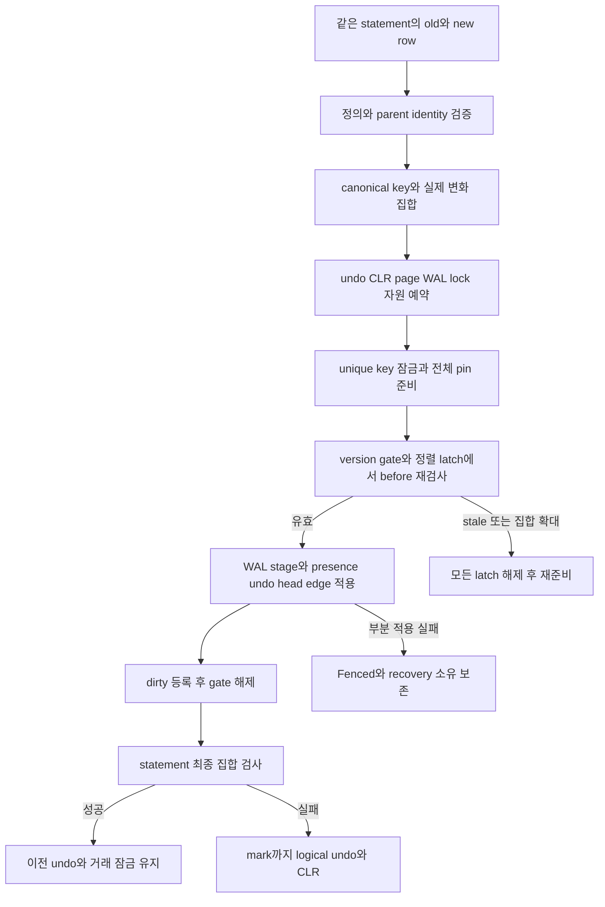
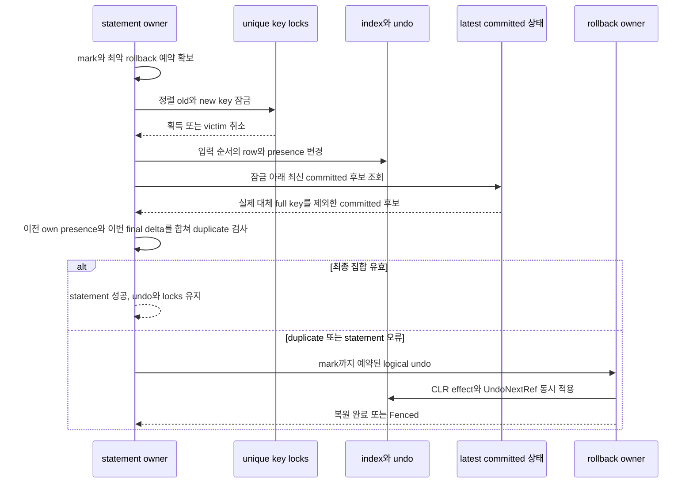
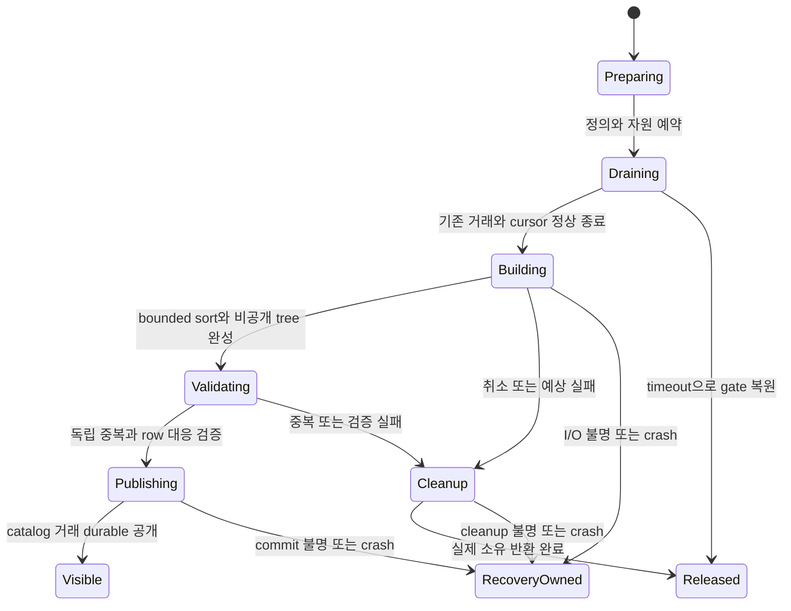

# DEV3 3.07 — 인덱스 개발 상세 명세와 설계도

2026-10-22 · **작업 상세 설계 / key·tree·presence 표현 공급 / 실제 인덱스·UNIQUE·build 통합 미완료**

[공통 규칙](dev3-task-designs.md) · [인덱스·UNIQUE 정본](disk-storage-design.md#keys) · [tree·cursor](disk-storage-design.md#tree) · [key 표현](dev3-key-format.md) · [presence 표현](dev3-row-format.md) · [catalog 정의](dev3-catalog-format.md) · [작업 분해](../plans/dev3-implementation-plan.md#work-sizing)

## 1. 목적·직접 선행·책임

공통 mutable tree 위에 versioned index entry와 조회를 연결하고, 하나의 statement가 만드는 최종 key 집합의 PK/UNIQUE를 검사한다. row 변경·index presence·undo를 같은 거래에 종속시켜 statement 실패와 전체 abort에서 일치 상태를 복원한다. offline build는 공개되지 않은 객체를 만들고 검증한 뒤 catalog 거래로 공개한다.

3.06.2/3의 행 변경·stable cursor, 3.09.1의 live undo/status, 3.10.1의 snapshot/잠금·변경 guard 중 실제 소비할 공급을 수신한다. 공통 tree의 split/root/anchor·page allocator·WAL·buffer는 하위 owner가 공급하며 index 전용 tree를 복제하지 않는다. 대상별 logical undo·CLR와 statement 종료는 3.09.2/3, catalog 공개·객체 retirement는 3.08, durable commit은 3.11, restart는 3.12, aging은 3.14와 연결한다. 이들 전체 대분류의 완료를 내부 presence 공급의 선행으로 만들지 않는다.

현재 key/tree/index record/catalog codec은 무효과 표현이다. 저장 bytes의 decode 성공은 entry의 가시성·UNIQUE·객체 실존이나 변경 권한을 증명하지 않는다. 이 문서의 연산·상태 이름은 설계 표기이며 신규 public Rust API의 채택 또는 구현을 뜻하지 않는다.

## 2. 기능 요구와 입력·출력

| 요구 ID | 상세 명세 |
| --- | --- |
| 3.07-R1 | 인덱스는 PK/Unique/Nonunique, 서로 다른 1–4개 열, table당 최대8개·PK 최대1개, ascending binary 비교를 지원. PK 대상 열은 이미 nonnullable이어야 함. expression/partial/descending/collation은 범위 밖 |
| 3.07-R2 | canonical composite는 escaping 후1,024 bytes 이하, physical key는 `(composite, RowId)`이며 RowId는 table 내 논리 identity. 비교는 검증된 composite와 RowId의 순서이며 physical bytes 전체의 raw 비교로 대체하지 않음 |
| 3.07-R3 | presence와 VersionStamp·UndoRef를 함께 보존. 동일 full key 제거/재추가는 하나의 presence 이력으로 처리하고 과거 snapshot이 요구하는 absent entry를 즉시 물리 삭제하지 않음 |
| 3.07-R4 | point/range/full scan은 같은 statement snapshot과 own writes를 사용. 현재 구조에서 마지막 full key 다음을 재탐색하고 index entry 및 해당 row의 가시성을 해석하여 독립 row 결과와 일치 |
| 3.07-R5 | UNIQUE는 전체 NULL만 중복 예외. 부분 NULL은 위치를 포함한 동일 tuple끼리 충돌. PK NULL은 거절. statement 중간 중복으로 key 교환을 거절하지 않고 최종 집합을 검사 |
| 3.07-R6 | 영향받는 old/new unique key를 `(index generation, encoded key)`별로 정렬해 예약·잠금. all-null 예외는 unique conflict lock에서 제외. 최신 committed 상태와 이전 성공 statement까지 포함한 transaction 전체의 own 최종 상태를 대조하고 잠금은 transaction 종료까지 보유 |
| 3.07-R7 | statement 실패는 mark까지 logical undo하여 이전 성공 statement를 보존. 전체 abort·deadlock victim은 전체 undo와 terminal 확인 뒤 잠금을 해제. WAL/CLR·잔류 page·잠금 ledger를 mark로 되감지 않음 |
| 3.07-R8 | offline build는 admission close/drain, bounded external sort, 비공개 객체 구성·검증, catalog commit으로 연결. 취소·실패·crash의 staging과 할당 소유를 보존하고 완료되지 않은 인덱스를 공개하지 않음 |

| 연산 경계 | 입력·사전조건 | 출력·소유 및 이후 소비자 |
| --- | --- | --- |
| 정의·key 준비 | 검증된 table/index identity와 schema generation, 선택 열, canonical row, 신뢰 RowId | caller-owned bounded key/변경 목록. key view는 buffer 수명에만 유효하며 index 접근 권한이 아님 |
| presence 변경 준비 | 같은 statement token, row 관측값, old/new key와 기존 presence/version, undo·WAL·page·잠금 예약 | 적용 전에 재검사할 before 상태와 준비 그룹. row owner가 발급한 mutation identity를 소비하며 index가 별도 행 버전을 발급하지 않음 |
| presence 적용 | 정렬된 guard/latch와 authoritative frame, 검증된 before 상태, consuming 예약 | presence/undo/head/edge/count/obligation을 완결 WAL 그룹에 연결. 이후 dirty/flush와 logical undo owner가 인계 |
| point/range/full 조회 | index object/anchor, 같은 statement의 snapshot guard, typed bound와 출력 용량 | 호출자 buffer의 visible RowUID/row 결과와 continuation. page/undo에서 빌린 bytes를 latch 밖에 노출하지 않음 |
| statement-final 검사 | 해당 statement의 최종 key 변화, 이전 성공 statement의 미변경 own presence, 보유 unique key locks, 최신 committed 상태 | 성공이면 statement 성공 인계. duplicate이면 mark rollback 필요; 검사 오류만으로 복원 완료를 응답하지 않음 |
| build/취소 | DDL owner, drain 권한, 신규 object identity와 사전 예약한 staging/file/page 소유 | 검증된 비공개 tree 또는 cleanup 진행 소유. 공개 결과는 catalog/commit owner가 확정 |

table/index의 DB·timeline·open identity, parent table generation/schema epoch와 anchor를 신뢰한 owner 문맥에서 검증한다. payload에 저장된 identity를 expected 값으로 되읽지 않는다. 동일 숫자 ObjectId·RowId라도 다른 table/namespace를 결합하지 않는다.

## 3. presence와 조회 알고리즘

row 변경의 old/new canonical 값에서 실제 인덱스 변화 집합을 계산한다. key가 달라지면 old full key의 presence를 제거하고 new full key의 presence를 추가한다. 같은 key를 같은 statement에서 여러 번 변경하면 최종 presence와 rollback 이력을 구분하며, 별도 중복 physical entry를 만들지 않는다. key가 바뀌지 않은 unrelated column UPDATE는 해당 entry의 logical identity를 바꿀 필요가 없다. 따라서 row와 index의 LogicalRowVersion이 항상 같아야 한다는 검사를 추가하지 않는다.

각 entry의 logical identity는 그 entry를 마지막으로 바꾼 사용자 행 mutation을 나타낸다. 한 mutation에서 제거·추가한 entry는 같은 identity를 사용할 수 있다. presence의 before 상태와 이전 version link, transaction undo head 및 incoming edge 수의 변경은 해당 완결 그룹에 묶는다. 물리 구조 변경은 공통 tree의 redo-only SMO이며 사용자 abort가 이전 전체 page image로 되돌리지 않는다.

준비·잠금 대기·추가 page load는 version/tree/page/append latch 밖에서 수행한다. X-lock 아래 행 관측 버전을 재검사하는 의무는 3.06/3.10이 소유하며, UNIQUE 검사 성공으로 대체하지 않는다. 준비한 key 집합을 적용 중 임의로 늘리지 않는다. 추가 필요량 발견은 변경 전에 다시 준비하거나, 이미 효과가 있다면 사전 예약한 statement rollback 경로로 처리한다. 구체 streaming 입력과 전체 key 집합 준비의 분할은 F02/F05에서 동결한다.

조회는 다음 순서로 진행한다.

1. index 정의와 parent table의 같은 snapshot 수명·anchor를 확보한다. bound의 열 수·형식·길이·inclusive/exclusive 의미를 먼저 검증한다. composite bound를 임의 RowId0의 유효 physical key로 위장하지 않는다.
2. 최초 호출은 lower/upper bound, 이후 호출은 마지막 full key를 기준으로 현재 anchor/root에서 재탐색한다. 공통 tree의 `(composite, RowId)` comparator와 child expectation을 사용한다.
3. candidate presence를 snapshot q와 own transaction에 맞춰 해석한다. UndoRef/TxnRef를 따라갈 때 source content latch를 놓기 전에 transient pin을 등록하며 다음 참조를 pin한 뒤 이전 pin을 놓는다.
4. visible present candidate만 RowUID로 row tree에서 확인하여 같은 statement의 row 값을 출력한다. 출력에는 일치하는 index 정의/row projection을 사용하며 row와 index 버전 token의 무조건 동일성은 요구하지 않는다. 구조/의미 불일치를 정상 row 부재로 숨기지 않는다.
5. 마지막 full key를 bounded continuation에 보존하고 pin/latch를 반환한다. caller 출력 용량을 넘기지 않는다. cursor가 속한 transaction/statement/private revision이 바뀌면 CursorInvalidated이며 다른 snapshot으로 몰래 이어가지 않는다.

point 조회는 같은 composite의 모든 RowId 후보를 가시성 검사한다. nonunique와 all-null Unique에는 여러 결과가 가능하다. range/full scan에서도 오래된 absent/present 이력과 split/delete/aging을 함께 다루며, sibling pointer나 호출 간 tree stack을 정본으로 삼지 않는다. 실제 bound 자료형·재탐색 제한·오류 enum은 착수 전 동결 항목이다.

## 4. statement-final UNIQUE와 잠금 설계

최종 검사 대상은 영향받는 unique key 범위에서 다른 거래의 최신 committed 상태에 **이전 성공 statement를 포함한 transaction 전체의 own 최종 presence**를 반영한 집합이다. 이번 statement의 delta 내부 중복뿐 아니라 이번 statement가 건드리지 않은 이전 own entry와의 충돌도 검사한다. 기존 entry를 제외할 때에는 실제로 대체·삭제한 full key와 그 최종 presence를 식별하며, 같은 encoded key의 모든 RowId나 자신의 TxnRef를 가진 모든 entry를 제외하지 않는다. self 재검사는 동일 full key를 두 행으로 세지 않는다. statement snapshot만 조회하면 그 뒤 commit된 duplicate를 놓칠 수 있으므로 가시성 조회와 unique conflict 조회를 구별한다. old/new unique keys를 정렬하여 잠근 뒤 검사하고, 잠금 보유 중 page latch를 잡는 짧은 적용 구간 외에 I/O/추가 잠금 대기는 공통 순서를 따른다.

예를 들어 row A의 key1과 row B의 key2를 한 statement에서 서로 교환하면 최종 집합 `{A:key2,B:key1}`은 성공해야 한다. 최종적으로 둘 다 key2가 되면 실패하고 이전 statement의 효과는 남긴다. `(1,NULL)` 두 개는 충돌하고 `(NULL,NULL)` 두 개는 허용한다. all-null은 unique conflict lock 예외이지만 row lock·객체 수명·undo·자원 규칙까지 면제하지 않는다.

같은 거래에서 S1이 `A:key7`을 삽입하고 성공한 뒤 S2가 `B:key7`을 삽입하면, S1이 아직 미커밋이어도 S2만 UNIQUE 실패로 rollback해야 한다. 반대로 S1에서 기존 A:key7을 삭제하거나 key8로 옮겼다면 S2의 B:key7은 성공할 수 있어야 하므로 이전 statement의 own absent도 반영한다. S2가 A를 삭제하거나 다른 key로 옮긴 뒤 B를 key7에 넣는 경우도 최종 집합이 유효하면 성공한다. 이미 가진 key lock의 재획득 성공은 이 검사를 생략할 근거가 아니다.

deadlock은 공통 wait-for graph와 victim 규칙을 소비한다. 단순 unique duplicate는 statement rollback, SerializationConflict/deadlock victim의 전체 abort는 transaction owner의 규약을 따른다. full undo 또는 terminal 확인 전에 잠금을 풀거나 성공 ABORT를 응답하지 않는다. 같은 실패 statement를 반복할 때 WAL/CLR와 회수 전 undo·완결 SMO·보유 잠금은 계속 charge한다.

## 5. offline build와 취소·복구

build는 새 거래·maintenance admission을 닫고 기존 거래/cursor와 이미 진행 중인 작업의 정상 종료를 기다린다. 기존 commit/rollback, 필요한 전용 flusher와 이미 진행 중인 작업의 완료 경로는 계속 허용한다. drain 뒤에도 build에 필요한 전용 flusher의 진행을 막지 않는다. timeout이면 소유한 gate를 복원하고 Busy를 반환한다. 긴 reader를 강제 만료하거나 숨은 commit을 하지 않는다. 이 drain은 dirty-pressure의 forward-effect 제한과 같은 것으로 구현하지 않는다.

drain한 안정 row 집합을 bounded 순회하여 `(composite, RowId)` run을 만들고 고정 fan-in으로 합친다. run bytes·목록·FD·merge buffer·새 tree/undo/allocator/WAL을 사전에 계산한다. 중복 key의 PK/Unique 검사는 정렬 이웃 비교와 독립 typed tuple 기대값으로 인수하며 all-null 예외를 유지한다. 임시 파일도 engine-owned staging 목록과 generation/owner에 귀속한다. 단순 directory scan이나 파일명만으로 삭제 대상을 정하지 않는다.

완성 tree와 정의를 연결하는 catalog 등록은 3.08의 독립 원자 DDL 거래에 속한다. 공개 이전 실패는 object/allocator ownership과 cleanup 진행점으로 정리하고, 공개 시도 이후 certainty는 3.11/3.12가 판정한다. commit이 채택된 tree를 미공개 orphan으로 정리하지 않는다. 취소·crash 뒤 정리도 bounded batch와 예약으로 진행하며 사용자 abort로 이미 완결된 tree SMO를 역으로 되돌리지 않는다.

## 6. 오류·자원·복구 인계

| 상황 | 필요한 처리·남길 소유 |
| --- | --- |
| 무효 schema/열·PK nullability·key 크기·caller bound | 첫 effect 전 거절. authority 불변이며 예약한 private 준비물만 실제 반환 |
| 부족한 lock/frame/WAL/undo·build staging 예약 | 첫 effect 전 명시 거절. 전체 pin 확보가 불가능하면 부분 pin을 놓음. foreground가 protected rollback/flush 몫을 빌리지 않음 |
| duplicate·취소·중간 row/index 실패 | 이미 효과가 있으면 mark rollback 완료 뒤 statement 오류. 이전 성공 statement와 전체 abort 예약 유지 |
| 관측 행 충돌·deadlock victim | 거래 전체 undo를 3.09/3.10에 인계. unique 오류로 축소하거나 일부 statement만 되돌리지 않음 |
| stage 뒤 부분 적용·WAL/flush/cleanup 불명 | 공통 fence. entry·undo·descriptor·staging의 소유를 유지하고 recovery에 전달 |
| index page/undo 참조 손상·stale owner/generation | 손상/identity 오류로 거절. decoder 실패를 empty index나 duplicate 없음으로 해석하지 않음 |
| CLR 적용 중 crash | 현재 물리 위치의 presence 효과와 head/edge/UndoNextRef를 redo하고 남은 undo만 진행. 완료 SMO와 다른 거래의 entry 보존 |

F05는 transaction의 mutation256·논리 payload1MiB와 별도로 실제 최대8 index의 old/new keys, presence before-image·undo/chunks, 높이16 경로의 split/anchor, CLR 재삽입 비용, key lock/registry·전체 frame 집합을 합산한다. 최대 허용 입력들이 동시에 성립하는지 먼저 확인하고 불가능한 극값을 하나의 fixture로 합치지 않는다. key change가 없는 index는 실제 변화가 없음을 검증한 뒤만 비용 감소를 인정한다.

build는 transaction private 예산과 유지보수 workspace 소유를 구분한다. 공통 12MiB 단일 유지보수 workspace를 사용한다면 대기 중 turn/상위 lock/page pin을 보유하지 않고, 전용4MiB flusher 공간을 빌리지 않는다. FD128 및 owned8GiB 안 protected1GiB·WAL256MiB를 동시에 만족한다. fixed 수치는 [자원 정본](dev3-resource-bounds.md)을 따르며 실제 run 크기·fan-in·목록 상한·각 opcode 예약표는 아직 미동결이다.

presence 삭제와 undo 완료는 즉시 공간 반환이 아니다. snapshot/Active rollback·영속 edge·transient pin·physical-address flush claim·DWB pending이 필요한 동안 보존하며 3.14 eligibility와 3.03 free/reuse를 통해 반환한다. crash 뒤 예약은 checkpoint+WAL의 같은 채택 prefix에서 3.12가 복원한다. index undo가 거래 BEGIN WAL을 필수로 요구하는 새 역방향 WAL 의존성을 만들지 않는다.

## 7. 하위 구현 단위와 완료 판정

| ID | 직접 선행·공급 | 산출물·완료 조건 |
| --- | --- | --- |
| 3.07.1 presence·point/range/full scan | 관련 key/tree/row 표현, 3.06.2/3, 3.09.1, 3.10.1의 해당 guard·snapshot | presence 이력과 row 대응, bounded 재탐색 cursor를 공급. 제거/재추가·split/delete·old snapshot·own write를 독립 row 기대값과 대조. 대상별 3.09.2/3 연결 없이 사용자 변경 API 완료로 공개하지 않음 |
| 3.07.2 PK·statement-final UNIQUE·key lock | 3.07.1의 해당 변경/조회, 3.09.2/3 index undo, 3.10.1 잠금·statement 공급 | 최종 집합·key 교환·부분 NULL·동시 경쟁과 오류 rollback. durable row/index 원자성은 3.11/3.12와 통합하며 unrelated codec의 완료 시험을 재실행하지 않음 |
| 3.07.3 offline build·취소/실패 cleanup | 3.07.1/2의 해당 tree·검증, 3.08 정의/공개와 3.11/3.12의 필요한 공급 | bounded run/merge·FD/staging 소유, catalog 공개/UNKNOWN, 취소·crash cleanup. create/drop 공개 순서는 하나의 통합 담당이 연결. 미공개 build primitive 공급과 최종 DDL 인수를 구분 |

3.07.1의 index producer와 그 대상의 3.09.2/3 소비는 같은 통합 단위로 닫는다. 미래 catalog undo 전체를 기다리게 하거나 반대로 primitive 검증만으로 statement 원자성 완료를 기록하지 않는다. 3.07.3에서 공통 tree 수정이 필요하면 3.06 owner에게 연결하고 별도 tree 구현을 추가하지 않는다.

## 8. 독립 인수 case

아래는 구현할 경로의 인수 입력·판정 명세다. 각 case의 구체 seed/크기·cut·명령·시간/자원 한도를 leaf 전에 동결하고 마지막 관련 검증 뒤의 실제 코드 diff에 대응하는 case만 선택한다. 기존 codec·하위 leaf PASS는 원래 source 범위로 수신한다.

| Case | 독립 입력·필수 판정 | 연결 |
| --- | --- | --- |
| 3.07-T1 순서·범위 | Bool/Int64/Utf8/Binary/NULL와1–4열,1,024-byte 경계, 같은 composite 여러 RowId. typed tuple 순서로 point/range/full 결과와 inclusive/exclusive bound를 대조; raw physical bytes comparator mutant 거절 | DS01/06, KU09 |
| 3.07-T2 presence 수명 | 같은 full key 제거→재추가, old snapshot·own writes·다른 거래 uncommitted, unrelated column UPDATE. snapshot별 row projection 일치와 단일 presence chain 확인; 무조건 row/index token 동일 mutant 거절 | DS01/04, KU09 |
| 3.07-T3 cursor 구조 변화 | next 호출 사이 split/root 이동/delete/aging. 마지막 full key 재탐색 결과에 중복/누락 없음; 자기 후속 mutation은 CursorInvalidated. stale stack·page hint를 정본으로 쓰는 mutant 거절 | DS01, KU09 |
| 3.07-T4 최종 UNIQUE | PK NULL 거절, `(1,NULL)` duplicate 실패, `(NULL,NULL)` 성공, 두 행 key 교환 성공, 최종 duplicate 실패. 앞선 성공 statement 유지와 row/index 양방향 일치 | DS06, KU10 |
| 3.07-T5 동시 key 경쟁 | 두 거래가 같은 new unique key를 요청하고 첫 거래 commit/abort를 barrier로 교차. 잠금 뒤 최신 committed 재검사; 오래된 snapshot만 검사하는 mutant 거절. all-null은 예외, 일반 row lock은 유지 | DS06, KU10 |
| 3.07-T6 실패·CLR | 여러 index 변경 중 fault·cancel·quota 실패, rollback 재삽입 split, 일부 CLR 후 crash. 독립 이력/edge multiset으로 mark 또는 전체 abort 범위, 다른 writer·완결 SMO 보존 확인 | DS02/06, KU10, RC-T13/14 |
| 3.07-T7 반복 실패 회계 | WAL floor가 pin된 상태에서 성공 S1 뒤 실패 S2 반복. 실제 WAL/CLR·잔류 undo/page·retained lock 누적과 다음 admission 사전 거절, 전체 abort 예약 보존 | DS03/06, RC-T14 |
| 3.07-T8 build 경계 | empty/nonempty·8 index 한도·중복 존재 table·buffer보다 큰 key working set. run/merge·FD/메모리 peak, 정의/row 대응, nullable PK·partial NULL 검증 | DS01/03/06 |
| 3.07-T9 build 중단·공개 | drain timeout, run 생성/merge/tree 설치/검증/catalog commit 전후 취소와 crash. 미공개 소유만 cleanup, ACK 공개 객체 보존, UNKNOWN은 복구 판정. source row와 기존 index 보존 | DS02/06, KU10, RC-T12/14 |
| 3.07-T10 이전 own statement와 UNIQUE | 같은 거래 S1에서 A:key7 INSERT/UPDATE 성공 후 S2에서 B:key7 INSERT/UPDATE. S2만 실패하고 S1 유지; S1 또는 S2가 A:key7을 DELETE/key 이동한 뒤 B:key7이면 성공, 동일 full-key self 재검사는 중복 아님. 이번 delta+다른 committed만 검사하거나 own TxnRef 전체를 제외하거나 이전 own absent를 무시하는 mutant 거절 | DS06, KU10 |

F03의 typed row 이력에서 key tuple과 visible presence를 독립 생성한다. production key encoder·tree walk·replay를 기대값 생성에 사용하지 않는다. 바뀐 index 경로의 실제 Linux reopen/다중 객체 fault가 구현되면 그 경로와 외부 ACK/UNKNOWN 이력을 연결하고 full audit에서 row→index와 index→row를 각각 검사한다. 정상 open마다 변경 없는 전체 index를 검사하는 의무로 바꾸지 않는다.

## 9. 실제 source 진입점·착수 전 동결

| 실제 진입점 | 현재 공급과 이 작업의 소비 |
| --- | --- |
| [storage/key.rs](../../crates/engine/src/storage/key.rs) | `CompositeKey`, `PhysicalKey`, `encode_composite`, `encode_physical_key`: canonical 비교·caller bytes. 실제 UNIQUE·잠금 없음 |
| [storage/tree_page.rs](../../crates/engine/src/storage/tree_page.rs) | `TreePageView::lower_bound/route_child/child_expectation`, `choose_split`: 표현·검색 위치·split 계획. 실제 mutable tree 공급은3.06 |
| [storage/row_record.rs](../../crates/engine/src/storage/row_record.rs) | `IndexRecord`, `encode_index_record`, `decode_index_record`, `RecordVersion`: presence/identity 표현. 실제 가시성·이력 변경 없음 |
| [storage/catalog_record.rs](../../crates/engine/src/storage/catalog_record.rs) | `IndexMode`, `IndexDefinition`, `validate_index_against_table`: parent/열/PK nullability 검산. table당 개수·namespace 유일성·실제 객체 공개는 상위 owner |
| [storage/undo_record.rs](../../crates/engine/src/storage/undo_record.rs) | index target/before 표현을 소비. logical undo·CLR·edge 이전은3.09 공급으로 확장 |
| [transaction/read.rs](../../crates/engine/src/transaction/read.rs) | 기존 transaction read/cursor의 API 문맥 확인용. 현재 DEV2 substrate의 구현을 DEV3 disk index 공급으로 간주하지 않음 |

착수 전 F01/F02에는 index 변경 opcode/native body와 logical undo body, bound 자료형·cursor private revision 수명, 최신 committed conflict 조회와 scan의 구분, 이전 own presence를 포함하는 transaction 최종 상태와 statement final-delta의 결합·정렬/중복 제거·streaming 입력 분할, index build owner/cleanup 진행점·catalog 공개 연결을 고정한다. 기존 frame/row/index bytes를 이 문서에서 다시 정의하지 않는다. 현재 허용되지 않은 semantic body를 일반 codec이 수락한다고 가정하지 않는다.

F04에는 presence append/apply·각 CLR·build staging/namespace·catalog 공개의 실제 cut과 외부 관측을, F05에는 key lock 수·batch/scan 재시도·동시 생존 workspace·run/fan-in/FD·forward/rollback/build cleanup 예약표를 고정한다. F06은 DEV2 경로의 reuse/adapt/DEV2-only/new를 실제 symbol별로 기록하고 F07은 공통 tree/transaction/catalog와 전용 index 구현 경로의 단일 소유를 정한다.

문서 작성 담당은 `/root/dev3_specs_review`다. 본 작성자는 이 문서를 독립 승인하지 않는다. 설계 채택 여부와 별도 검토 결과는 [공통 결정 기록](dev3-task-designs.md#decision)에 통합하며 실제 제품·인수 실행 상태는 [구현 기록](../implementation/dev3-implementation.md#dev3-work-breakdown)에 남긴다.
