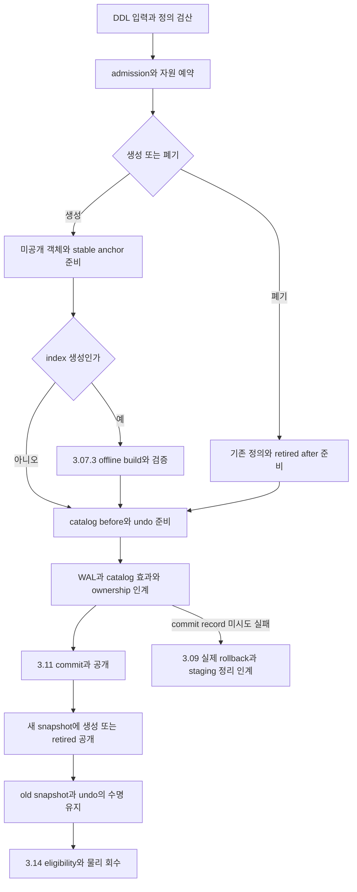

# DEV3 3.08 — 카탈로그·DDL 개발 상세 명세와 설계도

2026-10-22 · **작업 상세 설계 / catalog 표현 존재 / 실제 정의 변경·원자 DDL 미완료**

[공통 규칙](dev3-task-designs.md) · [catalog 표현](dev3-catalog-format.md) · [객체·API](disk-storage-design.md#ownership) · [DDL 동시성](disk-storage-design.md#concurrency) · [undo 표현의 미지원 경계](dev3-undo-format.md)

## 1. 목적·범위·공급

SQL 없이 native API로 table/index 정의를 생성·조회·폐기하고, row/index/catalog를 동일 거래 결과로 공개한다. catalog tree의 key는 ObjectId이며 이름은 정의의 속성이다. ObjectId/Generation/SchemaEpoch·stable anchor와 versioned 정의를 이용해 drop/recreate와 오래된 handle을 구분한다. SQL parsing·이름 정규화·권한·online index build는 이 작업의 범위가 아니다.

3.08.1은 3.06.1 공통 tree·3.09.1 live undo/status·3.10.1 guard의 필요한 공급으로 내부 catalog 변경을 준비한다. 3.08.2의 공개 create/drop은 해당 catalog rollback, commit·recovery와 연결한 뒤 완료한다. 실제 retirement/free는 3.14에 인계한다.

## 2. 데이터와 기능 명세

| 요구 ID | 상세 명세 |
| --- | --- |
| 3.08-R1 | table 이름·column 이름은 UTF-8 bytes1..128, NUL 없음, byte-exact 비교. column1..32, 중복 이름 거절, Bool/Int64/Utf8/Binary와 nullable 의미를 보존 |
| 3.08-R2 | index 정의는 mode·서로 다른 column position 1–4개·table당≤8·PK≤1을 검산. 각 position은 0-based이며 `0..table_column_count-1` 안에 있어야 함. PK는 기존 nonnullable column만 허용. parent ObjectId/Generation/SchemaEpoch 모두 일치 |
| 3.08-R3 | lookup은 snapshot/statement token과 namespace를 받는다. own 정의 변경과 committed q를 undo 가시성으로 판정하고 retired가 visible이면 없음으로 반환 |
| 3.08-R4 | handle은 DB/timeline/open identity와 ObjectId/Generation/SchemaEpoch·snapshot 소유에 결합. 이름 재사용을 동일 객체 재사용으로 간주하지 않음 |
| 3.08-R5 | create/drop은 독립 원자 거래다. catalog 정의·anchor·index와 allocation ownership을 WAL/undo/commit으로 연결하고 중간 정의를 사용자에게 공개하지 않음. table drop은 해당 generation의 모든 종속 index 정의와 table 정의를 같은 DDL 결과로 retire |
| 3.08-R6 | retired cell도 typed body와 anchor를 유지. old snapshot·WAL/DWB/checkpoint·undo가 요구하는 동안 물리 객체/mapping을 지우지 않음 |
| 3.08-R7 | namespace 중복·한도·취소·build 실패는 첫 effect 전 거절 또는 실제 rollback 뒤 결과. 실패 뒤 보이지 않는 staging 객체도 소유 없이 유실하지 않음 |

정의 bytes는 header232+table body≤4356 또는 index body≤136이다. tree key의 ObjectId는8-byte BE이며 cell 안 정수 endian과 구분한다. 단일 cell decoder는 table당 index 수·PK 수·이름 유일성·anchor 실존을 증명하지 않는다. 이 작업이 실제 catalog 집합·snapshot·load에 대해 검사한다.

## 3. 논리 인터페이스와 소유

| 연산 | 입력 | 출력·후속 의무 |
| --- | --- | --- |
| 이름 lookup/정의 lookup | 등록된 snapshot, namespace/name 또는 trusted handle | caller-owned 정의 또는 guard에 묶인 view. visible retired는 정상 부재, 손상은 오류 |
| create table | 검증한 TableSpec, DDL owner와 예약 | 새 ObjectId/Generation/SchemaEpoch·anchor를 가진 미공개 변경; commit 후만 성공 handle |
| create index | parent의 정확한 정의 identity, IndexSpec | 3.07.3의 검증된 build 결과와 catalog 등록을 하나의 DDL 거래로 인계 |
| drop table/index | 현재 handle·schema 검산·DDL owner와 안정화한 종속 index 집합 | table drop은 table+종속 index 전체, index drop은 해당 index의 versioned retired 정의·영속 retirement 작업 소유. 즉시 physical free 아님 |
| validate handle | engine이 발급한 identity와 현재 정의 | stale generation/schema 거절 또는 기존 snapshot에서의 정당한 옛 정의 접근 |

이 표는 논리 계약이며 신규 Rust signature의 채택이 아니다. 기존 [catalog.rs](../../crates/engine/src/catalog.rs)의 TableSpec 의미와 [catalog_record.rs](../../crates/engine/src/storage/catalog_record.rs)의 borrowed 표현을 수신하되, 현재 K0/DEV2 catalog 저장 경로를 DEV3 disk 구현으로 취급하지 않는다.

## 4. create·build·drop 설계도

1. 호출자의 정의를 불변 typed 입력으로 검산한다. 이름 중복은 현재 catalog 집합과 DDL의 소유/동시성 규약으로 확인한다. byte-exact 이름을 SQL 대소문자 규칙으로 몰래 바꾸지 않는다.
2. ObjectId/generation/schema 발급·anchor·tree·catalog cell·undo·최악 abort·staging 자원을 첫 effect 전에 예약한다. 발급 high-water는 실패 후 임의로 되감지 않는다.
3. index build는 새 거래/maintenance admission close·기존 거래/cursor/작업 drain을 거친다. 기존 commit/rollback·필요한 전용 flusher·진행 중인 작업의 완료 경로는 계속 허용하며, drain 뒤에도 build에 필요한 전용 flusher를 막지 않는다. timeout은 Busy와 gate 복원이다. build 결과를 catalog와 별개로 먼저 공개하지 않는다.
4. gate 밖 준비 후 공통 rank로 catalog/native before·parent identity·namespace를 재검사한다. complete WAL 그룹으로 정의와 undo/head/edge/count·obligation·ownership을 적용한다.
5. create 성공은 commit의 durable 결과/공개까지 연결한다. table drop은 정확한 parent ObjectId/Generation에 속한 최대8 index를 bounded 집합으로 수집하고, table과 종속 index의 retired version을 같은 DDL transaction으로 공개한다. 적용 전 집합을 다시 검산하여 concurrent create/drop index가 누락되지 않게 하며 집합이 바뀌면 재준비한다. index drop은 parent table을 retire하지 않고 남은 index/PK 집합을 재검산한다. drop 이후 snapshot에서 visible index만 남고 parent table이 없는 상태를 허용하지 않는다. old snapshot은 기존 table/index 정의와 anchor를 함께 보존한다. 동일 이름 재생성은 다른 generation으로 판정한다.
6. 실제 물리 회수는 index→row/overflow 등의 참조 제거와 horizon/undo/DWB 조건을 충족한 뒤 별도 bounded owner 작업으로 진행한다. catalog row 하나 삭제만으로 모든 공간이 반환되었다고 하지 않는다.

## 5. 오류·취소·복구

| 경계 | 요구 결과 |
| --- | --- |
| 입력·중복·정의 관계 오류 | effect 전 거절. parent schema가 달라진 경우 그 상태를 정의 성공으로 숨기지 않음 |
| build 중 취소/공간 부족 | source table 유지; 미공개 object/run/file의 실제 소유와 반환량 기록. cleanup 불명은 성공 종료 금지 |
| catalog stage 이후, commit 미시도 | catalog 대상 logical undo로 이전 정의/없음/retired 상태 복원. 앵커·SMO는 소유 규약으로 보존/회수 |
| commit append/sync 불명 | UNKNOWN+Fenced, create/drop 전체를 recovery에서 판정. caller의 동일 이름 재전송으로 해결하지 않음 |
| commit 뒤 reply 실패 | 선택된 DDL 유지, 외부 응답 미관측은 UNKNOWN |
| restart orphan build | allocation ownership·transaction/system terminal 상태로 검증한 미공개 작업만 정리. directory 이름 추측으로 삭제 금지 |

현재 undo codec는 Catalog target identity만 표현하며 occupied before body는 `UnsupportedCatalogBody`다. Missing/retire를 우회 허용하지 않는다. **catalog before body·native effect·logical CLR을 먼저 동결·구현한 뒤** catalog effect를 활성화한다. body bytes를 opaque blob으로 저장해 rollback 지원을 가장하지 않는다.

## 6. 자원·개발 단위

catalog cache는 metadata8MiB 합계 안에 둔다. 모든 정의/이름/retired 객체를 무제한 RAM map으로 만드는 방식은 제외한다. 이름 조회의 초기 구현은 bounded catalog 순회로 구성할 수 있으나 실제 탐색 비용·잠금/validation·cache hit 검산은 F02/F05에서 확정한다. name index를 새로 도입한다면 그 자체 WAL/undo/정합성 의무를 추가한다.

table drop의 F05는 table 한 cell만 계산하지 않는다. 최대8 종속 index 정의·각 undo/head/count·retirement owner·전체 rollback·commit 비용을 합산한다. 여러 WAL 그룹으로 적용하더라도 사용자에게 보이는 원자성은 같은 DDL transaction의 공개에 의해 유지한다. 구체 DDL lock/admission은 F02에서 동결하며, 마지막 집합 재검사와 commit 사이에 종속 index를 추가할 수 있는 공백을 허용하지 않는다.

| ID | 산출물 | 종료 조건 |
| --- | --- | --- |
| 3.08.1 | snapshot 정의 읽기·이름/parent/집합 검산·versioned 내부 변경 | catalog body의 undo 표현/producer와 before/after·namespace/generation 의미 검증. 사용자 DDL 원자성 완료와 구분 |
| 3.08.2 | native create/drop·index build 공개·retirement 인계 | 각 대상 rollback+commit/recovery와 실제 Linux fault 연결. old handle/old snapshot·새 generation과 공간 소유 보존 |

공통 tree 수정은 3.06 담당과 조정한다. catalog·index build·commit의 공개 순서는 한 통합 owner가 연결한다. 파일이 다르다고 같은 namespace 의미를 독립적으로 바꾸지 않는다.

## 7. 독립 인수·추가 동결

| 연결 | 고정할 사례와 기대값 |
| --- | --- |
| DS06·KU10 | 이름/column/인덱스 수·PK 수 경계, parent schema mismatch, nullable PK, duplicate 이름, 실패 create 후 기존 정의 유지 |
| DS02 | create/drop/index build의 WAL·sync·publish/reply cut. row/index/catalog가 모두 old 또는 합법 new 결과, 혼합 금지 |
| DS04 | reader가 옛 정의를 pin한 동안 drop/recreate; 옛 anchor 유지와 새 generation 분리, reader 종료 뒤만 회수 |
| DS03/실제 자원 | catalog cache 초과·외부 sort spill/FD·취소·재장애에서 charged/staging 소유와 반환 확인 |
| full audit | visible catalog↔anchor owner, index parent identity·정의·실제 row/index 결과의 양방향 일치 |
| 3.08-T6 / DS02·DS04·KU10 | table에0/1/8 index를 둔 drop과 concurrent create/drop index를 barrier로 교차. 같은 DDL q 이전 snapshot에는 table+옛 index가 보이고 이후 snapshot에는 모두 부재; 단독 index drop은 parent·다른 index 유지. 각 catalog 그룹/commit cut의 rollback·restart에서 visible orphan index 금지. table만 retire하거나 마지막 집합 검산 뒤 index를 추가하는 mutant 거절 |

leaf 착수 전 name namespace의 범위/lookup 알고리즘·DDL admission/lock 오류 우선순위·ObjectId/SchemaEpoch 발급 인계·catalog undo/retirement record·각 opcode F05를 구체화한다. 명세에 적힌 후보를 이미 존재하는 API나 새 채택 형식으로 승격하지 않는다. 기존 표현 시험은 무변경이면 재실행하지 않고 새 효과/연결만 검증한다.
