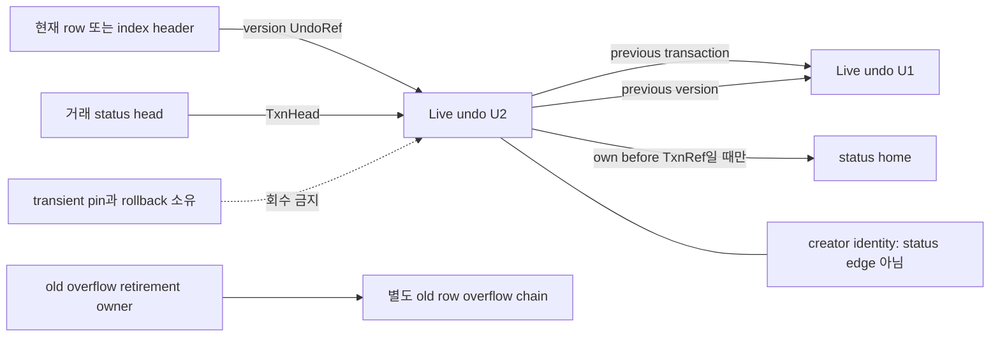
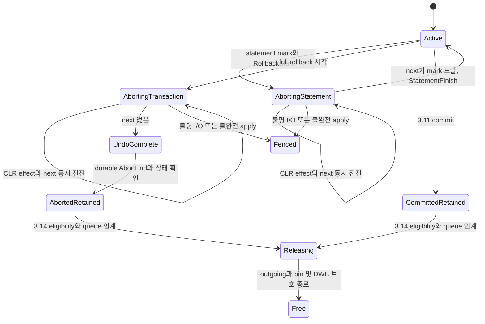
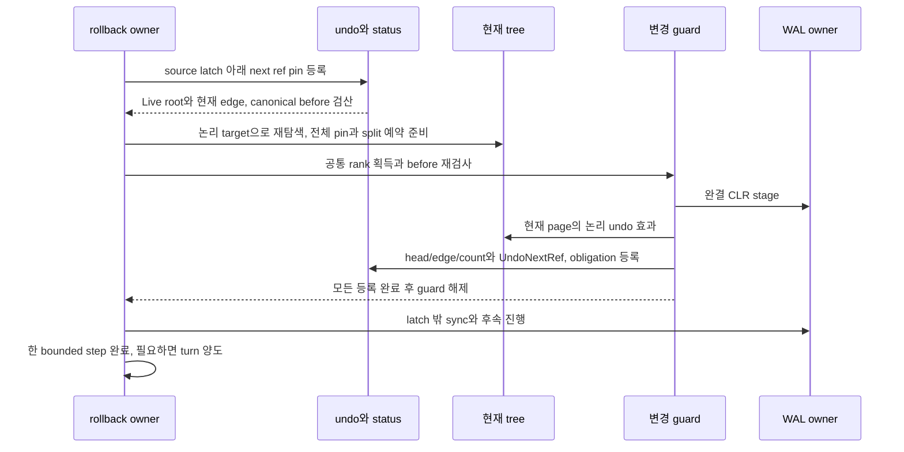

# DEV3 3.09 — undo·rollback 개발 상세 명세와 설계도

2026-10-22 · **작업 상세 설계 / D2 상세화 수용 / 표현·RollbackStart 생산의 제한 공급 / live undo·CLR·rollback 종료 미완료**

[공통 규칙](dev3-task-designs.md) · [구현 계획](../plans/dev3-implementation-plan.md#remaining-work) · [undo 정본](disk-storage-design.md#undo) · [참조 수명](disk-storage-design.md#undo-lifecycle) · [rollback 정본](disk-storage-design.md#commit) · [실제 구현](../implementation/dev3-implementation.md)

이 작업은 영속 undo/status를 변경 그룹에 연결하고, 현재 tree에서 대상을 다시 찾아 논리 undo를 redo-only CLR로 적용하며, statement mark 또는 전체 거래의 종료까지 진행한다. 형식·guard·자원표의 미동결 부분을 새 API나 정상 효과로 승인하지 않는다.

## 1. 목적·선행·책임

| 단위 | 직접 선행 | 공급할 결과·남길 경계 |
| --- | --- | --- |
| 3.09.1 live undo/status 기반 | 3.03.2 INIT, 3.04.2 append/sync, 3.05.3 retirement/진행, undo/status/obligation 표현 | undo root/chunk·status home·head/edge·잔여 예약을 영속 그룹으로 연결. 모든 대상 rollback 완료는 후속 |
| 3.09.2 logical undo·CLR 단위 적용 | 3.09.1, 해당 3.06.2/3.07/3.08 내부 변경 공급, 3.04.2 | 현재 위치의 undo 효과·UndoNextRef·obligation을 같은 CLR로 적용. 다른 거래/완결 SMO 보존·재삽입 split 예약·redo-only 진행 |
| 3.09.3 statement/full rollback 종료 | 3.09.2, 3.10.1 lock/guard | mark까지 이전 statement 보존, 전체 abort는 durable abort-end·상태 확인 뒤 잠금 해제. 반복 crash는 3.12.7/8 인수 |

3.09.1은 3.06.2의 사용자 행 변경보다 먼저 공급한다. live record와 상태 기반에 모든 미래 row/index/catalog rollback을 선행으로 요구하지 않는다. 각 대상의 forward producer를 추가할 때 그 대상의 3.09.2/3 소비를 같은 통합 단위로 닫아야 사용자 변경 API의 원자성을 완료로 판정한다. 3.06.1의 구조 변경은 system 그룹의 완결 효과이며 사용자 rollback이 이를 옛 page로 덮어쓰지 않는다.

`D3-MODULE-ADOPTION-001` **D2 PROPOSED 반영안**은 첫 Missing Row에서 A가 INSERT/CLR의 untrusted 후보를 생산하고 C가 actual source·참조·head/mark·잔여 credit을 검산해 stage/apply와 종료를 수행하도록 [소유를 분리](dev3-module-boundaries.md#row-reservation)한다. 동일 A CLR producer를 live rollback과 recovery task에서 소비하며 C는 제품 A를 import하지 않는다. 실패 statement는 원 mark까지 처리하여 이전 성공을 보존하고, full abort는 원 예약과 None head/실제 AbortEnd receipt로 종료한다. 성공 statement의 WAL0, failed statement와 full abort의 별도 debt, H net0/U edge cut·Compensated root의 terminal 이후 회수는 [Row 상태 전이](dev3-module-consumers.md#row-states)가 구체화한다. 일반 occupied before/index rollback이나 전체 undo 완료로 확대하지 않는다.

현재 [undo 표현](dev3-undo-format.md), [거래 core](dev3-transaction-format.md), [status home](dev3-status-home.md), [obligation descriptor](dev3-obligation-format.md)는 무효과 표현·관측을 제공한다. RollbackStart observer/materializer/producer는 full transaction의 Active→Aborting 한 전이에서 caller WAL/page bytes를 구성·검산한다. live dirty 적용·일반 tag2 append·CLR·abort-end·READY 권한은 없다. catalog target identity는 표현하지만 occupied catalog undo body는 `UnsupportedCatalogBody`다.

## 2. 요구 ID와 의미 불변식

| 요구 ID | 상세 요구 | 직접 인수 |
| --- | --- | --- |
| 3.09-R1 | UndoRef의 page incarnation·slot generation과 namespace-wide UndoSequence를 검산한다. record sequence·사용자 mutation sequence·WAL LSN을 혼용하지 않고 발급 wrap/재사용을 거절한다 | DS04, 3.09.1 |
| 3.09-R2 | previous-transaction은 같은 creator의 바로 앞 undo, previous-version은 같은 논리 target의 이전 version이다. 실제 loaded identity/sequence와 role별 조건을 검산한다 | DS04/06 |
| 3.09-R3 | creator의 TxnId/원래 status generation은 생성 identity다. 실제 before TxnRef만 status edge이며 creator로 status를 조회하거나 incoming을 증가시키지 않는다 | DS04 |
| 3.09-R4 | edge 중복도를 보존한다. 두 role이 같은 UndoRef를 가리키면 두 edge이며 source/head·target count·status count를 같은 그룹으로 갱신한다 | DS04, RC-T13 |
| 3.09-R5 | before는 canonical 값·논리 버전·resolved Committed(q) 또는 own TxnRef를 보존한다. Missing과 versioned RowDeleted/IndexAbsent를 구분한다 | DS01/06, KU10 |
| 3.09-R6 | root/chunk·행/인덱스 효과·head·현재 edge/count·진행점·remaining obligation·ownership delta는 opcode의 완결 WAL/CLR 경계로 연결한다 | DS02/04 |
| 3.09-R7 | CLR은 현재 tree에서 찾은 물리 page에 논리 효과를 적용한다. 원래 whole page를 복원해 다른 거래나 완결 SMO를 지우지 않는다 | DS01/06, KU10 |
| 3.09-R8 | CLR 효과와 UndoNextRef는 원자적이며 CLR 자체는 undo하지 않는다. durable 진행점만 먼저 전진시키는 경로와 ledger 이중 차감을 금지한다 | RC-T13/14 |
| 3.09-R9 | rollback은 현재 남은 previous-version과 cut 상태만 사용한다. Releasing에 새 edge를 연결하거나 cut 전 오래된 link를 부활시키지 않는다 | DS04, RC-T13 |
| 3.09-R10 | statement rollback은 mark까지 이전 statement를 보존하고 Active로 돌아간다. full abort는 모든 undo와 durable abort-end·상태 확인 뒤만 잠금 해제/ABORTED 결과를 허용한다 | DS06, KU10 |
| 3.09-R11 | statement mark는 자원 ledger의 snapshot이 아니다. WAL/CLR·SMO·retained lock·old overflow 보존·발급 sequence를 되감지 않는다 | DS03/04, F05 |
| 3.09-R12 | 시작 WAL이 회수된 Active 거래도 UndoRef chain과 선택된 상태/예약에서 rollback 가능해야 한다. 부족한 자원을 나중 checkpoint/aging으로 조달하는 순환을 금지한다 | RC-T13/14 |
| 3.09-R13 | reference를 source latch 밖으로 가져갈 때 bounded transient pin을 먼저 등록한다. horizon/rollback/queue/pin은 incoming과 별도 회수 금지 조건이다 | DS04 |
| 3.09-R14 | terminal 이후 남은 undo/status/retirement 작업은 durable owner/credit으로 인계한다. 그 형식이 미동결이면 terminal 적용은 Unsupported다 | DS02/04, F01/F05 |
| 3.09-R15 | 부분 rollback에서 이미 보상한 suffix는 Active 복귀·새 변경·checkpoint·재시작 뒤의 rollback에서 다시 undo하지 않는다. 보존용 참조와 남은 undo 시작점을 구별하며 BEGIN/CLR WAL 회수 뒤에도 이 구별이 영속 상태에서 복원되어야 한다 | 3.09.3, RC-T13/14 |

## 3. 참조·상태의 세부 설계도

다음 그림의 두 U2→U1은 서로 다른 저장 field다. 같은 대상이라는 이유로 하나로 합칠 수 없다. head·row undo field는 UndoRef40을 저장하며 target을 실제 load/pin해서 얻은 expected sequence를 적용 전제에 결합한다. 이 source들이 자기 UndoSequence를 가진다고 가정하지 않는다.

| 관계 | 실제 검산 | 보존/회수 조건 |
| --- | --- | --- |
| previous-transaction | 동일 creator TxnId+원래 status generation, target mutation sequence≤source, 실제 target UndoSequence<source | Active rollback에 필요한 chain을 cut하지 않음 |
| previous-version | target kind/owner/generation/entity/full key 일치, target creator/mutation이 before logical과 일치, 실제 sequence 감소 | snapshot/rollback에 필요한 현재 link만 사용 |
| undo before stamp | Committed(q) 또는 creator와 같은 own TxnRef; foreign unresolved TxnRef 거절 | own stamp만 status incoming edge; resolved q는 status 조회 불필요 |
| head·row/index UndoRef | 정확 ref/generation·Live state의 target 실제 sequence proof | source에 없는 sequence를 LSN/TxnId로 만들어 비교하지 않음 |
| stored incoming | row/index/head·두 previous role 등 실제 edge multiset | count0만으로 free 불가; horizon·rollback·queue·pin·DWB를 별도 검사 |
| old row overflow | before canonical 값은 별도 undo chunks에 복사, 원 overflow head는 별도 logged retirement inventory가 소유 | root에 old head가 없다는 이유로 즉시 반환하지 않음 |

count delta는 제거/추가 multiset에서 target별로 계산한다. `before >= removed` 확인 뒤 `(before - removed) + added`를 checked 산술로 검산한다. net0이어도 target의 현재 identity/Live 또는 허용 occupied status·before count proof가 필요하다. before0에서 remove1/add1을 상쇄해 통과시키지 않는다. net0 read proof 때문에 page write가 없는 가짜 NativeEffect를 만들지는 않는다. 구체 수명/API는 leaf F02에서 동결한다.

`UndoComplete`·`AbortedRetained`는 논리 구분이며 새 wire tag가 아니다. 기존 TransactionStatus의 head와 rollback next는 같은 포인터가 아니다. head는 남은 undo/aging 소유 anchor, next는 아직 undo할 cursor다. Statement에서 `next==target` 또는 둘 다 None은 mark 도달이고 Transaction에서 next=None은 undo 완료다. 후자를 곧바로 Aborted/잠금 반환으로 바꾸지 않는다.

## 4. 입력·출력·소유 경계

| 논리 연산 | 입력·신뢰 근거 | 출력·소유 의무 |
| --- | --- | --- |
| live undo 준비 | stable target/schema, 현재 before version, 자기 TxnRef·mutation identity, 기존 head/link, F05 예약 | 새 root/chunks와 적용 집합의 unpublished 준비값. raw unlinked pages도 준비 owner의 취소/복구 의무에 포함 |
| record lookup/traverse | caller namespace/PageIdentity, source의 실제 UndoRef와 등록한 transient pin, expected target | 검증된 Live view·canonical before, 다음 edge 이동은 새 pin 등록 뒤 이전 pin 해제 |
| status resolve | bounded 영속 directory와 TxnRef/StatusSlotRef·pin | home224·전체 identity의 현재 상태. creator만으로 directory를 찾지 않음 |
| RollbackStart | healthy Active owner, 실제 status/head, statement mark 또는 full target, 기존 충분한 reserve | 같은 owner/generation의 Aborting 상태와 progress, 비용 소비. 기존 bytes producer는 관측만 공급 |
| logical CLR 준비 | consumed Live root·현재 target 검색 결과·현재 cut/edge/count proof·before bytes·reserve | 현재 page들의 native before/after·redo와 next/target·after obligation을 결합한 완결 그룹 |
| CLR stage/apply | 3.04 guard와 전체 pin·예약, before 재검사 성공 | data/index/status/head/edge/count/DPT·cursor·ledger의 하나의 적용 |
| StatementFinish | 실제 mark 도달·남은 full abort reserve·정상 session | 같은 거래 Active, 이전 statement 결과와 transaction 소유 잠금 유지 |
| AbortEnd | 전체 undo 완료, terminal queue/credit 인계의 동결된 plan, WAL/상태 확인 | durable terminal 이후만 ABORTED와 lock 해제. 남은 retained 자원은 별도 owner 보존 |

이 경계의 실제 타입·error 우선순위·guard는 아직 일반 API로 구현되지 않았다. `DescriptorView`나 `RollbackStartObservation`을 reservation restored/apply/READY로 암묵 변환하지 않는다. 지원하지 않는 catalog body·terminal queue·native projection은 명시적으로 거절하며 opaque bytes 성공 경로를 만들지 않는다.

## 5. 단계별 알고리즘

### 5.1 3.09.1: live undo/status와 forward 인계

1. target을 논리 identity로 고정하고 row/key lock·snapshot/guard 계약을 만족한다. 타 거래의 committed before는 status를 안전하게 resolve하여 q를 저장하고, 자기 연속 변경은 own TxnRef와 이전 LogicalRowVersion을 보존한다. 같은 값의 UPDATE도 새 사용자 mutation identity다.
2. forward뿐 아니라 전체 abort의 undo/CLR·재삽입 split·terminal에 필요한 자원 벡터를 첫 effect 전에 예약한다. UndoSequence·TxnId·mutation sequence·slot generation의 발급/증가를 checked 검산하고 durable high-water에 결합한다. 정확 발급 프로토콜은 F01/F02 동결 항목이다.
3. before canonical bytes를 준비한다. ≤2,048-byte RowValue는 inline, 2,049..131,072는 최대9개의 undo 전용 chunk다. 모든 chunk의 identity/index/next/count/digest와 canonical schema를 검산한다. original row overflow와 undo chunks의 소유를 합치지 않는다.
4. new undo의 두 previous role·before status edge, source row/index undo link, transaction head와 target incoming의 before/after multiset을 만든다. 같은 대상의 두 role은 두 번 열거하고 count 변화와 실제 native field를 대조한다. status는 home224 전체를 사용한다.
5. 전체 pin을 준비하고 version-edit gate→tree gate→ordered page latch→WAL append→짧은 registry 순서를 따른다. 실제 identity/generation·head·cut·count·예약 token을 다시 확인한다. 추가 page/space가 필요하면 변경 없이 모두 놓고 준비로 돌아간다.
6. 완결 WAL을 stage한 뒤 root/chunk 연결·행/인덱스 효과·head/edge/count·descriptor/ATT/DPT를 함께 설치한다. 별도 선행 준비 그룹을 사용할 때는 각 중간 상태의 owner/obligation과 미공개 page 정리 의무가 복구 가능해야 한다. 1MiB frame 초과를 무검증 분할로 회피하지 않는다.
7. gate/latch 밖에서 WAL sync·flush를 수행한다. undo/status dirty page도 같은 WAL-before-page/DWB 보호를 받는다. group stage 후 일부 적용 실패는 fence이며 undo root만 있거나 행만 바뀐 상태를 정상 완료로 노출하지 않는다.

### 5.2 3.09.2: 현재 위치의 logical CLR

1. status의 rollback next로 현재 consumed root를 찾는다. source latch를 놓기 전에 transient pin을 등록하고, page I/O 뒤 namespace/ref/generation/실제 UndoSequence·Live 상태를 확인한다. cached raw pointer나 old epoch 숫자만으로 권한을 판단하지 않는다.
2. 이전 값을 canonical bytes로 재구성하고 현재 root의 previous-version과 previous-transaction을 각각 검산한다. next의 실제 sequence가 consumed root보다 낮아야 한다. 필요한 target/link가 없으면 정상 NotFound 또는 완료로 처리하지 않는다.
3. root의 RowUID·index full key·catalog identity로 **현재 tree**를 재탐색한다. locator·옛 page/slot은 힌트다. target의 현재 논리 버전·owner/generation과 이미 적용된 후속 효과를 확인하고, 다른 거래·완결 SMO가 바꾼 주변 cell/구조는 보존한다.
4. before kind에 따른 logical after를 만든다. Missing은 이전 entry 부재, RowDeleted/IndexAbsent는 이전 versioned 상태를 복원한다. row canonical 값의 저장 위치가 달라질 수 있으므로 필요한 row overflow 재삽입/분할도 미리 예약한다. 인덱스는 해당 presence의 full key·RowId·논리 버전/현재 undo link를 함께 복원한다.
5. 현재 cut 상태와 참조 소유를 반영해 source edge/head·count 전이를 계산한다. 오래된 before payload의 숨은 포인터를 복사하지 않는다. Releasing target에는 새 edge를 만들지 않고 net0 target도 실제 proof를 검산한다. old overflow의 별도 retirement owner를 잃지 않는다.
6. native current before/after·redo, consumed UndoRef/sequence, UndoNextRef/target, descriptor chain/hash·remaining budget/inventory를 한 CLR에 결합한다. 새 물리 page 집합이나 slot 위치가 달라졌으면 준비를 반복하며 latch 안 I/O를 하지 않는다.
7. 완결 CLR stage 후 효과와 cursor를 함께 적용한다. cursor만 먼저 전진하거나 CLR에 다시 undo를 붙이지 않는다. recovery ANALYSIS는 after descriptor를 한 번 채택하고 page REDO는 pageLSN 기준으로 별도 멱등 적용한다. 이미 채택한 같은 owner LSN의 ledger 재적용은 duplicate 오류이며 잔여 예약을 두 번 감소시키지 않는다.

### 5.3 3.09.3: statement와 전체 rollback 종료

statement 진입에서 현재 undo chain의 mark와 statement identity를 고정한다. 실패 시 mark 이후의 해당 거래 효과를 역순으로 CLR 적용하고 `next==target`까지 진행한다. StatementFinish는 Active 복귀와 남은 full transaction abort 의무를 결합한다. 이전 statement의 성공 효과·transaction lock·reserve를 보존하고 mutation sequence/TxnId/UndoSequence를 재사용하지 않는다.

**mark 도달 뒤 `next`만 지우고 보상 전 head를 그대로 새 rollback 시작점으로 사용하는 것은 금지한다.** Active 표현에는 rollback next가 없고 현행 full RollbackStart는 head를 시작점으로 소비하므로, CLR/StatementFinish는 다음 full abort가 이전 성공 statement의 남은 undo에서 이어지도록 영속 head/link와 edge/count·retirement 소유를 함께 인계해야 한다. 보상된 undo를 snapshot/참조/회수를 위해 보존하는 일은 그것을 다시 실행할 undo로 남기는 일과 다르다. 구체 head 전이·보존 anchor/queue·credit 형식은 F01/F02에서 동결하며, 아직 없는 skip 표나 WAL prevLSN 탐색을 암묵적으로 도입하지 않는다. 뒤의 새 forward undo도 보상된 suffix를 다시 자기 previous-transaction 경로에 연결해서는 안 된다.

재시작의 Aborting(Statement)는 정상 세션의 statement만 실패한 결과가 아니라 미완료 loser 거래다. 이미 보상한 suffix를 건너뛴 채 남은 전체 transaction undo와 AbortEnd까지 완료해야 한다. mark 도달을 이유로 Active를 READY에 남기지 않으며, statement→full 전환·head/next·잔여 예약의 원자 결합은 3.12가 소비할 F02 의무다.

전체 rollback은 target=None으로 남은 chain 전체를 처리한다. next=None은 undo 완료 위치다. 이후 남은 status/undo/old overflow/aging 작업의 durable owner와 credit을 terminal 그룹에 인계하고 abort-end를 영속화하며 상태를 확인한다. **그 뒤에만** 거래 잠금을 반환하고 ABORTED를 확정한다. terminal queue 형식·단일 owner descriptor에서의 안전한 인계가 동결되지 않은 현재 상태에서 정상 AbortEnd를 구현했다고 표시하지 않는다.

timeout/cancel·deadlock victim도 같은 실제 rollback을 완료해야 한다. rollback I/O 실패 또는 stage 이후 불완전 적용은 Fenced/RecoveryRequired이며 공유 변경이 모두 사라졌다고 답하지 않는다. commit record 첫 byte 시도 이후의 결과 불명은 3.11의 UNKNOWN이며 정상 precommit abort로 바꾸지 않는다. Drop은 숨은 undo/sync/terminal 성공을 실행하지 않고 소유 인계 또는 fence 의무를 따른다. statement 도중 full abort로 전환하는 정확 상태/소유 절차와 취소 재진입은 F02로 별도 동결한다.

## 6. 오류·복구·회수 인계

| 실패/경계 | 처리·보존 | 인수 연결 |
| --- | --- | --- |
| unsupported catalog body·native projection·queue opcode | 첫 효과 전 명시 거절. Missing/retire만 예외 성공시키지 않음 | 3.08·F01/F02 |
| 준비 중 schema/identity/예약 부족 | 새 effect 없음, 기존 owner와 abort reserve 보존. scratch는 실패 계약대로 폐기 | 3.09.1/2 |
| stale head·cut·generation·try-latch 실패 | 적용 구간 해제 후 재준비; partial pin을 보유한 대기 금지 | 3.10.1 |
| 필요한 undo 손상/누락·순환·sequence 위조·Releasing 참조 | 정상 NotFound/mark 도달/ABORTED 금지, invariant/corruption과 fence | DS04, RC-T13 |
| complete stage 뒤 apply/registry 실패·poison | WAL/dirty/예약 소유 보존, fence. caller scratch rollback으로 authority 복구 주장 금지 | 3.04/3.05 |
| CLR write/sync 불명 | 원래 I/O cause/certainty 보존, recovery가 complete prefix 판정. 동일 불명 CLR 무조건 재전송 금지 | 3.12.7/8 |
| CLR effect 뒤 crash | redo가 효과와 progress를 같이 복원하고 next부터 계속. 이미 소비한 bytes를 새 잔여 예약으로 되살리지 않음 | RC-T13/14 |
| next=None 뒤 AbortEnd 이전 crash | loser 종료는 아직 미완료. locks/terminal/queue 확인 없이 성공 판정 금지 | 3.12.7 |
| terminal 뒤 head/incoming 남음 | queue/credit과 참조를 보존하며 3.14가 eligibility·release 수행 | DS04 |
| begin WAL이 회수됨 | 선택된 checkpoint/obligation·undo/status에서 복원. 삭제한 prevLSN을 undo 필수 입력으로 요구하지 않음 | RC-T13/14 |

회수자는 Live→Releasing 전 incoming0 외에 horizon·Active rollback·queue owner·마지막 transient pin·prepared/in-flight flush claim·DWB pending을 확인한다. Releasing의 previous-version→previous-transaction→before status role별 cursor와 count 변경을 같은 logged 그룹으로 처리한다. chunk 반환은 next를 먼저 검산하고 allocator 반환·release-next·released count를 함께 인계하며 반환한 page를 다시 읽어 다음 주소를 찾지 않는다. 이 실행은 3.14와 3.03.4의 소유지만, 3.09는 그 수명과 충돌하지 않는 edge를 공급해야 한다.

## 7. F05 자원과 ledger

[실제 표현 크기](dev3-resource-bounds.md)와 [예약 회계](disk-storage-design.md#reserve-accounting)를 opcode별 bound에 대입한다. 아래는 이미 동결된 입력과 추가할 항이며 F05 완료값을 새로 선언하지 않는다.

| 항목 | 기존 입력 | 추가 산정·보존 의무 |
| --- | --- | --- |
| undo root | header432, slot 최소436, 최대37 slots/page; Row inline≤2,480, Index≤1,464 | root page 공유는 실제 identity 확인 뒤만 차감. row inline와 index key의 배타적 최대를 잘못 합산하지 않음 |
| 최대 row before |128KiB, chunk payload16,060, 최대9 chunk pages | root1+chunk9를 별도 page로 두면10page=163,840 bytes. root/chunk cell+slot132,984와 물리 page/extent charge 구분 |
| status home | core192+prefix32=224, 최대71 slots | directory·count·TxnRef proof·transient pin·head/progress·terminal queue 비용 별도. old82 limit를 persistent 발급에 사용 금지 |
| WAL/CLR | frame≤1MiB, header/trailer192, PageRedo header64; full INIT≤63개 | current path·최대8 index·높이16·undo/overflow·count/status/allocator·재삽입 split·terminal 모든 그룹의 실제 bytes 포함 |
| 준비 메모리 | 거래 private8MiB/전체64MiB, progress workspace12MiB 한 작업, flush4MiB 별도 | canonical before·최대 CLR·재탐색·전체 pin·중첩 locals 동시 peak. flush 몫 차용 금지 |
| disk/WAL | owned8GiB 안 protected1GiB, retained+outstanding WAL≤256MiB | already charged extent와 token 중복 금지. 소비한 CLR은 회수 전까지 retained, 남은 reserve와 중복 세지 않음 |
| 동시 실행 | 최대32거래, buffer4/16/64MiB, FD128 | 각 profile 실제 동시 admission과 rollback 최소 frame/FD/pin/registry 보장. max 거래 수가 모든 최대 작업 동시 수용을 뜻하지 않음 |

하나의 최대 before10page INIT만으로 WAL은 `192 + 10×(64+16384) = 164672` bytes지만 이 값은 해당 사용자 mutation 전체 비용이 아니다. row/index target 복원·head/count·old overflow retirement·status·obligation·allocator·SMO를 추가해야 한다. 필요 page가63 full INIT을 넘으면 각각 복구 가능한 group 분해와 obligation 인계를 먼저 설계한다.

statement mark 복귀 뒤에도 이미 쓴 WAL/CLR, 완료 SMO, 아직 회수되지 않은 undo/overflow, transaction lock은 남는다. 성공 statement 뒤도 전체 abort reserve를 유지하고, 실패 statement의 실제 소비와 Active 복귀 이후 잔여 의무를 다시 계산한다. 한 statement의 반복 실패가 ledger를 초기화해 quota를 우회하지 못해야 한다. reserve 반환은 실제 소유 종료/해제의 증거가 있을 때만 하며 logical value 복원만으로 file bytes를 free로 세지 않는다.

예약된 rollback은 자기 완료에 필요한 checkpoint/aging 선행 회수에 의존하지 않는다. 유한 try 실패 뒤 FIFO progress turn으로 전환하며 대기할 때 공유12MiB·partial pin을 반환한다. head 준비 단계에서 전용 flusher가 dirty frame을 비울 수 있어야 하고, 한 bounded CLR 뒤 turn을 넘긴다. 종료하는 I/O·공정한 actor 실행·유한 남은 obligation 아래의 진행과 모든 유한 crash prefix의 고정 자원 peak를 구별해 증명한다.

## 8. 구현 하위 작업과 실제 source

| 단위 내 작업 | 구현 산출물 | 완료 경계 |
| --- | --- | --- |
| 3.09.1-A live identity/status | durable undo sequence·status directory/slot·pin 수명 | exact identity와 generation, writer epoch 변경 뒤 old owner resolve |
| 3.09.1-B root/chunk 준비 | canonical before 생성·chunk 검산·old overflow retirement 인계 | 공개 전 취소/복구 소유, actual opcode F05 |
| 3.09.1-C group 결합 | source/head·두 edge·home count·descriptor/inventory | 실제 stage/apply·dirty 등록에 누락 없는 native binding |
| 3.09.2-A logical row undo | 현재 RowUID 탐색·값/삭제/부재·overflow 복원 | 다른 거래/SMO 보존, split 재삽입 예약 |
| 3.09.2-B index/catalog 소비 | presence full key/RowId와 catalog native before | 새 target producer와 rollback 함께 인수. catalog body 동결 전 Unsupported 유지 |
| 3.09.2-C CLR 실행 | effect+next+target+remaining과 현재 cut 반영 | redo-only, duplicate owner ledger 거절, 실제 재장애 연결 |
| 3.09.3-A statement 종료 | mark·StatementFinish·Active 복귀 | 앞선 statement와 reserve/lock 보존 |
| 3.09.3-B full 종료 | terminal queue/credit·AbortEnd·상태 확인·lock 반환 | durable terminal 전 반환0, 불명 결과 보존 |

| 실제 source 진입점 | 현재 공급과 확장 경계 |
| --- | --- |
| [undo_record.rs](../../crates/engine/src/storage/undo_record.rs) | root/target/chunk codec, `lookup_undo_record`, `validate_loaded_edge`, `UndoChunkVerifier`, checked count/generation. live I/O·pin·cut 없음 |
| [undo_ref.rs](../../crates/engine/src/storage/undo_ref.rs) | UndoRef·UndoSequence와 안정 참조 표현. 발급/실제 수명 증거와 구분 |
| [transaction_record.rs](../../crates/engine/src/storage/transaction_record.rs) | TxnRef·StatusSlotRef·LogicalRowVersion·VersionStamp·RollbackState/core 표현. persistence는 home224 사용 |
| [status_home.rs](../../crates/engine/src/storage/status_home.rs) | `StatusHome`, `adjust_incoming`, `decode_status_home_page`·lookup. count의 실제 graph/queue 정합성은 후속 |
| [obligation.rs](../../crates/engine/src/storage/obligation.rs) | `DescriptorSpec`, `RemainingBudget`, owner chain·descriptor codec. reserved bytes의 충분성을 단독 인증하지 않음 |
| [semantic_group.rs](../../crates/engine/src/storage/semantic_group.rs) | `observe_rollback_start`, `materialize_rollback_start`, `produce_rollback_start`; full transaction 한 전이의 caller bytes. CLR/StatementFinish/AbortEnd 미지원 |
| [wal_io.rs](../../crates/engine/src/storage/wal_io.rs), [read_buffer.rs](../../crates/engine/src/storage/read_buffer.rs) | 3.04/3.05의 실제 저장 owner와 연결할 진입점. 기존 genesis/clean 공급을 live rollback으로 해석하지 않음 |
| [undo_record_tests.rs](../../crates/engine/src/storage/undo_record_tests.rs), [semantic_group_tests.rs](../../crates/engine/src/storage/semantic_group_tests.rs) | 기존 표현/producer의 독립 vector. 새로운 effect·thread/reopen case는 해당 변경 경로에 추가 |

## 9. 독립 인수 case

다음 case의 실행 상태는 **NOT_RUN**이다. reference graph는 edge의 set이 아닌 role을 가진 multiset, status graph와 before values, transaction chain과 statement mark를 별도로 계산한다. production undo/CLR codec·replay의 결과를 oracle로 재사용하지 않는다. model·메모리 port·실제 thread·Linux I/O/reopen 증거를 구분한다.

| case ID | 독립 입력·반례 | 기대 결과 | 연결 |
| --- | --- | --- | --- |
| 3.09-C01 | 같은/다른 target의 transaction chain, 다른 creator의 version chain, 같은 target을 가리키는 두 role | role별 조건·실제 sequence 감소 검산, duplicate edge count2, cycle/위조 expected 거절 | 3.09.1, DS04 |
| 3.09-C02 | own before와 resolved other-commit, creator의 옛 status 재사용, foreign unresolved stamp | creator 조회/count0, own stamp만 실제 status edge, 다른 committed q 보존 | DS04/06 |
| 3.09-C03 | Missing/RowDeleted/IndexAbsent/Present, 같은 bytes 재UPDATE, inline2048/2049·128KiB before | 부재와 tombstone 구분, 이전 logical identity 복원, chunk 전체 count/hash/schema 일치 | DS01/06 |
| 3.09-C04 | net0 remove/add·before count0, duplicate roles, count under/overflow, status home old core192 입력 | net0 proof와 제거 존재 확인, checked count, home224 결합 없이 적용 거절 | DS04 |
| 3.09-C05 | forward root만 적용·head/count/descriptor 누락 mutant, stage 뒤 unwind | 완결 그룹만 허용, 부분 apply fence, 미공개 준비물 owner 보존 | DS02 |
| 3.09-C06 | source latch 해제 사이 target reuse, directory stale·다른 generation·Releasing | transient pin으로 ABA 차단 또는 재검사 실패, 정상 NotFound/성공 rollback 금지 | DS04, thread |
| 3.09-C07 | row 이동/split·다른 거래의 다른 row 변경 뒤 abort | 현재 위치만 undo, 다른 row와 완료 SMO 보존, whole-page restore mutant 검출 | DS01/06 |
| 3.09-C08 | row 재삽입 split, 최대 index old/new presence, rollback 중 새 page 필요 | 예약 안의 논리 CLR·구조 그룹 완료, latch 안 추가 탐색/I/O·부분 pin 대기 없음 | F05, KU10 |
| 3.09-C09 | A commit→B update→A aging cut→B abort→slot 재사용 | 현재 link 사용·cut 부활0, 값/snapshot 결과와 edge/count full-check 모두 일치 | DS04, RC-T13 |
| 3.09-C10 | old row overflow 교체 뒤 root에는 canonical copy만 존재, 긴 snapshot·rollback | old chain 별도 owner 보존, eligibility 전 반환0·소유 누락0 | DS03/04 |
| 3.09-C11 | 한 statement 여러 row/index 변경 후 실패, 앞선 statement 성공, 반복 실패 | mark 이후만 undo, Active 복귀·앞선 효과/잠금 보존, ledger/sequence 되감기0 | DS06, KU10 |
| 3.09-C12 | timeout/cancel/deadlock full abort, last CLR 뒤 AbortEnd 전 오류·terminal queue 미지원 | durable AbortEnd/상태 전 lock 반환0, Unsupported 또는 Fenced/RecoveryRequired, 거짓 ABORTED0 | DS02/04 |
| 3.09-C13 | CLR 각 write/sync·effect/progress cut와 재장애, 같은 owner group 중복 | effect와 next 함께 redo, 남은 chain만 undo, CLR undo0·ledger 중복 소비0 | RC-T13/14 |
| 3.09-C14 | Active begin WAL 실제 제거 후 abort/restart, 작은 신규 admission 설정 | 선택 profile/남은 obligation 전체 복원, 잘린 자원/owner 복구 거절, 삭제 WAL 재요구0 | RC-T13/14 |
| 3.09-C15 | 각 buffer/quota 경계−1/동일/+1·경쟁 reader·foreground 반복 실패 | 첫 effect 전 거절, 기존 rollback/flush 진행·고정 peak, checkpoint/aging 선행 대기 없음 | DS03/04·F05 |
| 3.09-C16 | catalog target 유효+occupied body/Missing/retire, 미동결 terminal 인계 | 지원 범위 밖 효과 명시 거절, opaque 성공0. 대상 동결 후 producer/CLR/종료를 함께 새 인수 | 3.08/3.09 |
| 3.09-C17 | S1 성공→S2 여러 변경 후 mark rollback→S3 같은 target 재변경→전체 abort; StatementFinish 전후 crash와 BEGIN/옛 CLR WAL 회수 변형 | S2의 보상 record 재undo0, S1/S3의 남은 undo만 한 번 수행, 보존 graph/credit 유실0. Aborting(Statement) loser는 mark에 멈추지 않고 durable AbortEnd까지 완료 | DS04/06, RC-T13/14 |

fault 기대값에는 각 group의 before/after page·role별 edge·stored count·status core/head/next·descriptor·remaining/retained·slot generation을 포함한다. 논리 값이 맞더라도 count/소유 유실을 PASS로 보지 않고, count가 맞더라도 필요한 snapshot/rollback 버전 유실을 PASS로 보지 않는다. 지속 crash의 완료를 보장하지 않으며 모든 유한 crash prefix의 안전성과 마지막 장애 뒤 충분한 정상 실행에서 종료를 별도 검증한다.

테스트는 마지막 관련 검증 이후 수정한 source와 새 target 연결 경로로 선택한다. 표현/producer의 무변경 완료 시험·전체 workspace/leaf·하위 wrapper를 반복하지 않는다. 과거 제한 PASS·실패·중단 결과는 원래 source/범위로 보존하고 소비자 미실행을 성공으로 합산하지 않는다.

## 10. 추가 동결과 완료 조건

| 동결 항목 | 구체 미완료 입력 | 착수 경계 |
| --- | --- | --- |
| F01 identity/status | durable UndoSequence/TxnId high-water, bounded status directory의 bytes·설치/제거·generation/INIT 결합 | 실제 발급·live lookup 전 |
| F01/F02 native 의미 | 대상별 canonical logical projection, Forward/CLR·StatementFinish의 page/edge/count/descriptor 결합·오류, 부분 rollback 뒤 effective undo head와 retained suffix 소유의 영속 분리 | 해당 producer/CLR 첫 effect 전 |
| F02 수명·재검사 | transient pin capacity/guard·target proof·net0 home proof, rollback next/mark·cut 경합·retry와 FIFO K | live edge/rollback 적용 전 |
| F01 terminal/retirement | old overflow inventory, durable queue body·owner/credit 인계, Commit/AbortEnd 뒤 ATT 제거·예약 반환 순서 | 관련 forward/terminal 효과 전 |
| F02 종료·실패 | statement→full abort 전환·재진입/취소·Drop 인계, abort-end/상태/lock 반환의 정확 경계와 typed error | 3.09.3 적용 전 |
| F05 opcode | forward/최악 CLR·split·재삽입·status/count·terminal 전체 자원표, 각 profile 동시 admission·재장애 고정 peak | 해당 첫 effect 전 |
| F03/F04 | 독립 before/after graph와 bytes·고정 effect cut/분모·oracle mutant·thread schedule·reopen 판정 | 변경 경로 시험 구현 전 |
| catalog 확장 | occupied catalog before body·schema/target·logical CLR와 DDL 원자 종료 | 3.08/3.09 대상 통합 전 |

3.09.1 완료는 표현을 live 저장에 연결한 제한 공급이다. 3.09.2는 실제 구현된 target별로, 3.09.3은 그 target을 포함한 statement/full 종료별로 판정한다. 일반 recovery/REBASE/loser undo·전체 DEV3/S1 완료는 3.12·3.16의 별도 의무를 유지한다. 문서군의 D2 상태·독립 검토 기록은 [공통 결정](dev3-task-designs.md#decision)이 소유한다.

## 비교 분석 후속 — 값·참조 다중도·잔여 의무의 통합 증명

표현 codec과 N=0 terminal 완료 뒤 실제 행 소비자는 `row 값/가시성 → Undo 연결 → statement rollback/CLR → commit 또는 full abort → 재장애 → cut/release → 실제 재사용`을 하나의 독립 이력으로 연결한다. previous-transaction과 previous-version이 같은 UndoRef를 가리켜도 **별개 edge 두 개**다. oracle는 집합이 아닌 edge multiset으로 incoming을 계산하고 before TxnRef/status edge와 transient pin을 구별한다. count0만으로 horizon·rollback·pin·DWB claim을 생략해 free하지 않는다.

원래 값 oracle, graph 다중도 oracle, [자원 전이 회계](dev3-resource-bounds.md#resource-vector-proof)를 독립적으로 대조한다. 새 CLR·기존 row/Undo overflow·retained WAL의 실제 charge는 논리 statement 복원 뒤에도 남을 수 있다. 같은 prefix의 restart는 remaining을 한 번만 복원하고 release cursor가 완료한 edge/chunk를 다시 반환하지 않는다. begin-WAL 제거 뒤 Active chain·부분 CLR의 두 번째 crash는 별도 후속 통합 의무이며 N=0 완료를 일반 Undo 복구로 승격하지 않는다.
