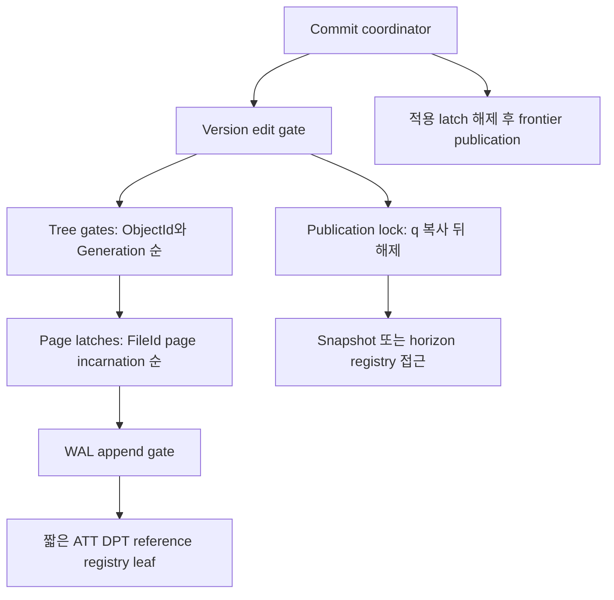
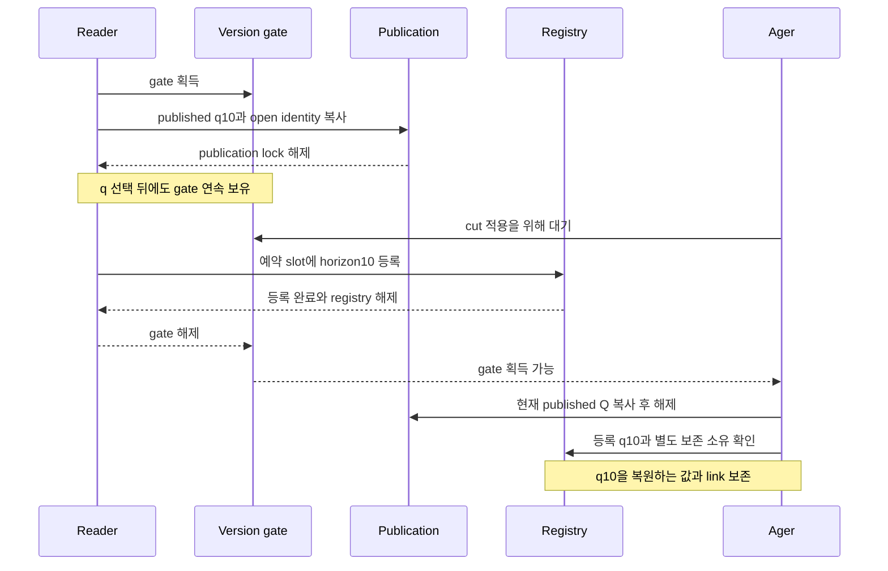
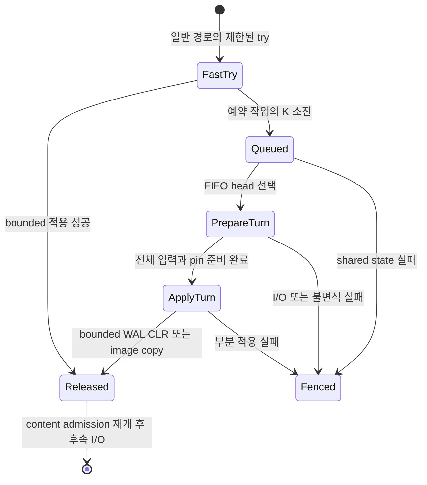

# DEV3 3.10 — 동시성·가시성 개발 상세 명세와 설계도

2026-10-22 · **작업 상세 설계 / D2 상세화 수용 / 기존 유한 모델 증거 보존 / 실제 DEV3 거래·thread 통합 미완료**

[공통 규칙](dev3-task-designs.md) · [개발 분해](../plans/dev3-implementation-plan.md#work-organization) · [동시성 정본](disk-storage-design.md#concurrency) · [변경 순서](disk-storage-design.md#mutation-protocol) · [snapshot 획득](disk-storage-design.md#snapshot-acquisition) · [관측 행 버전](disk-storage-design.md#observed-row-version) · [참조 수명](disk-storage-design.md#undo-lifecycle)

## 1. 목적·공급·현재 상태

mutable page 위에서 snapshot과 참조 수명을 보존하고, 충돌을 명시적으로 종료하며, 예약된 rollback·flush가 진행할 수 있는 동기화 경계를 만든다. 3.10.1은 guard/rank·snapshot/publication/registry·transient pin·FIFO progress turn의 primitive 공급이다. 3.10.2는 3.06/3.09의 해당 경로와 3.11.1의 commit 공개를 소비하여 두 격리 수준·관측 행 충돌·deadlock/취소를 실제 거래에 연결한다.

primitive의 수명·순서·thread 검증은 dirty buffer·undo·commit 전체 완료를 기다리지 않는다. 반대로 guard 단독 검증은 reader/writer/ager·실제 rollback·durable 공개 통합 인수가 아니다. [snapshot 부분 모델](dev3-snapshot-model.md)과 [전체 모델 계획](../plans/dev3-implementation-plan.md#state-model)의 원래 결과는 해당 source와 유한 범위의 증거로 보존한다.

아래 상태명은 설계 표기다. 채택된 잠금 순서와 가시성 의미는 유지하며 정확한 Rust guard/API·rank 표현·K·slot 수·오류 우선순위는 [착수 전 동결](#freeze)에 남긴다. 기존 DEV2 publication/retention 경로를 이름만으로 DEV3 공급이라고 간주하지 않는다.

## 2. 요구 ID

| 요구 ID | 개발 명세 | 인수·소비 |
| --- | --- | --- |
| 3.10-R1 | 적용 관계는 version-edit gate 아래 직렬화. tree/page/append/registry의 순서와 try 실패 cleanup을 하나의 guard 계약으로 제공 | 3.04/05/06/09, DS04/06 |
| 3.10-R2 | snapshot q 선택부터 horizon 등록까지 gate 연속 보유. 미등록 q를 사용 가능한 view로 반환하지 않음 | DS04·M02 |
| 3.10-R3 | horizon은 `H=min(published Q, 등록 q들)`이며 빈 registry면 H=Q. status11/frontier10에서도 q10 재구성 가능 | DS04·M02 |
| 3.10-R4 | snapshot guard 인계 중 기존 소유를 유지. transient UndoRef/TxnRef pin은 source latch 해제 전 등록하고 다음 pin부터 이전 pin으로 안전하게 인계 | DS04·M02, 3.09/14 |
| 3.10-R5 | ReadCommitted는 statement snapshot, 기본 Serializable은 transaction snapshot과 table/catalog 검증. 두 수준 모두 own writes와 stable cursor 수명을 유지 | DS06·KU10 |
| 3.10-R6 | UPDATE/DELETE의 첫 변경 전 모든 X lock 획득 경로에서 opaque observation 비교. mismatch/삭제는 전체 거래 SerializationConflict | DS06·KU10 |
| 3.10-R7 | row/key transaction lock과 content latch를 구분. wait-for cycle의 최대 TxnId victim을 전체 undo한 뒤 lock 해제 | DS06·KU10 |
| 3.10-R8 | 예약 rollback/유지보수는 K 뒤 FIFO turn으로 진행. 준비 중 기존 reader·전용 flusher를 허용하고 적용 단계에서만 content drain | DS03/06·M03/M06 |
| 3.10-R9 | lock/registry/waiter/ticket·frame·workspace의 자원 예산을 effect 전 확보. 부분 pin·상위 lock·maintenance workspace를 보유한 turn 대기 금지 | F05·DS03 |
| 3.10-R10 | fence/poison·불명 I/O·rollback 실패를 정상 취소/ABORT로 낮추지 않음. snapshot 강제 만료나 rollback reserve 대여로 압력 해소 금지 | DS03/04/06 |

## 3. 입력·출력·소유와 잠금 지도

| 논리 capability | 입력·반환 | 수명·실패·소유 |
| --- | --- | --- |
| 적용 guard | 사전 예약한 작업·전체 page 집합 → 정해진 순서의 gate/latch | 적용 중 I/O/allocation/quota/transaction 대기·callback 없음. 추가 page 필요 시 전체 해제 후 준비로 복귀 |
| snapshot guard | 열린 DB identity·예약 registry slot → 등록된 q의 view | 마지막 소유까지 horizon 등록 유지. q 값 복사만으로 guard가 되지 않음 |
| reference pin | source latch 아래 복사한 exact UndoRef/TxnRef와 사전 예약 pin slot → generation 재사용 방지 소유 | target load는 latch 밖. 영속 incoming count나 snapshot guard를 대신하지 않음 |
| row/key lock owner | transaction·stable RowUID 또는 index generation+encoded key → 배타 lock | 거래 종료까지 유지. statement rollback으로 이전 lock ledger를 복원하지 않음 |
| row observation | 실제 statement read 결과 → opaque identity | DB/timeline/open·table generation/RowId·statement token·LogicalRowVersion에 결합. caller 조립 불가 |
| progress ticket | 예약 rollback/유지보수 작업 → FIFO 준비/적용 권한 | ticket은 I/O 중 보유하는 mutex가 아님. 선택된 owner만 공유12MiB workspace 획득 |
| wait-for owner | bounded transaction graph·대기 요청 → 대기/획득/victim 결정 | graph leaf lock 안에서 undo·I/O·상위 잠금 획득 금지. victim 논리 작업과 예약을 3.09로 인계 |

그림은 모든 경로가 모든 lock을 잡는다는 뜻이 아니다. snapshot은 coordinator/tree/page/append를 요청하지 않는다. `version gate → publication 해제 → registry`에서 publication과 registry를 동시에 보유하지 않는다. commit은 status 적용 뒤 tree/page/append/registry와 version gate를 놓고 coordinator 아래 publication을 수행한다. publication lock을 가진 채 version gate를 요청하지 않는다. buffer map/예약 잠금은 적용 구간과 함께 잡지 않는다. reference pin 등록은 source content latch에서 아래 registry로 향하며 그 안에서 다시 상위 gate를 요청하지 않는다.

## 4. snapshot·horizon·참조 pin 알고리즘

### 4.1 최초 snapshot 획득

1. snapshot/registry slot과 guard 메모리를 예약한다. 새 snapshot은 turn의 신규 적용 admission에 참여한다. admission/gate 대기는 coordinator/publication/tree/page/append/registry 잠금과 page pin을 보유하지 않고 수행한다.
2. version-edit gate를 획득한 뒤 publication lock에서 DB/timeline/open identity와 published q를 복사한다. 이 q 읽기가 획득의 선형화 시점이다. publication lock만 해제하고 gate는 계속 보유한다.
3. registry leaf lock에서 예약 slot에 그 q의 horizon 소유를 등록한다. 등록까지 allocation·I/O·callback·다른 admission 대기를 하지 않는다. registry lock과 gate를 해제한 뒤 usable guard를 반환한다.
4. 실패/취소는 사용 가능한 미등록 q나 guard를 반환하지 않고 미소비 예약을 정리한다. 손상/poison은 정상 용량 부족과 구분하며 보수적인 기존 보존 소유를 임의 제거하지 않는다.

이 규약은 Serializable begin, ReadCommitted begin_statement, 짧은 catalog snapshot에 공통이다. 같은 primitive의 모델을 이름만 바꿔 여러 새 결과로 집계하지 않고 실제 각 호출 경로가 이를 사용하는지를 통합 시험에서 확인한다.

### 4.2 horizon 판정·guard 인계

1. aging은 version gate를 얻고 tree/page/append/registry 이전에 publication lock에서 Q를 읽고 해제한다. registry에서 등록 q들과 rollback/객체/backup 소유를 확인한다.
2. reader가 없어도 H=Q다. status가 Committed11이고 frontier가10이면 새로운 reader는10을 얻으므로 A@10 복원에 필요한 undo/객체를 보존한다. 미공개 status q11이나 무한대를 대신 쓰지 않는다.
3. H는 snapshot 요구의 경계이며 `record.q≤H`만으로 cut 가능하지 않다. 필요한 모든 snapshot 재구성과 별도 incoming edge/rollback/transient pin 조건을 함께 확인한다. gate 밖 후보는 실제 cut/reuse마다 다시 검사한다.
4. Serializable statement/cursor는 transaction guard를 끊지 않고 공유한다. 새 slot으로 인계하면 기존 등록을 유지한 채 gate 아래 새 등록을 만들고 그 뒤 old 등록을 해제한다.
5. 마지막 guard 해제는 registry leaf lock만으로 보존 요구를 줄인다. 이미 놓은 old q를 재등록하지 않는다. ReadCommitted의 다음 statement는 최신 published q를 새로 획득한다. Fenced 상태에서는 새 snapshot admission과 회수를 진행하지 않는다.

### 4.3 source latch에서 대상 pin으로 인계

1. read 진입에서 이동용 pin slots를 예약한다. source header/undo record의 content latch 아래 exact UndoRef/TxnRef를 복사한다.
2. latch를 놓기 전에 I/O 없는 bounded registry에 대상의 pin을 등록한다. source latch를 해제하고 target page를 load한 뒤 exact owner/generation을 검산한다.
3. 다음 edge를 따라갈 때 새 pin을 먼저 등록하고 이전 pin을 해제한다. 이력 길이만큼 pin을 누적하지 않는다. 동시에 필요한 이동용 pin 수는 실제 state/API의 F05로 동결한다.
4. referrer의 영속 edge를 cut하는 것과 이미 읽은 target을 재사용하는 것은 별도다. cut 후에도 transient pin이 남으면 대상 재사용을 막아야 한다. snapshot이 없어졌다고 살아 있는 transient pin을 제거하지 않는다.
5. crash 뒤 transient pin은 사라지지만 durable edge/count/rollback/queue 소유는 3.12에서 복원한다. runtime pin 상태를 disk incoming count로 합치지 않는다.

## 5. 격리·관측 버전·거래 잠금

### 5.1 두 격리 수준

| 구분 | snapshot·읽기 | commit/충돌 검증 |
| --- | --- | --- |
| ReadCommitted | statement 진입마다 published q를 등록. 같은 statement의 scan/mutation은 같은 token, own writes는 자기 변경으로 해석 | row X lock 후 observation 비교와 latest committed+이전 성공 statement를 포함한 transaction 전체 own 최종 상태의 UNIQUE. 서로 다른 행·비충돌 key writer는 함께 성공 가능 |
| Serializable | 기본 모드. transaction 시작 q를 유지하고 statement/cursor가 같은 소유를 공유 | read/write table·absence/range의 generation과 catalog namespace/generation을 등록. coordinator 아래 해당 마지막 committed 변경 q≤start_q 검사 |

가시성 resolver는 Committed(q)와 TxnRef/status를 구분하고 다른 거래의 미완료/나중 commit 효과를 undo로 제거한다. status가 먼저 committed여도 commit_q>snapshot_q이면 새 값을 읽지 않는다. row/index/catalog는 같은 transaction 상태와 frontier 공개 계약을 사용한다. own writes와 undo before-image의 상세 판정은 3.06/3.09와 연결하며 새 별도 visibility 알고리즘을 복제하지 않는다.

Serializable은 own writes를 validation의 외부 변경에서 제외한다. 성공 commit은 변경 table q를 전진시킨다. 독립 table writer는 모두 성공할 수 있지만 같은 table의 다른 행은 보수적 false conflict가 가능하다. DB 전체 q 동일성으로 검증 범위를 확대하거나 table validation을 old snapshot 조회만으로 대체하지 않는다. read-only 경로를 포함한 실제 API별 validation 수신은 F02/F06에서 owner 의미에 맞춰 확인한다.

### 5.2 관측 행 버전 비교

1. 실제 statement read에서 engine이 observation을 발급한다. 동일 bytes의 비교값이나 caller가 조립한 RecordVersion을 받는 API로 대체하지 않는다. native 단건 변경도 같은 statement view에서 기대 버전을 얻는다.
2. stable RowUID X lock을 얻은 뒤 해당 row의 첫 변경 전에 현재 terminal/own 논리 버전과 비교한다. 대기한 lock, 즉시 얻은 lock, 이미 가진 lock 모두 같은 검사를 수행한다.
3. 불일치나 삭제이면 전체 거래 SerializationConflict 경로로 전이한다. predicate 재평가·자동 mutation 재전송·최신 버전으로 기대값 덮어쓰기를 하지 않는다. 3.09의 전체 undo 완료 전에는 성공 abort를 응답하지 않는다.
4. 비교를 통과한 lock은 변경과 거래 종료까지 유지한다. before/after의 물리 위치·undo head 검산도 별도로 수행한다. split/compaction/q stamping은 논리 identity를 유지하고, 같은 bytes의 사용자 UPDATE는 새 identity를 만든다. undo는 이전 논리 identity를 복원한다.
5. 새 RowId INSERT는 기존 observation 대신 RowId 신규성과 final UNIQUE를 적용한다. 앞선 성공 statement가 만든 own-write 논리 버전을 현재 statement view에서 다시 관측하여 현재 statement에 결합한 observation을 얻을 수 있다. 이전 statement token/observation 자체를 재사용하지 않는다. 이후 own mutation이 old cursor를 무효화하는 private revision 경계는 함께 고정한다.

### 5.3 row/key lock·deadlock·취소

1. transaction lock wait는 page/tree latch·WAL append·publication lock 밖에서 수행한다. unique 영향 old/new key는 정렬해서 잠그고 거래 종료까지 보유한다. all-null 예외 key는 unique conflict lock에서 제외한다. final uniqueness 자체는 3.07이 담당한다.
2. 최대32 transaction의 bounded wait-for graph에 현재 대기를 등록하고 cycle을 검사한다. cycle의 가장 큰 TxnId를 victim으로 정한다. exact 총순서·요청 generation·stale edge 처리·victim 중복 선택 방지는 F02에서 고정한다.
3. victim 결정을 graph lock 아래 짧게 기록한 뒤 lock을 해제하고 3.09로 전체 rollback 소유·예약을 넘긴다. graph lock 안에서 CLR·I/O·다른 transaction 종료를 기다리지 않는다.
4. timeout/cancel도 실제 undo 완료 뒤 결과를 확정한다. durable abort-end·terminal 상태 확인 전 row/key locks를 풀지 않는다. rollback 실패는 Fenced/RecoveryRequired이며 lock 해제로 성공을 꾸미지 않는다.
5. statement 오류 rollback은 전체 abort와 구별한다. 이전 statement와 전체 abort 예약을 유지하며 statement 중 얻은 retained lock·WAL/CLR charge를 mark 숫자로 되감지 않는다. commit attempt 이후 cancellation/UNKNOWN 경계는 3.11의 계약을 소비한다.

## 6. FIFO progress turn 설계

공유12MiB maintenance workspace를 쓰는 작업은 빠른 try 경로부터 먼저 turn에 참여한다. 그림의 FastTry는 workspace를 보유하고 ticket을 기다릴 수 있다는 뜻이 아니다. foreground retry 한도와 예약 작업의 K 뒤 진행 전환은 F02에서 구별한다.

1. ticket 요청/대기는 coordinator/version/tree/page/append/registry lock 밖이다. 대기자는 page pin과 실제 공유 workspace를 반환하고 자기 자원 예약 token·논리 작업 소유만 유지한다. 이미 소유한 transaction row/key lock은 종료 규약에 따라 유지하지만 turn 안에서 새 transaction lock을 기다리지 않는다.
2. FIFO head는 신규 foreground/다른 maintenance 적용 진입을 닫고 기존 적용 구간을 drain한다. 신규 snapshot 등록도 여기 포함한다. 기존 reader의 content 접근과 별도 예약 flusher는 계속 허용한다.
3. 구조가 더 바뀌지 않는 상태에서 head가 재탐색하고 전체 page 집합을 load/pin한다. 선택된 owner만 maintenance workspace를 얻는다. partial pin을 보유한 추가 frame 대기 금지와 flusher 전용 자원은 계속 적용한다. I/O 중 turn 소유는 admission 상태이며 상태 mutex를 잡고 있지 않는다.
4. 준비가 끝나면 신규 reader/flusher content 진입도 잠시 닫고 기존 content 구간을 drain한다. 유한 content 구간에는 I/O·callback·다른 admission 대기가 없다.
5. 공통 lock 순서로 한 bounded WAL/CLR 적용 또는 flush image copy를 수행한다. latch와 turn을 모두 해제하여 content admission을 연 뒤 sync/I/O를 수행한다. 여러 CLR이면 매 단계 ticket을 양도한다.

종료하는 I/O와 공정한 actor 실행 아래의 진행을 검증한다. 모든 try 순간을 새 reader가 선점하는 공정한 starvation schedule도 drain 뒤 배제해야 한다. 무제한 try loop, 준비 전부터 flusher 차단, 상위 lock을 가진 ticket 대기, workspace를 가진 admission 대기는 허용하지 않는다. 모델 depth16까지 오류가 없다는 결과는 진행 증명이 아니며 fair cycle 검산/감소 증명과 실제 thread witness를 따로 남긴다.

[Commit 설치 장벽](disk-storage-design.md#commit-installation-order)은 turn과 별도 소유다. 물리 WAL sync 뒤에도 미설치 Commit이 있으면 다른 page-effect producer는 stage를 기다리되 turn·pin·공유 workspace를 반환한다. 이미 FIFO head로 선택된 maintenance도 장벽을 기다리며 head를 점유하지 않고 양도·재진입하여 Commit continuation이 자기 장벽을 통과해 설치를 마칠 수 있게 한다. 기존 reader·이전 image의 전용 flusher는 계속 허용한다. F02의 ticket/취소/깨움 규약과 NT10/11에 이 순환의 부정 사례를 포함한다.

## 7. 자원·오류·복구 경계

| 소유 | F05에서 계산할 항목과 반환 |
| --- | --- |
| 거래 잠금 | 최대32 거래는 상한이며 최대 요청32개 동시 admission 보장이 아님. row/key entry·key bytes·owner/waiter·wait-for graph·victim 작업 메모리를 포함 |
| snapshot/registry | user snapshot32와 기존 backup/checkpoint 별도 소유, guard 인계의 old/new 동시 slot, reference 이동용 pin·entry 세대. 무한 grow 금지 |
| turn/admission | ticket queue·active apply/content counter·cancellation bookkeeping·진행점. bounded ticket 발급과 counter overflow 처리·poison cleanup 필요 |
| page/workspace | buffer4/16/64MiB 안 전체 적용 pin, metadata/cache8MiB 안 registry/lock map, private8MiB/거래·총64MiB, flush4MiB와 단일 maintenance12MiB의 실제 중첩 |
| 종료 | statement 실패에도 retained row/key lock·undo/WAL 소유 유지. victim/취소가 기존 abort 예약을 인계받고 새 foreground 예산을 요구하지 않음 |

예상 slot/lock/메모리 부족은 첫 effect 전에 명시 거절한다. 이미 admission된 rollback을 일반 BufferBusy로 포기하지 않는다. 장기 snapshot은 시간만으로 강제 만료하지 않으며 quota 부족은 새 forward admission을 닫고 owner/부족 자원을 bounded 진단으로 알린다. poison·필수 pin invariant 실패·불명 I/O는 원래 cause/effect/certainty를 보존하며 공통 fence로 인계한다.

runtime lock·snapshot·transient pin은 crash 뒤 자동 재생성할 영속 edge가 아니다. 3.12는 durable status/undo/head/obligation으로 loser를 처리하고 READY 전까지 admission을 닫는다. 이 작업은 recovery 완료나 live lock 재구성을 독자적으로 선언하지 않는다. 성공 ABORT/commit ACK는 3.09/3.11의 영속 장벽 이후만 가능하다.

## 8. 하위 구현·완료 경계

| 기존 ID | 공급·산출물 | 완료 조건 |
| --- | --- | --- |
| 3.10.1.a guard/rank·잠금 기반 | F02와 하위 동기화 → owner guard·적용 rank·try 실패 전체 cleanup·bounded transaction lock primitive | 실제 API 수명/오류·역순/승격 거절·thread 경합. dirty/undo/commit 전체를 선행으로 요구하지 않음 |
| 3.10.1.b snapshot/publication/registry·transient pin | .1.a → q 선택/등록 gate, guard handoff, source-latch pin | publication/registry 비동시 보유·q10 보호·pin 동안 generation 보호. 실제 대상 연결은 소비 leaf에서 수행 |
| 3.10.1.c FIFO turn·admission/drain | .1.a/b의 해당 공급 → 두 단계 turn·workspace·flusher 진입 규칙 | turn 자체의 progress/thread·오류 cleanup. 실제 flush/CLR 진행 인수는 3.05/3.09와 별도 연결 |
| 3.10.2.a 두 격리·statement snapshot | 3.06/3.09의 해당 변경·3.11.1 + primitive | RC 두 statement·동일 statement 안정, Serializable table/catalog validation·own writes·공개 사이 보호 |
| 3.10.2.b 관측 행 버전 | .2.a와 row observation/change 공급 | 즉시/대기/이미 보유 X lock, native 단건·scan 변경에서 같은 충돌 의미. 전체 abort 결과 확인 |
| 3.10.2.c deadlock·취소/전체 undo | row/key lock·3.09.2/3·3.11.1의 종료 경계 | 최대 TxnId victim·timeout/cancel 전체 undo와 terminal 뒤 lock 해제, 실패 시 fence·예약 인계 |

transaction/lock/publication 공통 의미는 한 owner가 조정한다. 파일이 나뉘었다는 이유로 동일 rank·admission·horizon 의미를 서로 다른 구현자가 독립 변경하지 않는다.

## 9. 독립 thread·통합 인수

다음 case의 실행 상태는 NOT_RUN이다. 모델/primitive/실제 thread/실제 disk 이력을 구분하고 barrier 도달·owner/rank·등록·반환·expected/actual을 기록한다. 시간 지연만으로 원하는 interleaving이 발생했다고 추정하지 않는다.

| Case | 고정해야 할 schedule·독립 판정 | 요구·인수 |
| --- | --- | --- |
| C10-01 | status11이 이미 설치된 상태에서 q10 선택 직후 reader pause → writer frontier11 → ager cut 시도 → reader 등록. 등록 전 ager gate 진입 불가, q10=A | R2, DS04·M02 |
| C10-02 | status11 설치·frontier10·빈 registry → ager → 새 snapshot. H10과 A 보존, frontier11/마지막 q10 소유 해제 뒤 eligible 회수 | R3, DS04 |
| C10-03 | Serializable begin·RC statement·짧은 catalog snapshot의 실제 호출을 C10-01/02에 연결. 미등록 view 사용 mutant 검출 | R2/5, DS04/06 |
| C10-04 | guard handoff의 old 등록 해제 전후 barrier·취소·slot 부족. 적어도 한 등록 소유 유지, 실패 예약 반환, old q 재등록 금지 | R2/4, DS04 |
| C10-05 | UndoRef/TxnRef 복사→pin→unlatch→stamp/cut/reuse→target load. pin-before-unlatch 및 새 pin-before-old-release mutant 검출 | R4, DS04·M02 |
| C10-06 | 반대 발견 순서의 page 집합·shared→exclusive 요구·try 실패·partial pin 부족. rank/전체 cleanup, latch 안 I/O/대기 없음 | R1/9, M03·DS03 |
| C10-07 | 매 try 순간 reader가 선점하는 공정한 schedule. K 뒤 head/prepare/apply/drain 도달과 bounded 작업 완료 | R8, M03/M06 |
| C10-08 | dirty frame 부족에서 turn 준비, 전용 flusher가 필요한 page를 비움. 준비 중 flusher 차단 mutant는 progress 실패 | R8/9, 3.05·DS03 |
| C10-09 | 여러 maintenance와 foreground가 경쟁, 한 CLR마다 ticket 양도. workspace 소유 하나·FIFO 반환 순서·새 snapshot admission 구분 | R8/9, DS03/06 |
| C10-10 | RC statement1의 고정 결과→다른 commit→statement2. 한 statement 안정, 다음 q 갱신, own 성공 statement 보존 | R5, DS06·KU10 |
| C10-11 | Serializable 독립 table 두 writer 성공, 같은 table false conflict, absence/range/write-skew/catalog 변경 충돌 | R5, DS06·KU10 |
| C10-12 | A 관측→B UPDATE/DELETE commit/unlock→A 즉시 X lock. same-bytes UPDATE 포함, mismatch는 전체 abort. 대기·already-held 경로도 비교 | R6, DS06·KU10 |
| C10-13 | 다른 open/table/RowId/statement observation, 앞선 statement의 own-write 버전을 현재 statement에서 다시 관측, split·compaction·stamp. 이전 token 재사용 거절·논리 사용자 변경만 identity 변경 | R6, 3.06·KU10 |
| C10-14 | row/key lock cycle과 stale waiter/중복 victim 경쟁. 고정 TxnId 최대 victim 선택·전체 undo·terminal 뒤 unlock | R7, DS06 |
| C10-15 | lock wait timeout/cancel·rollback 중 I/O 실패·commit attempt 이후 취소. 규정된 전체 undo 또는 UNKNOWN/fence, 거짓 ABORT 없음 | R7/10, 3.09/11 |
| C10-16 | slot/ticket/lock/frame/workspace 경계−1/동일/+1·32거래 제한·반복 statement 실패. ledger/abort 예약 보존·long snapshot 강제 만료 없음 | R9/10, DS03/04/06 |

독립 기대값은 A@10/B@11 같은 고정 이력, explicit wait-for graph, page/lock 소유 trace에서 얻는다. candidate visibility/lock scheduler 출력을 정답 계산에 재사용하지 않는다. primitive 시험에서 실제 disk를 제공하지 않았다면 그 사실을 표시한다. 후속 제품 변경 때 실제 diff에 관련된 새 경로와 남은 의무만 선택하며 이미 검증한 무변경 모델·하위 suite를 반복하지 않는다.

## 10. 실제 소스 진입점·수신 분류

| 파일·symbol | 현재 범위·주의 |
| --- | --- |
| [transaction.rs](../../crates/engine/src/transaction.rs): `VolatileDatabase`, `Transaction`, `Coordinator` | 기존 volatile/private-root 거래 조립. DEV3 row/key lock·두 격리·observation·FIFO turn 구현으로 승계하지 않음 |
| [transaction/types.rs](../../crates/engine/src/transaction/types.rs): `TxnId`, `TransactionError`, `TransactionMode` | identity·효과/확실성/재시도 의미 수신 후보. 현재 enum/API에 DEV3 Isolation·CursorInvalidated가 존재한다고 가정하지 않음 |
| [publication.rs](../../crates/engine/src/publication.rs): `Publication::{snapshot,replace}`, `CommittedRoot` | 현재 Arc 기반 immutable Root. DEV3의 작은 frontier descriptor·q/등록 gate와 다른 공급 |
| [durable/retention.rs](../../crates/engine/src/durable/retention.rs): `Retention`, `Pin` | 기존 파일 보존 ledger. DEV3 registry/rank·incoming edge·transient pin을 대신하지 않음 |
| [storage/read_buffer.rs](../../crates/engine/src/storage/read_buffer.rs): `PagePin`, `PageReadGuard` | selected clean page의 실제 pin/read 수명. dirty 적용·global admission/drain 연결은 추가 구현 |
| [storage/session_fence.rs](../../crates/engine/src/storage/session_fence.rs): `SessionFence`, `UnwindFence` | 현재 저장 세션·reader의 permanent fence. 거래/turn 전체로 확대할 때 owner 수신과 오류 연결 필요 |
| [storage/transaction_record.rs](../../crates/engine/src/storage/transaction_record.rs): `TxnRef`, `LogicalRowVersion`, `VersionStamp` | 표현만 제공. status load·observation issuance·snapshot visibility는 후속 |
| [dev3_snapshot_model.rs](../../crates/testing/reference/tests/dev3_snapshot_model.rs), [dev3_progress_model.rs](../../crates/testing/reference/tests/dev3_progress_model.rs), [dev3_reservation_model.rs](../../crates/testing/reference/tests/dev3_reservation_model.rs) | 독립 유한 모델의 실제 진입점. 실제 Rust guard/OS thread·파일 효과 검증으로 주장하지 않음 |

## 11. 착수 전 추가 동결

| 항목 | 필요한 결정·검토 자료 |
| --- | --- |
| F02 guard/rank | 실제 symbol·lifetime·Send/Sync/재진입 범위·소유 이전, 역할별 rank와 금지 조합, try 실패 cleanup·poison/fence, no-allocation/I/O 적용 구간 |
| F02 snapshot/pin | registry slot identity·generation·handoff reserve, q 읽기/등록 선형화, unregistered view 차단, transient target 종류·pin 이전·마지막 해제와 reuse 동기화 |
| F02 turn | 유한 K·foreground 실패와 maintenance 전환 구분, FIFO ticket/cancel/overflow, 신규 apply/snapshot와 기존 content 구분, 두 drain 종료 조건·workspace 획득·실제 flusher 연결 |
| F02 거래 통합 | isolation API·table/catalog read-set와 q 저장·validation, observation 발급/검증·statement/private revision, TxnId 총순서·wait graph·victim/timeout/cancel 상태와 terminal 인계 |
| F03/F04 | 실제 barrier/cut·독립 이력·rank/graph/slot oracle·negative mutants, fair starvation schedule와 진행 판정, fault 후 fence/rollback 인수 |
| F05 | entry/waiter/ticket/guard 크기·최대 동시 슬롯·handoff 중첩·callback 없는 진단, 전체 pin/workspace/abort 예약과 지원 profile별 admission |
| F06/F07 | DEV2 재사용/adapt/전용/new inventory·실제 공급 source, 공통 transaction/publication 단일 owner와 소비자 수신·독립 검토·병합 순서 |

위 항목이 필요한 effect는 미동결 상태로 실행하지 않는다.
