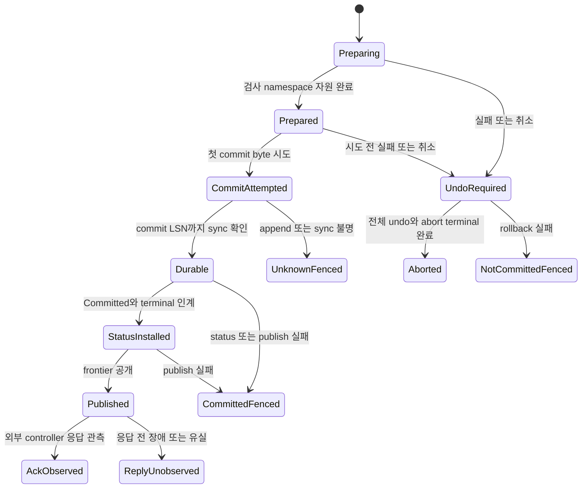
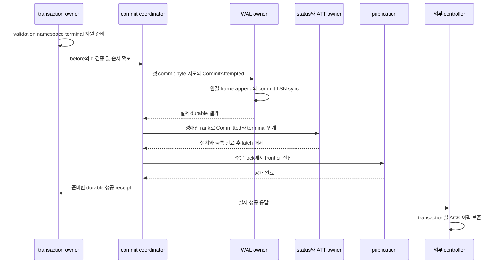
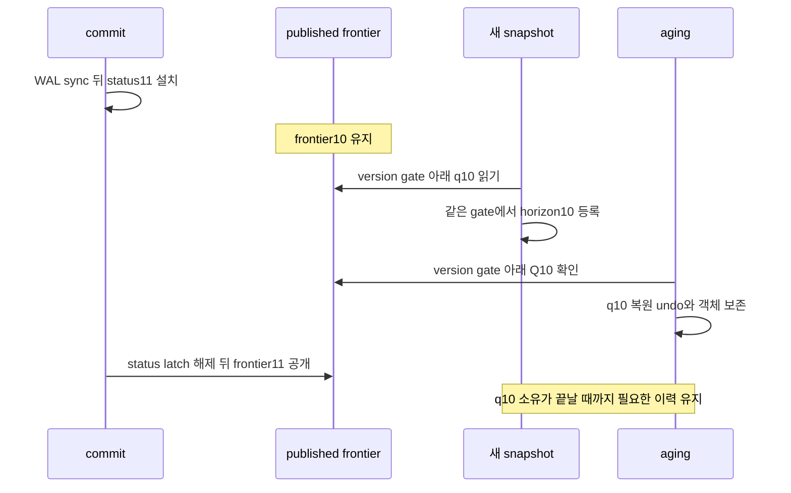

# DEV3 3.11 — commit·공개 개발 상세 명세와 설계도

2026-10-22 · **작업 상세 설계 / 거래·status·WAL 표현 공급 / DEV3 commit·공개·ACK 통합 미완료**

[공통 규칙](dev3-task-designs.md) · [commit 정본](disk-storage-design.md#commit) · [공통 잠금 순서](disk-storage-design.md#mutation-protocol) · [snapshot와 horizon](disk-storage-design.md#snapshot-acquisition) · [거래 표현](dev3-transaction-format.md) · [status home](dev3-status-home.md) · [영속 obligation](dev3-obligation-format.md) · [WAL 표현](dev3-wal-format.md)

## 1. 목적·선행·소유

한 거래가 변경한 row/index/catalog의 가시성을 하나의 commit 결정으로 전환한다. commit record까지의 WAL sync를 확인한 뒤 status와 published frontier를 순서대로 설치하고, 그 뒤에만 durable 성공을 응답한다. data page 전체 flush는 commit의 선행이 아니며 page가 아직 home에 없거나 uncommitted page가 이미 flush된 두 경우 모두 redo/undo로 복원할 수 있어야 한다.

3.11.1은 3.04.2의 append/sync와 공통 fence, 3.09.1의 live undo/status, 3.10.1의 coordinator·guard/publication/registry 공급 및 **그때 지원하는 대상**의 변경 공급을 소비한다. index/catalog 전체 완료는 첫 행 대상 commit의 선행이 아니다. 공급하는 것은 commit attempt/sync/status/frontier 경계다. 이 공급을 소비하는 3.10.2 전체 동시성 인수를 다시 3.11.1의 선행으로 요구하지 않는다. 3.11.2는 3.09.3·3.10.2·3.12.8과 다중 객체 ACK/UNKNOWN을 통합한다.

### 첫 행 거래의 연결 완료 조건

[현재 우선순위](../plans/dev3-implementation-plan.md#work-priority)의 세 번째 목표는 작은 실제 행 거래다. 지원하는 row opcode부터3.06.2→3.09.2/3→3.11.1→3.12.5–8을 연결하고 index/catalog의 나머지 대상은 이후 같은 경로에 추가한다. fixture의 table/anchor·identity는 실제 영속 생성·선택 경로로 공급하며 임의 handle·RAM 전용 table로 대체하지 않는다. 이에 필요한 최소 catalog 공급은 선행이고 전체 DDL/build 기능은 선행이 아니다.

공급 순서는3.11.1 공통 terminal/공개 primitive→최소 catalog create와 해당 undo/commit 의미의 연결→성공한 영속 table handle→첫 행 거래 인수다. 공통 primitive를 첫 행 거래 완료 뒤에만 공급하는 순환을 만들지 않는다. 최소 catalog 생성도 실제 recovery에서 재현되어야 하며 codec 성공이나 임의 사전 생성 파일로 원자성·identity 검산을 대신하지 않는다.

첫 연결도 해당 opcode의 before image·UndoRef/head·status incoming edge·잔여 예약과 CLR 진행점을 하나의 규약으로 소비한다. terminal queue의 표현·credit·종료 소유, 필요한 잠금/관측 검증·commit 설치 장벽·fence가 동결되지 않았으면 terminal opcode를 허용하지 않는다. 인덱스 없는 지원 fixture를 사용할 수 있으나 실제 존재하는 index/constraint를 건너뛰는 모드는 만들지 않는다.

완료에는 작은 fixture의 no-force ACK 후 새 프로세스 복구, uncommitted steal 뒤 loser 제거, 실패 statement 이전 결과 보존과 full abort, commit 불명 결과, 부분 CLR 재장애와 정상 admitted quota 경계의 복구 성공이 필요하다. [복구 정본](dev3-task-12-recovery.md)의 REBASE/LOG_OPEN/UNDO/VERIFY/STABILIZE·새 ACK 후 재개를 생략하지 않는다. 이 결과는 지원 opcode의 연결 증거이며 전체 CRUD·두 isolation·다중 객체·전체 DEV3 인수를 대신하지 않는다. 신규 사례는 [통합 목표별 시험](../plans/dev3-test-plan.md#direction-integration)에 배정한다.

transaction owner는 최종 검사·commit 상태·오류 certainty를, durable owner는 WAL의 실제 시도/sync prefix와 namespace를, storage owner는 authoritative status home·dirty/recLSN을, publication owner는 작은 CommittedView/frontier를 관리한다. 실제 page flush/복구/terminal aging은 각 owner에게 인계한다. 같은 이름의 DEV2 private/COW commit hook과 publication 구현은 비교 입력이며 DEV3 disk commit 공급으로 간주하지 않는다.

**일반 Commit과 nonempty retained Undo의 terminal owner/credit 인계는 미완료다.** [N=0 plan4 terminal·복구](dev3-plan4-recovery-owner.md)의 제한 공급은 유지하지만 이를 일반 Commit 지원으로 확대하지 않는다. [status home의 terminal 경계](dev3-status-home.md)는 Commit/AbortEnd 뒤 retained head/incoming을 가진 status/undo의 수명과 자원을 인계하기 전 실제 terminal opcode를 Unsupported로 유지한다. 이 문서의 상태도와 Committed 표현만으로 미지원 Commit body를 실행 가능하게 만들지 않는다.

## 2. 기능 요구·경계 API

| 요구 ID | 상세 명세 |
| --- | --- |
| 3.11-R1 | 최종 statement·UNIQUE·schema/Serializable validation, namespace 확인과 commit에 필요한 fallible 자원 준비를 첫 commit record byte 시도 전에 완료 |
| 3.11-R2 | 단일 coordinator가 q를 부여. q는 commit 가시성 순서이며 WAL LSN·file offset·wall clock과 구별. overflow/wrap·이미 사용한 identity의 재사용 금지 |
| 3.11-R3 | 첫 commit record byte를 시도하는 순간 CommitAttempted로 단조 전이. 성공한 write byte 수·전체 frame 완료·sync 반환 시점까지 늦추지 않음 |
| 3.11-R4 | 완결 commit LSN까지 WAL sync 확인 → TxnStatus Committed(q)와 관련 등록 → published frontier → ACK 순서. 예약된 최대 offset이나 producer의 진단 로그를 durable prefix로 사용하지 않음 |
| 3.11-R5 | row/index/catalog는 같은 TxnRef의 결정을 공유. status 또는 frontier를 객체별로 따로 공개하거나 durable commit 이전 일부 객체를 committed로 노출하지 않음 |
| 3.11-R6 | CommitAttempted 전 실패와 이후 불명을 구분. 전자는 실제 undo 후 ABORTED, undo 실패는 NotCommitted/RecoveryRequired와 Fenced. 시도 뒤 append/sync 불명은 UNKNOWN과 Fenced |
| 3.11-R7 | durable 뒤 publish/reply 실패는 commit을 취소하지 않음. 내부 publish 불변식 실패는 fence, 외부 응답 미관측은 UNKNOWN일 수 있음. 사용자 취소가 시도 뒤 rollback 분기를 만들지 않음 |
| 3.11-R8 | status=q11·frontier=q10 구간에도 snapshot10과 그 복원에 필요한 undo/객체를 보존. frontier 공개 lock 안 allocation/I/O/callback 없음 |
| 3.11-R9 | terminal 뒤 ATT 제거·abort 예약 반환과 retained undo/status·aging queue의 영속 인계를 구분. head/count0이나 Committed decode만으로 slot/free/reuse 승인 금지 |
| 3.11-R10 | 별도 controller의 실제 ACK/ABORT/UNKNOWN 이력과 transaction별 witness로 durability를 판정. 후속 overwrite가 이전 ACK 유실을 숨기지 않도록 전체 이력과 복구 상태를 함께 대조 |
| 3.11-R11 | Commit stage→sync→status/terminal·descriptor·dirty/DPT 설치 완료 동안 전역 의미 설치 장벽을 소유. 후속 page-effect WAL 그룹의 추월과 물리 Idle만으로의 admission 재개 금지 |

| 설계 연산 | 입력·사전조건 | 출력·소유 |
| --- | --- | --- |
| commit 준비 | 건강한 transaction, 끝난 statement, mutation/lock·read/write set, 현재 descriptor/status, namespace 증거 | 검증된 before 상태·q/commit frame/terminal 인계 준비물·응답과 설치 자원 예약. 공개 API 이름은 미동결 |
| commit 시도 | 같은 TxnRef/generation와 owner predecessor, 준비 완료 frame, 마지막 pre-attempt 취소 확인 | 원복 불가 CommitAttempted 소유. 단순 caller flag가 아니라 WAL 시도 경계와 결합 |
| sync 완료 수신 | 실제 WAL owner가 확인한 완결 prefix/commit LSN | 해당 거래의 durable 결정. 물리 prefix만으로 다른 TxnRef나 미지원 body의 commit 권한을 생성하지 않음 |
| status 설치 | durable 결정, authoritative home·descriptor/queue 인계, 선예약 pin/guard/dirty 등록 | Committed(q), ATT/terminal/retention 등록 일관성. 아직 frontier나 ACK를 의미하지 않음 |
| frontier 공개 | 같은 coordinator의 결정, status 설치 완료, 준비한 CommittedView | published q와 catalog 접근 identity의 원자 전환. old view 정리는 publication lock 밖 |
| 응답·해제 | 공개 완료, durable 성공 receipt와 거래 identity | caller의 성공 또는 미관측. 완료 후의 lock/자원 반환은 terminal owner에 맞게 한 번 수행 |

CommittedView는 DB/timeline·published q·catalog 접근 identity의 작은 descriptor다. mutable page 내용이나 이전 root graph 전체를 새 불변 snapshot으로 복제하지 않는다. caller가 지정한 q/LSN이나 decode한 Committed core는 이 연산들의 capability가 아니다.

## 3. 상태 설계도와 확실성

이 도식의 `CommitAttempted/Durable/StatusInstalled/Published`는 commit 처리 진행 단계다. 기존 status codec에 같은 이름의 새 wire tag를 추가하는 결정이 아니다. persistent 상태는 채택된 core·terminal group·control과 앞으로 동결할 의미 body가 소유한다. controller의 AckObserved/ReplyUnobserved도 DB status와 별개의 외부 관측이다.

`CommitAttempted` 전에도 update WAL과 shared dirty page·undo가 존재할 수 있다. 따라서 DEV2 private batch의 단순 폐기로 ABORTED를 만들 수 없다. 실패가 확정된 pre-attempt 경로는 예약된 전체 undo를 실행하고 durable abort-end와 상태 확인 뒤 결과를 정한다. rollback I/O 실패 시 commit은 미시도라는 사실과 shared 효과의 미정리 상태를 함께 전달한다.

commit 시도 뒤 취소·disconnect·timeout은 그 거래를 다시 Active로 만들거나 새 transaction으로 자동 재전송하지 않는다. append/sync 결과가 불명이면 recovery가 완결 이력을 채택할 때 거래 전체가 commit되거나 loser undo된다. durable commit 이후에는 항상 commit을 유지하며 UNKNOWN은 호출자의 응답 관측 범위일 수 있다. 내부 정상 상태로 계속 운영할 수 없는 실패는 공통 fence를 유지한다.

## 4. 준비·WAL·status·공개 알고리즘

1. 진행 중 statement/rollback이 없는지 확인하고 최종 UNIQUE·row/key 잠금·schema validation을 수신한다. Serializable은 해당 read/write table 및 namespace/generation 검증을 coordinator의 현재 committed 상태와 대조한다. 기본 DB 전체 q 일치 검사로 독립 table writer를 불필요하게 거절하는 DEV2 방식은 이 경로에 이식하지 않는다.
2. update/undo와 namespace closure를 확인한다. 새 파일/extent의 길이·header·필요한 FILEMAP/namespace 영속 선택이 끝나기 전 그 공간을 참조하는 durable commit을 허용하지 않는다. data page home sync를 대신 선행으로 추가하지 않는다.
3. commit record와 q·descriptor/terminal queue 전이, status home/dirty/ATT 등록, 작은 view, 성공/오류 응답·진단에 필요한 메모리와 pin/registry/lock·WAL 공간을 준비한다. 직접/간접 allocation과 destructor/callback을 포함해 inventory를 고정한다. 준비 중 반환 가능한 자원과 이미 charged된 update/undo·전체 abort 예약을 구별한다.
4. 실제 authoritative before 상태·owner predecessor·namespace·q를 재검사한다. transaction 취소는 첫 commit byte 시도 직전에 마지막으로 확인한다. 이후 byte 시도와 CommitAttempted 전이를 하나의 owner 경계로 결합하여 write error가 반환해도 미시도로 되돌리지 않는다.
5. 완결 commit frame을 ordered WAL에 연결하고 그 LSN까지 sync한다. tree/page/append/registry/publication latch를 가진 채 write/sync하지 않는다. sync 성공 이전에는 Committed status와 frontier를 설치하지 않는다. 다른 거래 update가 WAL에 섞여 있어도 이 거래의 완결 commit을 확인해야 한다.
6. 확인된 durable 결정으로 Committed(q) status 및 terminal/ATT·retention 인계를 적용한다. 각 status/head/count·queue/credit·descriptor 관계를 동결한 Commit 의미 그룹대로 검산하고 dirty/pageLSN/recLSN을 등록한다. commit의 status 공개는 generic update의 stage 직후 가시성 전환과 구별한다. 미지원 body나 미완료 queue 인계는 첫 시도 전에 거절한다.
7. status 설치에 사용한 tree/page/append/registry latch를 해제한 뒤 coordinator 아래 짧은 publication lock에서 작은 view/frontier를 전진시킨다. publication lock 안에는 allocation/I/O/callback과 큰 old-view 소멸을 두지 않는다. 공개 실패는 durable 결정을 취소하지 않고 fence한다.
8. terminal 인계가 정한 거래 잠금·미소비 예약의 반환을 완료하고 성공을 caller에 전달한다. retained undo/status·queue·WAL bytes는 해당 수명이 끝날 때까지 charge한다. ACK를 만들었다는 내부 사실과 caller/controller가 실제 ACK를 받았다는 사실을 별도 기록한다.

그림의 coordinator는 commit 순서를 나타내며 모든 구간에서 같은 mutex guard를 보유하라는 뜻이 아니다. 실제 guard/rank·단일 commit 소유와 suspension/revalidation 방식은 F02에서 고정한다. status 적용의 turn/admission 요청·대기는 coordinator/version/tree/page/append/registry lock 밖이어야 한다. sync 뒤 status 자원을 새로 quota 요청하거나 coordinator를 잡은 채 FIFO turn을 기다리는 경로는 허용하지 않는다. 이 설계를 구현할 때는 순서 소유를 잃지 않는 인계와 공정한 진행을 별도 검토한다.

### Commit의 지연 설치와 pageLSN 순서

단일 commit coordinator만으로 일반 update·CLR·SMO의 page 적용 순서는 보호되지 않는다. [전역 의미 설치 장벽](disk-storage-design.md#commit-installation-order)을 Commit stage와 원자적으로 획득하고, durable 결정의 모든 status/terminal·descriptor·dirty/DPT 설치가 끝난 뒤 반환한다. sync가 물리 WAL slot을 Idle로 돌려주더라도 이 장벽은 남는다. 다른 거래가 같은 71-slot status page의 다른 slot을 더 높은 LSN으로 갱신·flush하면 앞선 Commit 효과가 없는 높은 pageLSN이 남으므로, 초기 구현은 모든 후속 page-effect 그룹의 stage/apply를 막는다. page 일부 설치나 물리 sync 성공만으로 장벽을 반환하지 않는다.

기존 reader와 이미 설치된 image의 flusher는 계속 진행한다. sync 전에 복사된 낮은 LSN image는 정상이며, 그 copy 뒤 Commit을 설치하면 dirty counter 차이로 Dirty/recLSN을 보존한다. Commit continuation은 자기 장벽을 통과하고 선예약한 자원을 소비한다. 다른 producer가 장벽을 기다릴 때에는 turn·공유 workspace·pin·적용 lock을 반환해야 한다. 특히 FIFO head인 다른 maintenance가 장벽을 기다리며 turn을 점유해 continuation을 막는 순환을 금지한다. 양도·재진입과 대기자 깨움, stage 전후 취소·unwind의 소유는 F02에서 함께 동결한다. 이미 staged된 Commit을 나중에 쓸 수 있는 채로 정상 abort/장벽 반환을 하지 않는다. 설치 실패는 fence, durable 이후의 결정은 commit으로 유지한다. frontier 공개와 ACK는 장벽 반환 이후에도 기존 순서를 지킨다.

## 5. snapshot·checkpoint·terminal 수명과의 연결

status11이 설치되고 frontier가 아직10이면 새 snapshot은10을 선택할 수 있다. reader는 `commit_q > snapshot_q`인 새 버전을 undo로 제거한다. snapshot 획득은 version-edit gate 아래 published q를 읽고 같은 gate에서 horizon 등록을 완료하며, aging은 `H=min(published q, registered snapshot q)`와 rollback/객체 소유를 함께 확인한다. reader가 없다는 이유로 status11의 undo를 먼저 회수하지 않는다.

checkpoint capture는 commit coordinator와 version-edit 경계에서 등록까지 끝난 prefix만 수신한다. CommitAttempted 거래의 sync·status 설치가 끝나지 않은 채 terminal을 생략하거나 Active로 되돌린 capture를 만들지 않는다. 불명 commit이면 checkpoint를 진행하지 않는다. 실제 capture와 WAL floor는 3.13이 소유한다.

terminal commit이 채택되면 loser abort 의무는 끝나지만 retained head/incoming·aged stamp·queue 작업은 남을 수 있다. ATT의 active owner 제거와 queue의 영속 owner/credit 인계를 동일 의미 그룹으로 동결해야 한다. terminal의 count0, 남은 undo 없는 core, zero outstanding 표현을 개별적으로 보았다는 이유만으로 무조건 전부 반환하지 않는다. status/undo slot 재사용은 edge·queue·snapshot/rollback·transient pin·prepared/in-flight flush claim·DWB 소유를 모두 해소한 3.14/3.03 경로에서 수행한다.

## 6. 오류·복구·자원 표

| 경계 | 외부 결과와 engine 상태 | 복구·자원 인계 |
| --- | --- | --- |
| 준비/validation/namespace 실패, commit byte 미시도 | commit 미시도. 실제 전체 undo 완료 후 ABORTED | update/undo/CLR·이미 실현된 파일 bytes 보존. 실제 반환된 준비물만 차감 |
| 같은 pre-attempt 경로에서 undo/abort-end 실패 | NotCommitted/RecoveryRequired와 Fenced. 정상 ABORTED 아님 | 남은 undo와 terminal 예약을 보존하고 recovery가 이어받음 |
| 첫 byte 시도 뒤 append·sync 오류/불명 | UNKNOWN와 Fenced. zero bytes 보고만으로 확정 ABORT 금지 | candidate stream/owner·불명 charge 보존. 같은 요청 자동 재전송 금지 |
| sync 성공 뒤 status/ATT/queue 설치 실패 | commit 유지, 내부 불변식 실패면 Fenced; 성공 미관측은 UNKNOWN | redo가 committed 결정과 terminal 전이를 복원. loser undo 금지 |
| status 성공 뒤 frontier 실패 | commit 유지와 Fenced | 낮은 frontier로 계속 신규 snapshot/admission을 허용하지 않고 recovery로 공개 상태 재구성 |
| 공개 뒤 reply 오류/disconnect | commit 유지; caller는 UNKNOWN일 수 있음 | 정상 disconnect 자체를 data rollback 이유로 사용하지 않음. 내부 fence 여부는 실제 실패 원인에 따라 보존 |
| ACK 관측 뒤 candidate crash | ACK된 transaction 전체가 recovery 이력에 포함되어야 함 | success sync 보존 fault model과 source identity 하에서 row/index/catalog 및 transaction별 witness 대조 |

terminal record와 응답/상태 설치 자원은 [자원 정본](dev3-resource-bounds.md) 및 opcode F05에 대입한다. WAL slot1MiB, component64KiB, metadata/cache8MiB 안에서의 상태/descriptor/queue/reference 동시 생존량을 계산하고 caller buffer·status pin/dirty registration·publication 준비물의 별도 소유를 표시한다. 같은 commit frame 안 status redo bytes를 terminal 비용과 status 비용에 두 번 계산하지 않는다.

`charged + outstanding_reserved <= capacity`는 준비·시도·sync·terminal 인계·반환 각각에서 유지한다. 시도한 WAL bytes는 아직 sync를 확인하지 못해도 효과의 불확실성을 보존하며, 확인된 commit 뒤 abort 예약 반환은 retained WAL/undo/page의 물리 회수를 뜻하지 않는다. protected1GiB를 owned8GiB에 추가하는 계산, foreground가 flusher·rollback 최소 몫을 차용하는 계산을 하지 않는다. 준비 실패 때도 이미 존재하는 전체 abort 의무를 충족해야 한다.

3.12는 완결 commit을 winner로 채택하고 status/queue·공개 상태를 redo한다. 필요한 pageLSN/namespace 및 descriptor와 commit q를 검산하며 미완료 transaction만 undo한다. RECOVERY_REBASE/WRITER·STABILIZE 뒤 신규 ACK가 가능해야 하고, 두 번째 reopen에서 이전 UNKNOWN의 합법적 채택과 새 ACK를 모두 보존한다. 이번 3.11.1의 sync/공개 제한 검증을 이 전체 복구 결과로 확대하지 않는다.

## 7. 하위 작업·완료 기준

| ID | 직접 선행 | 산출물과 완료 조건 |
| --- | --- | --- |
| 3.11.1 commit attempt/sync/status/frontier | 3.04.2, 3.09.1, 3.10.1과 해당 row/index/catalog 변경 공급; Commit terminal body·queue/credit·F05 동결 | 첫 byte 경계, durable→status→frontier, 선예약 자원·rank·fence를 공급. 실제 연결한 대상의 case를 검증하며 3.10.2 전체 완료를 선행으로 요구하지 않음 |
| 3.11.2 다중 객체 ACK/UNKNOWN·Fenced 통합 | 3.11.1, 3.09.3, 3.10.2, 3.12.8과 해당 대상별 undo | row/index/catalog 전체의 pre-attempt rollback·UNKNOWN 채택·ACK durability와 외부 history. data flush 없는 commit·uncommitted steal·재장애/새 ACK를 좁은 통합 경로로 인수 |

transaction/publication·ATT/terminal·WAL writer를 바꾸는 부분은 하나의 통합 담당이 순차 연결한다. 3.10.1의 primitive 공급을 3.10.2 실제 거래 통합과 구별하고, 후속 동시성 결함을 막기 위해 3.11.1에 필요한 최소 snapshot/status11-frontier10 반례는 자체 인수에 포함한다. 대상 producer가 추가되면 그 변경과 대상별 undo/recovery 연결을 검증하며 이미 완료한 다른 대상 시험을 일괄 재실행하지 않는다.

## 8. 독립 인수·관측 설계

아래 case는 앞으로 구현할 경로의 인수 명세다. 실제 cut의 도달 여부·source/binary/fixture·독립 expected history·시간/자원 한도를 먼저 고정한다. candidate의 자체 `synced=true`나 성공 문자열은 진단만 제공하며 controller가 실제 응답을 받았다는 증거를 대체하지 않는다.

| Case | 입력·독립 판정 | 연결 |
| --- | --- | --- |
| 3.11-T1 준비 실패 | validation·namespace·q overflow·WAL/status/view/응답 예약 부족·시도 직전 cancel. commit write 미시도 관측과 실제 full undo/ABORTED, undo 실패 variant의 NotCommitted/RecoveryRequired+Fenced 구별 | DS02/06, KU10 |
| 3.11-T2 첫 byte | 첫 write 호출 직전·부분/zero/error·완결 frame 뒤·sync 전후 cut. 시도 뒤 불명을 ABORTED로 낮추는 mutant와 성공 write 뒤에만 CommitAttempted를 설정하는 mutant 거절 | DS02, RC-T12 |
| 3.11-T3 no-force·steal | data/undo/status 일부 home 미반영 상태에서 commit ACK→crash, uncommitted page는 이미 flush된 loser→crash. 별도 history로 winner 전체 보존/loser 제거, commit이 전체 data flush를 기다리지 않음을 관측 | DS02, KU10, RC-T12/13 |
| 3.11-T4 status/frontier | q11 durable·status11 설치 후 frontier10에서 실제 reader/ager barrier. reader10의 이전 값·undo 수명 보존, frontier11 뒤 새 snapshot의 다중 객체 가시성 | DS02/04, KU10 |
| 3.11-T5 공개·reply 실패 | sync 뒤 status·registry·publication 실패, publish 뒤 응답 전/중 disconnect. durable commit을 rollback하거나 잠금만 풀어 계속 쓰는 mutant 거절. 실제 ACK 관측/미관측 구별 | DS02, RC-T12 |
| 3.11-T6 다중 객체 | 서로 다른 table의 row·여러 index·versioned catalog를 한 거래에서 변경하고 모든 commit cut에 장애. 독립 이력의 전체 commit 또는 전체 undo, partial 객체 공개 거절 | DS02, KU10, RC-T12 |
| 3.11-T7 순서·capture | writer들의 update interleaving, nonconflicting commit, CommitAttempted와 checkpoint capture 교차. q·LSN 혼용, sync 미확인 최대 offset ACK, 미완료 status 등록 누락을 검출 | DS02/05, KU10 |
| 3.11-T8 terminal 소유 | retained head/incoming이 있는 commit, ATT 제거·queue/credit 인계 cut·재장애. active abort 예약과 retained queue 비용 구분, 영속 owner 유실·count0 조기 Free mutant 거절 | DS03/04/05, RC-T14 |
| 3.11-T9 ACK 이력 보호 | T1 ACK 값을 T2가 나중 overwrite한 fixture와 transaction별 독립 witness. 최종 row만 같은 ACK 유실 known-bad 입력도 checker가 거절. controller ACK 관측 이후 candidate만 crash | DS02, RC-T12 |
| 3.11-T10 재장애·새 ACK | 첫 UNKNOWN의 recovery·RESUME 후 새 transaction ACK, 두 번째 crash/reopen. 합법 UNKNOWN 채택과 두 세대 ACK, source WAL/namespace 보존 대조 | DS02/05, RC-T12/14 |
| 3.11-T11 지연 설치 순서 | T1 Commit@c sync 직후 status 설치 전 정지하고, 같은 status page의 다른 slot을 갱신하는 T2 update/CLR/aging을 시도. physical Idle에도 후속 stage0, T1 전체 등록 뒤만 재개. 앞선 maintenance head가 turn을 양도하여 continuation 진행, 이전 image flush의 redirty 보존, 설치 오류 뒤 fence. 각 장벽 cut→reopen에서 T1 winner/status·terminal 일치; @c 누락/P@c+1 mutant는 독립 이력·audit로 거절 | DS02/04/05, NT04/05/10/11/12, RC-T12/14 |

controller는 candidate 프로세스와 분리하고 crash 대상에서 제외한다. 응답 관측 이력은 transaction identity·expected delta·실제 outcome과 순서를 포함하며 candidate 출력으로 재구성하지 않는다. controller까지 잃으면 ACK 관측을 미확정으로 남긴다. transaction별 witness의 구체 저장/대조 방식은 F03에서 고정하여 후속 overwrite가 어느 거래의 유실을 가리는지 검사한다. witness 자체를 제품 commit 기록의 대체로 사용하지 않는다.

독립 oracle는 관측 ACK 집합이 복구 commit 이력에 포함되고 확정 ABORT가 commit되지 않으며 UNKNOWN은 완결된 합법적 전체 결과를 갖는지 판정한다. ACK 없는 transaction을 모두 ABORT로 간주하지 않는다. success sync bytes/namespace 보존 전제 밖의 사후 완전 삭제를 정상 tail 처리로 숨기지 않으며, 정상 recovery 필수 case의 오류를 사후 corruption rejection PASS로 바꾸지 않는다.

## 9. 실제 source와 착수 전 미동결 항목

| 실제 진입점 | 현재 범위·개발 시 연결 |
| --- | --- |
| [storage/wal_frame.rs](../../crates/engine/src/storage/wal_frame.rs) | Commit frame kind와 envelope 표현. Opaque/FrameView는 commit body 의미나 durable 결정 권한이 아님 |
| [storage/wal_io.rs](../../crates/engine/src/storage/wal_io.rs) | fresh WAL의 stage/write/sync·fence와 제한 producer 공급. 일반 commit append/sync는3.04 확장 필요 |
| [storage/transaction_record.rs](../../crates/engine/src/storage/transaction_record.rs) | `TransactionState`, `TransactionStatus`, `VersionStamp`, `TxnRef`의 무효과 표현. 상태 값 생성은 실제 전이나 공개 아님 |
| [storage/status_home.rs](../../crates/engine/src/storage/status_home.rs) | `StatusHome`, `decode_status_home_page`: core+incoming·71-slot home 검산. terminal queue·status directory·live 설치는 후속 |
| [storage/obligation.rs](../../crates/engine/src/storage/obligation.rs), [storage/semantic_group.rs](../../crates/engine/src/storage/semantic_group.rs) | descriptor 및 제한 RollbackStart 결합/생산. Commit/terminal body를 이미 지원한다고 가정하지 않음 |
| [transaction.rs](../../crates/engine/src/transaction.rs), [publication.rs](../../crates/engine/src/publication.rs) | 기존 `PreparedCommit`, `commit_with`, `Publication`의 오류/소유 문맥. DEV2 private/COW·volatile root 구현을 DEV3 mutable page/undo로 자동 재사용하지 않음 |

F01/F02에서 Commit operation/native body, q와 terminal status/descriptor·queue owner/credit의 원자 결합, owner predecessor·namespace 검산, 첫 byte attempt의 정확한 API 위치, cancellation·panic·drop·publication 오류의 certainty를 동결한다. read-only/empty transaction의 경로도 별도로 고정하며 기존 VolatileCommit의 빠른 경로를 durable ACK로 이름만 바꾸지 않는다.

특히 WAL stage에서 Commit 의미가 준비된 시점과 sync 뒤 status가 공개 가능한 시점을 구별하는 실제 guard/API, coordinator의 순서 소유와 progress-turn 대기의 인계, capture와 terminal 설치의 등록 경계가 필요하다. 모든 fallible 준비를 시도 전 마치는 allocation inventory와 응답 buffer 수명, lock 해제·ATT 제거·abort 예약 반환·queue 인계의 정확한 순서를 F02/F05에 기록한다. 이 미동결 항목을 일반 opaque payload나 임의 상태 tag로 채우지 않는다.

F03은 transaction별 외부 witness·known-bad 이력과 다중 객체 expected delta를, F04는 write/sync/status/frontier/reply와 실제 재장애 cut을, F05는 terminal/dirty/frame/registry/view/응답의 동시 peak를 고정한다. F06은 기존 DEV2 symbol의 reuse/adapt/DEV2-only/new를 구분하고 F07은 transaction/publication/terminal 공유 상태의 단일 수정 소유를 정한다.

문서 작성 담당은 `/root/dev3_specs_review`다. 본 작성자는 이 문서를 독립 승인하지 않는다. 별도 검토·채택은 [공통 결정 기록](dev3-task-designs.md#decision)에, 실제 제품·시험 상태는 [구현 기록](../implementation/dev3-implementation.md#dev3-work-breakdown)에 기록한다.

## 비교 분석 후속 — 의미 설치 장벽의 비용과 batch 조건

기준선은 기존 단일 Commit 의미 설치 장벽이다. I/O 중 mutex를 놓아도 stage→sync→status/terminal·descriptor·DPT 설치 동안 후속 semantic admission이 막히는 비용은 남는다. 다른 거래의 더 큰 pageLSN이 같은 status page에 먼저 설치되어 앞 commit을 recovery skip으로 숨기는 것을 금지한다. published q는 설치가 끝난 committed prefix만 반영한다.

장벽 서비스 시간 S, 거래당 한 번 서비스이면 포화 처리량 상한은 `X≤1/E[S]`다. Poisson 도착·독립 서비스·무한 FCFS queue의 M/G/1 근사에서 `E[Wq]=λE[S²]/(2(1−ρ))`, `ρ=λE[S]<1`이다. 평균2ms·분산0이면 부하율50/80/90/99%에서 평균 대기는1/4/9/99ms다. 이 값은 유한32 요청의 실제 queue나 p99 예측이 아니다. 실제 계측은 admission 대기·장벽 대기·sync·의미 설치·원래 요청 끝까지를 구별한다.

batch b에서 sync 비용 f와 거래별 설치 s의 이상식 `b/(f+b·s)`는 후보 비용식일 뿐이다. group commit을 구현하려면 다음을 별도 F02/F05·D2로 닫는다.

- batch admission·최대 bytes/count/deadline과 각 거래의 rollback/UNKNOWN 잔여 예약.
- batch 내 직렬 순서의 validation과 q 부여. 먼저 성공할 거래의 table/catalog epoch를 반영한 가상 prefix를 뒤 거래가 검증하며, 모두 옛 q0로 사전 검증해 통과시키지 않음.
- complete WAL prefix와 shared-page의 모든 관련 선행 효과 설치. checkpoint·snapshot 공개와 published q가 부분 설치를 추월하지 않음.
- sync 불명·prefix 일부 영속·일부 의미 설치 후 crash에서 외부 ACK/UNKNOWN과 winner/loser를 보존. batch 대기 중 workspace/turn이 completion을 막지 않음.

현재 table validation에서는 batch sync 횟수가 줄어도 [같은 snapshot·같은 table cohort의 제약](dev3-task-10-concurrency.md#serializable-conflict-bound)이 남는다. 먼저 실제 충돌·서비스 시간을 측정하고 bottleneck이 입증된 뒤 후보를 평가한다. 이 절은 group commit 채택·구현 승인이나 기존 ACK 의미 변경이 아니다.
