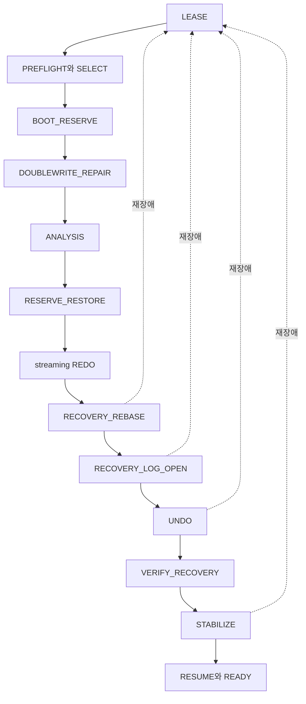

# DEV3 3.12 — 재시작 복구 개발 상세 명세와 설계도

2026-10-22 · **작업 상세 설계 / 표현·제한 모델 존재 / 일반 recovery·READY 미구현**

[공통 규칙](dev3-task-designs.md) · [복구 정본](disk-storage-design.md#recovery) · [예약 복원](disk-storage-design.md#recovery-reservation) · [REBASE](disk-storage-design.md#recovery-rebase) · [장벽별 기존 작업](../plans/dev3-implementation-plan.md#recovery-remaining)

## 1. 목적·입력·보장

선택된 control·namespace·완결 WAL prefix와 영속 undo를 이용해 ACK 거래를 보존하고 loser를 제거한 뒤 새 쓰기를 허용한다. 전원 상실 모델·프로세스 kill·합성 I/O fault를 구분한다. 성공 sync의 보존, active tail의 제한된 불완전 frame 제외, 완전 길이 checksum 오류 거절은 기존 의미를 유지한다.

입력은 exclusive lease, 생성 때의 checksummed recovery profile, 검증한 FILEMAP/DWB·checkpoint 또는 base closure, epoch/WRITER chain, caller 소유 고정 workspace다. output은 모든 장벽을 통과한 READY owner 또는 원인·실패 장벽·소유 보존을 담은 오류다. partial recovery를 usable reader/writer로 반환하지 않는다.

`D3-MODULE-ADOPTION-001` **D2 PROPOSED 반영안**의 첫 Row는 [plan4 owner의 확장](dev3-plan4-recovery-owner.md)과 [typed recovery action](dev3-module-boundaries.md#api-candidates)을 사용한다. C가 실제 선택/분석/replay/설치/공통 정리와 READY를 소유하고 A의 handler는 새 loser CLR 후보만 제공한다. C+B 단독 검증의 RejectInitialLosers는 최초 complete-prefix census에서 SystemPage를 포함한 Reserved와 Active/Aborting을 물리 변경 전에 거절한다. 이를 전체 제품 recovery의 loser 생략 옵션으로 사용하지 않는다. RAM-only stage 유실·actual durable CLR 보존·partial home REDO는 [정확 cut](dev3-module-consumers.md#fault-cuts)으로 각각 판정하며 거절 fixture의2PID와 정상3PID·재장애4PID의 보존 의무를 구분한다.

소스 WAL bytes는 수정하지 않는다. WAL 회수는 완전한 새 closure가 영속 인계된 뒤의 별도 unlink/dirsync다. home page는 redo/undo/DWB 규약에 따라 변경할 수 있으므로 DEV2의 source-page 불변 규칙을 그대로 적용하지 않는다.

### 1.1 현재 쓰기 경로를 먼저 연결하는 제한 복구

[방향 리뷰 후속 결정](../plans/dev3-implementation-plan.md#direction-review-adoption)의 최초 목표는 reserve/cancel·Status INIT·flush 파일의 새 프로세스 복원·검산이었다. [N=0 plan4 재개](../evidence/dev3-recovery-resumed-20261025.md)는 이 제한 공급을 확장한 source별 완료이며, 아래는 초기 inspection 범위의 계약이다. 현재 후속 작업은 [추가 의무](#post-plan4-obligations)를 따른다. 아래3.12.1–4의 공급을 조기에 구현하되3.12 전체 완료나 일반 open API로 공개하지 않는다. 정확 지원 prefix·opcode·control 조합은 실제 producer와 F01/F02/F05를 대조해 동결한다. 그 전에 미지원 연산을 no-op으로 읽는 replay를 작성하지 않는다.

1. LEASE/PREFLIGHT/SELECT에서 profile·namespace·선택 closure·bootstrap 예약을 검산하고 admission을 닫는다. 지원 여부 판정에 필요한 WAL/control을 검산해 미지원 입력은 가능한 첫 변경 전에 거절한다. 뒤늦게 손상/미지원 의미가 드러나면 기존 오류·fence를 보존하고 성공으로 반환하지 않는다.
2. 선택된 Pending만으로 DWB repair·sync·retirement를 수행한다. raw retired 슬롯은 복원 근거가 아니다. pending 없는 torn home의 완전 INIT+연속 WAL 예외와 healthy higher-pageLSN 거절은 아래 정본을 그대로 따른다.
3. 채택 prefix의 예약·owner·상태를 ANALYSIS/RESERVE_RESTORE로 정확히 재구성한 뒤 page별 REDO를 수행한다. 일부 home만 반영된 그룹을 통째로 skip하지 않는다. 미종료 owner·obligation을 버려 제한 범위를 맞추지 않는다.
4. 결과는 닫힌 복구 owner 안의 bounded inspection으로 확인한다. 현재 allocator/Status의 실제 page·identity·generation·pageLSN·ledger를 독립 기대값과 대조하고 원본 WAL을 보존한다. 결과가 필요한 caller scratch·수명·최종 flush 여부는 F02/F05에서 고정한다. 검사 뒤에도 일반 쓰기·거래 API와 admission은 열지 않는다.

정상 완결 prefix, WAL만 durable인 상태, allocator/Status의 혼합 home, 선택 Pending/torn home, retirement 뒤 raw 슬롯, repair 중 장애 후 다른 프로세스의 재진입을 작은 필수 사례로 준비한다. 아직 지원하지 않는 branch는 NOT_RUN/미공급으로 남기고 의미를 지운 fixture로 완료 처리하지 않는다. 이 inspection은 일반 VERIFY_RECOVERY나 공개 READY를 대체하지 않는다.3.12.5–8을 미구현이라는 이유로 N/A 처리하지 않으며 source WAL 회수·새 epoch·CLR·거래 종료/ACK 권한도 제공하지 않는다.

첫 행 거래에서는 아래 모든 장벽을 연결한다. 정상 profile에서 이미 admitted된 작업이 quota 경계에 있어도 기존 예약으로 완료되는 대표 사례와 각 유한 crash prefix의 고정 peak를 필수로 확인한다. 부족 실행 설정/손상/I/O 실패의 거절은 별도 분모이며 정상 복구 성공을 대신하지 않는다. 전체 slot/owner/profile 조합·장시간 캠페인은 S5에 남긴다.

## 2. 핵심 요구

| 요구 ID | 명세 |
| --- | --- |
| 3.12-R1 | 모든 장벽 동안 foreground admission을 닫는다. profile·실제 memory/frame/FD/disk 부족은 DB write 전 판정하고 새 foreground 한도로 과거 obligation을 줄이지 않음 |
| 3.12-R2 | BOOT_RESERVE는 home allocator/undo를 먼저 읽지 않고 선택 control/profile/namespace로 고정 몫을 확보. repair·analysis를 시작할 자원의 순환 의존 금지 |
| 3.12-R3 | RESERVE_RESTORE는 같은 채택 prefix의 descriptor·논리 inventory를 대조해 REDO의 추가 효과 전에 한 번 인계. stale home allocator·0으로 초기화한 ledger 사용 금지 |
| 3.12-R4 | REDO는 winner/loser 모두의 완결 이력을 streaming 반복. incarnation/pageLSN으로 적용 여부를 판정하고 전체 DPT를 RAM에 복제하지 않음 |
| 3.12-R5 | REBASE는 새 WAL 전에 home·undo/status·예약 closure를 고정 두 슬롯에 인계. 새 epoch와 잔여 undo 예약을 함께 확보할 때까지 LOG_OPEN 금지 |
| 3.12-R6 | recovery epoch/header sync와 WRITER 영속 선택 전 새 CLR append·그 효과의 home write 금지. CLR effect와 UndoNextRef는 원자 복구 |
| 3.12-R7 | VERIFY_RECOVERY는 실제 복구 대상과 terminal/예약을 검사. 정상 open에 변경 없는 cold table 전체 검사를 추가하지 않음 |
| 3.12-R8 | STABILIZE 뒤만 READY. 모든 유한 crash prefix에서 closure·고정 peak 보존; 완료 보장은 충분한 무장애 구간·정상 종료 I/O·공정한 actor를 전제 |

## 3. 장벽 설계도

하나의 recovery owner가 장벽 진행과 자원 인계를 소유한다. 각 단계는 다음 단계가 소비할 검증된 결과만 반환하며 raw profile decode 성공·physical WAL prefix 관측만으로 장벽을 건너뛰지 못하게 한다. 정상 예상 거절과 실제 변경 뒤 fence의 오류 범위를 분리한다.

## 4. 3.12.1 — LEASE·PREFLIGHT/SELECT·BOOT_RESERVE

[첫 3.12.1.a 소유 계약](dev3-recovery-select.md)은 초기 control·header-only WAL을 읽기 전용으로 선택하는 제한 단위를 구체화한다. BOOT_RESERVE·nonempty tag2 prefix·Pending 복구·전체3.12.1–4 인수와 구별하며, 실제 상태는 [구현 기록](../implementation/dev3-implementation.md#recovery-select)을 따른다.

[현행 WAL prefix 분석 계약](dev3-recovery-prefix.md)은 actual reserve/cancel·Status INIT의 owner·descriptor·inventory와 canonical RAM image를 닫힌 owner 안에서 재구성하는 후속 공급이다. [선택 실행과 제한 단위 최종 D1](../evidence/dev3-recovery-prefix-20261022.md)을 수용했다. home 무독해·무변경의 분석을 BOOT_RESERVE·Pending repair·물리 REDO의 완료로 세지 않는다.

[실제 닫힌 복구 계약](dev3-recovery-effects.md)은 고정 두 슬롯의 실제 provisioning, source 안정화, 선택 Pending 수리, 한 번 예약 인계와 page별 REDO를 연결한다. 2026-10-23 제한 구현설계 D2와 첫 실행 gate를 수용한 뒤 [선택 검증](../evidence/dev3-recovery-effects-20261023.md)을 마쳤다. 필수393의 source별 완료 단언·native31·compiler9+control1·checker30/변경1을 구별하며 제한 단위 최종 독립 D1을 수용했다. 일반 REBASE·새 epoch·READY와 전체 F05는 남아 있다.

1. writer lease를 획득하고 fixed root profile의 exact length/format/checksum·지원 profile·namespace를 검증한다. 이 이후 선택 대상의 expected identity를 전달한다.
2. FILEMAP/DWB와 명시 current/previous·base continuation을 검산한다. 손상 selector 대신 임의 큰 파일 번호·raw DWB·directory 탐색으로 대안을 만들지 않는다. checkpoint fallback은 3.13의 완전 closure 조건을 따른다.
3. 생성 때 선택된 recovery profile의 실제 자원과 이미 영속화된 작업 요구를 수용할 수 있는지 확인한다. 신규 foreground admission 축소와 복구 요구량은 별개다.
4. DWB repair·streaming analysis/redo·두 REBASE 슬롯·selector staging·기존 closure와 공존 peak·epoch/header/WRITER 여유를 확보한다. home undo를 읽기 위해 먼저 undo를 분석해야 하는 순환을 만들지 않는다.

선행은 3.02의 lease/선택 읽기와 해당 control/F05다. 성공 output은 repair에 사용할 trusted mapping·selected control·bootstrap reservation이며 READY가 아니다.

## 5. 3.12.2 — DOUBLEWRITE_REPAIR

선택된 pending batch만 읽어 slot sequence·DB/FileId/page/incarnation/pageLSN/image hash를 검산한다. 같은 주소의 새 flush/reuse는 retirement까지 금지한다. 모든 home image를 복원하고 **모든 대상 file sync 후 batch 전체 retirement를 영속 선택**한다. 일부 file 실패나 control 불명은 모든 pending/불명 소유를 보존한다.

healthy home이 pending보다 더 높은 LSN/incarnation이면 오래된 image로 덮지 않고 불변식 오류로 거절한다. 유효 pending 없는 initialized home 손상은 원칙적으로 거절한다. 예외는 FILEMAP·allocation generation과 일치하는 완전 INIT와 그 이후 채택 끝까지의 WAL 전체가 남은 경우다. 이 경우 REDO가 INIT부터 재구성하도록 표시하며 bootstrap에서 blanket page-load 거절하지 않는다. zero/uninitialized no-force home도 이 경로로 다룬다. delta WAL만으로 checksum 오류를 숨기지 않는다.

plan4 N=0의 실제 복구 owner에는 [동일 채택 이력의 정규 후속 home 예외](dev3-plan4-recovery-owner.md#선택분석과-물리-복구)를 적용한다. 같은 target·owner·incarnation과 선택 base/완결 suffix의 전체 바이트 증명, sync·재검산을 모두 요구하며 일반 higher-LSN/incarnation 허용으로 확대하지 않는다.

선행은 3.05.2/3의 pending·retirement 공급이다. repair 중 두 번째 장애에도 남은 선택 pending에서 재실행하고 retired raw image를 부활시키지 않는다.

## 6. 3.12.3 — ANALYSIS·RESERVE_RESTORE

| 재구성 항목 | 계산·불변식 |
| --- | --- |
| ATT·loser | capture 시점 ATT로 seed한 뒤 **capture LSN 직후**부터 채택 끝까지 replay. terminal 거래를 부활시키거나 winner를 undo하지 않음 |
| owner 상태 | latest UndoRef/rollback target/progress·previous-owner LSN/SHA·generation과 완결 그룹 누계를 검산 |
| 예약 inventory | immutable checkpoint inventory와 이후 WAL before/after delta로 동일 prefix의 소유를 재구성. home allocator를 정본으로 사용하지 않음 |
| ledger | existing file bytes와 page token, unrealized growth, retained WAL/이미 쓴 CLR와 remaining을 분리. 중복 차감/예약 재사용 금지 |
| 인계 | 모든 자원 부등식과 descriptor/inventory 합계를 확인한 뒤 recovery owner에게 정확히 한 번 인계 |

최대 admitted32 ATT와 실제 승인된 bounded system 작업만 상주한다. 전체 allocator/undo inventory를 RAM에 적재하지 않고 bounded stream으로 검산한다. system owner 수·inventory bank의 제안 수치를 완성된 지원 profile로 가정하지 않는다. REDO 완료 뒤 home allocator/undo/status와 같은 prefix를 다시 대조하되 예약을 다시 차감하지 않는다.

## 7. 3.12.4 — streaming REDO

`redo_start=min(capture LSN, checkpoint DPT 최소 recLSN)`에서 채택 끝까지 관련 완결 page redo를 읽는다. DPT가 비어 있거나 base-only인 경우의 sentinel/시작 위치는 선택 body의 F01에서 명시한다. ANALYSIS 시작 위치와 혼동하지 않는다.

1. WAL 내부의 frame/stream·opcode·native/redo·edge/count·progress 결합을 검산한 완결 그룹만 적용한다. allocation/INIT·tree SMO·undo/status·CLR·progress/obligation도 같은 대상이다. **runtime의 현재 before page와 nonterminal owner를 요구하는 `validate_group`를 REDO에 그대로 적용하지 않는다.** capture 이전 terminal owner는 ATT에 없을 수 있고, home page들은 이미 서로 다른 후속 LSN까지 반영되어 있을 수 있다.
2. 현재 owner chain/descriptor·inventory/ledger의 전이는 ANALYSIS에서 capture 직후부터 한 번만 채택한다. capture 이전 redo frame를 그 owner 전이에 다시 넣지 않고, page redo에서 reservation/count delta를 현재 ledger에 재차 더하거나 빼지 않는다. WAL에 기록된 의미 결합 검산, 같은 prefix의 owner 상태 채택, 물리 page 재적용의 세 책임을 구별한다. net0 proof 등 runtime에만 있는 입력의 replay 검증 근거는 F01/F02에서 동결하며 checksum 검증만으로 생략하지 않는다.
3. 각 page/redo 대상의 FILEMAP·owner·incarnation·prior/pageLSN을 대조하여 이미 반영한 대상만 건너뛰고 미반영 대상은 적용한다. 동일 incarnation에서 `pageLSN >= frameLSN`이면 그 page에 과거 native before/after 전체 일치를 다시 요구하지 않는다. 미반영 Patch는 정확한 prior pageLSN과 해당 opcode의 page-local 적용 조건을 검산한다. 한 page가 반영되었다는 이유로 다중 page 그룹 전체를 건너뛰지 않는다. 다른 세대는 LSN 대소만으로 승인하지 않고 선택 allocator/재사용 이력의 별도 근거를 요구한다.
4. page load가 실패하면 선택 pending 또는 앞 절의 완전 INIT 복원 근거만 사용한다. 필요한 WAL 중간 손상·완전 frame checksum 오류는 거절한다.
5. buffer pressure로 flush가 필요하면 채택 source prefix의 해당 LSN과 namespace를 먼저 sync 확인하고 WAL→DWB→home 순서를 따른다. 새 recovery WAL을 이 단계에서 만들지 않는다.

실제 복구 대상의 page 간 참조·count·head 관계는 관련 page가 같은 채택 prefix까지 복구된 뒤 VERIFY_RECOVERY에서 확인한다. 변경 없는 전체 graph는 3.15의 별도 full audit 범위다. 각 page의 canonical bounds/identity 검사와 WAL 내부 결합은 계속 수행하되, 다중 page 그룹의 중간 mixed 상태를 일시적인 전역 graph 모순이라는 이유로 거절하거나 이미 최신인 page를 과거 before로 되감지 않는다.

진행 메모리는 bounded buffer·stream cursor·ATT·고정 workspace이며 DB 크기 비례 DPT/전체 page 목록을 만들지 않는다.

pageLSN skip의 생산 전제는 [Commit 설치 장벽](disk-storage-design.md#commit-installation-order)을 포함한 동일 page의 WAL/적용 순서다. durable Commit@c의 status 설치 전에 같은 page의 다른 slot을 @c+1로 적용·flush하는 생산 경로를 허용하지 않는다. recovery가 모든 높은 pageLSN을 별도 과거 image와 비교하는 방식으로 이 생산 결함을 가리지 않는다. NT11/12의 부정 fixture는 T1 winner의 status/terminal 누락과 높은 pageLSN을 함께 만들어 외부 이력·full audit가 검출하도록 한다.

## 8. 3.12.5 — RECOVERY_REBASE

이 장벽은 admission이 닫힌 복구 전용이다. 3.13의 정상 fuzzy checkpoint 생산을 기다리지 않고, 기존 generic CURRENT/XWS1 genesis codec이 완성 body를 제공한다고 가정하지 않는다.

1. 채택 끝 L까지 source WAL/namespace를 sync한다. REDO 관련 dirty data/undo/status/allocator를 전부 DWB flush·file sync·retirement하고 DPT empty를 확정한다. cold table 전수 순회는 하지 않는다.
2. ATT/UndoRef/progress·remaining obligation·ownership root·commit/publication 상태·L·predecessor tip을 묶은 self-contained descriptor를 비선택 슬롯에 write/sync한다. 과거 L 이하 WAL bytes가 없어도 필요한 base closure가 완전해야 한다.
3. `current=새 base, previous=기존 closure`를 영속 선택하고, `current=previous=새 base`를 다시 선택하여 다른 슬롯의 옛 참조를 먼저 해제한다.
4. 비선택 다른 슬롯에 같은 L descriptor를 write/sync한 뒤 `current=두 번째 base, previous=첫 base`를 영속 선택한다. 둘이 이미 같은 L이면 불필요한 재기록을 생략할 수 있다.
5. 시작부터 두 슬롯 모두 선택 중이면 먼저 **source WAL/namespace까지 포함한 최신 current closure**를 current/previous 공통 fallback으로 영속 선택해 한 슬롯을 비운다. durable 선택 전에는 그 슬롯을 덮지 않는다.
6. selector는 base identity와 **base-only writer continuation**을 원자 선택한다. 별도 오래된 CURRENT/WRITER를 따라가 회수한 epoch를 다시 요구하지 않는다.
7. 두 base 인계 뒤 다른 live owner도 요구하지 않는 old WAL/control만 unlink/dirsync한다. 실패한 삭제 bytes는 charged이며 selector 불명은 old/new 합집합 closure를 보호한다.
8. 회수 뒤 새 epoch와 남은 UNDO 예약을 동시에 확보한 뒤만 LOG_OPEN으로 넘어간다. loser 완료를 기다려야 공간을 얻는 순환은 금지한다.

두 bootstrap 슬롯·selector staging은 고정 공간을 재사용한다. restart마다 임시 파일을 늘려서 고정 peak를 만족한 척하지 않는다. 구체 descriptor·ownership bank body와 설치 peak의 미완료 항목은 F01/F05에서 먼저 닫는다.

## 9. 3.12.6–8 — 새 WAL·UNDO·검증·공개

| ID·단계 | 처리·완료 조건 |
| --- | --- |
| 3.12.6 LOG_OPEN | 인증된 base L 다음의 새 recovery epoch/header를 연결해 sync하고 그 base identity를 참조하는 WRITER를 영속 선택. LSN wrap/재사용 금지. 새 epoch/header bytes를 쓰기 전에 quota에 charge |
| 3.12.7 UNDO | loser의 남은 UndoNextRef에서 logical undo. 현재 물리 위치의 effect·head/edge/count·progress·obligation을 같은 CLR로 기록. CLR은 redo-only, 완료한 undo는 반복하지 않음. Aborting(Statement) loser도 보상된 suffix를 제외한 전체 거래 undo·AbortEnd까지 마치며 mark 도달을 Active/READY 완료로 세지 않음 |
| 3.12.7 VERIFY_RECOVERY | 실제 redo/undo한 page·allocator·terminal 상태·예약 인계를 검사. 모든 undo와 durable abort-end 전에 ABORTED 성공 금지 |
| 3.12.8.a STABILIZE/RESUME | 선택 base+후속 WAL/CLR·epoch/namespace 영속성 확인, 필요 home write는 DWB. 실패 시 admission/READY/reclaim 금지. 선택 WRITER를 되돌리지 않음 |
| 3.12.8.b 연결 인수 | 각 장벽 반복 crash·새 ACK 뒤 reopen, 독립 이력과 3.15.1 full audit로 결과 대조 |

commit/publication의 공급은 3.11.1, logical undo는 3.09.2/3에서 받는다. full audit는 S3/fault 인수에 연결하되 정상 startup 필수 전체 scan으로 넣지 않는다. 필요한 recovery page/WAL 손상과 읽지 않은 임의 cold page 손상의 발견 시점을 구분한다.

## 10. 장애·자원 인수 표

| 사례 | 독립 판정 |
| --- | --- |
| profile 부족/손상/미지원 | DB write 미시도·정확 원인. 정상 profile 재개에서 ACK/loser 보존; 이 거절을 정상 복구 성공으로 세지 않음 |
| DWB repair·각 file sync·retirement cut | 전체 batch pending 소유, 재장애 뒤 최신 incarnation 보존, raw retired image 배제 |
| 다중 page 그룹의 일부 home만 반영된 cut | 대상별 incarnation/pageLSN으로 이미 반영한 page만 skip, 나머지 redo 완료. 한 page를 근거로 그룹 전체를 skip하는 mutant 거절 |
| capture 전 terminal 거래의 dirty page와 이미 더 최신인 status/count page | ATT에 없는 terminal owner를 부활시키지 않고 필요한 page만 redo. runtime before validator 재사용·ledger 이중 차감·중간 graph 불일치 거절 mutant 검출 |
| BEGIN WAL 제거+Active loser | checkpoint+WAL inventory에서 같은 잔여량 복원, 영속 UndoRef만으로 abort |
| 부분 rollback 중/StatementFinish 직후 crash, 후속 statement와 옛 CLR WAL 회수 | 보상된 suffix 재undo0, 남은 transaction 전체 rollback·AbortEnd, mark에서 Active/READY로 조기 복귀0 |
| 첫/중간/마지막 CLR cut | effect와 progress 동시 redo, 남은 chain만 수행, 이미 쓴 CLR bytes를 remaining으로 부활시키지 않음 |
| 두 슬롯 선택·공통 fallback·base-only cut | 모든 중간 선택에 완전 old/new closure, 불명 합집합 보호, 선택 중 슬롯 overwrite 금지 |
| epoch 선택 직후 연속 crash | 다음 REBASE가 해당 epoch를 포함해 고정 peak 내 회수/재사용, restart 횟수 비례 공간 누적 없음 |
| STABILIZE 실패·READY 뒤 새 ACK | 실패 중 admission 없음; 성공 뒤 ACK는 두 번째 reopen에도 보존 |
| 같은 WAL/dirty 양, DB256MiB/1GiB | 정상 open I/O가 cold 전체 scan으로 증가하지 않음; audit 시간/bytes는 별도 기록 |

8GiB 안 protected1GiB·WAL256MiB·4/16/64MiB buffer·전용 flush4MiB/단일 maintenance12MiB를 동시에 적용한다. 정상 admitted 이미지의 복구를 단순 quota 부족 거절로 끝내고 성공 인수하지 않는다. fixed bootstrap와 잔여 obligation의 모든 허용 cut 전후 수치 보존, 실제 peak·진행 witness를 제출한다.

## 11. 구현 진입·추가 동결·종료

현재 DEV3 표현 진입점은 [control.rs](../../crates/engine/src/storage/control.rs), [ownership.rs](../../crates/engine/src/storage/ownership.rs), [obligation.rs](../../crates/engine/src/storage/obligation.rs), [wal_io.rs](../../crates/engine/src/storage/wal_io.rs)다. [기존 durable recovery](../../crates/engine/src/durable/recovery.rs)는 DEV2 의미의 수신 비교 대상이며 이 알고리즘의 구현 완료가 아니다.

각 장벽 착수 전에 exact control/epoch/closure bytes, 허용 selector 상태, empty-DPT sentinel, inventory bank·owner bound, 각 fault cut와 정상/거절 oracle, source-WAL/namespace 보존 규칙, bootstrap 수치표를 동결한다. 3.12.1–7의 변경 경로를 좁게 검증하고 3.12.8은 새 연결 경로와 미완료 의무를 닫는다. 기존 완료 시험을 종합을 이유로 재실행하지 않는다. DS02–05·RC-T12–14의 미실행/미해결 항목이 남으면 전체 복구·S1은 미완료다.

## 완료된 plan4 이후의 추가 인수 의무

[2026-10-25 재개 증거](../evidence/dev3-recovery-resumed-20261025.md)의 N=0 owner 고유50개(static2/memory45/native3) source별 PASS와 한정 수용은 유지한다. 원 FAIL/HOLD·중단과 실제 실행 source도 유지한다. 다음은 그 결과의 소급 미완료 판정이 아니라 새 consumer/표현/경로의 추가 의무다.

| 추가 ID | 새 공급·인수 경계 | 연결 |
| --- | --- | --- |
| D3-COMP-01 | 최소 공통 terminal·Catalog CREATE로 실제 table/anchor 공급, 하나의 row opcode·Undo·CLR·ACK/loser·새 프로세스 복구. 각 effect 전 F05 | DS01/02/04/06, M01/02/04/06 |
| D3-COMP-02 | nonempty Active/부분 CLR·terminal retained queue/credit의 ANALYSIS→RESERVE_RESTORE→REDO→REBASE→LOG_OPEN→UNDO→VERIFY/STABILIZE. 같은 prefix 채택은 한 번, 재장애 peak 고정 | DS03/05, RC-T14, M04/06 |
| D3-COMP-03 | snapshot/horizon·edge multiset·aging/reuse 및 BEGIN-WAL 삭제 뒤 undo 독립성 | DS04/05, RC-T13/14, M01/02/06 |
| D3-COMP-05/06 | immutable fuzzy capture와 source-WAL-free namespace rewrite restore·새 unflushed ACK/recrash | DS02/05, RC-T14, M04/06 |
| D3-COMP-08 | 작은/대형 inventory와 실제 지원 profile·bounded recovery peak | DS03/05, PF09, M06 |

[plan4 owner](dev3-plan4-recovery-owner.md)의 newer-home 예외는 동일 target/owner/incarnation·선택 base+완결 suffix의 전체 canonical bytes 증명이라는 N=0 경계를 유지한다. 더 큰 pageLSN만으로 일반 row/Undo/Catalog의 stale image를 건너뛰도록 확장하지 않는다. home write skip이어도 해당 실제 sync/readback과 DWB Empty retirement 의무는 남는다. 새 opcode는 mixed-page redo·logical CLR·소유 인계의 별도 증명 없이 이 예외를 재사용할 수 없다. 정상 fuzzy checkpoint 전체 완료를 복구 REBASE의 선행 조건으로 만들지 않는다.
