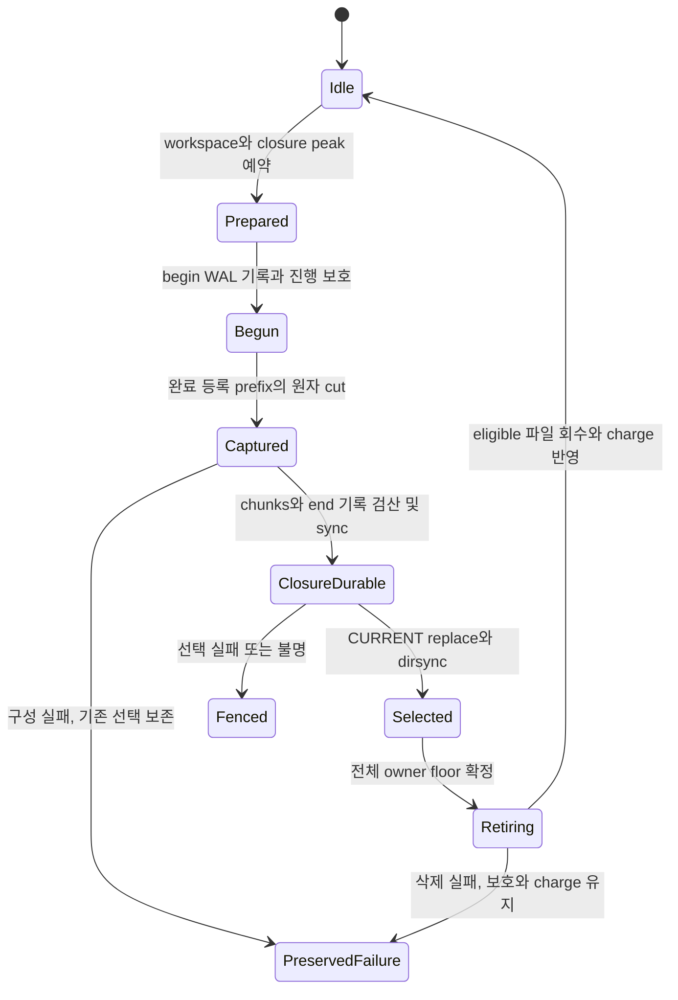
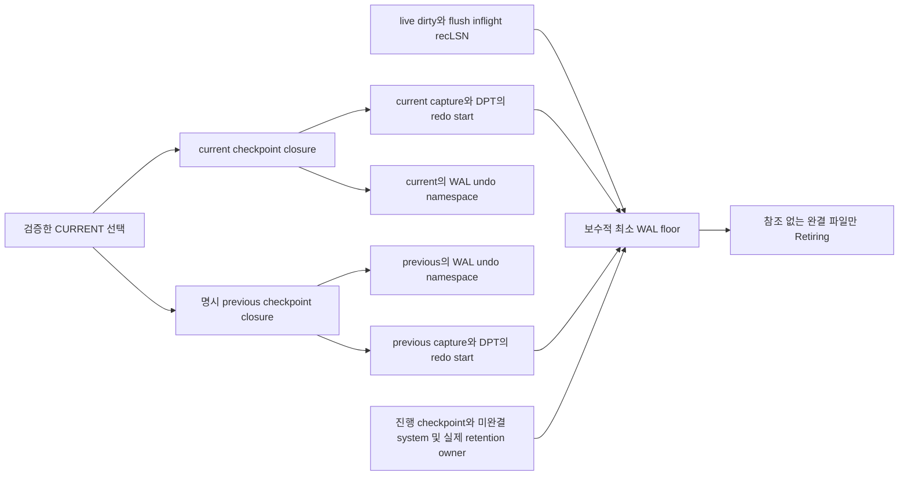
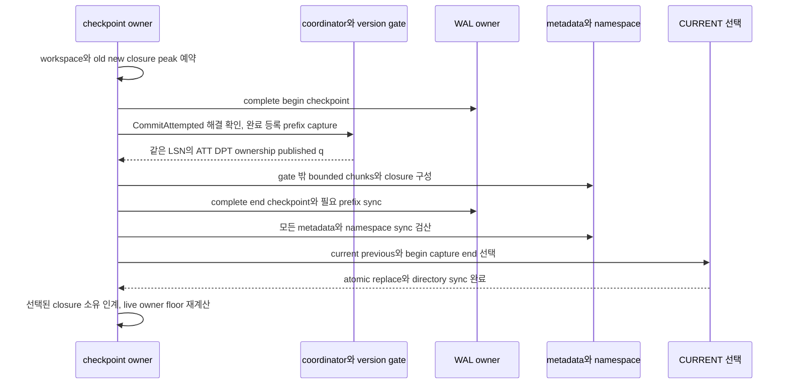

# DEV3 3.13 — checkpoint 개발 상세 명세와 설계도

2026-10-22 · **작업 상세 설계 / D2 상세화 수용 / control·descriptor 표현의 제한 공급 / fuzzy capture·CURRENT 선택·WAL 회수 미완료**

[공통 규칙](dev3-task-designs.md) · [구현 계획](../plans/dev3-implementation-plan.md#remaining-work) · [checkpoint 정본](disk-storage-design.md#checkpoint) · [복구 정본](disk-storage-design.md#recovery) · [control 표현](dev3-control-format.md) · [obligation](dev3-obligation-format.md)

이 작업은 정상 실행 중 이미 등록이 끝난 WAL prefix와 같은 시점의 ATT/DPT·진행/예약 소유를 capture하고, 완전한 checkpoint closure를 current/previous로 선택하며, 그 선택과 live owner가 더 이상 필요로 하지 않는 WAL만 회수하는 개발 명세다. 새 checkpoint/CURRENT body·자원 상한·성공 API를 채택하지 않는다.

## 1. 목적·선행·책임

| 단위 | 직접 공급 | 완료 경계 |
| --- | --- | --- |
| 3.13.1 fuzzy ATT/DPT capture | 3.05 dirty/flush-inflight 등록, 3.09 head/progress/obligation, 3.11 commit 상태/frontier, 3.12의 해당 선택·복구 공급 | 완료 등록 prefix의 capture와 metadata chunk 구성. 아직 CURRENT 선택·회수 완료 아님 |
| 3.13.2 current/previous 선택·fallback | 3.13.1의 완전 capture closure, typed namespace/control·실제 I/O 공급 | begin/capture/end·digest·current/previous closure를 영속 선택, 허용된 fallback 판정 |
| 3.13.3 WAL floor·안전한 회수 | 3.13.2, live dirty·미완결 system·기타 retention owner, coordinator/retention guard | 단조 floor·Retiring 등록 뒤 lock 밖 unlink/dirsync, 실제 반환/불명 보존 |

계획의 `capture → 선택 인계 → 회수` 순서를 유지한다. 3.12.5의 RECOVERY_REBASE는 새 WAL begin/end 없이 admission을 닫은 상태에서 self-contained base를 설치하는 복구 전용 장벽이다. 이 3.13이 완료되어야 REBASE를 시작할 수 있는 순환을 만들지 않는다. 반대로 정상 fuzzy checkpoint를 DPT empty·모든 home flush·base-only writer continuation을 보장하는 REBASE로 표시하지 않는다.

normal checkpoint는 전체 DB data snapshot이 아니다. 변경·flush는 capture 전후 계속될 수 있으며 모든 dirty home flush를 요구하지 않는다. previous checkpoint는 더 이른 analysis/redo 시작점이다. mutable datafile의 과거 사본·cold-page 손상 수리·완전 backup을 제공하지 않는다. exact-C backup은 3.15.2의 별도 drain/flush/복사/선택 작업이다.

현행 [control](dev3-control-format.md)은 Profile/FILEMAP/DWB selector·ControlRef를 지원하고 일반 CURRENT/checkpoint·recovery WRITER body를 지원하지 않는다. [obligation](dev3-obligation-format.md)은 descriptor와 일부 ownership 관측을 공급하지만 최종 checkpoint closure와 capture·선택·복구 적용을 공급하지 않는다. DEV2 checkpoint나 genesis WRITER의 제한 I/O를 DEV3 정상 checkpoint 구현으로 재표기하지 않는다.

## 2. 요구 ID와 불변식

| 요구 ID | 상세 요구 | 직접 인수 |
| --- | --- | --- |
| 3.13-R1 | capture는 coordinator/version-edit gate 아래 **page·head/status·DPT·예약 등록까지 완료된** prefix만 선택한다. staged WAL만 보고 cut을 정하지 않는다 | 3.13.1, DS05 |
| 3.13-R2 | CommitAttempted의 sync/상태 설치가 미완료면 capture를 진행하지 않는다. 불명 commit을 누락/Active로 고쳐 checkpoint를 성공시키지 않는다 | 3.13.1, DS02/05 |
| 3.13-R3 | capture LSN과 ATT의 TxnRef/head/rollback progress·remaining obligation, DPT의 recLSN, allocator/high-water·ownership inventory, published q를 같은 cut으로 결합한다 | DS05, RC-T14 |
| 3.13-R4 | capture 중 gate/latch/registry 아래 I/O·allocation·무제한 목록 복사를 하지 않는다. 큰 inventory는 같은 prefix를 재현 가능한 bounded 표현/수명으로 인계한다 | DS03/05 |
| 3.13-R5 | begin/capture/end 관계·전체 chunk count/digest·namespace/profile·owner/sequence·closure를 검산한 뒤만 CURRENT를 atomic replace+dirsync로 선택한다 | 3.13.2, DS05 |
| 3.13-R6 | previous fallback은 명시 reference와 필요한 WAL/undo/namespace가 모두 남고 현재 page가 redo로 설명될 때만 허용한다. 큰 파일 번호·raw 파일 scan으로 대체하지 않는다 | 3.13.2, DS05 |
| 3.13-R7 | selector 불명은 old/new의 가능한 모든 closure와 floor를 보존하고 fence한다. 두 선택 중 유리한 쪽을 추측하여 삭제하지 않는다 | DS05, RC-T14 |
| 3.13-R8 | WAL floor는 current/previous redo_start·live dirty recLSN·진행 checkpoint·미완결 system·실제 retention owner의 최소 필요 LSN이다 | 3.13.3, DS05 |
| 3.13-R9 | Active 거래 begin LSN은 undo store 독립성 조건을 만족하면 자동 floor가 아니다. free/undo/status 변경은 home flush·checkpoint 인계 전까지 필요한 WAL을 보존한다 | DS04/05, RC-T13/14 |
| 3.13-R10 | floor 확정/Retiring 등록은 coordinator→retention 경계, unlink/dirsync는 그 밖이다. 실제 영속 회수 전 charged bytes/FD·closure를 반환하지 않는다 | DS03/05 |
| 3.13-R11 | 회수와 새 dirty/owner·checkpoint 공개가 경쟁해 필요한 WAL을 지우지 못하도록 admission/등록을 조정한다. floor를 되감을 새 owner를 무검증 등록하지 않는다 | DS05, RC-T14 |
| 3.13-R12 | checkpoint F05는 capture 메모리·owner/DPT·inventory·old/new/previous 공존·file/FD·WAL 소비와 고정 peak를 모두 포함한다 | F05, PF09 |

## 3. 입력·출력·소유 경계

아래 연산은 내부 설계 경계다. exact Rust 타입·wire tag·오류 우선순위는 해당 leaf의 F01/F02에서 동결한다.

| 논리 연산 | 입력·소유 | 출력·보장 | 해제/실패 |
| --- | --- | --- | --- |
| checkpoint 준비 | 선택 profile, healthy session, checkpoint 작업/자원 token, 기존 current/previous closure | 고정 capture 공간·chunk/control staging·진행 WAL 보호 | 첫 effect 전 capacity/overflow 검산. 기존 선택 불변 |
| begin 기록 | 실제 WAL owner와 동결된 begin 의미 | ordered stream의 begin identity·진행 owner | begin 이후 실패도 consumed/retained bytes를 되감지 않음 |
| capture | coordinator·version gate, 완료 등록 prefix와 필요한 registry, 미해결 CommitAttempted 없음 | 불변 cut descriptor와 bounded ATT/DPT·예약/ownership의 같은-prefix 입력 | live registry 참조를 잠금 해제 뒤 그대로 읽지 않음 |
| closure 구성 | capture owner의 불변 입력 또는 고정 prefix 재현 자료, caller workspace | exact end metadata chunks·aggregate digest·필수 참조 검산 | 실패하면 성공 checkpoint로 선택하지 않으며 보호 중인 source를 유지 |
| current/previous 선택 | 완전 closure·end durability·namespace, 현재 선택 identity | directory sync까지 확인한 선택 | 불명이면 old/new 합집합 보존·공통 fence |
| redo 시작점 해석 | 검증된 checkpoint capture/DPT | `redo_start=min(capture_lsn, minimum DPT recLSN)` | DPT가 비면 capture LSN. 전체 DPT RAM 적재 요구 없음 |
| floor 확정·Retiring | current/previous·live retention의 같은 조정 경계, 명확한 namespace ownership | 더 이상 필요 없는 파일의 bounded retirement 작업 | 참조·범위·세대 재검사, 불명 상태에서는 새 삭제 금지 |
| 실제 회수 | 검증된 Retiring owner·파일 identity | unlink+dirsync 완료와 실제 charge 감소 | 실패/불명은 bytes/보존 책임 유지; 진단은 권한 아님 |

capture result는 성공 선택 전까지 현재 checkpoint가 아니다. current/previous reference는 그 자료를 필요로 하는 owner이며 selector 교체 성공만으로 이전 WAL 전부가 불필요해지지 않는다. runtime DPT는 buffer/flush-inflight의 recLSN을 보유하고 capture에 제공하지만 recovery는 선택된 DPT를 streaming하여 최소 recLSN을 구하고 전체 DB 크기의 RAM DPT를 다시 만들지 않는다.

## 4. 상태와 선택 설계도

이 상태는 새 disk enum이 아니다. 오류별 재시도 가능 범위는 F02에서 원래 I/O effect/certainty와 함께 고정한다. `PreservedFailure`는 정상 종료 성공을 뜻하지 않는다. 실패한 새 capture를 폐기할 때도 진행 owner의 WAL/immutable 파일 소유를 누가 언제 정리하는지 동결해야 하며 Drop에 숨은 unlink/sync를 넣지 않는다.

current와 previous가 같은 closure를 가리키면 물리 파일 bytes는 한 번만 charge한다. 서로 다르면 두 closure와 다음 설치 peak를 모두 보존한다. CURRENT 선택이 불명이면 가능한 old/new 선택 각각의 current/previous 합집합을 고려한다. FILEMAP/DWB의 임의 previous fallback은 이 그림이 허용하지 않는다.

## 5. 단계별 알고리즘

### 5.1 3.13.1: fuzzy capture

물리 WAL slot의 Idle 또는 synced prefix는 capture 가능 여부가 아니다. [Commit 의미 설치 장벽](disk-storage-design.md#commit-installation-order)이 남아 있으면 status/terminal·descriptor·DPT 등록이 끝나지 않은 것이므로 capture하지 않는다. 대기하면서 turn·공유 workspace를 보유해 그 Commit continuation을 막아서도 안 된다.

1. 기존 profile·WAL/dirty/owner ledger에서 checkpoint 작업을 admission한다. capture 버퍼·chunk/control staging·WAL bytes·FD·최대 closure 공존을 예약한다. 공유12MiB workspace의 작업은 3.10.1 turn에 참여하고 workspace를 보유한 turn 대기를 만들지 않는다.
2. 동결된 의미의 begin-checkpoint 기록을 complete WAL로 설치한다. 진행 중 checkpoint가 요구하는 WAL 구간과 임시 소유를 등록하여 CURRENT 선택 전 회수에서 보호한다. begin LSN, capture LSN, end LSN을 별도 값으로 다룬다.
3. coordinator 아래 CommitAttempted의 sync/상태 설치가 끝났는지 확인한다. 미완료면 필요한 대기를 gate/latch 밖에서 조정하고 capture를 다시 시도한다. 불명 commit은 진행 중단/fence이며 추측한 상태로 capture하지 않는다.
4. coordinator→version-edit gate→필요한 append/registry 순서를 준수한다. 이미 stage된 update·CLR·commit·abort에 대해 page/head/status/DPT·예약 등록까지 끝난 prefix를 고른다. 쓰기 중간의 old ATT와 new DPT를 섞거나 latest append LSN만 사용하지 않는다.
5. 고정 공간에 capture LSN, ATT의 owner identity/descriptor/head/rollback next/target·remaining, DPT identity/recLSN, allocator/high-water·예약 소유의 같은-prefix 참조, published q를 고정한다. descriptor core·status home·ledger가 서로 다른 시점이면 실패다. exact field 목록과 고정 capacity는 F01/F05에서 동결한다.
6. 모든 capture 등록을 마친 뒤 gate/registry를 해제한다. 필요한 WAL/closure의 소유는 checkpoint 작업이 유지한다. gate 아래 file read/write/sync·hash를 위한 큰 stream 순회·allocation·사용자 callback을 넣지 않는다.

큰 ownership inventory를 짧은 gate 아래 전체 복사할 수 있다고 가정하지 않는다. capture에는 고정 크기의 불변 근거와 같은-prefix owner 표를 인계하고 chunk는 밖에서 구성해야 한다. **그 근거를 어떻게 안정화하는지는 아직 F02 미동결**이다. immutable capture source 또는 보존된 checkpoint inventory+complete WAL prefix에서 cut까지 재현하는 방식 등은 정확 수명·재검사·읽기 비용·peak를 독립 검토해야 한다. mutable home allocator를 gate 해제 후 읽은 최신 값으로 capture cut을 대신하거나, root hash만 저장하여 전체 closure가 있다고 주장하는 구현은 허용하지 않는다.

### 5.2 3.13.2: end metadata와 current/previous 선택

1. capture immutable 입력으로 end metadata를 bounded streaming 구성한다. 전체 chunk 수·순서·범위·owner count·digest·DPT min recLSN·inventory 합계/중복 소유를 검산한다. 예상 namespace/profile/capture/owner 표는 신뢰한 capture에서 받으며 chunk 자신에서 복사하지 않는다.
2. begin/capture/end의 stream identity·순서와 exact closure를 결합한다. end WAL 또는 metadata record의 구체 배치·opcode, current/previous reference layout·checksum은 F01에서 동결한다. 현행 XCS1 FileMap/Doublewrite selector에 미지원 checkpoint body를 opaque로 끼우지 않는다.
3. 필요한 WAL prefix와 모든 metadata/chunk file을 sync하고 namespace 장벽을 만족한다. 일부 chunk만 성공하면 선택하지 않는다. full logical length·digest와 고정 container 물리 길이를 구별하며 suffix/raw staging을 후보로 검색하지 않는다.
4. CURRENT가 새 current와 명시 previous의 identity·begin/capture/end·전체 digest를 선택하도록 준비한다. 이전 current를 previous로 인계하는 구체 generation 전이는 F01/F04의 frozen 선택표로만 수행한다. selected current/previous가 참조하는 파일/슬롯을 덮어쓰지 않는다.
5. typed publish와 directory sync를 완료해야 새 선택을 확정한다. atomic rename의 가시성만 보고 durability를 주장하지 않는다. 실패/불명은 old/new 합집합 closure 보존, fence와 삭제 중단이다. WRITER를 checkpoint capture 시점으로 되돌리지 않는다.
6. 성공 선택 뒤 이전 작업의 소유를 정리하되 live dirty·미완결 system·backup 등 다른 owner의 보존을 확인한 다음 회수 단계로 넘긴다. metadata가 새로 선택되어도 오래된 redo start를 요구하는 previous는 계속 보호한다.

fallback은 검증한 CURRENT가 명시하는 previous만 대상으로 한다. 그 metadata와 필요한 WAL/undo/FILEMAP namespace가 모두 남아 있고 현재 page를 해당 history로 설명할 수 있어야 한다. missing/corrupt CURRENT에서 디렉터리를 스캔해 가장 큰 generation을 고르지 않는다. fallback 가능한 failure class와 current/previous 둘 중 어느 prefix를 채택할지는 F01/F04로 동결하며, datafile checksum 손상을 previous selector만 바꿔 성공시킬 수 없다.

### 5.3 3.13.3: WAL floor와 실제 회수

1. 검증된 current와 previous 각각에서 `redo_start=min(capture_lsn, min_rec_lsn)`을 구한다. DPT가 비면 그 checkpoint의 capture LSN을 사용한다. runtime의 live dirty/flush-inflight recLSN, 진행 checkpoint, 미완결 system, 실제 backup/archive/RP 등의 owner가 요구하는 LSN도 열거한다. 미구현 미래 owner를 지원 완료로 표시하지 않되 도입 시 이 계약에 통합해야 한다.
2. coordinator→retention 조정 경계에서 보수적 최소 floor를 확정한다. 새 owner/dirty 등록과 회수의 경쟁을 같은 프로토콜로 조정한다. floor는 단조 전진하고, 이전에 삭제 가능한 범위를 다시 요구하는 owner를 무검증 허용하지 않는다. 초기 begin LSN을 모든 Active 거래의 자동 최소값으로 더하지 않는다.
3. Active 시작 WAL을 제외하려면 현재 checkpoint head/progress·undo/status/allocator의 redo 가능성과 필요한 undo chain 독립성이 실제로 성립해야 한다. free/undo/status 변경도 home flush·checkpoint 인계 전까지 live recLSN/owner로 보호한다. 이 조건을 단순 terminal 여부·count0·dirty 수 감소로 대체하지 않는다.
4. WAL file의 exact stream/epoch·범위·namespace identity와 모든 closure 참조를 검산한다. floor에 걸치거나 incomplete tail·현재 writer·predecessor/선택 closure가 여전히 요구하는 파일은 회수하지 않는다. 물리 file 전체 회수의 경계·끝 LSN 포함 여부는 WAL owner F01/F02에서 동결한다.
5. 회수 가능한 파일을 bounded `Retiring` 작업으로 등록하고 필요한 ownership/charge를 보존한 채 lock을 해제한다. 실제 remove와 directory sync는 coordinator/version/retention latch 밖에서 한다. 임의 경로 unlink 대신 owned namespace의 검증된 파일을 사용한다.
6. unlink+dirsync의 확인된 결과만 actual retained/owned charge에서 반환한다. 오류/불명·남은 열린 inode handle의 책임을 숨기지 않는다. 안전한 재개/이미 없는 파일 판정은 frozen identity와 Retiring 상태에 따라 처리하고 선택 없이 삭제를 반복하지 않는다. selector 불명이나 신규 보존 관계가 unresolved이면 새 회수를 중단한다.

## 6. 오류·취소·복구 인계

| 경계·실패 | 요구 결과 | 남길 보호 |
| --- | --- | --- |
| 준비 용량/overflow·미지원 body | 첫 effect 전 오류, 현 CURRENT 불변 | 기존 live owner/closure |
| begin 뒤 capture 재검사 실패·CommitAttempted 대기 | 완료 등록 prefix가 확보될 때까지 정상 선택 없음 | begin 소비 WAL와 진행 작업 예약 |
| 불명 commit 또는 stage 후 불완전 등록 | checkpoint 진행 금지·공통 fence | 가능 history와 기존 owner |
| chunk 생성·end append/sync 일부 실패 | 새 CURRENT 선택 금지. 생성물 ownership 유지 | old current/previous와 필요한 새 진행 prefix |
| selector write/replace/dirsync 오류·불명 | old/new 합집합 closure 유지·새 삭제 금지 | 모든 가능한 redo floor와 실제 charge |
| current metadata 문제, previous 검증 실패 | arbitrary fallback/READY 금지 | 원본 bytes와 원래 corruption/cause |
| 회수 전 취소 | durable 선택 사실은 취소하지 않음. 명시 owner에 남은 cleanup 인계 | reference/charge가 끝나기 전 반환 금지 |
| unlink 성공 후 dirsync 실패·불명 | 실제 영속 삭제로 확정하지 않음, 새 회수/charge 반환의 보수적 처리 | Retiring owner와 uncertain 결과 |
| crash 후 reopen | 선택된 closure의 capture로 ATT seed, capture 직후부터 analysis; redo_start부터 streaming redo | pageLSN skip과 ledger 한번 채택 구분 |

recovery는 checkpoint 이전 owner 상태를 다시 analysis하여 terminal 거래를 ATT에 부활시키지 않는다. 반면 page redo는 보수적인 redo_start부터 commit 여부와 관계없이 이력을 반복한다. 이 두 시작점을 구별한다. old/new 선택 불명의 실제 crash image, torn control, 마지막 chunk 손상, metadata는 유효하지만 필요한 WAL gap이 있는 previous를 모두 판정해야 한다. 일반 startup에 변경 없는 cold table 전수 검사를 추가해 fallback 정합성을 대신하지 않는다.

## 7. 자원·bounded capture·PF09

| 자원 | 현재 소유 계약의 입력 | 이 작업의 미완료 증명 |
| --- | --- | --- |
| 메모리 | metadata8MiB, system16MiB=flush4MiB+단일 maintenance12MiB | capture ATT/DPT·owner table·chunk/hash/cursor·WAL frame·중첩 local·selector staging의 동시 peak. 별도 무제한 DPT/전체 inventory 복제 금지 |
| runtime DPT | buffer4/16/64MiB의 dirty와 flush-inflight recLSN | 실제 frame/claim 구조에 따른 최대 entry·중복 제거 규칙, 동시 capture 공간·수명 |
| transaction/owner | 최대32거래; descriptor1536-byte 표현 | system 상한4·총36과 inventory 세 bank는 원문 제안 범위. 전체 실행 지원 한도로 자동 채택 금지 |
| control | CURRENT/WRITER selection/staging 각4KiB capacity 입력, REBASE 두1MiB slot 제안 | 정상 fuzzy checkpoint의 exact body/chunk/file name·선택 공존 peak는 별도. REBASE1MiB에 정상 checkpoint 전체가 든다고 가정 금지 |
| inventory | immutable root/chunk 표현, chunk 최대169 items | F05의 실제 N_max·owner별 합계와 중복 소유, current/previous/new 공존·stream 재순회 비용 |
| disk/WAL | owned8GiB 안 protected1GiB, retained+outstanding WAL≤256MiB | 두 checkpoint closure와 새 설치·staging·진행 WAL·실제 FD128 내 소비, 실패/불명/재장애 peak |

control 문서의 알려진23,130,112-byte 소계는 DWB/FILEMAP/profile와 제안 REBASE 등을 합한 부분값이다. normal fuzzy checkpoint 두 세대+설치 peak·ownership inventory·epoch/terminal 작업 전체가 들어간 최종 fixed maintenance가 아니다. descriptor36개가55,296 bytes라는 산술도 실제 checkpoint 전체 fit·동시 system admission을 증명하지 않는다. 제안값을 이 상세 문서에서 지원 profile로 승격하지 않는다.

동일 cut의 큰 inventory를 streaming하려면 source/retained WAL·불변 root의 수명을 끝까지 확보해야 한다. checksum/digest는 준비 이후의 실제 canonical item 전체와 결합하며 해시에 item을 임의로 더하고 빼는 O(1) 갱신을 가정하지 않는다. 반복 scan은 bounded RAM이어도 I/O/CPU 비용을 만들므로 PF09에서 별도로 측정한다. capture latch 구간에 이 비용을 넣지 않는다.

PF09에는 begin→capture·capture→durable end·selector 완료 시간, capture에서 writer/commit 대기, ATT/DPT/owner/chunk 수·bytes, oldest recLSN와 checkpoint lag, 새/회수 WAL bytes·실패 charge, RSS/FD·workspace peak를 연결한다. 일반 reopen과 full audit 비용은 분리한다. floor가 live owner 때문에 정체되면 원인과 겹친 보존 범위를 bounded 진단으로 보고하며 reader 강제 만료·필요 WAL 삭제로 해결하지 않는다.

## 8. 구현 하위 작업과 실제 source 진입점

| 단위 내 작업 | 산출물 | 완료 경계 |
| --- | --- | --- |
| 3.13.1-A capture protocol | CommitAttempted 조정·완료 등록 prefix·ATT/DPT/owner guard | 상태 혼합 없는 짧은 capture, 실제 thread/try cleanup |
| 3.13.1-B bounded closure | immutable 입력/같은-prefix inventory 수명·chunk 구성 | gate 밖 I/O, 모든 owner/항목 검산, exact F05 |
| 3.13.1-C begin/end 의미 | WAL과 capture LSN의 결합·부분 실패 ownership | checksum만 맞는 누락 checkpoint 거절 |
| 3.13.2-A 형식/선택 | CURRENT body·current/previous·generation·digest·typed I/O | 새 F01/F02/F04 동결과 actual namespace cut |
| 3.13.2-B fallback | 명시 previous의 전체 closure·WAL/undo/namespace 검산 | 불완전 fallback·raw scan 거절, current page redo 설명 |
| 3.13.3-A retention | 단조 floor·owner 등록 경쟁·Retiring | 필요한 WAL 삭제 mutant 검출 |
| 3.13.3-B 회수 | bounded owned unlink/dirsync·charge 반환·재시작 | lock 밖 I/O, 불명/부분 삭제·두 번째 crash 안전 |

| 실제 source | 현재 공급과 후속 경계 |
| --- | --- |
| [control.rs](../../crates/engine/src/storage/control.rs) | `Profile`, `ControlRef`, `encode/decode_selector`, `FileMapCursor`. selector role은 현행 FILEMAP/DWB 범위이며 checkpoint/CURRENT 성공 decoder 없음 |
| [obligation.rs](../../crates/engine/src/storage/obligation.rs) | owner descriptor/remaining/chain 표현. capture table·runtime ledger·terminal 인계는 후속 |
| [ownership.rs](../../crates/engine/src/storage/ownership.rs) | ownership root/chunk·bounded 관측 공급. 실제 선택 closure·예약 복원 성공과 구분 |
| [wal_io.rs](../../crates/engine/src/storage/wal_io.rs) | actual staged/synced prefix와 writer owner. checkpoint begin/end 일반 opcode는 동결/연결 필요 |
| [semantic_group.rs](../../crates/engine/src/storage/semantic_group.rs) | 좁은 RollbackStart의 descriptor/page 결합. Checkpoint는 owner 하나의 해당 그룹 성공으로 대체하지 않음 |
| [read_buffer.rs](../../crates/engine/src/storage/read_buffer.rs) | 현행 clean buffer; 3.05가 추가할 DPT/flush-inflight와 capture 경계를 연결 |
| [namespace.rs](../../crates/foundation/src/namespace.rs), [Linux namespace](../../crates/platform/src/namespace.rs) | typed selector publish·directory sync·owned file 처리. engine이 Linux 구현을 직접 import하지 않음 |

DEV3 checkpoint의 새 source/module 경로는 실제 구현과 함께만 등록한다. 기존 DEV2 durable checkpoint를 동명이란 이유로 완성된 DEV3 공급으로 간주하지 않는다.

## 9. 독립 인수 case

다음 case의 실행 상태는 **NOT_RUN**이다. oracle는 명시 event history에서 cut별 ATT/head/next·descriptor·edge/ownership·DPT·q와 필요한 WAL 파일 집합을 독립 계산한다. production capture/recovery/encoder가 expected를 만드는 구조를 사용하지 않는다.

| case ID | 독립 입력·반례 | 기대 결과 | 연결 |
| --- | --- | --- | --- |
| 3.13-C01 | update/CLR의 WAL stage와 page/head/DPT/예약 등록 사이 capture 경쟁 | 미완료 등록 prefix 선택0, 모든 capture field 같은 LSN | 3.13.1, DS05 |
| 3.13-C02 | CommitAttempted sync 대기·status 설치 전·frontier 공개 전·불명 commit | 미해결 capture0, 정상 완료 뒤 같은 status/q·owner cut, 불명 성공0 | DS02/05 |
| 3.13-C03 | dirty flush copy·redirty·DPT 제거와 capture 실제 thread 경쟁 | 필요한 recLSN 누락0, removed 후 신규 dirty 등록 유실0, image sync와 floor 구별 | 3.05/3.13, DS05 |
| 3.13-C04 | ATT/head/progress/remaining/inventory 중 하나 누락·다른 cut으로 교체 mutant | checksum 재봉인해도 closure 불일치 거절 | RC-T14 |
| 3.13-C05 | 큰 inventory, 마지막 chunk 손상·누락·중복/범위 gap·owner count mismatch | bounded stream finish까지 확인, mutable home 최신값 대체 금지, heap 성장 없음 | DS03/05·F05 |
| 3.13-C06 | begin/capture/end 역순·다른 stream/profile·일부 metadata만 sync | CURRENT 선택0, 진행 WAL/소유 보존 | 3.13.2, DS05 |
| 3.13-C07 | CURRENT write/replace/dirsync 각 before/partial/after·torn selector | confirmed 선택 또는 보수적 old/new 합집합, 불명 뒤 회수0 | DS05, RC-T14 |
| 3.13-C08 | current 불가/명시 previous 정상, previous metadata 정상이나 WAL gap/undo/FILEMAP 누락 | 완전 closure만 fallback, 큰 파일번호/raw directory fallback0 | DS05 |
| 3.13-C09 | previous 더 이른 시작점과 current datafile의 최신 page, cold-page 손상 | 정상 redo는 최신 pageLSN 보존, previous로 data image 복원 주장0 | DS05 |
| 3.13-C10 | current/previous·dirty·system·진행 checkpoint 각각 다른 최소LSN, 새 owner 등록 경쟁 | 모든 실제 owner 최소값·단조 floor, 필요 파일 삭제 mutant 검출 | 3.13.3, DS05 |
| 3.13-C11 | Active begin WAL 회수 조건 충족/불충족 두 fixture, dirty undo/status/free page | 조건 충족 후 begin 자동 pin 없음·abort/restart 가능, 미충족 WAL 유지 | DS04/05, RC-T13/14 |
| 3.13-C12 | Retiring 등록 전후·unlink 전후·dirsync 불명·열린 old inode·재장애 | lock 밖 I/O, 영속 회수 전 charge 반환0, 필요한 closure 불변 | DS03/05 |
| 3.13-C13 | capture/selector generation MAX·DPT/owner/chunk capacity−1/동일/+1 | checked overflow/미지원 bound는 첫 effect 전 거절, 입력 잘라 성공0 | F01/F05 |
| 3.13-C14 | 동일 0/소량 WAL와 dirty 수의 다른 DB 크기, normal checkpoint 뒤 reopen | bounded selected metadata+WAL 중심 실행, cold table 전수 scan을 정상 open에 추가하지 않음 | DS03/PF09 |
| 3.13-C15 | 정상 fuzzy checkpoint와 3.12.5 REBASE의 별도 fixture | fuzzy dirty 존재 허용·normal begin/end, REBASE base-only/두 슬롯 의무는 별도 인수 | RC-T14 |

fault별 실제 bytes·file identity·sync/publish events, capture cut·owner 집합·floor/charge의 before/after, reopen 결과를 보존한다. 메모리 모델·actual Linux I/O·thread·reopen 결과를 구분하며 강제 종료를 전원 장애로 재표기하지 않는다. checkpoint 성공 뒤에도 전체 audit의 논리 정답 검증은 해당 S1/fault 인수에서 별도 수행한다.

마지막 관련 검증 이후 바뀐 코드와 새 capture/선택/회수 연결 경로만 선택 시험한다. 같은 source의 무변경 control/descriptor/clean buffer 시험이나 전체 workspace·leaf·하위 wrapper를 반복하지 않는다. 과거 PASS·중단·실패는 원래 scope로 보존하고 미실행을 새 성공으로 합산하지 않는다.

## 10. leaf 착수 전 추가 동결·완료 조건

| 항목 | 구체 미동결 내용 | 구현 경계 |
| --- | --- | --- |
| F01 checkpoint/current | begin/capture/end bytes·WAL opcode, ATT/DPT/high-water/publication·ownership closure body, CURRENT refs/generation·fallback 허용표·file 이름 | 3.13.1/2의 첫 새 효과 전 |
| F02 capture | CommitAttempted 대기와 coordinator/version/registry rank, short capture buffer, 큰 inventory의 같은-prefix 안정화·참조 수명 | capture 구현 전 |
| F02 소유·취소 | 진행 checkpoint retention 등록·실패 staging owner·Drop·retry·terminal cleanup | begin 효과 전 |
| F02 retention | 신규 owner/dirty 등록과 단조 floor, physical WAL file 끝 경계·predecessor closure·Retiring 재개/불명 판정 | 실제 회수 전 |
| F05 전체 peak | runtime DPT/capture·owner/inventory N_max·normal current/previous/new 공존·FD/12MiB workspace·WAL/protected 회계 | 해당 operation admission 전 |
| F03/F04 | cut별 독립 ATT/DPT/owner 기대값, exact effect/partial I/O·selector/fallback/회수 crash 분모·known-bad mutants | 변경 경로 시험 구현 전 |
| 소비 통합 | 3.12 analysis/redo 시작점·reservation restore, 3.05 redirty/floor, 3.09 begin-WAL 없는 abort, 3.15 exact backup 선택 | 해당 연결 경로 완료 전 |

3.13.1은 같은 cut의 bounded capture, 3.13.2는 실제 durable current/previous 선택과 허용 fallback, 3.13.3은 live owner를 보존한 실제 charge 회수로 각각 판정한다. 정상 checkpoint 완료를 REBASE·exact-C backup·일반 recovery·전체 DEV3/S1 완료로 확대하지 않는다. 문서군의 D2 상태와 독립 검토는 [공통 결정](dev3-task-designs.md#decision)이 소유한다.
