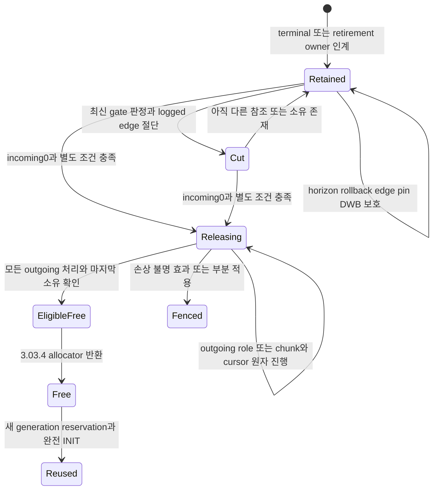
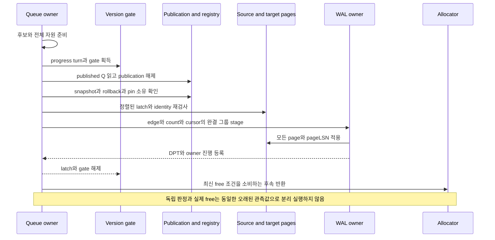

# DEV3 3.14 — 공간 회수 개발 상세 명세와 설계도

2026-10-22 · **작업 상세 설계 / D2 상세화 수용 / 표현·모델 증거 보존 / 실제 aging·공간 반환·재사용 통합 미완료**

[공통 규칙](dev3-task-designs.md) · [회수 정본](disk-storage-design.md#reclaim) · [참조 수명](disk-storage-design.md#undo-lifecycle) · [snapshot/horizon](disk-storage-design.md#snapshot-acquisition) · [보존 압력](disk-storage-design.md#retention-pressure) · [undo 표현](dev3-undo-format.md) · [상태 home](dev3-status-home.md)

## 1. 목적·공급 경계·현재 상태

snapshot과 rollback이 요구하는 값을 보존하면서 불필요해진 undo·status·삭제 row/index·overflow·retired object를 bounded owner queue로 정리하고 내부 공간을 재사용한다. whole-pack GC·전체 root tracing·전체 DB rewrite·필수 online shrink를 도입하지 않는다. page 내부 cell 정리는 logged compaction이며 undo의 안정 slot index를 이동시키지 않는다.

3.14.1은 3.05.3·3.09.1·3.10.1·3.11.1의 해당 공급 뒤 eligibility/horizon·마지막 pin/영속 edge/DWB 조건을 판정한다. allocator의 실제 free/reuse는 그 판정을 소비하는 3.03.4이며, 3.14.2는 3.03.4와 end-to-end 반환·재사용·압력 해소를 인수한다. **3.14.1 → 3.03.4 → 3.14.2**를 유지하며 allocator가 전체 회수 완료를 기다리는 순환을 만들지 않는다.

현재 undo root의 Free/Live/Releasing·cursor와 status home incoming은 표현/검산 공급이다. 실제 count 증감·terminal queue/credit·stamp/cut/release·slot 재사용 capability는 아니다. 특히 [terminal 작업의 경계](dev3-status-home.md)는 durable queue owner/credit을 같은 WAL 그룹으로 인계하는 계약이 동결되기 전 실제 terminal opcode를 Unsupported로 둔다. 이 문서가 그 미완료 제안을 채택하거나 실행 승인하지 않는다.

## 2. 요구 ID와 보존 소유

| 요구 ID | 명세 | 인수·소비 |
| --- | --- | --- |
| 3.14-R1 | gate 안 published Q와 registry로 H를 구하고 실제 cut/reuse마다 다시 검사. status11/frontier10·빈 registry에서도 q10 복원 보존 | DS04·3.10 |
| 3.14-R2 | incoming은 실제 영속 edge multiset의 수. snapshot/rollback/queue/transient pin·creator identity를 count로 합치지 않음 | DS04·M01/M02 |
| 3.14-R3 | terminal 상태·head와 잔여 cleanup owner/credit을 원자 인계. ATT 제거·abort 예약 반환이 회수 작업 소유를 없애지 않음 | 3.09/11·DS05 |
| 3.14-R4 | stamp·cut·edge/count·queue/진행점·obligation을 해당 완결 WAL 그룹으로 연결. rollback이 cut 전 edge를 되살리지 않음 | DS04·RC-T13 |
| 3.14-R5 | zero incoming과 horizon/rollback/transient 조건을 모두 만족할 때만 Releasing. 새 edge가 Releasing을 target으로 삼지 않음 | DS03/04 |
| 3.14-R6 | outgoing role·chunk를 durable cursor로 한 번씩 반환. 이미 반환한 chunk를 다시 읽어 다음 위치를 찾지 않음 | DS03/05·RC-T14 |
| 3.14-R7 | index key 정리→row/overflow 참조 제거→slot/extent 반환 순서를 유지. old row overflow는 별도 logged retirement owner가 보존 | DS03/04·3.06/07/08 |
| 3.14-R8 | 마지막 영속 edge·transient pin·prepared/inflight flush claim·DWB retirement와 정확 generation을 적용 시 검산하고 3.03.4에 반환. stale/ABA·wrap 거절 | DS03/04/05 |
| 3.14-R9 | 낮은 공간에서도 기존 예약으로 bounded aging/rollback/flush 진행. 정상 거래 종료나 먼저 회수될 공간에 자기 완료를 의존하지 않음 | DS03·M06 |
| 3.14-R10 | 압력 때 새 effect 전 거절과 bounded 원인 진단. 실제 returned bytes/page token/재사용/FS 반환을 구분하고 long snapshot을 강제 만료하지 않음 | DS03/04·PF09 |

| 소유 종류 | 보존 조건·회수와의 관계 |
| --- | --- |
| snapshot horizon | H 및 더 오래된 등록 소유가 필요로 하는 모든 버전 재구성. undo record q 하나를 비교하는 규칙으로 축소 금지 |
| Active rollback | reader가 없어도 transaction head/previous-transaction과 before 값 유지. RC statement 사이 snapshot 해제는 거래 rollback 소유 종료가 아님 |
| 영속 incoming edge | row/index header·transaction head·두 previous role 등 실제 field마다 중복도 포함. 동일 target에 두 field면2 |
| status edge | row/index/catalog Transaction stamp·undo before Transaction stamp. undo creator의 TxnId/original status generation은 생성 identity이며 status lookup edge 아님 |
| transient reference pin | source latch 해제 전 등록한 exact 대상의 generation 수명. edge cut 후에도 마지막 pin 전 reuse 금지 |
| queue/retirement | cleanup 진행점·old overflow·retired object·orphan build의 영속 owner와 credit. membership만으로 값 필요성/Free를 추정하지 않음 |
| DWB/control/recovery | image copy 전부터 pending retirement의 영속 완료와 RAM finalize까지 유지하는 physical-address flush claim, pending DWB 주소, current/previous checkpoint·FILEMAP/WAL closure가 필요한 mapping/bytes. reader pin이 없거나 control pending이 비어 있어도 flush claim이 남으면 free/reuse 금지. page free와 control/WAL 삭제 조건을 합치지 않음 |

## 3. 입력·출력·소유 인계 설계

| 논리 연산 | 입력 | 반환·인계 |
| --- | --- | --- |
| 후보 순회 | 영속 owner queue·segment cursor와 예약 workspace | bounded 후보·정확 identity·보존 이유. 전체 page/root 목록을 RAM에 올리지 않음 |
| eligibility 평가 | 후보, published Q·등록 snapshot, rollback/object/backup·edge/pin/DWB 관측 | 현재 적용 구간의 판정 또는 보류 이유. 오래 보관해 free 권한으로 재사용할 token 아님 |
| terminal 인계 | terminal status/head, 남은 undo/retirement 소유와 credits | durable queue owner·진행 책임. 실제 bytes와 원자 그룹은 미동결 |
| stamp/cut | expected live source·대상 generation·원자 removed/added edge 집합 | 새 stamp/link·count·queue/progress·WAL 인계. old creator identity는 유지 |
| release batch | Releasing root와 durable cursor/released/next, 대상 allocator 소유 | 다음 durable cursor와 실제 반환량. 한 batch 실패를 완료 전체로 집계하지 않음 |
| allocator 반환 | 최신 eligibility와 exact generation·flush claim/DWB/pin 부재 | 3.03.4의 Free/새 reservation/INIT 전이. 판정만으로 실제 bytes 차감하지 않음 |
| pressure 진단 | 제한된 소유 스냅샷·ledger 값 | 자원/owner 종류·q 또는 LSN·age·잘림 표시·실제 회수량. 진단은 회수 권한 아님 |

읽은 후보가 stale이면 최신 상태에서 다시 판정한다. 손상·count 불일치·유효해야 할 edge 대상 소실을 정상 보류/NotFound로 숨기지 않는다. queue/record view는 caller bytes를 빌리는 표현이며 pin·lock·write 권한을 대신하지 않는다.

## 4. 회수 상태와 원자 처리

Retained/Cut/EligibleFree는 논리 설계 상태이며 새 disk state tag가 아니다. 기존 undo의 실제 state는 Free/Live/Releasing을 따른다. 최초 incoming0의 Live record도 별도 소유가 있으면 Retained다. generation을 증가시키는 정확한 시점은 allocator·undo slot 정본을 따르며 cancel/free 때 과거 generation으로 되감지 않는다.

마지막 allocator 호출은 별도 후속 그룹이면 그 적용 gate에서 조건을 다시 검사한다. 필요하면 source edge 제거와 반환을 같은 그룹으로 묶는 opcode를 동결한다. 그림으로 무계약 원자성을 가정하지 않는다.

## 5. 단계별 알고리즘

### 5.1 후보·horizon·최신 eligibility

1. terminal/retired owner의 영속 queue나 segment cursor에서 bounded 후보를 읽는다. owner generation·진행 LSN·정확 record/page identity를 검산한다. 후보 발견과 actual reclamation을 구분한다.
2. 필요한 forward/release WAL·전체 pin·ref registry·workspace를 예약하고 latch 밖에서 page를 준비한다. 공유 maintenance12MiB는 3.10의 선택된 turn owner만 얻으며 대기 시 반환한다.
3. version-edit gate 아래 tree/page/append/registry 전에 publication에서 Q를 읽고 해제한다. registry에서 H=min(Q, 등록 q들)와 rollback/object/backup 소유를 구한다. 빈 registry를 무한대 horizon으로 해석하지 않는다.
4. 실제 source/target의 generation·현재 link·incoming multiset·pin·flush claim·DWB/retirement 조건을 재검사한다. flush claim은 page incarnation과 별도로 물리 주소의 재사용을 차단하며, claim 획득과 allocator free/reuse 판정을 같은 소유권 경계에서 serialize한다. image가 private workspace에 복사되어 page pin이 해제된 뒤에도 claim을 검사한다. 오래된 before-image에 남은 옛 link가 현재도 유효하다고 추정하지 않는다. 준비가 달라졌으면 모든 적용 latch/gate를 놓고 재탐색한다.
5. 필요한 모든 snapshot 값과 Active rollback을 재구성할 수 있을 때만 해당 stamp/cut/release를 허용한다. 미충족은 보류 이유와 진행 cursor의 계약에 따라 다음 bounded 작업으로 넘긴다. active 거래 종료를 기다리며 workspace를 붙잡지 않는다.

### 5.2 terminal status·commit-q stamp

1. Commit/AbortEnd가 terminal이어도 head/incoming과 cleanup 작업은 남을 수 있다. terminal owner는 queue record·잔여 credit·진행 소유의 원자 인계가 확정되기 전 ATT descriptor/예약을 모두 반환하지 않는다. 이 실제 opcode는 해당 계약 동결 전 Unsupported다.
2. horizon을 통과한 `Committed(q)` 거래의 현재 header에 자기 TxnRef가 남으면 logged commit-q stamp로 바꾼다. 다른 거래가 이미 대체했다면 그 before-image의 resolved stamp와 현재 소유를 확인한다. `Aborted`에는 commit q를 만들지 않으며, 남은 undo before stamp의 참조는 release와 참조 정리 경로에서 제거한다. logical row identity는 변경하지 않는다.
3. stamp의 TxnRef 제거와 status home224의 incoming 감소를 같은 그룹으로 처리한다. count-only 대상 home의 core를 actor의 descriptor core로 잘못 복사하지 않는다. status generation·exact target과 원래 core를 검산한다.
4. undo creator identity는 이력 식별용으로 남긴다. creator를 edge로 세거나 이미 해제한 status를 creator로 재조회하지 않는다. 실제 before Transaction stamp만 status 수명 edge다.
5. 모든 실제 TxnRef edge·head/queue 소유·pin 등이 끝난 뒤에만 status slot 반환을 검토한다. terminal decode·count0만으로 Free를 만드는 shortcut을 허용하지 않는다.

### 5.3 logged cut와 rollback의 공존

1. version chain에서 오래된 suffix 후보를 정하되 H의 모든 snapshot과 Active rollback이 요구하는 경로를 독립적으로 확인한다. previous-version과 previous-transaction은 별도 role이며 같은 대상이면 중복도2를 유지한다.
2. source link를 Cut으로 만들고 target incoming을 감소시키며 queue/진행점·obligation을 같은 완결 그룹에 담는다. removed edge가 실제 old count에 포함되었는지 검사하고 checked 산술을 적용한다.
3. rollback은 현재 previous-version 상태를 소비한다. cut 전 저장된 참조를 무조건 부활시키지 않는다. CLR의 row/index 효과와 head/edge/count/UndoNextRef가 현재 보존 소유에 맞는지 3.09와 함께 확인한다.
4. 필요한 target이 이미 Releasing/Free이거나 유효 참조를 찾을 수 없으면 invariant failure/Fenced다. count 수치가 맞는다는 이유만으로 필요한 과거 값 손실을 허용하지 않는다.

### 5.4 outgoing release·chunk 반환

1. incoming0과 horizon/rollback/transient pin 조건을 만족하고 queue가 작업을 소유하면 Releasing으로 전환한다. 새 incoming edge를 연결하는 경로는 이 상태를 거절한다.
2. 기존 undo 형식의 고정 cursor를 따른다. 0→1은 previous-version, 1→2는 previous-transaction, 2→3은 before status 참조를 처리한다. 없는 edge도 처리 완료로 진행하며 각 role의 제거/count 변화와 cursor 갱신을 같은 WAL 그룹으로 묶는다.
3. cursor3에서 before stamp region은 zero다. chunk가 있으면 같은 그룹으로 release-next=head.root를 설치한다. Releasing의 raw before metadata를 reader/rollback 값으로 노출하지 않는다.
4. 현재 release-next의 chunk identity/index/header를 검산하고 next를 확보한다. allocator 반환·next 인계·released+1을 같은 그룹으로 처리한다. 이미 반환한 앞 chunk를 읽어 진행을 재구성하지 않는다. 마지막은 released=count와 next zero를 함께 남긴다.
5. cursor3/count완료 뒤 queue 소유·마지막 pin·해당 page 반환에 필요한 flush claim 해제·DWB retirement와 관련 참조 제거를 다시 확인하고 root slot을 반환한다. cell offset compaction은 가능해도 안정 directory slot index는 유지한다. 재점유는 checked generation 증가이며 MAX는 재사용하지 않는다.

### 5.5 index·row·overflow·object의 반환 순서

1. snapshot에 필요한 versioned index key/presence를 먼저 보존/정리한다. 논리 삭제라는 이유로 tree entry를 즉시 제거하지 않는다. 그 뒤 row/tombstone과 overflow 참조를 제거한다.
2. 교체된 old row overflow는 undo root에 저장되지 않는다. canonical before의 별도 undo chunks가 있다는 사실만으로 old chain을 즉시 반환하지 않는다. 별도 logged retirement owner가 head·allocator inventory·snapshot/rollback 필요성을 인계받아야 한다.
3. retired table/index/anchor와 orphan build는 catalog generation·allocation ownership·transaction status를 검산하고 필요한 old snapshot/object/backup 소유가 끝난 뒤 bounded batch로 정리한다. 같은 이름의 재생성은 다른 generation이다.
4. 구조 unlink는 retirement 등록까지 공급한다. eligible page/slot/extent는 3.03.4가 최신 조건과 해당 물리 page의 flush claim 해제·DWB whole-batch retirement를 확인하여 Free로 만들고 새 allocation은 새 incarnation INIT으로 보호한다. pending 선택 전 준비된 old-generation image와 retirement 선택 뒤 RAM finalize 이전의 claim도 반환을 막는다. mapping/control/WAL 보존은 해당 owner가 끝내기 전 제거하지 않는다.
5. 내부 Free page 증가, 실제 새 allocation에 재사용된 page, owned file bytes 감소, filesystem 반환량을 별도로 계측한다. extent 안 page가 Free여도 이미 실현된 file bytes는 계속 charged일 수 있다. S1은 online shrink/OS 반환을 필수로 요구하지 않는다.

### 5.6 WAL 보존과 회수 압력

1. WAL floor와 undo horizon을 구분한다. dirty undo/status/allocator의 recLSN과 선택 checkpoint closure가 남아 있으면 그 redo WAL을 보존한다. 오래된 Active 거래의 시작 WAL 자체를 영구 undo 입력으로 요구하지 않는다.
2. checkpoint+이후 WAL에서 같은 prefix의 head/progress·obligation·allocator 소유를 복원할 수 있을 때 begin WAL을 놓는다. 그 뒤 runtime abort와 crash/restart loser undo가 durable UndoRef chain으로 가능해야 한다. 새 foreground 한도를 낮췄다고 기존 소유를 줄이지 않는다.
3. 긴 reader와 churn으로 부족하면 다음 statement 첫 effect 전에 해당 자원을 거절한다. 이미 시작한 작업은 기존 오류/rollback 규약을 따른다. 내부 무한 재시도·snapshot 시간 만료·undo 덮어쓰기는 금지한다.
4. timeout/cancel은 해당 소유자의 실제 종료 경로가 pin/undo를 해제한 뒤만 eligibility를 바꾼다. owner 해제 후 실제 반환이 충분하면 admission을 재개하고, 여전히 부족하면 계속 거절한다.
5. 제한된 진단에 capacity/charged/reserved/requested, 보존 이유/owner generation, snapshot q 또는 WAL LSN, age·eligible/reclaimed/reused 수량을 넣는다. 겹친 보존 범위를 중복 합산하지 않고 잘림을 표시한다. 행/SQL/bind 원문을 넣지 않으며 진단 실패가 기존 오류 certainty나 rollback 진행을 바꾸지 않는다.

## 6. 자원·실패·재시작

| 자원·실패 경계 | 계산·처리 의무 |
| --- | --- |
| queue/credit | terminal·retirement record와 bounded batch/cursor bytes, 다음 stamp/cut/release·WAL·allocator 작업의 잔여 비용. record format과 owner별 최대 queue 규모는 F01/F05 동결 전 미정 |
| 적용 집합 | source/target/head/status/count/allocator/queue page를 실제 identity로 합산. same target 두 edge는 count2지만 동일 page pin은 실제 identity가 같을 때만 공유 |
| 작업 메모리 | 단일 maintenance12MiB, 전용 flush4MiB, bounded registry/diagnostics·전체 page pin·nested codec scratch. 전체 undo/page 목록·root mark scratch 없음 |
| disk/WAL | owned8GiB 안 protected1GiB, retained WAL+예약≤256MiB. 이미 쓴 CLR/aging WAL은 실제 회수 전 charged; extent bytes와 내부 token 중복 charge 금지 |
| 준비 부족·stale 후보 | 첫 effect 전 보류/거절·재탐색. 공간이 생길 것이라는 가정으로 예약을 생략하거나 자기 rollback 완료를 aging 선행에 의존시키지 않음 |
| count/identity/cursor 손상 | underflow/overflow·순서 불일치·필요 target 소실을 보류/정상 부재로 낮추지 않음. 원인 보존·Fenced/RecoveryRequired |
| stage 뒤 partial apply·불명 I/O | 공통 fence·uncertain charge/소유 보존. Drop은 숨은 free/sync/완료 인계를 하지 않음 |
| 재시작 | logged cut/count/cursor/allocator 전이를 REDO하고 같은 role/chunk를 두 번 감소·반환하지 않음. crash 뒤 volatile pin 소멸과 durable rollback/queue 소유 복원을 구분 |

회수자는 FIFO turn으로 안정된 준비와 bounded 적용을 얻으며 준비 단계의 flusher를 막지 않는다. 한 batch가 끝나면 ticket/workspace를 반환한다. 실제 I/O가 종료하고 actor가 공정하게 실행되는 무장애 구간의 진행을 판정하며 영구 장치 실패나 계속되는 crash의 완료를 약속하지 않는다.

## 7. 하위 작업과 완료 조건

| 기존 ID·세부 단위 | 직접 공급·산출물 | 완료 경계 |
| --- | --- | --- |
| 3.14.1.a eligibility/horizon | 3.05.3·3.09.1·3.10.1·3.11.1 해당 공급 → owner별 보존 판정·최신 gate 재검사 | status/frontier gap·incoming/별도 소유·DWB 조건 검산. 실제 allocator 반환 완료를 선행으로 요구하지 않음 |
| 3.14.1.b owner queue·stamp/cut 준비 | .1.a와 terminal/queue F01/F02/F05 → 영속 소유/credit 인계, count·진행 그룹 | 미동결 terminal 실행 금지 유지. 논리 eligibility와 실제 공간 반환을 구분한 3.03.4 소비 계약 공급 |
| 3.03.4 외부 소비 | 3.14.1 + allocator/INIT/WAL/flush 공급 | 최신 eligibility의 실제 free·새 generation/INIT. 이 문서가 allocator 구현을 복제하지 않음 |
| 3.14.2.a release·retirement 통합 | 3.03.4 + .1 → outgoing cursor/chunks·index→row/overflow→slot/extent의 반환 | 실제 allocation state·참조 multiset·stale reference 거절·재사용량 확인 |
| 3.14.2.b 압력·장기 보존·복구 | .2.a와 관련 3.12/3.13 공급 → owner 해제/재개·begin-WAL 제거·재장애 | 긴 reader/Active rollback 보존, 실제 returned/reused·fixed peak·현재-build reopen. 전체 DEV3 인수와 구분 |

## 8. 독립 인수 사례

모든 case는 앞으로의 실행 명세이며 이번 문서 작성으로 NOT_RUN이다. 기대 graph는 field별 edge multiset, 기대 snapshot/rollback 값은 별도 이력, bytes/token ledger는 actual file inventory에서 독립 계산한다. production count/queue 출력을 정답으로 삼지 않는다.

| Case | 고정 입력·독립 판정 | 요구·인수 |
| --- | --- | --- |
| R14-01 | q10 선택/등록 사이 ager와 status11/frontier10·빈 registry. gate 연속 보유·H10·A@10 재구성 | R1, DS04 |
| R14-02 | 같은 UndoRef를 두 previous role이 참조, status before edge와 creator만 있는 record를 혼합. incoming multiset·creator 비참조 일치 | R2, DS04 |
| R14-03 | terminal count0/head존재·count>0/head없음·queue credit 미인계. Free 금지·terminal 미동결 경로 Unsupported | R3, DS05 |
| R14-04 | A commit→B update→A aging/cut→B statement/full rollback→slot reuse. 필요한 값과 현재 link 보존·cut edge 부활 없음 | R4, DS04·RC-T13 |
| R14-05 | incoming0이지만 snapshot/Active rollback/pin 등 외부 보존 소유 존재 시 release 보류. 이 조건이 해소되고 release queue가 작업을 소유하면 Releasing 진행; queue 작업 소유와 마지막 참조가 끝나기 전 root slot의 final Free 금지 | R5, DS03/04 |
| R14-06 | Releasing cursor0/1/2/3 각각 crash·redo, 동일 target 두 role. count 중복 감소 없음·새 edge target 거절 | R5/6, RC-T14 |
| R14-07 | chunk 첫/중간/마지막 반환 전후 crash와 반환 page 재사용. next/released 원자 인계, 반환된 page 재읽기 없음 | R6, DS03/05 |
| R14-08 | old row overflow 교체·DELETE·snapshot·rollback, 별도 undo chunks. retirement inventory 누락/즉시 반환 mutant 거절 | R7, DS03/04 |
| R14-09 | index presence aging→row tombstone→overflow→slot/extent, drop/recreate·orphan build. owner generation과 반환 순서 보존 | R7/8, DS03/04 |
| R14-10 | source ref 복사→pin→unlatch→cut→마지막 pin 해제, DWB pending/retirement 동시 경합. free 적용 시 최신 조건 검사 | R8, DS04/05 |
| R14-11 | undo/status/page generation MAX·stale locator/UndoRef/TxnRef·slot compaction. wrap/ABA 거절·안정 slot index 유지 | R8, DS03/04 |
| R14-12 | 긴 reader+churn으로 undo/owned/WAL 각 경계 도달→새 effect 거절→기존 값 보존→owner 해제→실제 회수/재사용→admission | R9/10, DS03/04 |
| R14-13 | Active 거래의 begin WAL을 실제 삭제한 runtime abort 및 crash/restart. head/obligation/allocator closure로 완전 undo | R4/9, RC-T13/14 |
| R14-14 |4MiB buffer·낮은 quota·여러 유지보수와 flusher 필요 상황. partial pin/workspace 대기 없음, rollback이 선행 aging 없이 완료 | R9, DS03·M06 |
| R14-15 | release/CLR/terminal queue·current/previous closure 인계 cut와 반복 crash. 같은 page/token 중복 반환·잔여 credit 소실 없음 | R3/6/9, RC-T14 |
| R14-16 | 진단 최대 항목·잘림·겹친 소유·q/LSN·실제 file bytes/Free pages/reused/FS 반환. bounded 생성·오류 certainty 보존 | R10, DS03·PF09 |
| R14-17 | old generation image copy 뒤 page pin 해제/pending 선택 전, pending retirement 영속화 뒤 RAM finalize 전을 각각 barrier로 멈추고 free/reuse 요청. 두 구간 모두 physical-address flush claim이 반환을 막으며, claim 종료 뒤만 새 generation INIT 가능. pending/reader pin만 확인하는 mutant와 old image가 새 generation home을 덮는 결과를 거절 | R8, DS03/05 |

BEGIN WAL 회수와 actual free가 없는 표현 시험은 R14-13/실제 반환 PASS가 아니다. 변경한 production 경로와 남은 통합 의무만 선택하며 동일한 무변경 표현/모델·workspace/leaf/하위 wrapper는 반복하지 않는다. 기존 실패·중단·미실행 기록을 새 성공으로 대체하지 않는다.

## 9. 실제 소스 진입점

| 파일·symbol | 현재 공급·남은 연결 |
| --- | --- |
| [undo_record.rs](../../crates/engine/src/storage/undo_record.rs): `UndoCell`, `linked_edges`, `before_status_ref`, `validate_release_chunk` | Free/Live/Releasing·edge·release cursor의 무효과 검산. live queue·WAL release·수명 집행은 미공급 |
| [status_home.rs](../../crates/engine/src/storage/status_home.rs): `StatusHome`, `adjust_incoming`, `decode_status_home_page` | core+incoming224-byte 표현·순수 원자 delta 계산. terminal owner/credit 및 slot 반환 capability 아님 |
| [allocation_page.rs](../../crates/engine/src/storage/allocation_page.rs), [allocation_reservation.rs](../../crates/engine/src/storage/wal_io/allocation_reservation.rs) | allocator 표현·제한 reserve/cancel 공급. 실제 eligible free/reuse는 3.03.4 |
| [overflow.rs](../../crates/engine/src/storage/overflow.rs), [ownership.rs](../../crates/engine/src/storage/ownership.rs), [obligation.rs](../../crates/engine/src/storage/obligation.rs) | chain·inventory·descriptor 표현과 검산. old overflow retirement/terminal queue의 새 영속 owner가 이미 있다고 가정하지 않음 |
| [doublewrite_control.rs](../../crates/engine/src/storage/doublewrite_control.rs) | DWB control 표현. 실제 whole-batch retirement는 3.05.3 소비 |
| [dev3_undo_model.rs](../../crates/testing/reference/tests/dev3_undo_model.rs), [dev3_snapshot_model.rs](../../crates/testing/reference/tests/dev3_snapshot_model.rs), [dev3_recovery_model.rs](../../crates/testing/reference/tests/dev3_recovery_model.rs) | 기존 독립 유한 상태 검산. 실제 aging/free/thread/reopen 인수로 확대하지 않음 |

## 10. 착수 전 추가 동결

| 항목 | 동결 의무 |
| --- | --- |
| F01 queue/retirement | terminal owner·credits·status/head 인계, old row overflow retirement record·allocator inventory, catalog/retired object/orphan 진행 record. bytes/IDs/checksum·원자 효과 미동결 |
| F01/F02 semantic 그룹 | stamp·cut·outgoing role release·chunk 반환·slot Free·queue enqueue/dequeue와 progress/obligation의 exact before/after. count와 durable cursor가 분리되는 중간 상태 금지 |
| F02 eligibility API | 최신 gate에서 사용할 소유/guard, source pin·physical-address flush claim·DWB retirement·queue claim 경합, claim 획득/해제와 allocator free/reuse의 원자 조정, stale 후보·Releasing target·MAX generation 처리·오류 효과 |
| F03/F04 | independent graph/snapshot/rollback/byte ledger·negative mutants, 실제 thread barrier와 stage/DWB/home/queue/allocator/restart cut, begin WAL 제거 witness |
| F05 | queue 크기·batch당 page/edge/chunk 수·WAL/credit·메모리·frame/FD·retirement worst-case, maintenance/progress 예약·반복 restart 고정 peak·bounded 진단 항목수 |
| F06/F07 | 실제 3.05.3/3.09.1/3.10.1/3.11.1 수신과3.03.4 소비 계약, source/case identity·독립 검토·단일 owner와 병합 순서 |

미동결 queue/credit/retirement를 표현 tag의 존재로 자동 채택하지 않는다. 회수 가능성 판정과 실제 반환·재사용·압력 해소를 각각 증거로 남기고, 필요한 소유가 남아 있는 동안 안전한 보류를 제품의 무조건 쓰기 가용성으로 과장하지 않는다.

## 비교 분석 후속 — 장기 reader의 보존 압력과 진행

보존 Undo bytes U는 `U(t)=U(0)+∫(생성률−확인된 반환률)dt`다. reader/horizon 때문에 반환이0이고 초당 λ회 변경·회당 실제 retained u bytes이면 남은 예산 M의 소진 시간은 `M/(λu)`다. M=512MiB, λ=1000/s에서 u=1KiB/16KiB이면524.288초/32.768초다. 고정 비율의 예시이며 실제 workload 예측이 아니다.

실행 전 owner별 horizon/pin/queue/claim 지연과 charged/reserved 잔량을 기록한다. pressure에서는 새 foreground admission을 제한하면서 이미 admission한 rollback·flush·release가 사용할 예약을 보존한다. 긴 reader를 임의로 무효화하거나 아직 eligible하지 않은 Undo를 지우지 않는다. reader 종료 후 eligibility→edge cut→retirement→확인된 반환→새 generation 재사용을 각각 관측하고, 불명 삭제는 charge 반환으로 세지 않는다. 새 기능의 작은 pressure/재사용 case와 S5의 장기 reader·부하 조합을 분리한다.

## 첫 Row profile의 live 정리 (3.14.1 부분 공급, 2026-11-02)

**XADB-DEV3-ROW-RETIRE-001 · 구현·선택 검증·독립 검토 두 차례(ACCEPT, 열린 필수 0) / PR #36 병합(main `8fa96c5`).** 기준은 main `f1600a2`다. 이 절은 3.14.1의 일부만 공급한다. 3.14.1 전체, 3.03.4의 실제 allocator 반환, 3.14.2의 압력·재사용 인수는 그대로 미완료다.

**문제.** 첫 Row profile의 INSERT 거래는 Terminal Job 하나와 넣은 행마다 Root Job 하나를 쥔다. 열린 session에서 이 Job을 비우는 경로가 없어 Job cell 64개로 한 행 거래 32개까지만 들어갔다. Status cell도 TerminalFinish 전에는 같은 home의 다음 Begin이 쓸 수 없었다. 정리 frame(Prune, ReleaseRole, RootFree, TerminalFinish)은 이미 복구의 `row_recovery_cleanup`이 닫힌 facade에서 썼지만 live 입구는 없었다([S9 기록](dev3-module-boundaries.md#row-m4-s9)).

**공급.** 새 WAL 형식·frame·opcode·page 형식은 없다. 복구 정리와 같은 준비(`prepare_row_recovery`: 같은 producer, 같은 target 집합, canonical replay 증명, arena 입력)로 같은 scope3 그룹을 열린 session에서 설치한다.

| 입구 | 하는 일 |
| --- | --- |
| `RetentionWriter::row_cleanup_next(skip)` | 다음 정리 한 단계(Job ordinal, 연산) 또는 None. control Job만 읽는다. 끝난 actor(그 Terminal Job이 TerminalReady)만 고르고, Job ordinal 순서의 첫 후보를 준다. root 단계가 먼저다: commit된 actor의 가장 새(undo sequence가 가장 큰) RootRetained root는 Prune, Releasing root는 cursor 3까지 ReleaseRole, cursor 3이면 RootFree다. root 단계가 하나도 없을 때만, root가 남지 않은 actor의 TerminalReady Job에 TerminalFinish를 준다. 그래서 root가 여럿인 actor에서는 Prune과 ReleaseRole이 섞여 나올 수 있다. 실행 중인 actor는 고르지 않는다. `skip`의 ordinal은 건너뛴다. 호출자는 `Visibility(Busy)`로 거절된 단계(오래된 snapshot 옆의 Prune)의 ordinal을 넘겨, 붙잡힌 actor 하나가 다른 actor의 정리를 가리지 않게 한다. 목록은 Job cell을 가리킨다. 호출 사이에 Job이 할당되지 않으면(이 writer의 Begin·Row 쓰기가 없으면) 단계가 설치되어도 목록은 유효하다. 정리 단계는 cell을 비우기만 하고, 건너뛴 cell은 그 자신의 단계로만 비워지는데 그 단계는 고르지 않기 때문이다. 할당 뒤에는 목록의 cell이 다른 actor의 Job일 수 있다(이 조건은 [live 정리 호출자](#live-row-cleanup-caller) 단위에서 정확히 적었다. 처음에는 "다음 단계가 설치될 때까지만"이라고 적었다). 한 actor의 TerminalReady Job 둘, 같은 undo sequence의 head root 둘은 복구와 같이 Fatal이다 |
| `RetentionWriter::retire_row` / `Plan4Retention::row_retire` | 한 그룹을 gate/progress shell(`progress_lifecycle`) 안에서 실행한다. Prune은 RowWrite, 나머지는 RowProgress 등급이다. 먼저 live facade(epoch lane 활성)를 확인하고, target 집합 전체를 LOAD한다. dirty victim이 필요하면 아무것도 준비·stage·pin하지 않고 `FlushRequired(target)`를 돌려준다. Allocation page(pool의 고정 frame 0)는 보호만 하고 LOAD하지 않는다. 준비와 설치는 inline되지 않는 별도 frame(`retire_resident`)에서 한다 |

**retirement 보호.** 참조 target을 은퇴시키는 그룹(Prune: head U `MissingPrune`과 그 Q, RootFree: U `UndoFree`, TerminalFinish: actor `TerminalFree`)은 기존 retirement protocol로만 설치한다. 잡은 원 target 집합이 version hold 아래 Q와 snapshot horizon을 잡는다. `verify_row_retirement`는 모든 원 target의 stamp가 준비 때와 같은지, 잡은 Job(TerminalFinish는 Terminal Job, 나머지는 root Job)이 그룹의 actor를 가리키는지 확인하고, target을 그 Job에서(Prune은 잡은 Status의 `Committed(q)`까지) 다시 읽는다. `begin_retirement`는 살아 있는 참조 pin이나 Prune의 Q보다 오래된 snapshot이 있으면 `Visibility(Busy)`(Unchanged)로 거절하고, 아니면 retiring 표지를 게시한다. 표지가 있는 동안 은퇴하는 target의 새 capture는 Busy이고, shell 안에서는 terminal read gate가 닫혀 새 읽기가 들어오지 않는다. stage·apply receipt(`RowRetirementStaged`·`RowRetirementApplied`·`RowRetirementRejected`)는 `apply_row_retirement_n`만 만들고, 표지를 이 그룹의 frame digest에 묶는다. stage가 Unchanged로 거절되면 표지를 intent 상태로 되돌리고 취소한다. ReleaseRole은 아무것도 은퇴시키지 않으므로 기존 그룹 본문(`ExistingGroup::RowRelease`)으로 설치한다. 그 U는 이미 Prune(commit)이나 CLR(abort)로 reader가 닿지 않는다. 어떤 그룹도 epoch나 Q를 게시하지 않는다.

**효과.** stage 전 거절은 Unchanged다(WAL·Job·page·fence 변화 없음). 예외는 invariant 위반이다: 잡은 page의 decode 실패, control Job의 모순, producer의 모순 검사는 Fatal이다. stage 뒤 실패는 다른 그룹과 같이 Fatal(session fence)이다.

**자원.** live 정리 본문은 `CatalogProgressCharge` 44,304 B 안에 든다: memory·native 모두 43,924 B다. `CatalogProgressCharge::new`의 debug assertion과 시험 `live_row_retirement_fits_the_progress_charge`가 이름으로 확인한다. 이 값은 peak에 접지 않으므로 shared·charge·전체 peak는 바뀌지 않는다. 남는 380 B가 `retire_row`를 부르는 호출자의 몫 전부다. Row 쓰기처럼 호출자 몫(`ROW_WRITE_CALLER_BYTES`)을 따로 두지 않았으므로, 자동 호출을 붙이는 단위는 호출자 상한을 정하고 이 본문이나 charge를 다시 맞춰야 한다. (다음 단위 [live 정리 호출자](#live-row-cleanup-caller)가 본문을 39,564 B로 줄이고 호출자 상한 4,096 B를 두었다.)

**범위 밖.** 자동 호출(commit·rollback 뒤 정리를 부르는 background cleaner나 statement driver 연결)은 없다. 호출자가 `row_cleanup_next`·`retire_row`를 부른다. (A statement driver의 정리 단계는 [다음 단위](#live-row-cleanup-caller)가 공급했다.) UPDATE·DELETE·index·overflow 정리(DEV3 bundle 4), allocator의 실제 page 반환(3.03.4), checkpoint·WAL 절단, 동시 writer, Catalog aging은 이 단위가 아니다. 한 그룹마다 WAL 전체 replay 검증을 하므로 그룹 수에 대해 비용이 이차로 는다([F6-a](../evidence/f6-wal-revalidation-survey-20261102.md)). [F6 M0](../evidence/f6-wal-revalidation-survey-20261102.md#f6a-m0)가 pool frame 16(flush 없음)에서 센 값으로, 한 행 commit 거래의 정리 6그룹은 각각 전체 replay 1회를 하고 WAL을 367,106 B 늘린다(거래 자체는 4회, 262,257 B).

**인수 대응.** R14 사례의 PASS를 주장하지 않는다. LRR-02와 LRR-05는 R14-05의 일부(오래된 snapshot 옆 release 보류)를, LRR-01은 Job·Status·Undo 재사용을, LRR-06은 live 정리 중간 상태에서 복구가 나머지를 끝내는 것을 첫 Row profile에서만 보인다. 시험이 닿지 않는 분기(stage의 Unchanged 거절, 정리 residency의 `FlushRequired`, 닫힌 facade의 거절)와 시험·결과는 [증거](../evidence/live-row-retirement-20261102.md)에 있다.

## live 정리 호출자: A statement driver의 정리 drain (2026-11-02)

**XADB-DEV3-ROW-RETIRE-002 · 구현·선택 검증·독립 검토 두 차례 / PR 대기.** 기준은 main `372b22e`(PR #37 병합)다. [live 정리](#live-row-retirement)의 두 C 입구를 부르는 A statement driver의 정리 drain 입구와, 그 drain이 쓰는 자원 몫을 공급한다. 지금 이 입구를 부르는 것은 시험뿐이다. 새 WAL 형식·frame·opcode·page 형식·오류 종류는 없다. 3.14.1의 다른 부분, 3.03.4, 3.14.2는 그대로 미완료다.

**문제.** live 정리 본문 43,924 B가 charge 44,304 B를 거의 다 써서 호출자 몫이 380 B뿐이었다. 어떤 driver 호출도 이 몫에 들지 않았다. 호출자는 `row_cleanup_next`·`retire_row`를 직접 부르고 Busy와 `FlushRequired`를 스스로 처리해야 했다.

**C 본문 축소.** `retire_resident`는 준비 결과를 `?`로 꺼냈다. 그래서 2,072 B짜리 준비 그룹이 그 frame에 세 벌(호출 결과, `?`의 분기 값, 묶은 값) 있었고, census(`carrier_source_bytes`)도 그렇게 셌다. 이제 준비는 결과 slot 하나에 쓰고, 설치는 그 자리의 그룹을 빌려 쓴다. Observation도 따로 복사하지 않고 반환 slot에 바로 쓴다. 호출 순서·검사·오류·효과는 같다. census는 바뀐 코드를 따른다: 본문은 memory·native 모두 39,564 B다(4,360 B 감소). 준비 경로(36,620 B, 그 아래 shell·입구 항 2,944 B)가 여전히 residency 경로(35,844 B)보다 크다. charge·shared·peak는 그대로다.

**호출자 상한.** C 소유 [`row_caller_budget.rs`](../../crates/engine/src/storage/wal_io/row_caller_budget.rs)에 `LIVE_ROW_CLEANUP` 4,096 B를 둔다. [F4 상한](dev3-module-boundaries.md#f4-caller-budgets)과 같은 규칙이다. A는 자기 몫이 이 상한 이내인지 검산하고, C는 본문과 상한의 합이 charge 이내인지 검산한다(시험 `live_row_retirement_fits_the_progress_charge`, 여유 644 B). 상한을 넘으면 A 구현을 줄이거나 양쪽 계약을 다시 검토한다. 실패한 뒤 상한이나 charge를 올려 통과시키지 않는다. 이 값은 source-bound inventory이며 stack 측정이 아니다. 상한은 F4 모듈이 `cfg(test)`라서 `CatalogProgressCharge::new`의 debug assertion은 본문만 본다.

**A의 정리 단계.** `retire_finished_live(call, loan)`(generic `retire_finished`)은 C가 고르는 단계를 차례로 설치한다.

| C의 답 | A의 동작 |
| --- | --- |
| 다음 단계 (Job ordinal, 그룹) | `retire_row`로 설치하고 다시 묻는다 |
| `FlushRequired(target)` | call의 flusher와 전용 flusher Owner로 target을 flush하고 Ready까지 계속한 뒤 같은 그룹을 다시 시도한다. preflight의 flush와 같은 이유로 반복이 끝난다(배타 port 아래에서 다른 writer가 victim을 다시 더럽히지 않는다) |
| `Visibility(Busy)` (`RetentionError::visibility_busy`) | 그 ordinal을 `skip`에 넣고 계속한다. 한 drain에 8개까지이고, 9번째 Busy는 drain을 끝낸다 |
| 다른 거절 | drain을 끝내고 `RetireStop { retired, failure }`를 돌려준다. Unchanged면 session은 그대로이고 다음 drain이 이어 간다. Fatal이면 C의 fence다(`failure.must_resolve`) |
| None | `Retired { groups, held, complete: true }` |

한 drain은 64그룹까지 설치하고 나머지는 다음 drain에 남긴다(`complete: false`). 넣은 행마다 Root Job이 하나이므로, n행 거래는 commit 뒤 5n+1그룹(행마다 Prune, ReleaseRole 셋, RootFree, 그리고 TerminalFinish), abort 뒤 4n+1그룹(Prune 없음)을 남긴다. 그래서 12행을 넘는 commit은 drain 한 번에 끝나지 않고, 호출자는 `complete`가 false인 동안 다시 drain한다. drain은 call(배타 `MutationPort`)을 쥐고 있어 호출 사이에 Job이 할당되지 않으므로, C의 `skip` 규칙(위 `row_cleanup_next`)대로 drain이 끝날 때까지 목록을 유지한다. 그래야 붙잡힌 Prune을 설치마다 다시 시도하지 않는다(시도마다 준비의 전체 replay가 든다). Busy가 아닌 Unchanged 거절도 drain을 끝낸다. C는 다음 drain에서 같은 단계를 다시 먼저 고르므로, 그 원인이 없어질 때까지 뒤의 단계도 기다린다.

**호출 위치.** 호출자는 `commit_live`나 `finish_aborted_live`가 돌아온 뒤 같은 call로 이 단계를 부른다. commit·abort 입구 안에서 부르지 않으므로 그 입구와 census는 바뀌지 않는다. commit 입구 안에서는 drain의 slot이 A의 Commit frame에 더해지는데, C의 Commit window가 그 frame을 3,024 B(`row_caller_budget::COMMIT`)로 묶고 A의 몫이 이미 그 값이다(A 여유 0 B. 2 B는 C의 stage 여유다). census는 frame 단위이므로, 한 함수에서 `commit_live`와 drain을 함께 부르는 호출자도 commit 동안 drain의 결과(`Result<Retired, RetireStop>`)와 인자를 쥔다. 그래서 제품 호출자는 drain을 inline되지 않는 별도 frame에서 부르거나, 그 slot을 넣어 commit census를 다시 한다. abort 입구는 `transaction.finish_aborted` 상한 6,144 B에 묶여 이 이유가 그대로 들지는 않는다. 그래도 두 경우를 같은 모양(입구가 돌아온 뒤의 별도 단계)으로 두어, drain의 몫을 상한 하나(`LIVE_ROW_CLEANUP`)로만 본다. 제품 statement 실행기(SQL 연결)는 아직 없다. 그 실행기가 commit·abort 직후 이 단계를 부르고, 자기 caller term으로 아래 census를 다시 한다. background cleaner는 없다.

**자원 (A).** A의 네 C 호출 지점의 몫은 per-call / frame-static으로 `cleanup.next` 2,664 / 2,840 B, `cleanup.retire` 2,868 / 3,164 B, `cleanup.try_flush` 3,098 / 3,635 B, `cleanup.continue_flush` 3,090 / 3,627 B다(memory·native type 같음, 상한 4,096 B). 셈법은 `call_sites`와 같다(표준 slack 한 번, C 호출 결과 두 번, 경로 위 driver frame의 모든 slot). caller term(472 B)은 `commit_caller_source`처럼 caller의 LiveCall과 Owner 둘, loan 참조, 결과 slot만 센다. `row_cleanup_next`의 본문(control Job을 그 자리에서 decode)은 live 정리 단위와 같이 charge 밖이며 따로 세지 않는다.

**시험.** C 단위 LRC-C01(`visibility_busy`는 Unchanged `Visibility(Busy)`만 참), A 단위 LRC-A01..05(literal stand-in: 한 commit의 6그룹 순서, Busy 건너뛰기, flush 뒤 재시도, 다른 거절과 Fatal, 두 상한), JOIN LRC-J01(한 Status에서 commit → abort → commit, 각 drain 뒤 Row Job 전부 Free, 6·5·6그룹, 남은 것 없는 drain은 0)과 LRC-J02(오래된 snapshot이 Prune을 잡는 동안 drain은 held 1로 끝나고 WAL·Job을 바꾸지 않음, snapshot이 끝난 뒤 6그룹), 두 census 시험. 결과는 [증거](../evidence/live-row-cleanup-caller-20261102.md)에 있다.

**범위 밖.** 제품 statement 실행기의 실제 호출, background cleaner, 정리 비용(그룹마다 전체 WAL replay 1회, [F6 M0](../evidence/f6-wal-revalidation-survey-20261102.md#f6a-m0). drain마다 붙잡힌 단계를 최대 8개까지 다시 준비하므로 그때마다 전체 replay가 더 든다), 실제 C 위의 정리 `FlushRequired`(LRC-J01·J02는 frame 16이라 victim이 필요 없다. [live 정리 증거](../evidence/live-row-retirement-20261102.md)의 LRR-06대로 10 frame 이하는 준비가 먼저 실패하고 11 frame 이상에서는 victim이 생기지 않아, 이 분기는 literal stand-in(LRC-A03)에서만 시험한다), UPDATE·DELETE·index·overflow 정리, allocator의 실제 page 반환은 이 단위가 아니다. R14 사례의 PASS를 주장하지 않는다.
