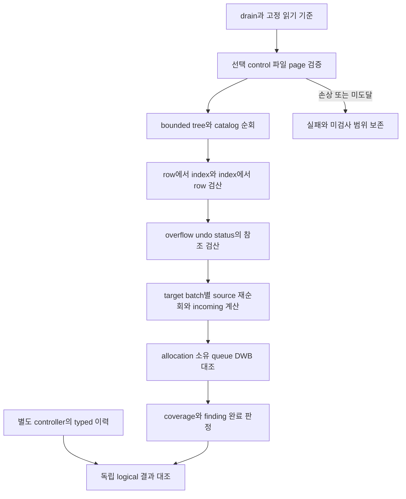
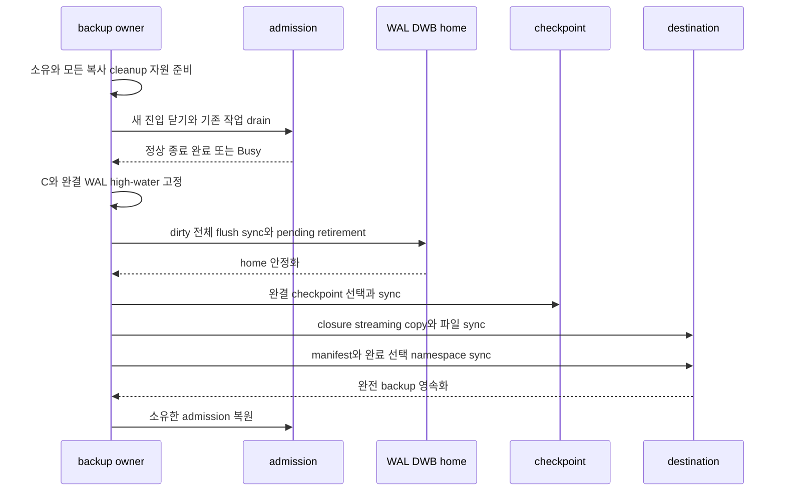
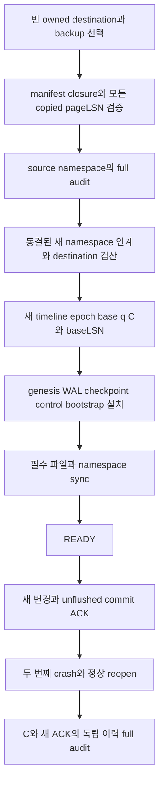

# DEV3 3.15 — 백업·무결성 개발 상세 명세와 설계도

2026-10-22 · **작업 상세 설계 / 선택 page·표현 검산 공급 / DEV3 full audit·backup·restore 미완료**

[공통 규칙](dev3-task-designs.md) · [정상 recovery와 full audit](disk-storage-design.md#recovery) · [exact-C backup·restore](disk-storage-design.md#checkpoint) · [참조 수명](disk-storage-design.md#undo-lifecycle) · [선택 읽기](dev3-page-io.md) · [control 표현](dev3-control-format.md) · [복구 profile](disk-storage-design.md#capacity-profile)

## 1. 목적·분리된 공급·소유

이 작업은 고정 상태의 전체 논리·물리 정합성을 bounded 공간으로 검산하는 full audit와, admission을 drain한 정확한 C의 backup/restore를 제공한다. full audit는 정상 open의 VERIFY_RECOVERY와 별도다. 정상 open은 필요한 WAL/selector/allocator·terminal 상태와 실제 redo/undo한 page를 검증하며 변경 없는 cold table/index를 매번 전수 검사하지 않는다.

3.15.1의 독립 이력·입력·checker 준비는 S0부터 진행하고 구현된 저장 경로를 S3/fault 인수에 공급한다. backup이나 3.12 전체 완료를 기다려 검사기 설계를 시작하지 않는다. 실제 full audit는 공급된 page/tree/row/index/catalog/allocator/undo/status 표현과 읽기 경로를 소비하며 미공급 대상은 검사 완료로 표시하지 않는다. 3.15.2.a는 영속 통합·flush/checkpoint의 필요한 공급 뒤 exact-C backup을, 3.15.2.b는 source WAL 없는 restore와 새 ACK·reopen을 인수한다.

engine의 storage/transaction/durable/catalog가 자신이 소유한 invariant와 읽기 capability를 공급하고 audit coordinator가 범위·완료를 취합한다. backup coordinator는 drain·C·복사/선택 소유를, restore coordinator는 빈 destination·namespace·genesis/control 설치를, 외부 controller는 ACK 이력과 독립 expected 결과를 소유한다. 제품 내부 audit와 독립 oracle는 같은 생산 알고리즘을 정답 생성에 공유하지 않는다.

## 2. 요구·입력·출력

| 요구 ID | 상세 명세 |
| --- | --- |
| 3.15-R1 | full audit는 admission drain한 고정 상태에서 모든 row↔index·unique·catalog·allocation·undo/status 참조와 소유를 검사. 검사 생략·범위 미도달을 성공으로 표시하지 않음 |
| 3.15-R2 | 전체 page/edge/object 수 비례 RAM map 또는 추가 disk spill 없이 bounded cursor·고정 batch·재순회를 사용. 필요 반복 I/O와 시간은 측정하며 선형 시간으로 과장하지 않음 |
| 3.15-R3 | incoming count는 실제 영속 edge의 multiset에서 독립 재계산. 동일 대상에 두 필드가 연결되면2개. horizon·transient pin·queue 작업 소유를 count에 합치지 않음 |
| 3.15-R4 | 정상 open과 full audit의 실행·비용·검출 범위를 분리. cold page 손상은 첫 접근 또는 audit에서 발견할 수 있으며 startup 검출로 과장하지 않음 |
| 3.15-R5 | backup은 새 거래/maintenance admission을 닫고 기존 거래/cursor·aging/DDL의 정상 종료를 drain. 기존 commit/rollback 허용, timeout은 gate 복원과 Busy, 강제 reader 만료/숨은 commit 없음 |
| 3.15-R6 | drain 뒤 C를 고정하고 모든 dirty data/undo/status/allocator를 WAL→DWB→home 규약으로 flush+sync, 완결 checkpoint 선택 뒤 mutation 중지 상태에서 streaming 복사 |
| 3.15-R7 | destination 파일·manifest·namespace의 영속화 뒤에만 backup 성공. 취소/복사 실패는 source C를 유지하고 불완전 destination을 성공 backup으로 선택하지 않음 |
| 3.15-R8 | restore는 빈 소유 경로에 완전 closure와 full integrity를 검증한 뒤 새 timeline/writer epoch·base q=C·genesis WAL/checkpoint/control·고정 bootstrap 슬롯을 설치하고 sync 후 개방 |
| 3.15-R9 | backup manifest는 source 완결 WAL high-water LSN을 인증. 모든 copied pageLSN이 그 이하이며 새 timeline의 첫 LSN은 그보다 큼. q=C와 baseLSN을 혼용하지 않음 |
| 3.15-R10 | drain한 backup의 loser abort obligation은0이어야 하지만 terminal retained queue·credit까지0이라고 추정하지 않는다. 남은 maintenance ownership/credit을 새 base ledger에 검증하여 인계하며, 전체 빈 ledger는 모든 관련 의무의 종료를 증명한 경우에만 허용. source WAL 없이 restore→새 unflushed ACK→두 번째 reopen을 인수 |
| 3.15-R11 | drain 대기 중 기존 작업의 종료에 필요한 공유 maintenance workspace·진행 turn을 backup이 독점하지 않는다. 새 외부 admission 차단과 기존 거래의 rollback/terminal·진행 작업 완료·backup 소유 flush/checkpoint 허용을 구별 |

| 연산 경계 | 입력·신뢰 기준 | 결과·소유 |
| --- | --- | --- |
| audit 준비/실행 | 고정 DB/timeline·선택 controls·authoritative 상태, bounded workspace·cursor, 고정 범위 | 범위/coverage·검산 합계·bounded finding·완료/실패. page 수정·repair·회수 권한 아님 |
| independent history 검사 | controller의 실제 ACK/ABORT/UNKNOWN, typed row/catalog delta, 고정 snapshot expected | 거래별 합법 이력과 audit 결과의 대조. candidate의 재생 결과로 expected를 다시 만들지 않음 |
| backup 준비/drain | 건강한 source, owned 빈 destination 또는 명시 staging 권한, 복사/cleanup·flush 자원 | drain 소유와 고정 C 또는 Busy/실패. 다른 owner의 admission close를 임의로 해제하지 않음 |
| backup 복사/선택 | C의 완결 checkpoint·allocation/file closure·source high-water | 완전 backup manifest와 영속 선택. 복사된 bytes가 있다는 사실만으로 성공 반환 불가 |
| restore 검증/설치 | 선택된 완전 backup, source identity/manifest hash, 빈 destination·새 namespace identity와 profile | 검증된 base q=C/baseLSN, 새 genesis/control/WRITER·bootstrap 및 READY. 기존 DB 덮어쓰기·자동 형식 변환 권한 없음 |

공개 함수 이름과 오류 enum은 착수 때 F02에 고정한다. 기존 `check_integrity(full)`·`backup_exact`는 owner 계약의 기능 이름이며 현재 DEV3 실행 API가 있다는 주장이 아니다. manifest/control의 실제 bytes·선택 protocol을 이 문서에서 새로 발명하지 않는다.

## 3. bounded full audit 알고리즘

audit 시작 전에 일관된 읽기 기준과 mutation 중지 소유를 확보한다. page에서 빌린 내용은 guard/latch 수명 안에서 검산하고 다음 읽기에 필요한 identity만 bounded cursor에 남긴다. 살아 있는 dirty frame을 검사하는 범위와 실제 home bytes를 검사하는 범위를 receipt에 구분한다. flush가 필요한 audit profile이면 기존3.05 경로에서 먼저 완료하고 audit가 임의 raw home write를 수행하지 않는다. restore의 source backup은 동결된 파일 bytes가 기준이다.

| 순회 | 알고리즘과 판정 |
| --- | --- |
| 선택·파일·page | 선택된 profile/FILEMAP/control의 identity/digest/길이와 열린 handle metadata를 검사. allocation inventory에 따라 allocated page를 유한 순서로 방문하여 page envelope·owner/incarnation/kind/bounds 검산. directory 최대 번호로 손상 선택을 보충하지 않음 |
| tree·catalog | 각 catalog object/anchor에서 공통 tree를 bounded 재탐색. parent/child kind·level·key range·정렬, object/parent generation/schema, 이름/정의 유일성을 검산. 한 page가 모순된 owner/structural parent에 연결되거나 선택된 정의가 누락됨을 거절 |
| row→index | 각 visible row의 canonical 값에서 별도 typed tuple 기준으로 예상 index entries를 정하고 실제 visible presence를 찾아 비교. 정의된 모든 index에 대해 누락·잘못된 key·중복을 검출 |
| index→row·UNIQUE | 각 visible present entry의 RowUID가 같은 C의 row와 key projection에 대응하는지 확인. sorted composite 집합의 PK NULL·부분 NULL·all-null 예외와 final UNIQUE를 검사. unrelated row 변경 때문에 index/row logical token이 다른 정상 사례는 허용 |
| overflow·undo chain | owner·generation·chunk count/길이/digest와 참조 target을 검산. undo의 실제 sequence 감소·target/creator·previous-version/transaction 구분을 확인. 길이·순회 상한 초과/누락/순환은 완료로 처리하지 않음 |
| incoming·status | 각 target을 고정 batch로 선택하고 모든 가능한 영속 source field를 재순회하여 edge multiset의 incoming을 계산. stored count와 대조하고 TxnRef directory/home·terminal retained head·queue 상태를 검산 |
| allocation·소유 | 각 allocated/free/reserved 대상에 대해 구조 참조·영속 owner inventory·retirement queue·DWB pending을 대조. 같은 physical token의 이중 소유, 필요한 참조가 있는데 Free, 소유·queue 없는 allocated orphan을 구별하여 보고 |

큰 incoming map 없이도 target batch마다 source를 다시 읽어 count를 계산할 수 있다. target별 count는 checked arithmetic을 사용하며 early overflow를 wrap하지 않는다. 이 초기 방법은 worst-case 반복 순회 비용을 부담하므로 page read/재방문·시간을 기록한다. 비용 최적화를 위해 disk sort/spill 또는 DB 규모 비례 map을 자동 도입하지 않는다.

구조적으로 읽을 수 없어서 하위 검사를 진행하지 못한 영역은 `검사하지 못한 범위`로 남긴다. finding 저장 공간이 가득 차도 총 발견 수·잘림 여부·검사 완료 여부를 구분한다. 상세 진단의 잘림은 성공 판정을 만들지 않고, 필수 coverage/receipt 자체를 잃으면 인수 실패다. audit는 손상 page를 자동 수정하거나 graph를 재작성해 expected에 맞추지 않는다.

필수 refcount 검산과 snapshot/rollback 논리 결과 검산은 별개다. count가 일치해도 필요한 before-image를 잃은 경우가 있으므로 known-bad history와 snapshot expected를 함께 둔다. 감사의 모델 graph는 production edge update/replay 함수를 정답 계산에 공유하지 않는다.

## 4. offline exact-C backup 알고리즘

1. source의 건강 상태와 destination 소유/빈 상태·형식을 확인하고 backup/workspace·FD·staging·실패 cleanup 자원을 준비한다. 이 준비의 capacity 예약과 공유12MiB workspace/진행 turn의 실제 독점 획득을 구별한다. 기존 작업이 같은 workspace를 요구할 수 있으므로 drain 전부터 독점한 채 기다리지 않는다. source path와 destination을 구별하고 source 파일을 destination 정리 대상으로 삼지 않는다.
2. 새 거래/maintenance의 외부 admission을 닫고 기존 거래/cursor·진행 중 aging/DDL의 정상 종료를 기다린다. page/tree/append/publication latch나 부분 pin·공유 maintenance workspace/turn을 보유한 drain 대기는 금지한다. 기존 commit/rollback/terminal과 이미 시작한 작업의 예약된 하위 단계·필요 flusher는 계속 진행해야 한다. backup 자신이 실행할 flush/checkpoint는 drain owner의 명시 권한으로 진행하며 닫힌 외부 admission을 다시 기다리지 않는다. timeout이면 자신이 소유한 drain만 해제하고 Busy를 반환한다.
3. drain 완료 후 published C와 source의 채택된 완결 WAL 경계를 고정한다. Active/Aborting/CommitAttempted 거래와 실행 중인 미완결 변경 그룹이 없는지 확인한다. 대기 중인 terminal retained maintenance queue/obligation·credit은0으로 가정하지 않고 backup closure와 restore base ledger로 인계한다. terminal retained 참조나 allocated 저장 공간은 loser 부재만으로 삭제하지 않는다.
4. 모든 dirty data/undo/status/allocator를 WAL-first·선택 pending DWB·home sync·whole-batch retirement로 안정화한다. 필수 checkpoint를 완결하고 CURRENT 선택을 영속화한다. C와 파일/page closure를 유지한 채 mutation을 중지한다.
5. allocation/file metadata가 정의하는 closure를 bounded 순회하여 destination에 streaming 복사한다. mutable source file을 reflink/immutable이라고 가정하지 않는다. free 공간·padding과 allocated contents의 destination 표현 및 필요한 physical 길이는 동결할 manifest/restore 계약에 따른다.
6. 각 복사 파일의 내용/길이·digest·소유를 검산하고 backup manifest에 source identity·C·완결 WAL high-water와 완전 closure를 연결한다. destination files→manifest→선택/namespace의 필요한 sync를 모두 확인한 뒤만 성공한다.
7. 성공·취소·예상 실패의 모든 종료에서 보유한 drain을 상태에 맞게 해제한다. 취소/복사 실패는 source의 C를 바꾸지 않고 incomplete destination을 성공 backup으로 선택하지 않는다. source 자체의 flush/checkpoint 불명은 source fence를 유지하며 단순 destination cleanup 성공으로 건강 상태를 되돌리지 않는다.

backup C는 committed 논리 cut이고 WAL high-water는 복사 pageLSN을 인증하는 로그 경계다. 둘을 같은 숫자로 사용하지 않는다. 복사 중 source의 C가 고정되어 있어야 하며 새 foreground commit을 허용한 online backup으로 조용히 확장하지 않는다.

## 5. source WAL 없는 restore와 새 timeline

restore는 backup 선택·형식·manifest/digest·모든 file/page closure를 source identity로 검증한다. source WAL 파일이 없어도 backup 자체로 C를 재구성할 수 있어야 한다. manifest가 인증한 완결 high-water보다 큰 copied pageLSN이 하나라도 있으면 거절한다. high-water가 표현 최댓값이어서 더 큰 첫 LSN을 만들 수 없다면 첫 destination 설치 effect 전에 거절하며 wrap/0 초기화하지 않는다.

drain한 backup에 Active/Aborting loser와 실행 중인 미완결 변경 그룹이 없고, loser abort obligation이0임을 실제로 검증한다. **이는 terminal retained undo/status/retirement queue의 소유와 남은 처리 credit까지0이라는 증명이 아니다.** 아직 남은 유지보수 의무·영속 incoming·실제 charged bytes를 backup closure에 포함하고, 새 namespace의 검증된 base ledger에 같은 의무와 credit을 인계한다. 전체 ledger를 빈 상태로 시작하려면 해당 queue/retained 작업까지 모두 종료되었다는 별도 검증이 필요하다. corrupt ATT/descriptor를 버리거나 queue를 복사하면서 credit만0으로 만들지 않으며, loser 부재만으로 page·status를 Free로 만들지 않는다. 이 인계 형식이 미동결이면 source-WAL-free restore는 Unsupported다.

새 timeline·writer epoch, base q=C와 manifest high-water를 인증한 baseLSN, genesis WAL/checkpoint/control 및 고정 bootstrap 슬롯을 설치한다. 새 timeline의 첫 LSN은 source high-water보다 커야 한다. 새 namespace의 파일/선택·필요한 sync가 완료되기 전 READY를 노출하지 않는다. 설치 중 crash는 완성되지 않은 destination을 정상 DB로 열지 않으며 source backup의 bytes·선택을 수정하지 않는다.

**새 timeline과 복사된 영속 identity의 결합은 F01/F02 미동결 항목이다.** 기존 row/index/catalog의 LogicalRowVersion, TxnRef/status/undo decoder는 DB/timeline의 정확한 일치를 요구한다. source page를 그대로 복사하고 control의 timeline만 바꾸면 이 검사를 만족하지 못한다. 착수 전 모든 포함 identity·참조·generation·digest의 새 namespace 인계 방식을 고정하고 source 검증과 destination 검증의 expected context를 분리해야 한다. 임의로 과거 timeline을 허용하거나 provenance field를 새로 추가하거나 bytes를 재작성하는 방식을 이 문서가 채택한 것은 아니다. 동결·독립 검토 전 해당 restore effect는 Unsupported다.

인수의 마지막 단계에서는 source WAL을 제공하지 않은 복원 DB에서 새 변경을 commit하여 ACK를 외부에서 관측한 후, 새 data page를 아직 home에 쓰지 않은 상태로 다시 crash한다. 두 번째 reopen이 새 WAL redo를 pageLSN 때문에 잘못 건너뛰지 않고 C와 새 ACK를 모두 보존해야 한다. restore 직후 read 성공만으로 이 인수를 완료하지 않는다.

## 6. 오류·자원·관측

| 실패 또는 제한 | 결과·보존할 상태 |
| --- | --- |
| audit 손상·불일치·필수 범위 미도달 | 실패와 구체 검산 단계/coverage 보존. repair·skip 후 PASS 금지. 정상 open의 이전 성공을 사후 전체 무결성 PASS로 확대하지 않음 |
| audit/backup drain timeout | Busy, 자신이 소유한 admission 상태 복원. reader 강제 종료·숨은 commit 없음 |
| backup 복사·destination sync/선택 실패 | source C 보존, destination 불완전/불명 상태 기록·소유 유지. source가 건강하면 자신이 닫은 admission 해제; source 불명은 fence 유지 |
| backup 취소 | 복사 중단·bounded cleanup 인계, 완료 선택 이전에는 성공 backup 없음. 취소로 source mutation이나 checksum 보정을 하지 않음 |
| restore 형식·digest·profile·pageLSN·namespace 불일치 | 해당 설치 effect 전 거절. 원본 backup과 기존 destination 외부 파일 보존 |
| restore 설치 중 I/O 불명/crash | destination READY 금지, owned staging/선택 소유를 보존해 재진입 또는 명시 거절. 원본을 truncate하여 성공시키지 않음 |
| receipt/coverage 유실·timeout·상한 도달 | 검증 완료 아님. 미실행/미완주 범위와 이전 결과를 보존 |

full audit의 메모리는 page/cursor·target batch·checked count·bounded finding의 합으로 고정한다. tree 깊이16, overflow/undo의 채택 길이·sequence 조건을 순회에 적용하고 전체 graph를 heap으로 모으지 않는다. 12MiB 단일 유지보수 workspace를 쓰는 경우 선택된 owner만 획득하며 대기 중 latch/부분 pin을 보유하지 않는다. 별도 flusher4MiB는 drain/flush 동안 계속 사용할 수 있어야 한다.

backup/restore는 manifest 목록을 DB 크기만큼 RAM에 담지 않고 chunk/cursor로 읽는다. copy buffer·digest 상태·control scratch·FD·출력 receipt를 F05의 동시 peak에 포함한다. 실제 physical file 길이·allocated copy bytes·free 표현·destination growth·cleanup 예약을 구분하고 두 DB/backup에 같은 bytes가 존재하는 비용을 숨기지 않는다. source owned quota와 destination의 별도 저장 한도/부족 처리는 작업 시작 전에 고정한다. OS ENOSPC/I/O 불명은 quota 산식으로 제거되는 문제가 아니다.

PF09에는 audit page/edge 방문·재순회 수·read bytes/시간, 정상 open read bytes/시간, backup drain/flush/checkpoint/copy 중단시간, copied/owned bytes, restore 검증/설치시간, RSS/FD·workspace peak와 취소 cleanup을 따로 기록한다. 같은 소량 WAL·dirty-page 수의256MiB/1GiB fixture에서 정상 reopen 비용과 full audit 비용을 섞지 않는다. 추가 disk spill 없음은 I/O 비용이 작다는 주장이 아니다.

## 7. 하위 작업·완료 기준

| ID | 선행·공급 시점 | 산출물·완료 조건 |
| --- | --- | --- |
| 3.15.1 bounded full audit·독립 이력 | S0부터 F03 입력·known-bad·checker 준비. 실제 실행은 관련3.01/3.02·tree/row/index/catalog/undo/allocator 읽기 공급을 단계별 소비 | bounded 전체 coverage·양방향 row/index·incoming/소유 검산과 외부 이력. S3/fault 및3.12.8에 공급하며 backup 완료를 기다리지 않음 |
| 3.15.2.a offline exact-C backup | 영속 통합,3.05 flush/retirement,3.10 admission,3.11 terminal,3.13 완결 checkpoint와 관련3.15.1 | drain→C→flush/checkpoint→stream copy→완료 선택. timeout/취소/부분 I/O·source 보존 및 fixed memory/FD 인수 |
| 3.15.2.b restore→새 ACK→reopen | 3.15.2.a closure,3.15.1 audit,3.02/3.12 설치/READY와3.11 ACK 공급, 새 namespace 인계 동결 | source WAL 없는 full restore·loser abort obligation0/retained maintenance 소유·credit 검산·새 timeline/baseLSN/고정 bootstrap 설치, 새 unflushed ACK와 두 번째 reopen 보존 |

3.15.1의 독립 input/checker 변경도 D2 검토를 받으며 candidate 변경과 oracle 기준을 한 담당의 자기 승인으로 동시에 바꾸지 않는다. product 경로와 외부 checker의 책임·원본 expected identity를 분리한다. 일부 leaf의 audit 공급 완료를 아직 없는 전체 대상의 full audit PASS로 기록하지 않는다.

## 8. 독립 인수 case

다음 case별 source/diff·고정 입력·실제 cut·예상 결과와 자원/시간 상한을 구현 전에 정한다. 변경 없는 하위 codec/회귀 전체를 반복하지 않고 새 audit/backup/restore 경로와 그 경로의 남은 의무를 선택한다.

| Case | 입력·필수 판정 | 연결 |
| --- | --- | --- |
| 3.15-T1 audit 기본 | empty 및 여러 table/index/catalog·overflow·terminal retained undo가 있는 정상 C. 양방향 결과와 독립 typed 이력, 모든 대상으로의 coverage | DS01/02/04/05 |
| 3.15-T2 checksum 유효 논리 오염 | index 누락/유령/잘못된 key, 부분 NULL UNIQUE 중복, catalog parent/anchor 오염, allocated/free 소유 모순을 hash 재계산 후 주입. checksum 검사만으로 PASS하는 mutant 거절 | DS01/02/03/06 |
| 3.15-T3 graph multiset | 동일 target으로 향하는 두 다른 영속 field, count−1/+1, dangling/stale generation·queue 유실·undo cycle/sequence 위조. count와 logical snapshot/rollback 결과를 별도로 판정 | DS03/04, RC-T13/14 |
| 3.15-T4 bounded audit | row/index/locator/allocation inventory 각각 buffer4배와 고정4/16/64MiB profile. RAM·FD·target batch/재순회 peak, 추가 spill0, finding 잘림/timeout이 완료를 위장하지 않음 | DS03, PF09 |
| 3.15-T5 open/audit 분리 | 같은0/소량 WAL·dirty-page 수의256MiB/1GiB. 정상 reopen의 non-full-scan 경계, 접근하지 않은 cold page 손상이 첫 read/audit에서 거절됨을 따로 관측 | DS03/05, PF09 |
| 3.15-T6 drain | 긴 reader·Active 거래·진행 aging/DDL에서 backup 대기와 timeout. 기존 rollback/terminal이 공유12MiB workspace를 필요로 하는 schedule, 닫힌 admission 아래 backup의 checkpoint를 포함. drain 중 workspace 독점/하위 작업 재admission 교착0, 강제만료 없음·Busy 뒤 정상 admission, C가 drain 후 고정됨 | DS03/04/05 |
| 3.15-T7 backup cut | 여러 file의 DWB pending/home sync/retirement·checkpoint·copy/manifest/선택/dirsync 전후 실패/취소. source C 보존과 불완전 destination 미선택, 성공 backup 전체 closure | DS02/05, RC-T14 |
| 3.15-T8 restore 거절 | missing/truncated/mismatched file·manifest digest, copied pageLSN>high-water, high-water MAX, 미지원 profile, nonempty destination, loser/obligation 위조, 새 namespace 인계 오류. 예상 거절과 source 보존 | DS02/05 |
| 3.15-T9 source-WAL-free | source WAL 접근 불가한 완전 backup만 제공. 새 timeline·base q=C·첫LSN>high-water·모든 pageLSN 검산, loser abort obligation0·retained maintenance 소유/credit 인계·고정 bootstrap 및 full audit. ACK 뒤 aging 미완료 queue를 둔 fixture에서 credit0 초기화 mutant 거절, 복원 뒤 새 foreground admission 전에 예약 보존 검산 | DS02/03/04/05 |
| 3.15-T10 새 ACK와 재open | T9 뒤 새 변경 ACK를 외부 관측하고 home flush 전 crash. 두 번째 reopen에서 새 redo 적용, C와 새 ACK·row/index/catalog 일치. LSN0 초기화로 redo를 건너뛰는 mutant 거절 | DS02/05, RC-T12/14 |
| 3.15-T11 독립 oracle | ACK된 이전 값을 후속 거래가 덮어쓴 이력·UNKNOWN/확정 ABORT·missing receipt known-bad. 최종 데이터 동일만으로 ACK 유실을 은폐하지 못하고 checker가 의도 결함을 검출 | DS02, RC-T12 |

full audit와 독립 history 모두 성공해야 해당 인수 경로를 통과한다. 정상 recovery를 요구한 fixture의 실패를 audit가 손상으로 검출했다는 이유로 정상 reopen 성공으로 집계하지 않는다. 원래 FAIL/중단/NOT_RUN과 source identity를 보존한다.

## 9. 실제 source 진입점·착수 전 동결

| 실제 진입점 | 현재 범위·소비 |
| --- | --- |
| [storage/page_io.rs](../../crates/engine/src/storage/page_io.rs), [storage/control.rs](../../crates/engine/src/storage/control.rs) | `PageFileReader`, 선택 FILEMAP·Profile/FileMapCursor. bounded 선택 읽기 공급이며 전체 audit·일반 CURRENT/backup manifest 구현 아님 |
| [storage/tree_page.rs](../../crates/engine/src/storage/tree_page.rs), [storage/row_record.rs](../../crates/engine/src/storage/row_record.rs), [storage/catalog_record.rs](../../crates/engine/src/storage/catalog_record.rs) | page-local 형식·row/index/catalog의 identity와 상태 검산. 전역 row↔index·UNIQUE·catalog 실존은 새 audit 의무 |
| [storage/undo_record.rs](../../crates/engine/src/storage/undo_record.rs), [storage/status_home.rs](../../crates/engine/src/storage/status_home.rs) | undo linked edge·home core/incoming의 표현. 전역 incoming multiset/queue/실제 수명 검증은 별도 |
| [storage/ownership.rs](../../crates/engine/src/storage/ownership.rs), [storage/allocation_page.rs](../../crates/engine/src/storage/allocation_page.rs) | inventory/profile 결합 관측과 allocation 표현. 전체 DB reachable ownership·restore ledger 완결성으로 확대하지 않음 |
| [durable/backup.rs](../../crates/engine/src/durable/backup.rs) | DEV2 immutable archive의 `inspect_checkpoint/inspect_archive/copy_archive` 참고. DEV3 mutable page drain·새 timeline identity 인계·일반 restore를 이미 공급한 것으로 보지 않음 |
| [controller/oracle.rs](../../crates/testing/controller/src/oracle.rs), [controller/durable.rs](../../crates/testing/controller/src/durable.rs) | 기존 controller의 typed expected 비교·외부 process 관측/actor 경계. DEV3 full graph/history oracle의 새 case와 protocol은 별도 동결 |

F01은 backup manifest/완료 selector·allocated/free physical copy 표현, authenticated source high-water/baseLSN, 복사 identity의 새 timeline 인계, 새 genesis/checkpoint/control·bootstrap의 정확 bytes를 고정한다. F02는 audit 대상별 순회/coverage·읽기 기준, admission drain 소유/timeout·공유 workspace 반환과 기존 작업/backup 하위 단계의 진행 권한, destination 소유와 취소/cleanup/restart, loser abort obligation0 판정과 retained terminal 참조/queue/credit의 base ledger 인계를 고정한다. 현재 control codec의 지원 범위를 임의 확대하지 않는다.

F03은 typed 이력·row/index 대응·명시 edge multiset·known-bad bytes, F04는 drain/flush/copy/selection/restore/새 ACK의 실제 cut, F05는 target batch·재순회/시간·복사 buffer·FD·destination disk/cleanup peak와 full-audit receipt 상한을 동결한다. F06은 DEV2-only archive와 재사용 가능한 foundation port를 구별하고 F07은 audit/checker·backup/restore·control 공유 파일의 수정 소유를 정한다.

문서 작성 담당은 `/root/dev3_specs_review`다. 본 작성자는 이 문서를 독립 승인하지 않는다. 검토/채택은 [공통 결정 기록](dev3-task-designs.md#decision)에, 제품·인수 실행 상태는 [구현 기록](../implementation/dev3-implementation.md#dev3-work-breakdown)에 남긴다.
