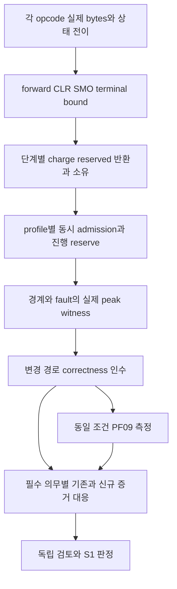

# DEV3 3.16 — 자원 종합·성능·최종 인수 개발 상세 명세와 설계도

2026-10-22 · **작업 상세 설계 / 항목별 일부 증거 존재 / global F05·PF09·S1 미완료**

[공통 규칙](dev3-task-designs.md) · [수치 계산 정본](dev3-resource-bounds.md) · [자원 인수](../plans/dev3-implementation-plan.md#resource-proof) · [PF09](../plans/dev3-implementation-plan.md#performance) · [완료 정본](../plans/stage-completion.json)

## 1. 목적과 진입 경계

각 opcode가 첫 effect 전에 제출한 F05를 종합하여 동시에 성립하는 engine 한도·진행 조건을 확인하고, 실제 disk 기능의 남은 correctness·fault·성능 의무와 증거를 대응시킨다. 3.16이 다른 작업의 자원 계산·oracle·fault 설계를 뒤늦게 처음 수행하는 단계가 되어서는 안 된다.

제품 gate S1과 DEV3 내부 구현 묶음 S1(표현 leaf)은 다르다. 표현·모델·component의 PASS로 제품 S1을 승격하지 않는다. DEV2의 미해결 PF04·현재 단계 미완료도 그대로 보존한다. 새 문서·새 commit·전체 source fingerprint 변경 자체는 재시험 사유가 아니다.

## 2. 요구와 인수 입력

| 요구 ID | 명세 |
| --- | --- |
| 3.16-R1 | opcode마다 forward·실패 cleanup·전체 abort/CLR·SMO·terminal·bootstrap의 실제 encoded bound와 소유/반환을 갖는다. 미정 항목은 effect 허용 불가 |
| 3.16-R2 | 모든 자원에서 charged+outstanding≤capacity를 동시에 만족. 공유 workspace·page token·이미 소유한 file bytes를 중복 차감하거나 누락하지 않음 |
| 3.16-R3 | 4/16/64MiB buffer에서 실제 최대 동시 admission을 계산. 최대32 transaction은 상한이며 최대 크기32개를 모두 허용한다는 약속 아님 |
| 3.16-R4 | 정상 admitted 작업의 rollback/flush/recovery는 protected 몫과 progress turn으로 종료 가능. corrupt/I/O 거절을 정상 진행 성공으로 바꾸지 않음 |
| 3.16-R5 | 독립 correctness history가 확보된 동일 의미·durability·환경에서만 PF09 비교. 시도 TPS·durable 성공·충돌·거절/재시도 비용을 분리 |
| 3.16-R6 | 기존 PASS는 원래 source/case 증거로 재사용. 새/수정 경로와 남은 의무를 명시하고 omitted/중단/FAIL을 현재 실행 PASS로 표시하지 않음 |
| 3.16-R7 | 모든 필수 DS01–06·KU09/10·RC-T12–14·PF09 의무의 충족 근거와 독립 검토를 연결. 미실행/미해결 실패가 남으면 S1 미완료 |

입력 자료는 실제 opcode/codec revision, 자원 ledger·수명 표, runtime/native/thread/reopen 기록, 외부 ACK/UNKNOWN 이력, 독립 oracle·mutant 결과, fixture/환경·binary/source/로그 identity다. 후보 설계의 성능 추정·문서 정합성 검토는 제품 실행 결과 열에 넣지 않는다.

## 3. 자원 회계 설계

각 opcode 표는 다음 열을 가진다. 실행 전 구체 수치·source를 고정하며 논리 payload 길이를 그대로 WAL 비용으로 쓰지 않는다.

| 열 | 계산 내용 |
| --- | --- |
| 입력과 표현 상한 | row/key/index 수·tree 높이·논리 mutation 수·실제 codec revision |
| page/slot | data·index·overflow·undo root/chunk·status·allocator·anchor·count/queue page, rollback 재삽입 split 포함 |
| WAL/control | frame header+native before/after+redo+edge/inventory+descriptor, forward/CLR/system/abort-end, 설치·교체 peak |
| growth/token | 신규 extent64-page 올림, 실제 파일 bytes, 기존 extent의 page token, 미소비 intent를 구분 |
| 동시 생존 자원 | 전체 pin 집합·encode/decode 중첩 locals·caller/owner/scratch·FD·lock/registry·DWB slot |
| 수명·반환 | admission→prepare→stage/apply→sync→statement 복귀→terminal→retirement→recovery 각 소유자/실제 반환 사건 |

전역 제약은 owned8GiB, 그 안 protected1GiB, retained/outstanding WAL256MiB, buffer4/16/64MiB, metadata/cache8MiB, private 거래당8MiB/합64MiB, system flush4MiB+단일 maintenance12MiB, FD128·snapshot32 등 기존 profile을 따른다. component WAL1MiB+metadata64KiB·locator1MiB를 metadata에서 한 번씩 빼고 나머지5.9375MiB 안에 frame header/ATT/locks/cache 등이 실제로 들어가는지 확인한다. source-owned 타입 회계·compiler stack·실제 RSS를 서로 다른 측정으로 보고한다.

## 4. 회계 반례와 진행 검증

statement 논리 rollback은 ledger를 mark로 되감지 않는다. `W_n=W_0+Σ(forward_i+CLR_i)−실제회수_n`을 독립 계산하고, retained lock·undo/page·완결 SMO·전체 abort 예약을 계속 소유한다. reserve의 이미 소비된 CLR bytes가 다시 remaining으로 나타나는 mutant를 거절한다.

모든 자원에 필요량−1/동일/+1, row128KiB·index8·tree 높이 경계, buffer4/16/64MiB·최대32 요청을 사용한다. 서로 양립하지 않는 극값은 실제 유효한 별도 fixture로 나눈다. 계산된 수까지만 admission하고 나머지는 첫 effect 전에 거절한다.

rollback이 자기 완료를 위해 checkpoint/aging 회수를 기다리는 순환, maintenance workspace를 가진 채 turn을 기다리는 경로, turn 준비에서 flusher까지 막는 경로, 부분 pin 보유 frame 대기, 무한 try-latch 재시도는 금지한다. 정상 I/O와 공정 actor 아래 유한 작업의 ticket/drain/완료 witness를 검증한다. 외부 ENOSPC/I/O 불명은 fence/복구 사례로 구분한다.

crash 뒤에는 고정 bootstrap+동일 prefix에서 복원한 obligation+실제 retained bytes가 기존 한도 안에 들어가야 한다. BEGIN WAL 제거, 부분 CLR, 두 슬롯 current/previous, 새 epoch 선택 직후 반복 crash를 포함한다. restart마다 누적되는 임시 bytes를 허용하지 않으며 충분한 무장애 구간에서 loser 완료를 별도로 검증한다.

## 5. 4배 working set과 대형 inventory

row/index/locator/allocation inventory의 **각 실제 접근 집합**이 configured buffer의4배 이상이어야 한다. 동일 metadata 재읽기 I/O·zero padding·sparse apparent size로 독립 inventory bytes를 늘리지 않는다. page-cache miss와 실제 device I/O witness도 구별한다.

| buffer | allocator cell6208 bytes 기준 최소 extent | extent 물리 bytes |
| --- | --- | --- |
| 4MiB | 2,703 | 2,834,300,928 |
| 16MiB | 10,811 | 11,336,155,136 |
| 64MiB | 43,241 | 45,341,474,816 |

기본8GiB만으로16/64MiB profile의 allocator4배 요구를 충족했다고 주장할 수 없다. [64GiB qualification 전용 준비 방향](dev3-resource-bounds.md)은 전체 회계·profile/형식 적합성·실제 fixture·실행 전 단계이며 현재 지원 profile이 아니다. 제품 기본 한도를 조용히 올리거나 allocator4배 분모를 줄이지 않는다. 대형 fixture에는 실제 FILEMAP/extent 확장 표현과 control/WAL/protected·다른 작업 공간도 포함해 D2 동결한다.

## 6. PF09 설계·측정 명세

| workload | 독립 조건·측정 |
| --- | --- |
| CRUD·point/range | 1/2/4 writer/reader, 요청·시도·durable 성공 TPS, 성공 latency와 원래 요청부터 retry 포함 latency |
| 충돌 분해 | 독립 table / 같은 table 다른 행·비충돌 key / 같은 행·unique key × RC/Serializable. 실제 read/write/key/catalog 의존으로 true/false conflict 판정 |
| WAL·DWB | commit/WAL sync p99, batch1/8/64의 실제 평균 크기·pages/s, image/home/control bytes와 file sync/dirsync 횟수 |
| flush·진행 | oldest recLSN lag·dirty age·선택/완료/redirty·서비스 최대 간격·무진행 round·admission 거절 원인·rollback/eviction latency |
| snapshot/aging | 긴 reader·Active 거래, undo 생성/보존/회수·owner/horizon lag, 실제 재사용, WAL floor와 undo 수명 분리 |
| checkpoint/reopen/audit | 같은 WAL/dirty 양에서 DB256MiB/1GiB, 정상 read bytes/시간과 REBASE flush/selector/회수, full audit 별도 |
| backup/restore | exact C 일치·중단 시간·copy bytes·취소/복구와 source-WAL 없는 restore 뒤 새 ACK |
| 자원 | RSS/FD/pin/lock·private/system/protected peak, 장기 기울기, runtime baseline과 사전 고정 margin |

실행 전에 환경·filesystem/장치·build/features·fixture/seed·부하율·queue 상한·retry 정책·warm/cold 조건·반복/시간·batch deadline·비교 regression 한도·계측 비용 허용치를 동결한다. 이 문서는 미측정 TPS/p99 목표를 새 SLA로 만들지 않는다. 성능 job과 장치 부하 작업을 겹치지 않는다.

Serializable 같은 table false conflict를 허용하더라도 충돌률/재시도 비용을 숨기지 않는다. native RC와 SQL Serializable의 수치를 동일 의미 성능 개선으로 비교하지 않는다. group commit·gate 분할·부분 batch retirement는 측정 뒤 별도 설계 변경이다.

## 7. 인수 추적 행렬

| 의무 | 공급·통합 담당 작업 | 결과에서 확인할 핵심 |
| --- | --- | --- |
| DS01·KU09 | 3.01/3.06/3.07/3.10 | 실제 tree/overflow/cursor·row↔index, split/delete 중 고정 snapshot |
| DS02·KU10·RC-T12 | 3.02/3.03/3.04/3.05/3.08/3.11/3.12/3.15 | multi-object 원자성·steal/no-force·WAL/DWB·ACK/UNKNOWN·외부 이력 |
| DS03 | 3.03/3.05/3.06/3.07/3.10/3.12/3.14/3.16 | 4배 각각·bounded RAM/FD·pressure/drain·startup/audit 비용 분리 |
| DS04·RC-T13 | 3.03/3.06/3.08/3.09/3.10/3.12/3.14 | snapshot/Active undo·pin/ABA·begin-WAL 제거·old object/overflow |
| DS05·RC-T14 | 3.03/3.04/3.05/3.09/3.12/3.13/3.14/3.15 | 예약 복원·fuzzy/fallback/floor·DWB repair·REBASE·restore 재개 |
| DS06 | 3.06/3.07/3.08/3.09/3.10 | 부분 NULL·최종 UNIQUE·key 교환·이전 statement·관측 행 full abort |
| M01–M06 | 해당 producer/consumer와 독립 모델 | 실제 declared 공간/반례/진행 범위. 모델 PASS와 native/thread/disk 결과 분리 |
| PF09·S1 | 3.16 종합, 각 기능 owner 확인 | 같은 의미의 성능 분모·필수 의무/증거 누락 없음·미해결 FAIL 없음 |

## 8. 증거 취합·완료 판정

2026-10-22 후속 사용자 지시에 따라 [단계별 테스트 계획](../plans/dev3-test-plan.md#final-suite)의 **최종 S5 DEV3 전수 실행**을 수행한다. 중간에는 변경 기능의 필수만 실행하고, 추가 테스트·큰 fixture·계측은 해당 구현과 함께 준비한다. 아래 과거 증거 재사용은 중간 실행 선정과 최종 전수 뒤 후속 diff의 판정에 적용하며 최종 전수 실행을 생략하는 근거가 아니다. DEV0/1/2·workspace 전체 wrapper 실행으로 확대하지 않는다.

증거 대응표는 `의무 ID / 사례·변형 / 실제 source·binary·fixture / 마지막 실행 범위·원래 결과 / 이후 관련 diff / 신규 실행 필요 여부·이유 / 독립 검토 / 남은 의무`를 갖는다. 재사용한 과거 결과는 그대로 표시한다. root fingerprint만 달라진 경우 source의 관련 경로를 대조하고 무변경 case를 재실행하지 않는다. 새로운 연결 코드에는 그 연결을 검증하는 case를 선택한다.

제품 코드를 수정하지 않는 이번 작업에서는 제품 시험·compiler/Clippy·문서 verifier를 실행하지 않는다. 문서 검사는 push gate에서 수행한다. 원본 FAIL·중단 receipt를 수정하거나 omitted case를 새 PASS로 만드는 집계는 금지한다.

완료를 선언하려면 실제 DS/KU/RC/PF 의무를 모두 추적하고, source별 적용 범위·변경 경로 증거·검토 결과·정상/거절/미실행 분모를 명확히 해야 한다. 단순 완료 문서 수/16, 모델 case 수, 코드량으로 진행률을 만들지 않는다. 이 문서의 작성 완료는 전체 DEV3나 제품 S1의 완료가 아니다.
