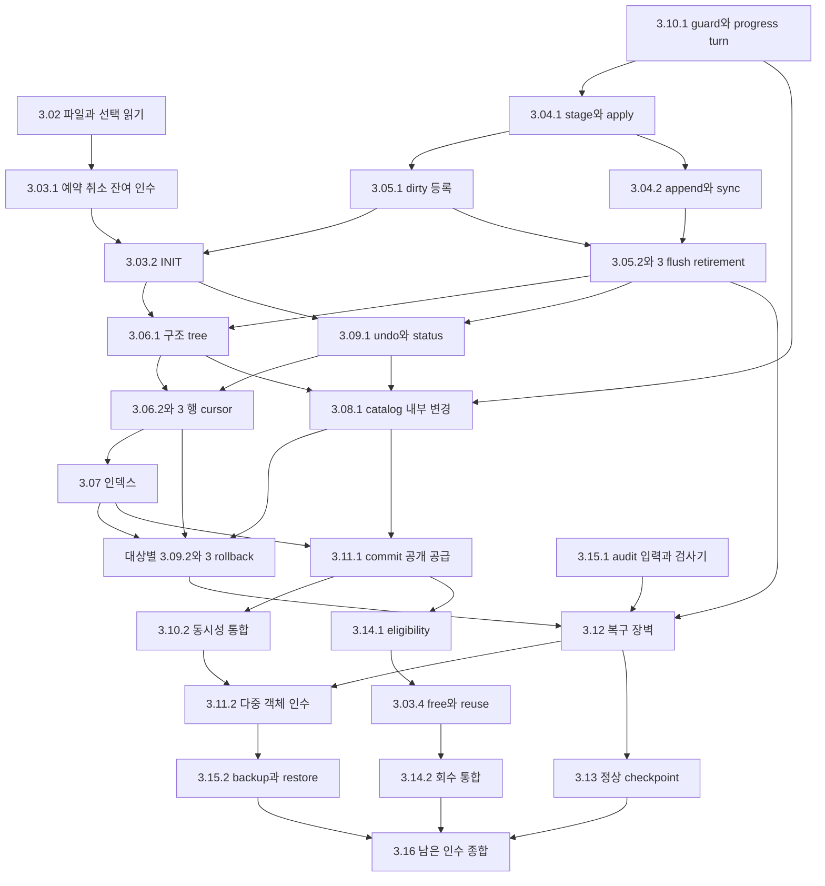

# DEV3 — 16개 작업의 개발 상세 명세·설계도

2026-10-22 · **D3-TASK-DESIGN-001 D2 상세화 수용 / 작성자 외 독립 검토 완료 / 새 제품 구현·실행 없음**

[개발 문서](../README.md) · [구현 계획](../plans/dev3-implementation-plan.md#remaining-work) · [저장 설계 정본](disk-storage-design.md) · [실제 구현](../implementation/dev3-implementation.md#dev3-work-breakdown)

기존 3.01–3.16 분류마다 개발 상세 명세와 세부 설계도를 제공한다. 각 문서는 기능 요구, 입력·출력과 소유권, 상태·처리 순서, 실패·복구, 자원 계산, 하위 구현 단위와 인수를 묶는다. 번호는 실행 순서나 균등한 작업량이 아니다. 현재 구현 상태는 구현 문서가, 순서·배정은 기존 계획이, bytes와 제품 의미는 각 소유 계약이 계속 소유한다.

이 문서군은 기존 계약을 구현 가능한 경계로 풀어 쓴다. 미채택 opcode·control body·수치 예약표를 새로 채택한 것으로 만들지 않는다. 아래의 논리 연산명·상태명은 설계 표기이며 실제 Rust symbol이나 공개 API의 존재를 주장하지 않는다. 각 문서의 마지막 절은 **해당 leaf 착수 전에 추가 동결할 구체 항목**을 식별한다. 그 항목이 필요한 effect는 동결·독립 검토 전 실행할 수 없다.

<a id="catalogue"></a>
## 1. 작업별 명세

| ID | 상세 명세·설계도 | 핵심 산출물 | 직접 인수 연결 |
| --- | --- | --- | --- |
| 3.01 | [형식·정체성](dev3-task-01-formats.md) | 신뢰 기대값을 받는 codec·참조·의미 검산 | F01–03, DS01–06의 표현 |
| 3.02 | [파일·읽기 기반](dev3-task-02-files-reads.md) | namespace·FILEMAP·extent·선택 reader | DS02/03/05 |
| 3.03 | [공간 할당](dev3-task-03-allocation.md) | reserve/cancel·INIT·growth·free/reuse | DS02/03/04/05, RC-T14 |
| 3.04 | [WAL 변경 경로](dev3-task-04-wal.md) | semantic stage/apply·append/sync·owner chain | DS02/05, KU10, RC-T12/14 |
| 3.05 | [dirty buffer·flush](dev3-task-05-buffer-flush.md) | recLSN·WAL→DWB→home·retirement·진행 | DS02/03/05, PF09 |
| 3.06 | [트리·행](dev3-task-06-tree-rows.md) | 공통 tree·SMO·row/overflow·cursor/locator | DS01/03, KU09 |
| 3.07 | [인덱스](dev3-task-07-indexes.md) | presence·scan·최종 UNIQUE·offline build | DS01/06, KU09/10 |
| 3.08 | [카탈로그·DDL](dev3-task-08-catalog-ddl.md) | versioned 정의·이름·원자 create/drop | DS02/04/06, KU10 |
| 3.09 | [undo·rollback](dev3-task-09-undo-rollback.md) | live undo/status·logical CLR·종료 | DS02/04/06, RC-T13/14 |
| 3.10 | [동시성·가시성](dev3-task-10-concurrency.md) | guard/rank·snapshot/pin·잠금·격리 | DS04/06, KU10 |
| 3.11 | [commit·공개](dev3-task-11-commit.md) | durable commit·상태/frontier·ACK/UNKNOWN | DS02, KU10, RC-T12 |
| 3.12 | [재시작 복구](dev3-task-12-recovery.md) | 예약 복원·REDO·REBASE·UNDO·READY | DS02–05, RC-T12–14 |
| 3.13 | [checkpoint](dev3-task-13-checkpoint.md) | fuzzy capture·선택/fallback·WAL floor | DS05, RC-T14 |
| 3.14 | [공간 회수](dev3-task-14-reclamation.md) | horizon·logged cut/release·재사용 | DS03/04/05, RC-T13/14 |
| 3.15 | [백업·무결성](dev3-task-15-backup-integrity.md) | bounded full audit·exact-C backup/restore | DS02/03/05 |
| 3.16 | [자원 종합·성능·최종 인수](dev3-task-16-qualification.md) | F05 합산·PF09·필수 의무/증거 대응 | DS01–06, KU09/10, RC-T12–14, S1 |

<a id="dependency-map"></a>
## 2. 공급 설계도

화살표는 해당 기능의 최소 공급을 뜻한다. 전체 대분류 완료를 요구하지 않는다. 3.01의 관련 표현과 opcode별 F05는 모든 소비자에 붙는 공통 선행이므로 그림에서 반복하지 않는다. 전체 선행 목록은 [기존 분해표](../plans/dev3-implementation-plan.md#remaining-work)가 정본이다.



RECOVERY_REBASE는 3.12.5에서 공급하며 3.13의 fuzzy checkpoint 완료를 기다리지 않는다. audit 입력/검사기는 S0부터 준비한다. 3.14.1은 회수 가능성의 판정, 3.03.4는 allocator의 실제 전이, 3.14.2는 end-to-end 반환 인수다. 3.10.1 primitive는 실제 buffer/undo/commit 통합보다 먼저 공급한다. catalog 내부 변경은 구조 tree·undo·guard에서 직접 공급하고, 이후 index build/DDL 공개는 3.07.3·3.08.2에서 연결한다.

<a id="common-contract"></a>
## 3. 모든 작업에 적용할 개발 경계

| 경계 | 상세 명세에 적용할 규칙 |
| --- | --- |
| 효과·소유 | 입력 준비와 실제 권한을 구별. bytes decode는 write 권한이 아니다. 소유권·수명은 consuming owner/guard로 인계하고 raw writer/frame을 소비자에게 우회 공개하지 않음 |
| 변경 그룹 | page 효과·undo/head/edge/count·진행점·obligation·inventory를 해당 opcode가 요구하는 하나의 완결 그룹으로 연결. update/CLR/system의 WAL stage 뒤 부분 메모리 적용 실패는 공통 fence. Commit의 Committed status·terminal 공개 설치는 3.11에 따라 sync 뒤 수행 |
| 잠금 | [공통 rank](disk-storage-design.md#mutation-protocol) 준수. latch 안 I/O·allocation·quota/transaction 대기 없음. 전체 pin 확보 또는 모두 반환. FIFO turn 준비에서는 flusher 진행 허용 |
| 불변식 위반 | typed 입력 거절과 구분. 손상·poison·불명 I/O를 Unchanged나 정상 NotFound로 낮추지 않음. 원래 cause/effect/certainty/retry 범위를 보존 |
| 내구성 | sync 확인은 해당 대상의 사실. commit ACK·READY·전체 복구 성공은 상위 장벽과 외부 관측까지 필요. Drop은 숨은 commit/sync/성공 rollback을 하지 않음 |
| 보존 | 오래된 snapshot/Active rollback·영속 edge·transient pin·DWB pending·current/previous closure의 소유가 끝난 뒤만 반환. q·LSN·generation을 혼용하지 않음 |
| 자원 | [F05 원문](dev3-resource-bounds.md)과 [자원 벡터](disk-storage-design.md#reserve-accounting)에 실제 크기 대입. 미정 bound·overflow는 첫 effect 전 거절 |
| 계층 | `xadb-engine`의 storage/transaction/durable/catalog 책임 안에 배치. engine은 foundation port를 사용하고 Linux 조립은 worker/platform 담당. DEV2 전용 구현을 DEV3 공급으로 가정하지 않음 |

공통 오류 판정은 `준비 중 예상 거절 → authority 불변`, `stage 이후 불완전 적용/불명 효과 → Fenced`, `statement 실패 → mark까지 실제 undo 뒤 결과`, `commit 첫 byte 시도 이후 불명 → UNKNOWN`, `복구 장벽 실패 → READY 금지`다. 하위 owner 계약의 더 엄격한 규칙이 우선한다. 구체 error enum·우선순위·source/cause는 leaf F02에서 실제 API에 연결한다.

<a id="resources"></a>
## 4. 자원 설계도와 소유 회계

```text
owned disk 8 GiB
 ├─ foreground와 실제 보존 파일
 └─ 그 안의 protected 1 GiB
      ├─ fixed DWB 16 MiB / control·bootstrap peak
      └─ 거래 abort·CLR·진행 예약
별도 동시 제약: retained WAL + outstanding WAL ≤ 256 MiB

buffer 4/16/64 MiB : clean + dirty + 예약 frame
metadata/cache 8 MiB : WAL slot 1 MiB + component 64 KiB
                      + locator 1 MiB + 나머지 5.9375 MiB
system workspace 16 MiB : 전용 flusher 4 MiB + 단일 유지보수 12 MiB
private : 거래당 8 MiB, 전체 64 MiB / 최대 거래 32 / FD 128
```

이는 기존 profile의 소유 구분이며 실제 F05 완료 증명이 아니다. `charged + outstanding_reserved ≤ capacity`를 모든 자원에 동시에 적용한다. 이미 파일에 실현된 extent bytes와 그 안의 page token, 이미 쓴 CLR bytes와 잔여 예약을 중복 계산하지 않는다. statement mark 복귀는 ledger 복귀가 아니며, 마지막 검증 이후 수정된 경로의 peak를 다시 계산한다.

<a id="verification"></a>
## 5. 인수·검토·실행의 구분

후속 사용자 지시의 [단계별 테스트 계획](../plans/dev3-test-plan.md)은 **중간 필수 실행 / 구현과 함께 테스트 추가 / 최종 S5 DEV3 전수 실행**을 구분한다. 아래 무변경 재실행 금지는 중간 단계에 적용하며 최종 DEV3 전수는 명시 예외다. 개별 설계의 인수 표 전체를 매 작업마다 실행하지 않는다. 이 실행 시점 구체화는 D3-TEST-PLAN-001에서 검토하며 아래 기존 상세 설계의 검토 기록은 보존한다.

각 작업의 표는 앞으로 검증할 case의 명세다. 수정 없는 코드의 완료 시험, 전체 workspace/leaf/하위 wrapper를 반복하지 않는다. 다음 구현에서는 마지막 관련 검증의 source와 실제 diff를 case에 대응시키고, 새 코드·수정 경로와 남은 미실행 의무만 선택한다. 새 연결 코드가 생긴 경우 그 통합 경로를 검증하며 기존 하위 시험 전체를 다시 돌리지 않는다.

기대값은 production encoder/replay와 독립된 bytes·typed tuple·명시 edge multiset·외부 ACK 이력으로 만든다. 모델·메모리 포트·실제 Linux I/O·실제 thread·reopen의 결과를 따로 기록한다. 이미 실패하거나 중단한 원본은 보존하고, 미실행은 NOT_RUN, 탐색 상한 도달은 INCONCLUSIVE로 남긴다. 자동 문서 검사는 [push gate](../policies/documentation-policy.md#push-gate)에서만 수행한다.

각 leaf 착수 자료에는 작업 ID, 계약/구현/통합 담당·독립 검토자, source/dirty digest, 실제 symbol/경로, F01–07의 해당 고정 입력, case별 명령/예상 결과/자원·시간 한도를 기록한다. 완료 자료에는 실제 source/binary/fixture/log와 관측 결과, 해결한 결함, 다음 소비자에게 공급하는 capability와 남은 인수를 남긴다.

<a id="decision"></a>
## 6. D3-TASK-DESIGN-001 결정 기록

| 항목 | 기록 |
| --- | --- |
| 분류·상태 | D2 · 상세화 수용. 아래 범위별 독립 설계 검토 PASS. 기존 소유 계약의 작업별 상세화이며 신규 제품 의미·형식·실행 한도 채택 없음 |
| 권한·일자 | 사용자의 DEV3 16개 개별 작업별 상세 명세·설계도 작성 요청, 2026-10-22 |
| 작업·계약·통합 | `/root`. 사용자 후속 병렬 작성 요청에 따라 `/root/dev3_buffer_design`은 3.05/09/13, `/root/dev3_tree_design`은 3.06/10/14, `/root/dev3_specs_review`는 3.07/11/15 작성. 나머지 개별 문서와 공통 색인·연결은 `/root` 작성 |
| 기준·보존 | HEAD `a285043b91571cef83dacda49fcf2a63e99160d2`. 기존 dirty 7개 문서 사본 `/tmp/xadb-dev3-task-designs-09310rid`, 시작 diff SHA-256 `ec63c4d55a7e34959873c6bab1421192e51ddf86ff8e95de0dc5a91c51925082` |
| 선택·대안 | 16개 독립 문서와 공통 색인 채택. 단일 거대 문서는 작업별 인계를 어렵게 하고 기존 codec bytes 복제는 정본 충돌을 만들므로 상세 처리와 인수 연결에 집중 |
| 대체 | 기존 계약/분류/계획을 대체하지 않음. 미채택 F01/F02/F05는 각 leaf의 동결 의무로 유지 |
| 검토 결과 | 2026-10-22, `/root/dev3_specs_review`: root 작성 3.01–04/08·공통 색인·문서 연결 PASS. `/root/dev3_buffer_design`: 3.06/10/12/14/16 PASS. `/root/dev3_tree_design`: 3.05/07/09/11/13/15 PASS. 각 검토자는 본인 작성 문서를 제외했으며 지적 반영 구간을 재확인. 미해결 수정 요구 없음 |
| 검증 | 문서만 작성. 제품 시험·compiler/Clippy·문서 자동 검사·push 미실행 |
| 재검토 | source/API와 설계 불일치, 공급 순환, 새 opcode/형식·profile 도입, 누락된 오류/복구·자원 경계 발견 |

독립 검토는 기존 소유 계약·분해 계획·실제 제한 공급과 대조한 설계 검토다. Commit의 sync 뒤 status 공개, catalog 열 위치와 create/drop 공통 commit 장벽, catalog 내부 변경의 직접 공급, offline build 중 전용 flusher 진행을 보완했다. frame pin과 content latch를 구별하고, REDO는 다중 page 그룹의 대상별 반영 여부로 판정하도록 수정했다. commit-q stamp는 Committed(q)에 한정하고 회수 queue의 작업 소유를 외부 보존 소유와 구별했다. 관련 인수 사례도 같은 경계로 정리했다.

수용 범위는 이 16개 작업의 개발 명세·설계도와 문서 연결이다. 구현 전 추가 동결 표는 남은 작업이며, 미채택 terminal queue/credit·checkpoint/control body·restore namespace 인계·opcode별 F05를 이번 결정으로 확정하지 않는다. 기존 구현·시험 결과와 DEV3/S1 완료 상태는 변경하지 않는다.
