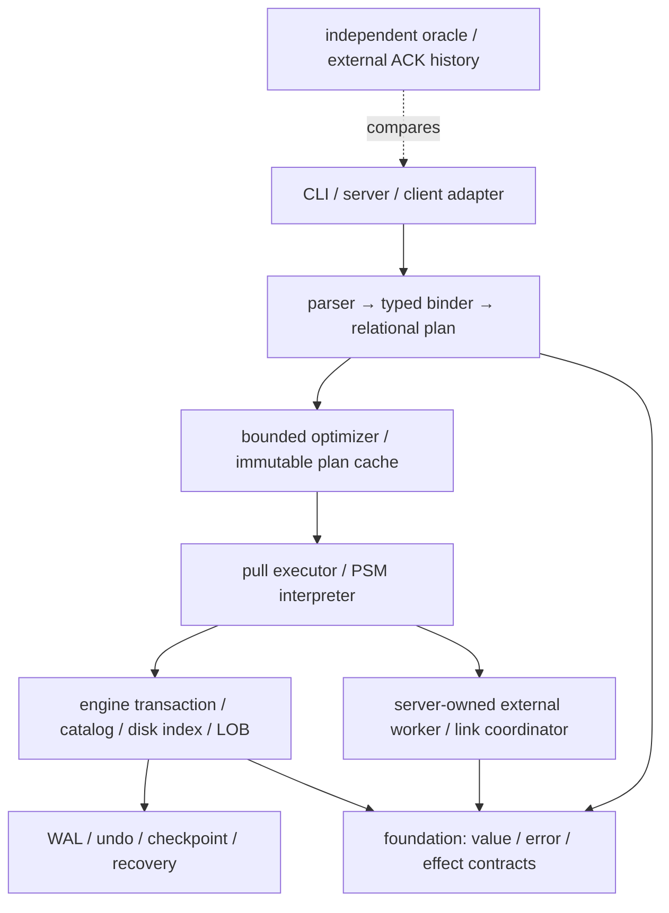

# DEV7 — 확장 SQL·프로그래머블 객체·외부 거래 설계

2026-10-19 · **DEV7-DESIGN-001 / D2 아키텍처 설계 채택·독립 검토 PASS / leaf 동결·구현·SC07–SC11·SQL_EXT1 NOT_RUN**

[구현·검증 계획](../plans/dev7-implementation-plan.md) · [Oracle·Altibase·로컬 소스 조사](../evidence/dev7-source-research.md) · [완료 계약](../plans/stage-completion.json) · [기능 요구](../plans/capability-inventory.json)

이 문서는 XADB-037–041의 아키텍처·의미·실패 경계와 구현 전 동결 의무를 정한다. DEV7에 배정된 9개 요구군의 64개 요구를 [배정표](../plans/dev7-implementation-plan.md#coverage)로 추적한다. 모든 함수 overload·wire byte·물리 opcode가 동결된 최종 구현 명세라는 뜻은 아니다. [F01–F10](../plans/dev7-implementation-plan.md#freeze)의 미완료 입력은 해당 구현을 막으며, 후속 leaf의 의무를 삭제하거나 N/A로 바꾸지 않는다.

## 1. 범위와 기존 계약

| 작업 / 인수 | DEV7의 책임 | 필요한 실제 공급 |
| --- | --- | --- |
| XADB-037 / SC07 | 수치·문자·binary/bit·시간·연산·cast·함수·collation과 codec | DEV1 의미 경계, DEV3 row/index와 DEV4 typed SQL |
| XADB-038 / SC08 | 관계 연산·optimizer·prepared 확장·DDL/view·제약·격리/savepoint·partition SQL | Q1/S1; PART/NG는 해당 SQL leaf에 추가 |
| XADB-039 / SC09 | PSM·package·trigger·sequence·scheduler·queue·객체 온라인 변경 | SC08; server 작업과 권한은 실제 B3 |
| XADB-040 / SC10 | LOB·공간 값/연산/index·파일 교환 | SC07와 실제 disk 기준선; streaming은 B3/CLIENT1 확장 |
| XADB-041 / SC11 | 외부 routine·DB link·XA·변경 전달/분석·client 후속 업무 | SC09와 XADB-036, 실제 소유 peer/TM; log 소비는 해당 보존 공급 |

단계 DAG의 DEV7 진입은 DEV4 그대로다. 순수 의미 설계·독립 vector 준비에 DEV5/6 전체를 요구하지 않지만 server/driver/외부 효과를 인수할 때는 실제 공급이 필요하다. 실행 순서와 task 의존성은 [계획](../plans/dev7-implementation-plan.md#sequence)을 따른다.

Linux·Rust·단일 DISK 제품 엔진, [DEV3 in-place/WAL/영속 undo](disk-storage-design.md), [DEV4](dev4-sql-design.md)의 미인용 이름 대문자·SQL 빈 text 입력 NULL·기본 SERIALIZABLE·DDL 전 commit 경계, [DEV5](dev5-server-design.md)의 요청/권한/UNKNOWN, [DEV6](dev6-client-design.md)의 수명/오류를 유지한다. 메모리 전용 테이블·혼합 저장 엔진·기존 DBMS 전체 호환은 도입하지 않는다. query workspace·spill·buffer·cache는 필요하다.

현재-build fresh fixture에서 format/type/protocol profile을 새로 동결한다. 안정 릴리스의 이전 버전 호환은 [버전 정책](../policies/version-compatibility-policy.json)의 별도 의무다. DEV2 volatile 결과나 현재 미커밋 코드·문서 채택으로 S1/Q1/CLIENT1 완료를 추정하지 않는다.

## 2. 소유 경계와 실행 구조

foundation은 실제 공유하는 값·비교·hash/key·format identity만 소유한다. SQL 이름·cast 선택·함수 registry·AST·optimizer·PSM은 sql, page·LOB chunk·constraint 검사 잠금·savepoint/prepare 영속 상태는 engine, session/권한·scheduler·외부 worker·coordinator 조립은 server 책임이다. engine에서 sql/server/client/platform 구현을 import하지 않는다. 외부 I/O는 주입된 effect 경계로 호출하며 engine latch·publication lock 안에서 실행하지 않는다.

typed logical plan은 output schema, nullability, ordering, dependency `(ObjectId, Generation, SchemaEpoch)`, expression volatility와 부수 효과를 갖는다. 물리 실행은 `open → next(batch) → close` 수명으로 시작하고 각 호출에 별도 cancellation/deadline context를 받는다. plan에는 실행 cursor·binding·transaction·snapshot·이전 요청 context를 저장하지 않는다. cursor가 owning snapshot·workspace·spill guard를 보유한다. 임의 callback을 engine 내부로 전달하지 않는다.

현재 역할 package를 확장한다. 새 crate·dependency·generator·clients 실행 루트는 실제 구현 때 [빌드 정책](../policies/repository-build-plan.md)과 JSON·fingerprint/clean export에 등록한다. 이 설계가 빈 소스 경로를 만들거나 dependency를 채택한 것은 아니다.

## 3. SC07 — 값·타입·식

`TypeDescriptor`는 type ID·precision/scale·길이 단위·collation/version·timezone 규칙을 식별한다. 비교/정렬/hash/key/직렬화의 의미 버전을 공유하고, SQL→index→spill→WAL→driver 전 구간을 같은 값 의미로 검증한다. 비교 결과가 같은 값은 같은 hash와 index 동등 class를 가져야 한다. SQL `NULL = NULL`과 grouping/set/key의 NULL 동등성은 별도다.

| 영역 | 채택 방향과 경계 | F01에서 동결할 항목 |
| --- | --- | --- |
| 정수 | 기존 BIGINT/Int64 유지. SMALLINT·INTEGER32는 명시 범위 타입으로 추가; 기존 INTEGER alias 의미를 몰래 변경하지 않음 | literal·산술 결과 승격·각 driver narrowing 오류 |
| 정확 수치 | DECIMAL/NUMERIC(p,s): p=1..38, s=-84..127. NUMBER(p,s)는 같은 의미; 인자 없는 NUMBER와 decimal FLOAT(p)는 38자리 이하의 coefficient/exponent 표현을 별도 제공 | 정규화 coefficient·exponent, decimal FLOAT의 유효 지수 범위, 연산별 결과 precision/scale·최대 중간 자릿수 |
| rounding | 저장/명시 scale 변환은 가장 가까운 값, 정확한 동률은 0에서 멀어지는 방향. 중간 연산의 암묵 반복 rounding 금지; overflow/0 나눗셈은 오류 | 9.995→DECIMAL(3,2) overflow, ±1.25→scale1=±1.3, 음수 scale·carry vectors |
| 근사수 | BINARY_FLOAT/BINARY_DOUBLE를 binary32/64로 구분. FLOAT라는 이름만으로 IEEE 형식으로 해석하지 않음. -0은 +0, NaN은 canonical 값 | XADB total order `-Inf < finite < +Inf < NaN`, NaN 동등/key/hash; SQL도 같은 non-NULL 비교 규칙, 수치 혼합은 명시 cast |
| 문자 | UTF-8 공통 표현, CHAR/VARCHAR·NCHAR/NVARCHAR의 문자/byte 길이를 명시. CHAR 저장은 우측 space padding. 모두 CHAR인 비교는 길이를 맞춰 padding; VARCHAR가 있으면 space도 값 | Unicode scalar 길이, UTF-8 부정값, BINARY와 버전 고정 Unicode collation, 정규화/대소문자 동등 class와 sort key 상한 |
| binary/bit | BYTE/VARBYTE·BIT/VARBIT, 길이와 padding bit를 직렬화. 빈 binary는 값이며 NULL과 구별 | bit order, 0길이·비정렬 bit·홀수 nibble의 거절/명시 변환 |
| 시간 | DATE는 달력+초까지의 시각, TIMESTAMP는 0..9 소수초. timezone 없는 local 값과 timezone 있는 instant를 별도 타입으로 표현. interval은 month 계열과 day/time 계열을 구분 | 달력 범위·BC/연도0 대응, 월말 산술, 고정 offset/IANA tzdb version, DST gap 거절·overlap offset 명시, leap-second 입력 정책 |
| 변환 | Int64→충분한 decimal 등 손실 없는 공통형만 암묵 승격. text↔numeric/time, approximate↔exact는 명시 cast. session format의 숨은 숫자 변환 없음 | cast 행렬·typed NULL·결과 metadata·오류 위치/효과 |

기존 SQL 빈 text 입력의 NULL 정규화는 유지한다. 함수가 생성한 빈 text, CHAR padding, LOB의 빈 값은 별개이며 각 함수 결과 규칙을 F01에 기재한다. UTF-8로 표현 가능한 국제 문자를 저장하는 것과 locale별 비교를 제공하는 것은 서로 다른 인수다. Unicode collation/tzdb 변경은 index 재구성과 plan 무효화가 필요한 의미 변경이며 OS locale에 자동 추종하지 않는다.

함수 inventory는 산술·ABS/ROUND/TRUNC·문자 길이/SUBSTR/concat/trim/case 변환·날짜/interval 산술·format/parse·CASE/COALESCE/NULLIF·LIKE/정규식·hash/암복호화를 포함한다. CASE/COALESCE의 선택하지 않은 branch는 실행하지 않는다. optimizer는 오류·volatility·side effect가 있는 식의 평가 횟수/위치를 임의 변경하지 않는다. 정규식은 입력·pattern·실행 작업량이 bounded인 엔진을 선택하고 syntax·Unicode 규칙을 고정한다. 암호 기능은 key handle·허용 알고리즘·nonce 생성/중복 방지·인증 실패의 무효 결과를 분리하며 키/평문을 plan/로그에 넣지 않는다. 암호·Unicode·정규식 라이브러리 선택은 DP04 검토가 남아 있다. 함수 이름만으로 이 의무를 완료하지 않는다.

## 4. SC08 — 관계 의미와 실행

| 기능 | 규범 의미 | 기본 물리 전략 |
| --- | --- | --- |
| join | INNER/LEFT/RIGHT/FULL/CROSS, ON의 TRUE만 match. outer NULL 확장은 ON 평가 뒤, WHERE는 그 뒤. 동일 key의 중복 곱 보존 | nested loop 기준선, equijoin hash·index nested loop·merge 후보; outer의 match flag는 spill에도 보존 |
| subquery/lateral | scalar 0행→typed NULL, 2행 이상→Cardinality 오류. EXISTS는 존재만, IN/NOT IN은 3값 논리. lateral은 바깥 행 환경과 같은 statement snapshot | correlated nested execution 기준선. null-aware semi/anti와 cardinality guard가 증명된 경우만 decorrelation |
| grouping | COUNT(*)와 COUNT(expr) 구분, 빈 입력의 전체 집계 COUNT=0·나머지 NULL, GROUP BY는 0행. DISTINCT·GROUPING SETS/ROLLUP/CUBE와 GROUPING bit로 실제 NULL/소계 구별 | sort aggregate 기준선, bounded hash aggregate+spill; grouping set 개수도 admission |
| set/pivot | UNION/INTERSECT/EXCEPT 각각 ALL/DISTINCT, NULL은 set 동등. PIVOT의 명시 열·집계, UNPIVOT의 INCLUDE/EXCLUDE NULLS를 구분 | bag multiplicity count, sort/dedup; pivot은 CASE+grouping 동등 변환으로도 제공 |
| window | ROW_NUMBER/RANK/DENSE_RANK, LAG/LEAD, FIRST/LAST_VALUE, 집계 OVER. ROWS/RANGE/GROUPS·EXCLUDE와 peer 의미 분리. ORDER BY 있을 때 기본 frame은 RANGE UNBOUNDED PRECEDING..CURRENT ROW, 없으면 전체 partition | partition/order sort 후 spool. frame 전체를 메모리에 고정하지 않음; 큰 peer group도 bounded scan |
| 재귀/계층 | WITH RECURSIVE anchor+반복항, UNION은 전역 중복 제거, UNION ALL은 중복 유지. SEARCH/CYCLE의 경로 기반 cycle 표시/확장 중단. 계층 업무는 이 문법으로 대응 예제 제공 | 디스크 work queue·visited/path 구조, frontier 교체. 깊이/행 한도 초과는 오류로 끝내며 잘린 성공 반환 금지 |
| 확장 DML | INSERT SELECT·MERGE/upsert·RETURNING, 대상 RowUID/observation 고정. MERGE에서 한 target을 여러 source가 변경하면 오류. affected count는 직접 target 기준, cascade/trigger 비용 별도 | source/target spool·중복 target 검사 뒤 engine statement 적용. hidden 부분 commit 금지 |

ORDER BY 없는 결과는 bag으로 비교한다. 정렬 동률의 ROW_NUMBER·ROWS frame 결과는 total ordering을 주지 않으면 특정 순서를 약속하지 않는다. 독립 oracle은 가능한 결과 집합/불변식으로 검사하거나 고유 tie-breaker를 추가한다. 반환 prefix 뒤 오류는 incomplete이며 성공 결과와 섞지 않는다. RETURNING 결과는 statement 최종 제약 성공 뒤 공개한다. commit 전의 반환값은 내구 ACK가 아니다.

표현식/관계 결과의 확정 범위를 넘는 모든 overload는 F01/F02의 필수 목록으로 전개한다. 위 함수 예시 수를 전체 SQL 기능 수로 사용하지 않는다.

## 5. Optimizer·통계·prepared cache

규칙은 의미 보존 전제와 반례 vector를 갖는다. predicate pushdown은 outer join의 보존 측·NULL·volatile/오류 식을, join reorder는 lateral/side effect를, subquery 제거는 NULL·중복·scalar cardinality를 확인한다. 각 규칙을 끈 기준 plan과 독립 관계 oracle를 함께 대조한다. production executor 두 개의 일치만으로 정답을 결정하지 않는다.

ANALYZE는 snapshot으로 row count·NULL fraction·NDV·범위/히스토그램을 bounded sample로 만들고 object generation·schema·stats epoch·sample seed를 저장한다. 초기 join 순서 탐색은 최대 8개 relation의 bounded 동적 계획, 그 이상은 결정적 greedy+원래 순서 후보로 제한한다. 비용 단위는 page I/O·row evaluation·sort/hash/spill bytes이며 실제 계측으로 보정한다. 통계가 없거나 틀려도 정확성과 quota는 유지한다. JIT·parallel/vectorized 실행은 이번 필수 구현 경로가 아니며 측정 뒤 별도 결정한다.

공유 cache는 immutable plan template만 보관한다. key는 canonical SQL+parameter types+DB/object dependency+search path+effective principal/authorization epoch+collation/tz/session semantic profile+optimizer version이다. 실제 parameter 값·secret·cursor·snapshot은 넣지 않는다. 캐시 hit에서도 dependency와 권한을 execute admission에서 다시 검사한다. 캐시 전체가 차도 uncached 실행이 가능하고, 참조 중인 plan은 eviction해도 수명 종료 전 해제하지 않는다.

DEV4의 공개 prepared handle은 고정 parameter/result metadata와 stale 명시 오류를 유지한다. 같은 dependency/metadata 내의 통계·물리 plan 변경은 **execute 시작 전** 재최적화 가능하다. schema/generation이나 결과 metadata가 바뀌면 `ReprepareRequired`를 반환하고 사용자가 새 prepare를 수행한다. 자동 SQL 재실행·이미 반환한 결과 중간의 plan 전환은 하지 않는다. parameter skew에 대한 generic/custom 후보는 동일 metadata·최대 2개/entry 안에서 선택하고 비용 측정이 없으면 generic을 유지한다.

## 6. 제약·격리·savepoint

PK/UNIQUE/NOT NULL은 기존 engine 소유 의미를 유지한다. CHECK는 row-local deterministic 식만 허용하고 TRUE/UNKNOWN은 통과, FALSE만 위반이다. subquery·sequence·외부 effect 함수는 CHECK/default의 무조건 허용 대상이 아니다. FK는 같은 타입/collation의 명시 unique parent key, MATCH SIMPLE, 문장 최종 검사를 기본으로 한다. delete/update의 NO ACTION·RESTRICT·CASCADE·SET NULL을 구분하고 cycle·cascade 중복 target·NOT NULL 충돌을 검사한다. deferred 검사 기능은 명시 `DEFERRABLE`일 때만 사용하며 commit 검증 이전에 미해결 의무를 모두 판정한다.

**동시 FK의 첫 구현은 제약에 참여하는 parent/child table의 transaction 소유 보호 잠금을 획득한다.** 해당 statement에서 미리 아는 cascade closure의 새 잠금 집합은 ObjectId 순서로 요청한다. 이전 statement의 잠금은 계속 유지하므로 transaction 전체가 항상 같은 획득 순서를 갖는다는 뜻은 아니다. dynamic SQL/trigger가 추가하는 table도 effect 전에 보호하고, 이전 잠금과 순서가 역전되면 DEV3 wait-for/deadlock·bounded wait 계약으로 판정한다. 일반 victim은 full abort하며 Prepared는 victim에서 제외한다. 정렬을 회복하려고 기존 잠금을 해제/재획득하여 무결성 창을 만들지 않는다.

child insert와 parent delete/update 양쪽이 같은 보호를 받는다. 잠금 뒤 최신 committed 상태+자기 변경으로 참조 무결성을 검사하며 일반 snapshot SELECT와 구별한 engine constraint probe를 사용한다. 이 probe는 사용자 조회로 노출하지 않는다. 과거 snapshot에서 부모를 봤다는 사실만으로 FK 성공을 허용하지 않는다. SERIALIZABLE의 read/write dependency 검증도 유지한다. key/range 단위 최적화는 별도 동등성/교착 검증 뒤다.

RC는 statement snapshot, RR은 transaction snapshot+write 충돌 검증으로 정의한다. RR에서 write skew는 허용하며 SERIALIZABLE로 표시하지 않는다. SERIALIZABLE은 DEV3 table read/write-set 검증을 유지한다. 모든 isolation의 쓰기는 engine observation을 잠금 획득 후 다시 검증하고 오래된 관측이면 자동 statement restart 없이 거래 conflict로 끝낸다. RC/RR SQL 노출은 engine API·native history·SQL/client 통합을 모두 갖춘 별도 F03 공급 후다. SELECT FOR UPDATE·row/range/table lock와 NOWAIT/bounded WAIT도 snapshot 관측·timeout·cancel 결과를 명시하며 범위 보호를 단순 현재 행 열거로 대신하지 않는다.

SAVEPOINT는 `(TxnId, generation, undo_mark, statement frontier, deferred-constraint mark)`를 저장한다. 같은 이름 재지정은 이전 marker를 대체한다. ROLLBACK TO는 이후 marker를 제거하고 대상 marker는 유지하며, RELEASE는 해당 marker와 그 이후 marker를 제거한다. 성공 statement의 implicit marker와 사용자 marker를 별도 관리한다. rollback은 row/index/LOB/queue/cascade와 deferred 목록을 복원한 뒤 반환한다. **read dependency와 획득한 transaction 잠금은 full end까지 보수적으로 유지**한다. rollback 이후 영향을 받은 cursor/locator는 무효화한다. 로그/CLR·undo·삭제 실패 자원은 [DEV3 rollback 회계](disk-storage-design.md#rollback-accounting)대로 실제 반환 전까지 charge한다. cleanup I/O 실패는 RecoveryRequired/Fenced이며 정상 statement 오류로 축소하지 않는다.

## 7. Catalog·view·DDL·partition

view/synonym은 이름 문자열 대신 해석한 object identity와 schema dependency를 저장한다. synonym은 권한을 부여하지 않는다. view는 기본 invoker 권한으로 실행하고 definer 모드는 명시 권한·고정 search path·재검사 계약을 갖춘다. view update는 직접 base row에 유일 대응하는 경우만 허용하고 나머지는 명시 오류 또는 INSTEAD OF trigger 계약을 따른다.

ALTER ADD/DROP/MODIFY/RENAME·default/comment·CTAS는 dependency graph와 권한을 검증한다. 기존 DEV4의 DDL 전 거래 commit과 DDL 자신의 outcome 두 개를 유지한다. invalid syntax/bind 거절 시점과 precommit 뒤 실행 실패를 구별한다. materialized view는 query/dependency+refresh generation+last-success snapshot을 저장하고 최초에는 명시 full refresh를 제공한다. 새 결과는 shadow generation으로 만들고 검증 뒤 atomic catalog switch한다. 실패하면 기존 complete generation을 유지하고 freshness를 사실대로 노출한다. incremental refresh는 별도 leaf이며 미구현을 full refresh 성공으로 인증하지 않는다.

온라인 변경(R07-10)은 필수 후속 leaf다. `Declared → Building → CatchUp → Switching → Published / Aborting`의 durable job 상태를 둔다. snapshot+bounded delta capture로 shadow를 만들고 짧은 writer fence에서 catch-up/검증/epoch switch한다. delta 포화·취소는 switch 전 abort하며 기존 객체를 유지한다. switch 뒤 cleanup은 결과를 되돌리지 않는다. rebuild·transform 식은 replay 때 재평가하지 않는다. process crash 뒤 job owner를 fencing하고 switch decision에 따라 재개/회수한다. 상세 WAL·capture·DDL 공존 조합은 F04를 먼저 동결한다; offline DDL만으로 이 leaf를 닫지 않는다.

PART의 range/list/hash routing·local index와 NG global tree를 SQL로 노출할 때 pruning 전후 전체 scan 동등성, partition key UPDATE의 원자 이동, split/merge/exchange의 schema epoch와 index 유효성을 검증한다. 실제 P1/H2/H3 없이 SQL 문법 수락만으로 PASS할 수 없다. partition 수·global decimal key는 해당 core 수치/타입 인수와 결합한다.

## 8. SC09 — PSM·trigger·sequence·queue·scheduler

PSM은 typed AST를 작은 해석기로 실행한다. procedure/function·IN/OUT/INOUT·overload·local 변수·record/array/typeset·IF/CASE/LOOP·exception·cursor·dynamic SQL·package spec/body/session state를 F05 inventory로 전개한다. dynamic SQL은 일반 binder/권한/quota 경계를 통과하며 SQL 문자열을 compiler 내부 권한으로 우회하지 않는다. deterministic/stable/volatile/effectful 분류는 선언만 믿지 않고 허용 operation으로 검증한다. package generation 변경 후 기존 state는 `PackageStateInvalidated`로 폐기하고 다음 명시 호출에서 초기화한다.

일반 CALL은 하나의 statement rollback 경계다. 내부 statement 오류는 자기 mark까지 복원한 후 handler로 전달하고, 처리되지 않은 오류는 CALL 시작점까지 되돌린다. OUT 값과 결과는 CALL 성공 뒤 확정한다. 일반 routine/trigger 내부의 COMMIT/DDL은 거절하여 호출자의 거래를 숨겨 끝내지 않는다. autonomous routine은 명시 별도 transaction·snapshot·quota·commit outcome을 가지며 부모를 suspend한다. 부모 rollback이 자식의 확정 commit을 취소하지 않는다. 부모가 가진 잠금에 자식이 접근하면 parent-child self wait를 탐지해 자식 오류로 종료하고, 잠금을 공유하는 가짜 중첩 거래로 구현하지 않는다.

CALL의 반환 result는 성공 판정 전에 같은 statement의 bounded spool에 완성한다. OUT·result metadata/rows의 client 공개와 일반 fetch는 그 뒤 시작한다. spool 한도/쓰기 실패는 CALL rollback이며 뒤늦은 handler가 이전 결과를 성공으로 되살리지 않는다. result 생성에 부수 효과가 있는 lazy cursor를 반환하지 않는다. 성공 뒤 fetch I/O 오류는 incomplete result로 표시하며 이미 확정된 CALL/transaction outcome을 바꾸지 않는다. autocommit CALL은 LOB 결과의 owning snapshot/pin을 결과 수명까지 유지하는 별도 result ownership을 F06/F08로 동결하기 전에는 해당 locator 반환을 거절한다.

첫 REF CURSOR profile도 CALL 안에서 읽어 완성한 spool을 가리키는 typed handle이다. 반환 handle은 session/result generation과 spool guard를 소유하고 close/다음 결과로 이동/세션 종료에 무효화한다. base-table cursor·이전 operation context·부모 PSM stack을 숨겨 보유하지 않는다. spool bytes·metadata·OUT 값의 공존 peak는 query/DB 전체 예산에 포함한다. base-table lazy REF CURSOR는 별도 snapshot·late failure 계약을 추가하기 전에는 지원하지 않는다.

trigger는 BEFORE/AFTER statement·row와 view의 INSTEAD OF를 구별한다. 같은 event 내 순서는 catalog에 저장한 명시 order와 object ID로 고정한다. BEFORE statement→BEFORE row의 NEW 수정→row-local 타입/NOT NULL/CHECK→실제 row effect→AFTER row→AFTER statement→최종 statement 제약 순서다. UNIQUE/FK는 기존 문장 최종 상태 규약을 유지하며 AFTER가 발생시킨 추가 DML·cascade도 같은 최종 검사에 포함한다. mutation 중인 table의 재진입 조회/변경은 초기에는 MutatingTable 오류로 거절한다. cascade·trigger·PSM 전체를 합친 depth/operation budget을 사용하며 recursion을 서로 다른 counter로 우회하지 않는다.

sequence는 session CURRVAL과 durable range reservation을 분리한다. NEXTVAL은 범위 상한의 WAL sync 뒤 발급하며 rollback/crash로 gap이 생길 수 있고 gapless를 보장하지 않는다. CYCLE을 명시한 경우에만 wrap하며 unique key의 보장을 대신하지 않는다. ALTER/DROP·epoch·cache·복구가 발급한 non-cycle 값을 재사용하지 않게 한다. 고성능 lock-free cache를 첫 구현에 요구하지 않는다.

queue는 disk table+index의 transaction 객체다. enqueue와 dequeue/ack는 같은 engine transaction에 참여한다. dequeue의 claim은 row 잠금으로 보호하며 rollback/crash에는 다시 소비할 수 있다. ordering은 가용 메시지 중의 정책이며 여러 consumer의 외부 완료 순서가 아니다. DB 내부의 소비 기록과 외부 부수 효과 사이 exactly-once를 약속하지 않는다. retry/dedup key·lease generation·dead-letter 전이는 별도 영속 상태다.

scheduler는 durable job definition·다음 due 시각·lease/run generation·시도/결과를 갖는다. server의 bounded worker가 lease를 얻고 실행한다. 재시작/lease 상실 시 at-least-once가 기본이며 외부 효과의 UNKNOWN을 성공/실패로 단정해 재실행하지 않는다. wall-clock 변경·missed-run policy·동일 job 중복 실행 방지·취소/권한 철회를 F05에 동결한다. 관리·통신 built-in package는 일반 ACL과 allowlisted endpoint/effect를 사용한다. 임의 OS shell·파일 경로를 SQL 권한으로 자동 허용하지 않는다.

## 9. SC10 — LOB·공간·저장 한도 확장

LOB는 inline scalar와 별도 engine object다. `LobId/generation/version/length`와 disk chunk tree를 사용하며 logical row는 descriptor를 보유한다. BLOB byte offset과 CLOB Unicode scalar offset을 구분한다. 빈 LOB는 NULL과 다르다. locator는 session·transaction/snapshot·object generation에 묶이며 full commit/rollback·소유 result 종료 후 사용은 거절한다. 필요한 지속 사용은 명시 owned copy로 한다. SQL text/binary의 기존 64 KiB scalar와 AXF1 1 MiB frame을 통째로 늘리지 않고 bounded chunk로 전송한다.

write/append/truncate는 statement undo와 같은 거래에 참여한다. chunk를 먼저 만들어도 row에 공개되지 않은 orphan은 engine allocator/undo로 추적한다. snapshot pin보다 이른 chunk 회수 금지, recovery는 chunk/descriptor의 같은 결정만 보인다. upload 완료 전 취소는 statement 복원, commit 시도 뒤 단절은 UNKNOWN 규칙이다. backpressure 상태에 engine page latch를 보유하지 않는다. checksum/length·UTF-8 경계·중복/누락 offset·close 후 chunk를 검증한다.

**D7-STORAGE profile**은 현재 S1의 256 mutation/1 MiB 논리 after-image 한도를 변경하는 별도 공급 계약이다. 최초 확장 목표는 거래당 논리 row mutation 4,096·canonical 변경량 64 MiB·단일 LOB 16 MiB, 전송 chunk 최대 64 KiB다. 이 숫자는 측정된 용량이 아니며 F03의 forward/undo/CLR/WAL·page·lock·FD·memory 상한 산식과 admission이 없는 operation은 거절한다. LOB bytes·cascade/trigger effects·descriptor/index 변경을 빠짐없이 센다. 이미 할당된 old bytes·new bytes·undo와 WAL 보존량의 공존 peak를 예약한다. 목표 크기를 수용하지 못하면 인수를 실패로 남기고 profile을 재설계한다. S1의 기본 profile·이전 증거와 engine disk8 GiB/WAL256 MiB/maintenance1 GiB를 암묵 확대하지 않는다. 큰 DML을 여러 commit으로 쪼개지 않는다.

공간 값은 2D Geometry의 Point/LineString/Polygon·multi·collection, empty/NULL·SRID를 구별한다. WKT/WKB/EWKT/EWKB와 버전 있는 내부 codec을 분리한다. F06에서 coordinate 범위·NaN/Inf 거절·ring closure/orientation·invalid topology 정책·SRID별 planar/geodetic 지원표를 고정한다. 지원하지 않는 SRID/차원을 무손실인 것처럼 버리지 않는다. 동일 planar SRID의 contains/intersects/touches/overlaps/distance·buffer/union/intersection 등 연산을 독립 기하 vector로 인수한다. bounding-box index는 후보만 반환하고 exact predicate를 다시 평가한다. index 경계 rounding은 false negative가 없어야 하며 근사 결과를 exact로 표시하지 않는다. shapefile과 속성/encoding/SRID import/export는 별도 adapter·전체/부분 실패 정책과 fixture를 갖춘다. 기하 library 선택·robust predicate 구현은 DP04/F06 의무로 남는다.

## 10. SC11 — 외부 routine·DB link·변경 교환

외부 C/C++ routine은 별도 Linux worker process에서 실행하고 함수명·library digest·ABI·input/output descriptor를 등록한다. engine/server에 임의 shared library를 직접 load하지 않는다. bounded RPC·CPU/memory/FD/time 제한·capability별 file/network 접근·worker generation을 적용한다. worker crash가 engine rollback 성공을 보장하지 않으며 외부 effect의 certainty를 별도 전달한다. pure routine은 정답 비교가 가능하지만 effectful routine의 자동 재호출은 금지한다.

DB link는 `ReadOnly`, `IndependentRemote`, `Atomic2pc`의 transaction mode를 명시한다. ReadOnly는 local+remote의 전역 snapshot을 약속하지 않는다. IndependentRemote는 remote commit을 local rollback으로 취소할 수 없음을 결과에 보존한다. Atomic2pc는 참여자 모두의 실제 prepare/recover·durable decision을 검증한 연결만 admission한다. 단순 순차 commit을 atomic이라고 부르지 않는다. 원격 타입/collation/null/date 차이는 adapter의 lossless mapping 또는 명시 오류다. remote pushdown은 해당 의미 동등성이 검증된 연산에만 적용한다.

2PC의 원자 결정과 전역 isolation은 별도 capability다. 각 RM의 local SERIALIZABLE만으로 전역 SERIALIZABLE을 표시하지 않는다. link 선언은 peer별 isolation과 전역 보장 범위를 명시하며, 요청한 전역 수준을 입증한 F07 schedule/locking protocol이 없으면 첫 remote effect 전에 UnsupportedIsolation으로 거절한다. 기본 SERIALIZABLE 요청을 조용히 per-peer 수준으로 낮추지 않는다. 전역 보장이 필요한 초기 조합은 참여자를 사전에 고정하고 ordinary writer/DDL까지 참여하는 보수적 보호 protocol부터 설계·검증한다. 이종 peer가 이를 제공하지 않으면 명시 per-peer 수준의 별도 opt-in 조합만 허용한다.

R10-03은 Oracle/JDBC 대상 adapter의 **외부 필드·타입 mapping·binding/batch·원격 오류·독립 commit certainty**를 설계한다. 전달할 변경을 얻는 내부 추출·WAL 해독·보존/offset/구독 알고리즘은 기존 `D-LOGGING` 보류를 유지한다. 외부 adapter fixture의 성공을 실제 변경 추출·end-to-end 전달의 PASS로 올리지 않는다. R10-04는 HDFS/Hive 등 분석 환경의 bounded bulk/file/stream adapter와 타입/encoding·완결/부분 실패를 별도 runtime에서 인수한다. 환경별 지원 조합은 F08에 남으며 로컬 파일 왕복만으로 원격 분석 환경 인수를 닫지 않는다.

R10-05의 변경 분석·구독은 [기능 요구](../plans/capability-inventory.json)의 `DEFERRED_BY_USER`와 `D-LOGGING`에 **필수 예약 항목으로 유지**한다. 이번 설계는 해당 상세 logging 조사·구현 알고리즘·인수 사례를 작성하지 않는다. 전체 DEV7 gate를 닫을 때 미해결 의무로 남고 N/A나 다른 기능 PASS로 치환하지 않는다. 이 보류를 해제하는 별도 범위 결정 뒤 소유 계약과 시험을 확장한다. DEV8 replication failover/RPO와도 별개다.

## 11. XA·in-doubt의 상태와 복구

XA RM은 SQL prepared statement와 다른 거래 `PREPARED` 상태를 갖는다. XID는 TM namespace·format ID·gtrid·bqual의 bounded bytes이며 중복 start/prepare/decision은 상태별로 검증한다. `Active → Ended → Preparing → Prepared → CommitDecided / AbortDecided → Completed → Forgotten`을 기본으로 한다. rollback-only·read-only vote·join/suspend/resume·one-phase·heuristic 상태/API는 F07에서 flag별로 동결한다.

| 경계 | durable 사실과 허용 동작 |
| --- | --- |
| prepare 전 | 모든 write/constraint·Serializable 검증, undo/redo·잠금/참조·prepared slot·recovery 예약을 확보. 실패하면 정상 abort 또는 I/O fence |
| prepare 응답 | XID·TxnId·prepare LSN·retained lock/validation descriptor·resource manifest를 WAL sync한 뒤 Prepared ACK. user row는 아직 보이지 않음 |
| prepared 유지 | connection/timeout/세션 종료가 abort하지 않음. engine ATT에서 일반 loser와 구별; checkpoint/retention/aging에 포함하고 backup은 아래 Busy 규칙. restart 때 잠금·validation 보호·undo 참조를 일반 admission 전에 복구 |
| commit 결정 | TM의 권한 있는 결정을 영속 기록하고 redo 가능한 commit으로 원자 가시성 공개. 동일 XID의 같은 결정 재전송은 같은 outcome, 반대 결정은 protocol/heuristic 오류 |
| abort 결정 | abort intent 이후 CLR로 완전 undo. 재장애에는 이어서 undo, 완료/반복 결정 receipt 보존 후 보호 해제 |
| 완료 보존 | terminal decision/tombstone은 TM forget/ack 계약 전 지우지 않음. ledger 포화는 신규 admission 거절. 무조건 TTL 삭제 후 XID 재사용 금지 |

`Preparing` 진입과 session cancel/close는 같은 transaction owner에서 선형화한다. prepare 시도 이전 취소는 full abort, 시도 이후에는 prepare의 durable 판정을 기다린다. prepare WAL 결과 불명이면 engine fence/recovery로 판정하며 connection close를 ABORT 근거로 쓰지 않는다. durable Prepared는 session에서 분리된 engine-owned 거래다. DEV5의 idle/300초 만료·disconnect·pool reset·권한 철회·graceful shutdown은 그 세션의 handle만 닫고 Prepared 자체를 보존한다. 일반 deadlock victim 선택에서도 Prepared를 제외한다.

일반 admission/DDL drain과 분리된 **예약된 resolve control 경로**가 인증된 기존 TM의 recover/commit/rollback과 관리자 해소를 진행한다. 신규 ordinary 권한이 철회되어도 기존 XID를 해소할 권한은 별도 capability로 확인한다. prepared slot이 32개 차도 최소 한 해소 작업의 worker·memory·FD·WAL/CLR 예약은 남아야 한다. 종료는 그 영속 상태/예약을 recovery에 인계하며 heuristic abort하지 않는다. 기존 S1 exact-C backup은 Prepared가 하나라도 있으면 새 backup effect 전에 Busy로 거절한다. DDL/온라인 switch는 충돌 Prepared를 timeout으로 지우지 않고 자기 작업만 Busy/timeout으로 끝내며, 해소 control의 admission을 막지 않는다. prepared를 포함한 backup/복원은 TM/XID 재접속·중복 writer 방지를 갖춘 별도 F07 profile 전에는 지원하지 않는다.

prepared 거래의 SERIALIZABLE read/write 보호는 살아 있어야 한다. 첫 구현은 관련 table에 충돌하는 commit/DDL을 막는 prepared validation fence를 유지한다. prepare 뒤 다른 writer를 허용하고 commit 때 serialization 실패를 반환하는 구조는 채택하지 않는다. lock·fence·재시작 재구성은 SQL 없는 engine 시험으로 먼저 인수한다. volatile lock만 WAL에 없는 채로 남기는 것은 금지다.

coordinator는 global ID·모든 participant·prepare 시도와 vote·global decision·participant ACK를 durable journal로 관리한다. 전체 YES 확인 뒤 COMMIT decision을 sync하고 나서 commit message를 보낸다. decision이 영속된 뒤에는 timeout/cancel로 ABORT로 전환하지 않는다. crash 후 완전한 journal을 읽어 기존 decision을 재전달하고, decision이 없음을 검증한 transaction은 ABORT decision을 먼저 영속화해 해소한다. torn/손상 journal을 decision 부재로 처리하지 않는다. RM의 Prepared 응답이 유실된 참여자도 목록에 남겨 recover/abort를 반복한다.

`UNKNOWN`은 호출자가 결과를 모른다는 관측이고, `Prepared`는 engine이 복구 가능한 투표 상태라는 사실이다. transport 단절은 둘을 서로 대체하지 않는다. `recover`는 권한 있는 TM에게 완결된 prepared 목록을 bounded page로 반환한다. 관리자의 force commit/rollback은 감사·XID·기존 decision 충돌·heuristic 결과를 영속 기록하고 정상 원자 완료로 위장하지 않는다. 일반 세션의 DDL implicit commit·로컬 COMMIT/ROLLBACK은 XA branch 안에서 effect 전 거절한다. current-build crash/recrash와 실제 두 RM/TM의 외부 이력이 SC11 필수다.

## 12. Driver·protocol·업무 확장

DEV6 기본 native/C·JDBC·ODBC의 수명·UNKNOWN·오류 계약을 확장한다. wire/profile 정본은 server/client 공동 F08이며 numeric tag를 이 문서에서 추측해 추가하지 않는다. unknown required capability는 effect 전 거절한다. 새 decimal/time/interval/LOB/spatial metadata는 precision/scale·timezone·collation·길이 단위를 포함하고 손실 있는 자동 문자열 fallback은 하지 않는다.

Callable IN/OUT/INOUT·여러 result·generated keys·array/batch·LOB streaming·pool reset·XAResource·ODBC descriptor/diagnostic 지원표를 API별로 작성한다. batch는 전체 원자 모드와 각 statement 모드를 명시하고 implicit partial commit은 없다. 세션당 한 active result 기준은 결과 집합을 순서대로 소비/닫은 뒤 다음 결과 집합으로 진행하도록 확장하며 동시 active cursor 수를 암묵 늘리지 않는다. RETURNING/OUT·batch count는 statement/transaction certainty와 함께 전달한다. pool reset은 일반 거래의 rollback 확정·cursor/LOB·package state·역할/semantic setting·cancel generation까지 정리하지 못하면 연결을 폐기한다. XA Prepared는 rollback 대상이 아니며 위 engine owner로의 인계와 session 분리를 확인한다.

embedded SQL은 host 변수·indicator·array·cursor·dynamic SQL·다중 connection/thread를 포함한 빌드 가능한 생성/호출 adapter로 제공한다. PHP/PDO·.NET과 framework는 실제 언어 runtime+검증된 표준 연결 경로를 명시하며 README 예시만으로 인수하지 않는다. TCP/TLS·원격 인증은 DEV5/COMM 확장 공급을 먼저 갖추며 local-only CLIENT1 증거를 원격 지원으로 확대하지 않는다.

## 13. 자원·오류·관측

DEV4 query당 workspace8 MiB·SQL 전체64 MiB·temporary disk256 MiB/query 및1 GiB/DB·임시 FD10/query 및64/DB를 유지한다. operator마다 이를 새로 할당하지 않고 query 소유 ledger에서 합산한다. 공유 plan cache의 최초 상한은 8 MiB/DB·128 entries이고 SQL 전체64 MiB 안에서 차감한다. active와 retired/pinned plan·old/new bindings의 공존량도 포함한다. 새 cache가 준비된 statement의 기존 수명을 깨뜨리지 않는다.

join/hash aggregate/window/재귀/DML 대상 spool 모두 같은 temp namespace·length/checksum·소유 manifest·cleanup 예약을 사용한다. hash skew로 같은 bucket만 커지면 재분할을 최대 4회까지만 시도하고 bounded sort/merge 또는 block nested-loop로 전환한다. hash 구현의 best-effort 초과를 XADB quota 초과 허용으로 가져오지 않는다. spill 전환의 입력/출력 공존·FD·buffer를 미리 확보하고, 부족하면 statement/result 오류로 끝낸다. 이미 삭제하지 못한 파일 bytes를 반환한 것으로 세지 않는다.

fallback은 아직 output을 공개하지 않은 build/partition 단위에서만 수행한다. 완료 partition을 재방문하거나 이미 반환한 행을 재출력하지 않는다. outer match flag·집계 partial state·partition 완료 frontier를 같이 보존한다. 그 상태/예약을 보존할 수 없는 전환은 결과 incomplete 오류이며 상위 query의 숨은 재실행이 아니다.

최초 실행 상한: join relation64·exact 탐색8, grouping sets256, recursive depth1,024/누적행1,000,000, PSM/trigger 합산 depth32·instruction10,000,000, savepoint64/거래, LOB locator32/세션, 외부 worker4/DB, XA prepared32/DB·참여자8/거래다. 상한을 넘으면 명시 Limit이며 현재 작은 상한 통과가 제품의 업무 용량 충족을 자동 증명하지 않는다. worker/PSM/package memory·prepared 유지 disk는 기존 DB/server/engine budget의 하위 예약이며 F09에서 중복 없이 산식을 완성한다. prepared 하나가 오래 유지되면 retention 압력으로 신규 쓰기가 거절될 수 있으나 그 거래를 임의 삭제하지 않는다.

오류는 기존 code/Effect/Certainty/RetryScope에 해당 owner 결과를 전달한다. ordinary type/constraint/quota 오류는 현재 statement rollback 확정 뒤 transaction 유지 가능, serialization conflict는 full abort, cleanup 실패는 RecoveryRequired, commit/prepare/remote effect 단절은 독립 certainty를 갖는다. ordinary fetch의 prefix는 전체 결과 성공이 아니다. statement 취소는 sequence 발급·autonomous commit·명시 외부 effect까지 취소했다고 주장하지 않는다.

plan/node→estimated/actual rows·loops·memory peak·spill bytes/pass·skew fallback·dependency invalidation·constraint/cascade·PSM depth·LOB bytes·XID/phase를 연결한다. SQL/bind/key/LOB 본문·secret은 기본 진단에서 제외한다. 미계측·유실은 0과 구분한다. [성능 계약](ai-performance-engineering.md)의 독립 결과·baseline/candidate·원시 bundle·재현 의무를 [성능 계획](../plans/dev7-implementation-plan.md#performance)으로 확장한다.

## 14. DEV7-DESIGN-001 결정과 상태

| 항목 | 기록 |
| --- | --- |
| 분류·상태·일자 | D2 · ACCEPTED (아키텍처 설계 범위) · 2026-10-19 |
| 담당·권한 | 설계·계약·통합 `/root`; 사용자의 DEV7 설계 및 Oracle·Altibase·로컬 DBMS 참고 요청, DP01의 기존 위임 |
| 선택 | bounded pull 실행과 spill, 의미 descriptor, 보수적인 FK/prepare 보호, interpreted PSM, disk LOB, process 격리 외부 효과와 명시 2PC |
| 대안 | 전체 DBMS dialect 복제·무제한 materialization·무조건 cache/자동 재실행·in-process 외부 routine·순차 remote commit의 원자 주장 배제. vector/JIT·fine-grained FK 등은 측정·기능 근거 뒤 재검토 |
| 적용·대체 | 기존 DEV7 범위/SC07–11을 구체화. D7-STORAGE·RR/RC·XA는 별도 공급 profile로만 하위 capability를 확장. DEV2/3/4 기본 증거·기존 ABI·안정 버전 의무를 소급 대체하지 않음 |
| 독립 검토 | `/root/dev7_design_review`가 원문·owner 계약·관련 diff·반례를 검토. D7-R01–R05 수정 후 재검토 PASS, 필수 P1/P2 잔여 없음. 계약/통합 `/root` 반영 확인. [상세 기록](../evidence/dev7-source-research.md#review) |
| 남은 입력 | F01–F10의 overload/API/codec·resource/fault·runtime/dependency 동결. 실제 구현 담당은 leaf 착수 때 배정 |
| 실행 | 제품 코드 변경·문서 검사·제품 시험·외부 DBMS 실행 비교 없음. SC07–SC11·SQL_EXT1·배포 NOT_RUN |
| 재검토 | 의미/계층 충돌, SQL보다 큰 저장 effect, cache 권한 누출, quota/cleanup 순환, prepared 상태 유실, 독립 oracle 반례, 실제 workload 한도/성능 미충족 |
