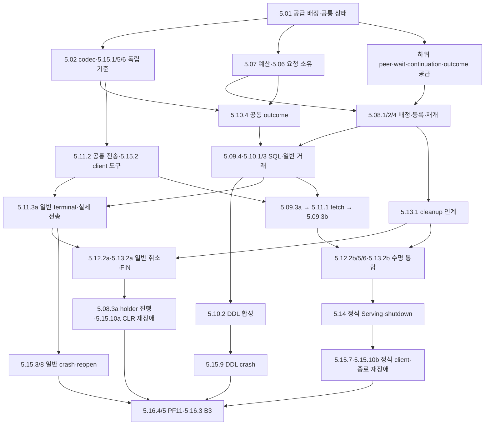

# DEV5 — 서버 개발 작업 분류와 공급·인수 계획

2026-10-22 · **D5-WORK-BREAKDOWN-003 D2 ACCEPTED / 16개 분류·64개 하위 작업의 내부 인계 보완 / 제품·B3·PF11 NOT_RUN**

[서버 소유 계약](../contracts/dev5-server-design.md) · [기존 구현·검증 계획](dev5-implementation-plan.md) · [ARIES·Oracle·로컬 DBMS 조사](../evidence/dev5-work-breakdown-research-20261022.md) · [DEV3 분해 방식](dev3-implementation-plan.md#remaining-work) · [완료 정본](stage-completion.json)

DEV3처럼 기능의 위치를 찾는 대분류와 실제 개발·검토·인계하는 하위 작업을 구분한다. 기존 D5-I01–I06의 큰 묶음을 5.01–5.16, 하위 64개 작업으로 나눈다. 최초 44개 작업의 공급 경계·분량을 재검토하여 20개를 추가하고 일부 기존 ID의 범위를 좁혔다. [변경 대응표](#revision-map)가 이전 ID와 현재 완료 범위를 연결한다. 번호는 실행 순서·진행률이 아니며 XADB-012/033·DEV5/B3의 범위와 DEV4/COMM 선행을 바꾸지 않는다. 각 행은 계획된 산출물이지 존재하는 API·runner·명령이 아니다. 개별 API·byte layout·모델 공간·자원 peak는 D5-F01–F05에서 해당 구현 전에 동결한다.

[003 후속 검토](#decision-003)는 64개 ID와 전체 의무를 유지하면서 큰 통합 항목의 [내부 인계 단위](#handoff-units)를 분리한다. 특히 close 공급→fetch→EOF 인수의 숨은 순환을 해소하고 일반 commit 응답·취소/FIN·CLR 재장애를 DDL/fetch/shutdown 전체보다 먼저 연결한다. 이전 001/002 조사·채택 기록은 당시 범위로 보존한다.

이번 요청은 **분류 재검토·개선 반영·완료 후 1회 commit**이다. 제품 개발·시험을 재개하지 않는다. 아래 인수 항목은 모두 PLANNED_NOT_RUN이며 독립 설계 검토가 실행 PASS를 대신하지 않는다. DEV3 최종 S5의 전수 재실행 예외를 DEV5로 확대하지 않는다. 시험 선택은 [사용자 지시](../../AGENTS.md)와 [이 문서의 증거 수신 규칙](#verification)을 따른다.

## 1. 16개 기능 분류

| ID·분류 | 작업 성격 | 책임·주요 산출물 | 기존 작업·동결 | 직접 인수 연결 |
| --- | --- | --- | --- | --- |
| [5.01 공급 계약·개발 입력](#task-01) | 공급 조정 | 실제 Q1/C1/engine 공급표, 요청·소유·상태 경계 | I01–I06 공통, F01–F05 | SC03/KU14/PA08/PF11의 착수 입력 |
| [5.02 XSQ1 형식·codec](#task-02) | 제품 구현 | header/value·operation·terminal/metadata 표현 | I01, F01·D6-W01 | T01/02/06/10/13 |
| [5.03 요청 조립·COMM 연결](#task-03) | 제품 구현·전송 연결 | bounded fragment 수신·완결 요청 인계·실패 반환 | I01, F01/F03 | T02/05/08/09 |
| [5.04 peer 인증·정책 갱신](#task-04) | 하위 공급 수신·제품 구현 | OS identity·Hello/Welcome·불변 policy/epoch | I02, F02 | T03/04/08 |
| [5.05 권한 검사·정리 예외](#task-05) | 제품 구현·권한 통합 | SQL class별 검사, revoke 선형화, 자기 cleanup 허용 | I02/I04, F02 | T04/07/10/12 |
| [5.06 세션·요청 정체성](#task-06) | 제품 구현 | session/handle scope·request generation·단일 terminal | I03, F03 | T05/07/09, M01 |
| [5.07 자원 예약·admission](#task-07) | 제품 구현·자원 회계 | 예산 회계·효과 전 credit·독립 cleanup 예약 | I03, F03 | T02/08/12, M02 |
| [5.08 worker·대기 진행](#task-08) | 하위 공급 수신·제품 구현 | 직렬 배정·park/resume·wake/cancel 소유 | I03, F03 | T08/09/12, M01/02 |
| [5.09 prepared·binding·metadata](#task-09) | 제품 구현·SQL 통합 | prepare/describe·원자 bind·stale/close 수명 | I04, F01/F02/F03 | T06/07, PA08 |
| [5.10 SQL·거래·DDL 결과](#task-10) | 제품 구현·거래 통합 | direct/execute·거래 모드·DDL 두 outcome·확실성 | I04, F01/F02/F03 | T04/10/11/13, KU14/PA08 |
| [5.11 result·fetch·응답 전송](#task-11) | 제품 구현·전송 통합 | snapshot과 요청 context 분리·owned batch·backpressure | I04/I05, F01/F03 | T02/05/06/07/08/09 |
| [5.12 취소·deadline·수명 만료](#task-12) | 제품 구현·수명 통합 | CancelAck·취소 결과·idle/transaction timer | I03/I05, F03 | T05/08/09/12, M01/02 |
| [5.13 세션 정리·fencing](#task-13) | 제품 구현·정리 통합 | cleanup 단일 소유·실제 undo·engine fence 전파 | I03/I05, F03/F04 | T04/08/09/12/13 |
| [5.14 서버 시작·종료](#task-14) | 제품 조립·lifecycle 인수 | recovery 뒤 Serving·listener·quiesce/drain/supervisor | I05, F03/F04 | T03/12/13 |
| [5.15 독립 client·복구·동시성 인수](#task-15) | 검증 도구·인수 실행 | 독립 bytes/history·외부 ACK·fault/model·known-bad | XADB-033, I01–I05, F04 | T01–13, C01–08, M01/02, SC03/KU14/PA08 |
| [5.16 관측·성능·B3 종합](#task-16) | 계측 구현·성능 인수·증거 집계 | causal spans·PF11·증거 집계·DEV6 이관 | I06, F05 | T14/P01–04, PF11/B3 |

T/C/M/P/F는 기존 계획의 D5-T/C/M/P/F ID다. 새 테스트 번호로 기존 의무를 대체하지 않는다. 5.01·5.07·5.10.4·5.12.3·5.15.1/5/6·5.16.1은 각 소비 작업과 함께 진행하는 기반이며 마지막 통합 때 한꺼번에 추가하는 항목이 아니다. 서버의 WAL/undo/recovery 작업은 하위 engine 공급의 **수신·조립·외부 관측**이다. DEV3 알고리즘을 server에 다시 구현하지 않는다.

## 2. 공통 착수·완료 조건

| 기록 | 하위 작업에 필요한 내용 |
| --- | --- |
| 소유·변경 | 작업 ID, 실제 구현/계약/통합 담당·독립 검토자, 기준 commit/dirty digest, 실제 symbol·변경 파일. 계획 번호마다 crate나 파일을 강제하지 않음 |
| 선행 수신 | 아래 직접 선행의 좁은 산출물·실제 API·revision·원래 증거 범위. Q1/C1의 미공급 사항, mock/모델과 실제 Linux·SQL·disk 공급을 구분 |
| 동결 | 해당 F01 bytes/F02 auth/F03 상태·수명·자원/F04 oracle·fault/F05 측정 입력. 새 입력·fixture·oracle·harness는 기능 구현과 함께 작성 |
| 첫 효과 전 | 권한/class/expected_result 검사 위치, ownership 인계, completion/cleanup·최대 reply credit, 실패·취소·Drop의 반환 책임. effect/certainty/retry와 선형화점 명시 |
| 검증 선택 | 마지막 관련 검증 이후 실제 코드 diff→필수 case/인접 경계 대응. 변경 없는 완료 시험·전체 wrapper 재실행 금지. 독립 literal·known-bad와 실제 thread/I/O/reopen은 관련 변경에 적용 |
| 완료·미완료 | 공급 완료와 사용자 요청의 end-to-end 인수를 별도 기록. source/binary/fixture/log·실행 범위·실패와 잔여 의무 보존. 제한 검증으로 B3 승격 금지 |

실제 서버 조립에는 [기존 착수 gate](dev5-implementation-plan.md#entry)의 S1→Q1 및 C1 공급과 suspend/resume·peer/clock/cancel API가 필요하다. 선행이 없는 동안 wire vector·예산표·모델·mock adapter를 준비할 수 있지만 mock SQL 성공을 실제 서버 인수로 보고하지 않는다. 미래 작업 전체의 완료를 좁은 공급의 선행으로 삼지 않는다.

## 2.1 하위 공급 배정과 수신

아래 D5-S는 **DEV5가 소비할 기존 책임의 공급 추적 ID**다. 64개 server/검증 작업에 하위 engine·SQL 구현량을 중복 합산하지 않는다. 초기 상태는 모두 **OPEN_SUPPLY / 실제 API·별도 검토·인수 미완료**다. 소유 모듈과 연결 작업을 지금 지정하고 실제 구현자·검토자·기준 revision은 해당 작업 착수 때5.01.1에 기록한다. 이름이 없는 API를 존재하는 것으로 등록하지 않는다. 미공급 소비는 BLOCKED_SUPPLY로 남기되 다른 독립 준비를 막지 않는다.

| ID·소유 계층 | 연결할 공급 작업 | 수신할 산출물·최소 반례 | 소비·동결 |
| --- | --- | --- | --- |
| D5-S01 foundation/platform | [COMM-C0/C2의 peer port 공급](comm-implementation-plan.md#dev5-supply) | accepted Unix socket과 같은 수명의 typed peer identity·조회 실패; claimed UID 불일치·연결 재사용/오류. 실제 public port·safe OS adapter·원래 source/선택 시험 증거. 현재 ByteStream의 존재만으로 UID 공급 완료 아님 | 5.04.1; F02 |
| D5-S02 engine | [3.10.1/2와3.07.2/3·3.08.2의 서버 대기 공급](dev3-implementation-plan.md#dev5-supply) | row/key wait와 offline build/DDL drain·그 admission의 등록/조건 검사 원자화, cancel/unregister·stale wake·generation·latch/pin 해제. wait-for graph의 victim 판정과 worker 반환은 별개. 등록 직전 unlock·취소·중복 wake 반례 | 5.08.2/3; F03 |
| D5-S03 sql | [4.13.1·4.14.2/3의 continuation 공급](dev4-work-breakdown.md#dev5-supply), D5-S02 | statement token·이미 수행한 변경·rollback 예약·result 위치·operation context를 보존한 중단/재개·cleanup 인계. stack borrow 없이 소유 이동/Send 가능성 검토. 같은 SQL 재실행0·deadline 연장0·취소/close 소유 단일성 | 5.08.4·5.09/10/11/13; F03 |
| D5-S04 sql | [4.03/4.10/4.13의 분류·authorization 공급](dev4-work-breakdown.md#dev5-supply) | parser/prepared class·expected_result 첫 효과 전 검사·DDL precommit 전후 authorization·자기 ROLLBACK 분류. prior commit 뒤 ddl 거절과 위조 cleanup class 거절 | 5.05.1·5.09.4·5.10.1/2; F01/F02 |
| D5-S05 engine/sql | [3.09.3·3.11.1/2·3.12.8](dev3-implementation-plan.md#dev5-supply), [4.12.3·4.13.2/3·4.14.3](dev4-work-breakdown.md#dev5-supply) | 공통 effect/certainty·commit/undo receipt와 fence·owned cleanup, 실제 결과 없는 identity 합성 금지. durable 뒤 응답 유실·undo 실패·중복 인계·engine fence의 세션 전체 전파. 의미 표는5.10.4에 먼저, 실제 effect 증거는 소비 경로별 수신 | 5.10.3/4·5.13·5.15.3/8/9/10; F01/F03/F04 |
| D5-S06 platform | 독립 supervisor 효과 공급; 5.01.1/2에서 배정·계약 조정 | session/scheduler 구현 전 F03에서 실제 API·프로세스 소유·종료 witness·독립 검토를 고정하고 좁은 공급 인수를 제공. grace 실패 뒤 candidate 프로세스 종료·다음 recovery 인계, 실행 thread를 분리해 같은 engine 재개 금지, lease/undo 소유 강제 반환 금지. 공급 준비는5.14.3 완료를 기다리지 않으며 정식 종료 조립은 소비자가 인수 | 5.14.3; F03/F04 |

D5-S02의 engine 등록과 D5-S03의 SQL 실행 소유 공급을 먼저 검토한다. native/embedded SQL은 기존 동기 facade 안에서 같은 경계를 구동할 수 있지만 server 전용 타입을 import하지 않는다. 이 표는 내부 signature나 새로운 runtime을 채택하지 않으며 실제 API 동결과 변경 코드 시험은 공급 구현 때 수행한다. S1→Q1/C1→B3 단계 gate와 현재 미완료 상태는 유지한다.

## 3. 하위 개발 단위

각 표의 선행은 **기능 구현에 필요한 최소 공급**이다. 실제 server 통합은 위 공통 gate를 추가로 만족해야 한다. 계약·fixture·오류 vector 준비는 해당 공급 전에도 가능하다. 동일 분류 안의 단위도 완료 경계를 구별한다. `a/b/c`를 붙인 ID는 아래 [내부 인계표](#handoff-units)의 좁은 공급을 가리키며, 접미사 없는 부모 ID의 완료에는 그 내부 단위 전부가 필요하다.

### 5.01 공급 계약·개발 입력 — 2개

| ID·산출물 | 직접 선행 | 완료 조건·인수 경계 |
| --- | --- | --- |
| 5.01.1 하위 공급·부족분 목록 | DEV4/COMM/DEV3 소유 계약·기존 증거 | [D5-S01–S06](#supply)의 공급 작업·실제 symbol/revision/증거·구현/검토 담당을 수신 대장에 기록한다. Q1/C1·lease/recovery와 미공급 peer/authorization/continuation/cleanup을 구분. 공급 담당의 배정·API·검토가 없으면 해당 소비는 BLOCKED_SUPPLY이며 목록 작성으로 gate 충족 금지 |
| 5.01.2 공통 상태·소유 표와 leaf 동결 배정 | 5.01.1의 계약 목록 | server/transport/SQL 상태, session/request/txn generation, I/O/worker/cleanup owner, terminal 선형화·lock order·Send 조건을 하나의 F03 입력으로 정리. F01–05 담당과 소비 leaf를 배정하고 미동결을 유지 |

### 5.02 XSQ1 형식·codec — 3개

| ID·산출물 | 직접 선행 | 완료 조건·인수 경계 |
| --- | --- | --- |
| 5.02.1 header·typed value 검산 | 5.01.2, F01의 해당 literal bytes | 40-byte header·big-endian·version/flags·checked length·UTF-8·NULL·Int64 경계·잔여 bytes 거절. allocation 전 검산과 T01의 독립 vector. AXF1 checksum/전송을 다시 구현하지 않음 |
| 5.02.2 요청 body·handle·capability | 5.02.1, F01·D6-W01 해당 입력 | Hello/Cancel과 ordinary timeout prefix 구분, operation별 exact field/order·statement/result handle·expected_result 표현. 1 MiB SQL/8 MiB body 등 기존 한도 유지; decode가 실행 권한을 부여하지 않음 |
| 5.02.3 Reply/Error·metadata·outcome | 5.02.1, F01·D6-W01·DEV4 결과 계약 | authoritative mode/txn/result state와 타입/nullability/bound/source/label/class, prior/ddl 두 outcome, effect/certainty/retry/cause 보존. 실제 없는 commit identity를 합성하지 않음. T01/06/10/13 |

### 5.03 요청 조립·COMM 연결 — 2개

| ID·산출물 | 직접 선행 | 완료 조건·인수 경계 |
| --- | --- | --- |
| 5.03.1 bounded assembler | 5.02.1/2, 5.07.1 | FIRST 예약·연속 offset·동일 kind/session/request/total·LAST·최대256조각·조립30초. 중복/누락/EOF/cancel 폐기와 capacity 반환, 완결 전 SQL 효과0. T02의 모델/메모리 포트 범위 |
| 5.03.2 실제 COMM 수신·실패 인계 | 5.03.1, 5.06.2, 5.07.2, 실제 C1 | RX lease를 bounded mailbox/owned body로 인계하고 I/O owner에서 SQL 실행 금지. FIN 뒤 미실행 RX admission 차단, partial frame/trickle·quota 거절 close, 1 MiB SQL+envelope와 큰 bind의 실제 socket 경계. T02/05/08/09 |

### 5.04 peer 인증·정책 갱신 — 4개

| ID·산출물 | 직접 선행 | 완료 조건·인수 경계 |
| --- | --- | --- |
| 5.04.1 peer identity port 수신·인증 adapter | 5.01.1, D5-S01, F02, 5.07.1 | foundation/platform의 accepted-socket identity를 수신하고 connection lifetime에 결합. 조회 실패/미지원·claimed UID 불일치 거절. raw fd/private socket 접근·SQL 효과 없음. 실제 OS port와 server adapter의 변경/시험 소유를 분리. T03 |
| 5.04.2 Hello/Welcome 인증 연결 | 5.04.1/4, 5.02.2/3, 5.06.1, 5.12.4의 handshake 공급, 실제 C1 | UID/principal/DB allowlist·version/capability·5초 handshake, 실패 시 SQL/session handle 미생성. 같은 UID의 principal을 별개 OS 보안 주체로 주장하지 않음. fixture socket 검증과 정식 Serving 연결5.14.2를 구분 |
| 5.04.3 policy reload·epoch | 5.04.4 | signal handler는 flag만 전달, 새 불변 map 검증 뒤 원자 교체. 실패/공존 pool 부족은 기존 정책 유지. 과거 snapshot 반환·bounded 진단과 T04 reload race; 요청별 권한 적용은5.05 |
| 5.04.4 불변 policy load·파일 검증 | 5.01.1, F02, 5.07.1 | owner/type/mode/symlink·64 KiB·64 principal·엄격 grammar/중복 검사. policy pool512 KiB 안에 입력·파싱·공존 snapshot peak 포함. 실패 시 허용 기본값 없음. OS credential 조회와 별도 검토. T03/04 |

### 5.05 권한 검사·정리 예외 — 2개

| ID·산출물 | 직접 선행 | 완료 조건·인수 경계 |
| --- | --- | --- |
| 5.05.1 class별 authorization adapter | 5.04.4, D5-S04, F02 | read/write/ddl/connect·COMMIT 사용 권한 재확인, snapshot 획득의 권한 선형화점, DDL precommit 전후 호출 위치. SQL prefix/client class를 믿지 않음. 자기 cleanup의 session/handle 소유와 일반 gate 예외를 고정 policy callback vector로 검증; reload 통합은5.05.2 |
| 5.05.2 revoke·DDL·cleanup 통합 | [5.05.2a–c 경로별 선행](#handoff-units) | 일반 COMMIT 권한·DDL 두 outcome·prepared/fetch 철회를 별도 인수. 자기 cleanup·교차 token/위조 class 거절과 T04/07/10/12 전체 의무는 유지. DDL/fetch 미완료가 일반 거래 revoke 인수를 막지 않음 |

### 5.06 세션·요청 정체성 — 2개

| ID·산출물 | 직접 선행 | 완료 조건·인수 경계 |
| --- | --- | --- |
| 5.06.1 session registry·handle scope | 5.01.2, 5.07.1 | boot incarnation·재사용 없는 session ID·statement/result slot/generation·connection 소유. wrap/교차 scope 거절. Closing/Fenced/cleanup-pending도32 slot에 포함하고 성급한 재사용 금지. T05/07 |
| 5.06.2 request state·terminal primitive | 5.06.1, 5.02.1/2 | FIRST에서 ID 소비, 세션 ordinary1개, duplicate/pipeline/overflow 거절. assembling→queued→running/parked→reply-pending과 terminal 단일 확정·generation 검사. 새 fetch context와 상위 수명 신호를 구별. 실제 송신 장벽은5.11.2, 실제 취소는5.12 |

### 5.07 자원 예약·admission — 3개

| ID·산출물 | 직접 선행 | 완료 조건·인수 경계 |
| --- | --- | --- |
| 5.07.1 자원 ledger·최악 peak | 5.01.2, F03 자원 입력 | assembly32 MiB·reply16 MiB·control2 MiB와 SQL64/transport64/engine·stack/FD를 분리 합산. 복사·capacity·policy512 KiB·trace512 KiB·wait/cleanup 공존 peak, checked 산술과 반환 소유를 계산. RSS 보장으로 확대하지 않음 |
| 5.07.2 ordinary admission·completion/output credit | 5.07.1, 5.06.2, 5.03.1 | SQL 효과 전 completion/cleanup·최대 reply staging, mutation 전4 KiB terminal 확보. fetch는 output credit 전 cursor 진행0. 부족 시 기존 binding/result/거래 의미 보존. T02/08과 각 소비 기능의 실패 vector |
| 5.07.3 예약된 cleanup·control 진행 | 5.07.1, 5.06.2 | 내부 cleanup이 새 assembly·512 KiB staging·TX credit을 요구하지 않음. 기존 terminal 보존·고정 cleanup/runnable/CancelAck slot. 포화 상태의 예약/회수 primitive와 M02 입력; 실제 undo 인계는5.13 |

### 5.08 worker·대기 진행 — 4개

| ID·산출물 | 직접 선행 | 완료 조건·인수 경계 |
| --- | --- | --- |
| 5.08.1 세션 직렬 배정·completion 반환 | 5.06.2, 5.07.2/3 | worker4·round-robin·세션 단일 실행 owner, completion 뒤 worker 반환. I/O owner는 SQL/disk/undo/join 금지, TX 공간 대기로 worker 점유 금지. 모델/mock과 실제 SQL 연결을 구별 |
| 5.08.2 wait registration·runnable 인계 | 5.08.1, D5-S02의 wait 공급, F03 | 조건 검사/등록 원자화·unlock/cancel 경합·stale wake 격리, 고정 runnable slot에 generation별 한 번 인계. worker·상위 latch·부분 pin을 점유하지 않음. 공급 계층 primitive와 scheduler 인계를 좁게 검증; SQL continuation 실행은5.08.4 |
| 5.08.3 holder·DDL drain·cleanup 진행 통합 | [5.08.3a/b 경로별 선행](#handoff-units) | 실제4-worker의 holder COMMIT/ROLLBACK/close를 먼저, 서버 DDL drain/admission을 다음에 인수. T08/12·M02 전체 유지. bounded model과 실제 thread 결과 분리; 일반 timeout으로 waiter를 제거해야만 holder가 진행하면 실패 |
| 5.08.4 SQL continuation 재개·취소 인계 | 5.08.2, D5-S03/05, F03 | 같은 generation/statement/deadline·기존 변경/예약을 유지해 한 worker만 재개/cleanup. latch·부분 pin·stack borrow 잔류 금지와 thread 이동 검증. SQL 처음부터 재실행·timeout 대체 금지. narrow 실제 SQL 공급 검증 뒤 holder·DDL 진행은5.08.3 |

### 5.09 prepared·binding·metadata — 4개

| ID·산출물 | 직접 선행 | 완료 조건·인수 경계 |
| --- | --- | --- |
| 5.09.1 Prepare·Describe·handle 소유 | 5.02.2/3, 5.05.1, 5.08.1, 실제 DEV4 prepared 공급 | SELECT/DML prepare·typed hint/metadata, 권한·session·generation 검사, session64 statements/result1 한도. raw 주소·SQL 재파싱 우회 금지. T06, D6-W01 |
| 5.09.2 BindAll 원자 교체 | 5.09.1, 5.03.2, 5.07.2, 실제 DEV4 bind 공급 | count/type/NULL/빈 text/binary·caller buffer 해제·큰 bind. old+new peak를 예약하고 실패 시 이전 binding 전부 보존. UTF-8 빈 값 정규화는 SQL에서 한 번. 실행/commit을 binding 완료와 합치지 않음. T02/06 |
| 5.09.3 stale·close·재실행 수명 | [5.09.3a 공급→5.11.1→5.09.3b 인수](#handoff-units) | DROP/recreate·index/schema epoch·권한 변경·old catalog, CloseStatement/CloseResult·invalid metadata 의미 유지. 먼저 close/invalidation 공급을 검증하고 fetch 뒤 EOF/close/reexecute·pin/plan/bind를 인수. 10,000회 확대 fixture는5.15.14. T07; 새 schema 의미 없음 |
| 5.09.4 prepared Execute·expected_result 연결 | 5.09.2, 5.08.4, 5.10.3/4, D5-S04, 실제 Q1 | prepared class의 expected_result를 거래 시작·첫 효과 전에 검사. literal/native와 direct 결과·outcome 대조, 문자열 치환 mutant 거절. binding 교체 성공과 실행 성공/commit 구별. commit 의미는5.10.3 공급을 함께 인수. T06/10 |

### 5.10 SQL·거래·DDL 결과 — 4개

| ID·산출물 | 직접 선행 | 완료 조건·인수 경계 |
| --- | --- | --- |
| 5.10.1 direct·거래 모드·SQL 실행 | 5.02.2/3, 5.05.1, 5.07.2, 5.08.4, 5.10.4, 실제 Q1 | ExecuteDirect 하나로 BEGIN/COMMIT/ROLLBACK/SET 연결. parser/prepared class의 expected_result 검사를 거래 시작·DDL precommit보다 먼저 수행. 명시 거래 S2 실패 뒤 S1 보존·Active+SET 거절·열린 result의 COMMIT 거절. adapter 연결의 완료이며 durable terminal 통합은5.10.3. T10/11 |
| 5.10.2 DDL precommit·DDL 결과 합성 | 5.10.1/3, D5-S04/05의 DEV4 DDL callback·engine 공급 | 일반 commit/abort 장벽을 재사용하여 prior와 ddl의 identity/outcome/certainty를 별도 전달. prior COMMIT 권한 거절은 Active, prior commit 뒤 ddl 거절은 prior=Committed/ddl=NotAttempted. C07·T04/10; DDL 실패 전체 재시도 금지 |
| 5.10.3 일반 거래 terminal·commit 장벽 통합 | 5.10.1/4, D5-S05의 실제 commit/undo/fence 공급 | statement 성공≠COMMITTED, durable+publish 뒤만 commit terminal, 완료 undo만 ABORTED. 무변경 거래 receipt를 합성하지 않음. UNKNOWN/NotCommittedRecoveryRequired/NoTransaction/NotAttempted·client 수신 유실을 구별. DDL 완성을 기다리지 않고 T09/10/13·C02–06의 일반 거래 경계를 공급 |
| 5.10.4 공통 outcome·terminal 장벽 표현 | 5.01.2, 5.02.3, 5.06.2, D5-S05의 의미 계약 | statement 효과·거래 상태·확실성·retry/cause·선택 commit identity를 단일 판정표/typed 표현으로 공급. COMMITTED는 해당 engine의 durable+publish 판정, ABORTED는 필요한 undo 완료 판정을 수신. statement 성공·NoTransaction/NotAttempted·무변경 거래에서 receipt가 없는 경우를 보존하며 identity를 합성하지 않음. 신호·local flush와 거래 결과를 분리. 독립 literal/known-bad로 표현을 먼저 검증; 실제 I/O는5.10.3·DDL 합성은5.10.2 |

### 5.11 result·fetch·응답 전송 — 3개

| ID·산출물 | 직접 선행 | 완료 조건·인수 경계 |
| --- | --- | --- |
| 5.11.1 fetch·snapshot·operation context | 5.09.3a/4, 5.06.2, 5.07.2, 5.08.4 | Execute(N)의 종료 context와 살아 있는 result snapshot 분리. Fetch(N+1)은 새 context·같은 snapshot, park는 원래 deadline 유지. 1..128 rows/canonical256 KiB·wire512 KiB·RowBufferTooSmall 위치 보존, EOF/미완료 close 구분. T06/07/09;5.09.3b의 EOF 통합 완료를 선행으로 요구하지 않음 |
| 5.11.2 owned reply·fragmentation·TX 기반 | 5.02.3, 5.06.2, 5.07.2/3, 5.12.1, 실제 C1 | 소유 bytes와 고정 terminal로 실제 socket의 부분 송신·backpressure·TX ticket 반환을 검증. output 대기로 worker를 점유하지 않고 Reply 조각 사이 CancelAck 삽입 금지. 전체 enqueue 뒤 ordinary admission, RX 분류 전 완료 ticket 회수. fetch 완성 없이 literal reply로 검증하며 SQL 성공 증거로 세지 않음. T02/05/08/09 |
| 5.11.3 SQL 결과·fetch·CancelAck 전송 통합 | [5.11.3a 일반 terminal / b fetch 선행](#handoff-units) | 실제 일반 DML/COMMIT terminal 전송을 먼저 인수하고 owned fetch batch를 추가. slow peer/부분 송신·worker/pin/output credit, terminal+CancelAck 완결 장벽을 각 경로에 적용. local flush≠외부 ACK. DDL 전송은5.10.2·5.15.9에서 추가. T02/05/06/08/09 |

### 5.12 취소·deadline·수명 만료 — 6개

| ID·산출물 | 직접 선행 | 완료 조건·인수 경계 |
| --- | --- | --- |
| 5.12.1 generation 취소 신호·CancelAck | 5.02.2/3, 5.06.2, 5.07.3, 5.08.1 | 같은 인증 연결의 현재 요청만 신호, Requested/NotActive·동일 target 합치기·다른 target flood 거절. terminal/cancel 선형화·이전 ID가 다음 fetch에 영향0. T05/09·M01 |
| 5.12.2 phase별 취소·disconnect 결과 | [5.12.2a 일반 거래 / b fetch 선행](#handoff-units) | assembly/queued/running/parked/CommitAttempted/terminal/send별 효과와 statement undo/전체 cleanup 구분. 일반 거래를 먼저, result context를 후속 인수. commit 시도 뒤 결과 대기·확정 terminal 불변, 신호만으로 abort 성공 금지. DDL은5.10.2·5.15.9. T09·C03/05/08 |
| 5.12.3 공통 clock·deadline 표현과 등록 | 5.01.2, 5.06.2, 공유 Clock 공급 | 공유 monotonic epoch, checked 시각 산술·역행/overflow 실패, request/transaction generation별 고정 timer slot과 해제 소유. fake Clock 경계 직전/동일/직후·late timer를 검증. 만료 효과는5.12.4–6/5.14.3에서 소비하며 이 기반이 실제 undo 완료를 요구하지 않음 |
| 5.12.4 handshake·assembly·ordinary·output timer | 5.12.3, 5.07.3 | handshake5/assembly30/ordinary 기본30초·1..30,000ms/output10초를 각 시작·종료점에 연결. trickle/park 재개로 연장 없음. 기반은 가짜 소비자·실제 Clock adapter로, 해당 request/전송/cleanup 소비 연결은5.12.2·5.13.2와 검증. 시간 도달은 신호이며 undo/commit 완료 보장 아님. T02/03/09 |
| 5.12.5 Ready·Active/result idle 종료 | 5.12.3, 5.12.2, 5.13.1 | Ready/terminal→완결 요청 worker 인계 사이만 session60/Active·result30초 적용. running/parked 제외·부분 byte/Cancel로 갱신 금지. 다음 호출 없이 Closing·전체 cleanup, 기존 terminal 보존. fake 경계와 실제 timer/포화 인수. T09/12 |
| 5.12.6 거래300초 수명·commit 경합 | 5.12.3, 5.12.2, 5.10.3, 5.13.1 | 거래 생성 시각·generation 유지, 짧은 statement 반복으로 연장 금지. 만료는 admission 차단·Closing·전체 undo이며 Active 재사용 금지. CommitAttempted 선형화가 먼저면 engine 결과 보존. idle과 별도 fake 경계·실제 timer/undo fault. T09/12 |

### 5.13 세션 정리·fencing — 3개

| ID·산출물 | 직접 선행 | 완료 조건·인수 경계 |
| --- | --- | --- |
| 5.13.1 cleanup 소유 인계 primitive | 5.07.3, 5.08.4, D5-S05의 실제 engine/SQL cleanup 공급 | result/statement/txn/continuation을 단일 cleanup owner에 인계, 예약 slot로 진행·완료 또는 recovery 인계 전 재사용 금지. Drop은 allocation/hidden commit/blocking join 없음. trigger별 실제 연결 전에 단독 실패·중복 인계 검증 |
| 5.13.2 close·FIN·revoke·만료 cleanup 통합 | [5.13.2a close/FIN / b 확장 수명 선행](#handoff-units) | 일반 거래 CloseSession/FIN의 전체 undo를 먼저 연결하고 revoke·result·idle·거래 수명 trigger를 추가. output 포화·기존 terminal 보존·32 slot 회계·미완료 undo의 ABORTED/반환 금지. T04/08/09/12·C08 전체 의무 유지 |
| 5.13.3 engine fence·panic·복구 인계 | 5.13.1, 5.10.3, engine 실패 계약 | durable I/O UNKNOWN/poison을 모든 세션 admission에 반영, 새 연결로 우회 금지. client만 UNKNOWN인 응답 유실과 구별. recovery 소유 전 lease/undo 강제 해제 금지. T09/12/13의 fault 경로 |

### 5.14 서버 시작·종료 — 3개

| ID·산출물 | 직접 선행 | 완료 조건·인수 경계 |
| --- | --- | --- |
| 5.14.1 startup·lease·recovery 조립 | 5.01.1의 실제 S1/Q1/C1, 5.04.4, 5.07.1, 5.08.1 | config/profile/DB lease→현재 build recovery→자원/worker 확보의 실제 조립과 실패 역순 정리. listener를 아직 열지 않는 좁은 startup 시험, 두 server DB open 거절. T03/12 |
| 5.14.2 owned listener·Serving 공개 | 5.14.1, 5.03.2, 5.04.2, 5.05.2, 5.08.3, 5.11.3, 5.12.4/5/6, 5.13.2/3 | recovery와 필수 서비스 공급 후 Unix endpoint 0700/0600·배타 생성·소유 identity로 공개. symlink/기존 타인 endpoint 보존·TCP SQL Unsupported. Q1/C1 실제 증거와 T03/12; 시험용 좁은 조립을 정식 Serving/B3로 표시하지 않음 |
| 5.14.3 quiesce·drain·supervisor | 5.14.2, 5.13.2/3, 5.12.3, D5-S06 | grace30초의 시작/종료와 실패 supervisor를 연결. admission/listener 차단→실행/parked cleanup→최종 reply 전체 enqueue→COMM drain→join/engine close/자기 endpoint 제거. 초과는 Failed·프로세스 종료/다음 recovery이며 성공 위장 금지. T12·C08; 불필요한 checkpoint 추가 없음 |

### 5.15 독립 client·복구·동시성 인수 — 14개

| ID·산출물 | 직접 선행 | 완료 조건·인수 경계 |
| --- | --- | --- |
| 5.15.1 독립 byte oracle·literal·codec mutant | 5.01.2, 해당 F01 bytes | production encoder/decoder와 독립 literal·decoder, 정상/최대/손상·unknown field·부분 frame 기대값 및 codec known-bad. T01/02/06의 소비 기능과 함께 작성. SQL/history 기대값은5.15.5/6이며 production codec 공유 금지 |
| 5.15.2 독립 protocol client·socket/history 도구 | 5.15.1/6, 실제 C1·XADB-032 공급 | 완결 Reply/Error와 CancelAck를 독립 해독하고 server 밖 history에 기록. request/query/commit 성공·client clock 분리. literal peer로 분할/유실/잘못된 decoder·history 실패를 검증한 뒤 실제 기능 시험에 재사용. 정식 Serving/B3 인수는5.15.7 |
| 5.15.3 fault controller·reopen harness | 5.15.2/5/6, F04·실제 engine hook/reopen 공급 | cut 도달 receipt·후보 PID/binary/fixture 확인→해당 kill/fault→current-build reopen 두 번·독립 row/index/catalog 대조의 공통 도구. 미도달/손상/timeout 거절. process kill·I/O fault·전원 모델 분리. harness 자체 검증과 실제 C01–08 실행은5.15.8–10으로 구분 |
| 5.15.4 M01 요청 상태 안전성 모델 | 5.01.2, F03의 M01 입력, 5.15.5 | 기존 세션2/worker1 등의 축소 상태·전이·상한을 동결하고 유한 공간 완주. terminal 유일성·late cancel/wake·권한/수명/cleanup 소유 mutant 거절. 실제 thread 증거와 구별; 모델 코드 변경에 해당하는 범위만 실행 |
| 5.15.5 독립 SQL·outcome 기대값 | 5.01.2, F01/F04의 해당 의미 | literal/native 기대 rows/index/catalog·state/effect/certainty, prior/ddl 두 identity와 request/query/commit 구별. production SQL/replay/상태 전이를 정답 생성에 공유하지 않음. 부분 bind·권한/cleanup 우회·오류 outcome mutant를 각 기능과 함께 공급. T04/06/07/09/10/11/13 |
| 5.15.6 외부 ACK history·receipt·부정 판정 | 5.01.2, F04의 history 계약 | 독립 durable history/도달 receipt·source/binary/fixture 소유와 손상/빈/유실 검출 도구. 완결 client 수신만 ACK이며 server 로그/local flush 사용 mutant·wrong binary·누락 cut 거절. 실제 candidate 연결은5.15.2/3; 관측되지 않은 ACK를 합성하지 않음 |
| 5.15.7 정식 서버 protocol 인수 | 5.15.2/5/6, 5.14.2, 실제 XADB-032 | 실제 Unix server로 T03–11/13의 해당 요청·결과·ACK 수신을 인수. 독립 client는 DEV6 driver 완성을 기다리지 않음. 좁은 fixture 검증의 receipt를 정식 Serving 증거로 바꾸지 않음 |
| 5.15.8 일반 요청·commit·전송 crash 인수 | 5.15.3, 5.10.3, 5.11.3a, 5.13.3, 5.14.1; 각 cut의 실제 소비 경로 | C01–06 각 하위 cut의 receipt 뒤 장애 주입. 그때까지 실제 수신한 history만 사용; C06만 대상 완결 COMMITTED/ABORTED ACK 후 kill. ACK commit 보존·확정 abort 비가시·UNKNOWN 원자성, 두 번 reopen. literal reply만인5.11.2로 SQL 송신 cut를 닫지 않음. 정식 Serving 전 좁은 조립과5.15.7의 실제 통합을 구분 |
| 5.15.9 DDL 두 거래·응답 유실 crash 인수 | 5.15.3, 5.10.2, 5.05.2b, 5.11.3a와 실제 DDL outcome 연결, 5.13.3, 5.14.1 | C07 precommit durable→native DDL 전, DDL durable→reply 전을 각각 도달·reopen. prior만/둘 모두 보존과 권한 거절 뒤 outcome·두 identity 확인. ACK 전 cut에 대상 ACK를 필수 선행으로 붙이지 않음. 일반 거래 C01–06 전체 완료를 이 사례의 선행으로 요구하지 않음 |
| 5.15.10 cleanup·CLR·shutdown·재복구 인수 | [5.15.10a 일반 cleanup / b 종료 선행](#handoff-units) | C08의 cancel/FIN·CLR/recovery 재장애를 shutdown 전 좁은 실제 조립에서 인수하고 정식 종료 경로를 별도 추가. 완료 cleanup만 ABORTED, 나머지 RecoveryRequired/Fenced·외부 ACK 보존. timeout/강제 종료를 정상 graceful 성공으로 세지 않음 |
| 5.15.11 M02 자원·worker 진행 모델 | 5.01.2, F03의 M02 입력, 5.15.5 | 기존 holder/waiter/worker 축소 모델과 output/cleanup 포화·wait 등록·wake/cancel 경합의 유한 공간/공정성 동결. holder 무진행·wake 유실·cleanup credit 대기 mutant 거절. 실제 OS I/O의 시간 상한으로 확대하지 않음 |
| 5.15.12 실제 thread·schedule·property 인수 | 5.15.4/11의 독립 기대값, 해당5.03–14 실제 공급 | T08/09/12의 barrier와4-worker·32session 사례, 기존 property64/256 seeds·128/1,024 operations·관련30분 stress를 선택 가능하게 작성. 기능별 필요한 새 사례와 미실행 확대 사례를 구분. 모델 PASS를 실제 thread 결과로 대체하지 않음 |
| 5.15.13 protocol·입력 fuzz 인수 | 5.15.1, 해당5.02/03/04/09 실제 공급 | 관련 target별 기존30분 fuzz·보존 corpus와 malformed/경계 길이·allocation 반환을 선택 실행 가능하게 작성. target별 source/seed/corpus/도달/실패를 기록하고 무변경 완료 target 재실행 금지 |
| 5.15.14 반복 handle·disconnect 수명 인수 | 5.15.2/5, 해당5.09/11/12/13 실제 공급 | T07의10,000회 EOF/close/reexecute와 T08/12의 disconnect·cleanup 지연 반복을 별도 recipe로 작성. pin/plan/bind/FD·Closing 포함32slot과 반환을 검증. 작은 사례와 확대 실행 결과를 따로 보존 |

### 5.16 관측·성능·B3 종합 — 5개

| ID·산출물 | 직접 선행 | 완료 조건·인수 경계 |
| --- | --- | --- |
| 5.16.1 bounded 진단·causal 연결 | 5.01.2, 5.07.1; 각 계측 대상 구현 | session/request→queue/worker/SQL/WAL→enqueue/local flush/client 수신의 ID 연결.128 bytes×4,096 events ring을 control2 MiB에 포함, trace loss·공유 WAL 중복 귀속·시도/성공 TPS 구별·민감 본문 제외. 계측은 각 경로와 함께 추가하고 비용 측정은 후속 |
| 5.16.2 PF11 profile·workload·측정 도구 | 5.16.1의 metric 계약, 5.15.2/5/6, F05 | P01–03 fixture/seed·AB/BA 순서·30초 warmup/60초 측정·10 paired blocks·raw sample/환경/정확성/trace loss/통계 입력·재현 bundle을 사전 동결. P04는5초 startup 제외60초의 매1초 정상 client 완료·quota·output timeout 뒤 cleanup을 보는 별도 진행 profile로 준비. 도구 known-bad와 선택 가능한 recipe를 작성. 준비 완료를 실제 비용·성능 PASS로 세지 않음 |
| 5.16.3 B3 증거 집계·DEV6 이관 | 해당5.02–14 실행 증거, 5.15.7–14, 5.16.4/5 | SC03/KU14/PA08/PF11 및 T01–14/C01–08/M01–02/P01–04 분모·source·잔여를 집계. 미실행/FAIL/INCONCLUSIVE면 B3 미완료. D6-W01 codec/metadata/state·취소·capability·실제 recipe 이관; driver/remote/TLS/ACL/resume 완료로 확대하지 않음 |
| 5.16.4 PF11 비용 측정·통계·confirmation | 5.16.2, 5.15.7, 대상5.15.8–10의 정확성 증거 | P01–03 실제 경로의 off/상시/상세·10 paired blocks·95% CI와 기존5% throughput/10% p99 한도를 측정하고 개선 주장 시 독립10쌍 confirmation. P04는 기존5초 startup 제외60초·매1초 정상 client 완료·quota·output timeout 뒤 cleanup의 진행 인수를 별도로 판정. 미실행/환경·정확성 실패/불확실성을 PASS로 바꾸지 않음 |
| 5.16.5 PF11 원인 판별·새 세션 재현 | 5.16.2, 5.15.7, 해당 경로 정확성 증거 | queue/worker CPU/WAL/output의 사전 주입 원인과 외부 latency·내부 span을 대조. 공유 WAL 중복 귀속·trace loss·민감 본문 제외. 같은 bundle을 새 세션에서 replay하고 검출·재현을 인수. 비용 측정과 별도 완료이며 PF11은 둘 다 요구 |

## 3.1 큰 통합 작업의 내부 인계

아래는 기존 64개 작업 중 7개의 내부 공급·인수 분리다. 부모 행의 포괄 선행 대신 **해당 내부 단위의 직접 선행**을 적용한다. 그 선행이 가진 공통 gate·전이적 공급은 그대로 필요하다. `a`만 수신하면 상태는 부분 완료이며, `b/c`와 부모 행의 전체 의무까지 닫혀야 부모 ID를 완료로 표시한다. fixture/명령/receipt도 내부 단위별 선택과 범위 식별이 가능해야 한다. 새 기능·파일 수나 일수 할당이 아니다.

| 내부 단위·담당 책임 | 직접 선행 | 별도 완료·소비 경계 |
| --- | --- | --- |
| 5.05.2a 일반 거래 revoke | 5.05.1, 5.04.3, 5.10.3, 5.13.1 | 새 epoch의 write 철회 뒤 COMMIT 거절·Active 보존과 자기 ROLLBACK 허용. SQL/권한 담당이 일반 거래 이력으로 인수 |
| 5.05.2b DDL revoke | 5.05.1, 5.04.3, 5.10.2, 5.13.1 | prior commit 권한 거절/commit 뒤 ddl 거절·두 outcome·reopen. 5.15.9가 수신하며 prepared/fetch 철회 완료는 선행 아님 |
| 5.05.2c prepared/result·cleanup 권한 | 5.05.1, 5.04.3, 5.09.3a/4, 5.11.1, 5.13.1 | prepare 뒤 revoke·Describe/Bind/Execute/Fetch 재검사·소유 close/cancel 허용·교차/위조 token 거절. 전체 trigger cleanup은5.13.2b에서 추가 인수 |
| 5.08.3a 일반 holder 진행 | 5.08.4, 5.10.1/3, 5.13.2a, D5-S02의 실제 row/key wait 공급 | A holder·B–E waiter의 실제4-worker COMMIT/ROLLBACK/close 진행. scheduler/SQL 담당이 T08/12 최소 반례를 먼저 인수; DDL 대기 공급 완료는 선행 아님 |
| 5.08.3b DDL drain·admission 진행 | 5.08.4, 5.10.2, 5.13.2의 해당 cleanup 공급, D5-S02의 실제 DDL drain 공급 | 서버 DDL adapter를 통한 drain·새 admission 대기·holder 정리. native/mock drain만으로 서버 통합 완료 금지. result holder는5.11.1·5.13.2b 수신 뒤 추가 인수 |
| 5.09.3a close·invalidation 공급 | 5.09.4, D5-S05의 invalidation/cleanup 공급 | stale/generation 검사·CloseStatement/CloseResult의 단일 소유·metadata·해제 primitive. fetch가 요구하는 미완료 result close를 공급하며 EOF/reexecute 실증을 완료 조건에 섞지 않음 |
| 5.09.3b EOF·close·재실행 수명 인수 | 5.09.3a, 5.11.1 | 실제 EOF/부분 fetch→close/reexecute·DROP/recreate·old catalog에서 pin/plan/bind/descriptor를 대조. wire 연결 차이는5.11.3b, 반복 확대는5.15.14가 인수 |
| 5.11.3a 일반 거래 terminal 전송 | 5.11.2, 5.10.3, 5.12.1 | 실제 DML/COMMIT/ROLLBACK 결과와 CancelAck를 socket에 연결. 작은 terminal의 backpressure/부분 송신·최종 수신·credit 반환을 검증. 5.15.8은 literal 전송 대신 이 공급을 사용 |
| 5.11.3b fetch batch 전송 | 5.11.3a, 5.11.1 | owned rows·다중 fragment/slow reader·pin과 output credit·Reply/CancelAck 순서. fetch의 wire 인수이며 query EOF·transaction commit을 혼동하지 않음 |
| 5.12.2a 일반 거래 취소·disconnect 결과 | 5.12.1, 5.08.4, 5.10.3, 5.11.3a, 5.13.1 | 일반 요청의 assembly/queue/run/park/commit/terminal/send별 신호와 undo·certainty. send 경합은 실제 전송을 사용. 명시 거래의 statement rollback과 FIN의 전체 cleanup을 구별 |
| 5.12.2b result context 취소 | 5.12.2a, 5.11.1/3b | Execute(N) 종료 뒤 Fetch(N+1)의 새 context·동일 snapshot·late cancel 격리·park deadline 보존. 미완료 query와 명시 거래 효과는 DEV4 그대로 |
| 5.13.2a 일반 CloseSession·FIN cleanup | 5.13.1/3, 5.03.2, 5.10.3, 5.11.3a, 5.12.2a/4 | 실제 일반 거래의 close/FIN·output timeout을 예약 cleanup에 연결. TX 포화에서도 전체 undo, terminal 보존·slot 반환 지연·오류 fence. 5.08.3a·5.15.10a의 좁은 공급 |
| 5.13.2b revoke·result·만료 cleanup | 5.13.2a, 5.05.2a/c, 5.09.3, 5.11.3b, 5.12.2b/5/6; DDL 권한 사례는5.05.2b 추가 | 권한/idle/거래 수명·result/statement 소유를 같은 cleanup에 통합. trigger 중첩·32 slot·반복 disconnect, 부모 T04/08/09/12 전체 인수. result/idle의 인수는 DDL 권한 사례 완료를 기다리지 않음 |
| 5.15.10a 일반 cleanup·CLR·재복구 | 5.15.3, 5.12.2a, 5.13.2a/3, 5.14.1, 실제 engine 재장애 hook | C08의 cancel/FIN cleanup·CLR·recovery redo/undo 재장애를 좁은 실제 조립에서 확인. undo 미완료의 성공 위장·ACK 유실·부분 복구 거절. shutdown 미완료를 별도로 유지 |
| 5.15.10b 확장 trigger·종료 재장애 | 5.15.3, 5.13.2/3의 해당 trigger 공급, 실제 engine 재장애 hook; 종료 경로만5.14.3 추가 | result/revoke/만료의 C08 연결 차이는 해당 공급 직후 인수하고, 정식 shutdown·grace 실패·supervisor 인계는 종료 공급 뒤 인수. 부모 완료에는 둘 다 필요. 10a의 완료된 무변경 사례를 반복하지 않고 원래 evidence와 영향 검토를 수신 |

`5.09.3a → 5.11.1 → 5.09.3b`로 EOF의 숨은 순환을 끊는다. `5.11.3a → 5.12.2a → 5.13.2a → 5.15.10a`에는 fetch/DDL/shutdown 전체가 필요하지 않다. DDL 취소/전송의 두 outcome은5.10.2·5.15.9에서 별도로 확인하며 일반 거래 인수로 대신하지 않는다. 공통 session/scheduler/cancel/cleanup 상태 담당이 이 경계의 변경과 소유 이동을 함께 검토한다.

## 4. 공급 순서와 작업 크기

그림은 주요 공급만 표시하며 각 leaf 표의 선행이 정본이다. 5.12.3 공통 timer와5.12.4 transport/request timer,5.15.4/11 모델·5.16.1 계측 계약은 초기에 준비한다. 5.07.1은 회계 기반이며 미래 소비 코드 전체의 실측 완료가 선행이 아니다. 실제 소비마다 peak와 반환을 인수한다.

**준비·좁은 조립·정식 Serving·B3를 구분한다.** 독립 client와 literal reply 전송은 실제 C1 위에서 SQL 없이 준비할 수 있다. 일반 거래 crash는 필요한 실제 Q1/C1/engine·lease/recovery·오류/fence 공급이 준비된 시험 전용 조립에서 검증하며 없는 기능을 공개하지 않는다. 이 조립은5.14.2의 정식 Serving을 대체하지 않는다. 실제 정식 서버의 연결 차이는5.15.7과 관련 새 통합 사례에서 인수하고, 이미 같은 경로에서 완료한 무변경 사례는 source/연결 영향 검토로 수신한다. C08의 cancel/FIN·CLR/recovery 부분은5.15.10a에서 조기에 인수한다. 5.15.10b 중 shutdown 재장애만5.14.3 뒤이며 C01–07과 C08의5.15.10a 범위에 shutdown 완료를 요구하지 않는다.

| 우선 묶음 | 착수·공급할 것 | 완료로 확대하지 않을 것 |
| --- | --- | --- |
| A · 위험한 하위 공급과 공통 입력 | 5.01/D5-S01–06 배정, F01–03, 5.02, 5.07.1, 5.10.4, 5.12.3, 5.15.1/4/5/6/11·5.16.1 준비 | 실제 signature/소유 이동·worker 진행 미확인을 mock PASS로 해소하지 않음 |
| B · 입력·자원·대기·전송 기반 | 5.04/05.1, 5.06/07, 5.03, 5.08.1/2/4, 5.12.1/4, 5.11.2, 5.15.2 | wire/예약·인증·등록/재개·전송의 좁은 공급. 정식 Serving 인수 아님 |
| C · 일반 거래와 실패 경계 먼저 연결 | 5.10.1/3·5.11.3a·5.12.2a·5.13.1/2a/3·5.14.1, 5.08.3a·5.05.2a, 5.15.3/8/10a의 해당 cut. 그 뒤5.09/11의 fetch·5.10.2/5.05.2b/5.15.9 DDL을 공급별 확장 | [첫 실제 연결](#first-integration)은 일반 commit 응답·취소/FIN undo·holder 진행·관련 reopen까지. 좁은 공급 완료로 부모 ID나 Serving을 완료 처리하지 않음 |
| D · 실제 lifecycle·수명 인수 | 5.05.2c, 5.08.3b, 5.09.3b, 5.11.3b, 5.12.2b/5/6, 5.13.2b, 5.14.2/3, 5.15.7/10b/12/13/14의 해당 공급 | 모델/실제 thread/socket·재장애·반복 수명을 분리. 도구는 앞서 준비하고 각 변경의 필요한 사례를 먼저 수행 |
| E · 잔여 확대·성능·증거 종합 | 5.15의 남은 의무, 5.16.2 준비 뒤5.16.4/5 실행, 5.16.3 | 묶음·전체 fingerprint 변경을 이유로 무변경 완료 시험 반복 금지 |

각 묶음은 새 DEV 단계·전체 실행 명령이 아니다. 모델/도구/계측은 해당 소비 기능과 함께 만들며 확대 실행의 미완료를 남긴다. 고정 worker4/session32·시간/메모리 수치는 기존 기준선이지 최적성의 실측 결과가 아니다. 구조 변경이 필요하면 F03의 실제 소유/진행 근거와 PF11 비용을 D2에서 비교하며, 이번 분류만으로 worker 증설·async runtime을 채택하지 않는다.

### 첫 실제 연결과 우선순위

공통 F01–04와 실제 Q1/C1·lease/recovery·인증/예산·대기/cleanup 공급을 수신한 뒤, 준비된 단일 DISK fixture에서 **인증 → direct DML → 명시 COMMIT/ROLLBACK → 완결 client 결과 → reopen**을 먼저 연결한다. 같은 연결에서 S1 성공/S2 실패의 statement rollback, commit 경계 취소·FIN의 전체 cleanup, holder 진행, C02–06·C08의5.15.10a에 해당하는 cut와 known-bad를 함께 인수한다. fixture는 하위 owner가 준비하며 server가 누락된 DDL을 우회 구현하지 않는다. C01 decode/admission 효과0도 해당 연결에서 닫는다.

이 첫 연결은 일반 경로의 필요한 기능·실패 사례를 묶은 작업 단위이며 새 공개 capability나 B3 gate가 아니다. Q1/C1 선행을 완화하지 않고 정식 Serving 전 시험 조립으로 기록한다. 다음에 prepared/bind·result/fetch/수명, DDL precommit/권한·drain, 나머지 만료·정식 종료를 각 공급에 맞춰 추가한다. DDL과 result 어느 한쪽의 전체 완료를 다른 쪽의 선행으로 요구하지 않는다. 각 신규 연결의 필수 검증은 그 구현과 함께 수행하고 긴 미실행 확대 의무를 별도 보존한다.

### 분량·담당·완료 단위

| 성격 | 대상 | 배정·분량 판단 |
| --- | --- | --- |
| 공급 조정/수신 | 5.01, 5.04.1, D5-S01–06 | 목록 작성량과 하위 구현량을 구별. 공급 작업·담당·API·증거 없는 항목은 OPEN_SUPPLY이며 server 완료율에 포함하지 않음 |
| 제품 구현/연결 | 5.02–14, 5.16.1 | 표현·primitive와 실제 소비 통합을 나눔. 특히5.08.2/4·5.10.3·5.12.5/6·5.13은 상태/실제 I/O 위험이 높아 공통 상태 owner와 별도 검토를 확보 |
| 검증 도구/모델 | 5.15.1–6/11, 5.16.2 | 독립 기대값·checker·fixture·recipe 자체의 known-bad와 대상 제품 인수를 분리. 제품 encoder/상태 전이를 정답 계산에 공유하지 않음 |
| 실제 인수 실행 | 5.15.7–10/12–14, 5.16.4/5 | 각 T/C/M/P와 실제 cut·target·schedule·source를 분모로 기록. 긴 반복/부하·환경 준비·분석량을 leaf1개라는 이유로 작게 추정하지 않음 |
| 증거 집계/이관 | 5.16.3 | 새로운 실행과 원래 결과 수신을 구별. 미실행·FAIL·INCONCLUSIVE와 남은 하위 공급을 보존 |

5.16.4의 P01–03에서90초 실행을 baseline/candidate 각각10쌍 수행하면 비교1셀만30분이며 fixture 재설정·복구·분석은 별도다. [실행 분량 대장](#execution-budget)에 전체 셀과 준비 비용을 산정한다. 총64개·문서/파일 수·예상 일수로 진행률을 계산하지 않고 leaf별 공급/구현/필수 검증/미실행 확대/검토 상태를 기록한다.

기본은 단일 구현 담당과 별도 검토자다. 미래 병렬 구현은 공통 F01/F02/F03와 실제 파일 소유부터 정한다. session/scheduler/cancel/cleanup은 하나의 전이·소유 계약 담당 아래 통합하며 무조정 동시 변경하지 않는다. 독립 oracle는 production 알고리즘을 공유하지 않고 공유 Markdown/JSON/Cargo는 통합 담당이 순차 반영한다.

### 실행 분량·준비 비용의 사전 산정

| 작업군 | 착수 때 기록할 분모·준비량 | 완료·우선순위 판단 |
| --- | --- | --- |
| 5.08/12/13의 소유·진행 통합 | wait 종류×trigger×phase 중 해당 변경의 실제 case, supply API/Send·lock order, 고정 schedule·최악 자원 | 가장 먼저 공급 가능성을 확인. 내부 인계별 단일 담당+별도 검토; 큰 통합 하나를 끝낼 때까지 반례를 미루지 않음 |
| 5.15.8–10 복구 | C01–08의 하위 cut·장애 축·도달 hook·독립 ACK·fixture/reopen 횟수, 비결정 cell의 기존3회 | F04에서 중복 없는 cell 소유와 recipe를 고정. 일반/DDL/종료 경로별 실행. 하위 엔진 시험과 서버 연결 시험을 중복 합산하지 않음 |
| 5.15.4/11/12–14 모델·확대 | M01/02의 actor/action·탐색 상한·완주량, seed/operation·stress·fuzz target·수명 반복 수, 도구 known-bad와 실제 실행 시간 | 모델 cutoff는 미완료. 필수 기능 사례와 확대 selector를 분리하고 이미 검증한 무변경 사례는 다시 실행하지 않음 |
| 5.16.2/4/5 PF11 | P01–03의 workload/client/거래/계측 비교 셀, P04 별도 진행 profile, fixture 생성·reset·spill 공간·sample 보관·분석·재현 준비 | F05에서 전체 예상 시간과 disk/FD를 계산하고 관련 정확성 수신 뒤 실행. 계측 도구 준비·비용 측정·원인 판별/새 세션 재현을 별도 완료로 기록 |

PF11 예산 예시는 P01의 client4조합+P02의 table2×거래모드2×client2조합+P03의 client2조합으로 기본14 workload 셀이다. 각 workload에서 off→상시와 off→상세를 각각 독립10쌍 비교한다면28개 비교 셀×30분=**14시간**이며 P03을 scan/sort/spill별로 더 나누면 그만큼 늘어난다. 이는 선택 가능한 recipe의 산술 예시이고 확정 inventory나 새 시험 의무가 아니다. fixture/reset·P04·원인 주입/replay·실패 분석·조건부 confirmation10쌍은 별도다. 실제 셀/비교 방식은 기존 PF11 계약을 만족하도록 F05에서 사전 동결하고 실측을 보고 조합을 줄이지 않는다.

구현 난도와 실행 대기 시간을 분리해 추정한다. 조정/표현 작업, 실제 소유·I/O 통합, 독립 oracle 준비, 장시간 인수는 같은 한 행이어도 분량이 다르다. 근거 없는 일수·속도 향상률은 제시하지 않으며, 첫 실제 연결의 결과로 후속 추정을 갱신하되 필수 품질 기준은 유지한다.

## 5. 기존 동결·인수 의무의 담당

| 정본 의무 | 주 담당·함께 닫을 경계 |
| --- | --- |
| F01 / D6-W01 | 5.02·5.09/10/11, 독립 byte5.15.1·의미5.15.5; body bytes/metadata/expected_result는 구현 전 공동 동결 |
| F02 | D5-S01/04, 5.04/05; SQL/DDL 소비5.09/10과 cleanup5.13 |
| F03 | D5-S02/03/05/06, 5.01.2·5.06/07/08/10.4/12/13/14; 모델5.15.4/11. 경로별 자원/소유를 effect 전 동결 |
| F04 | 5.15.1/2/3/5/6 도구와5.15.7–10 실제 client/fault; Q1/C1 원래 evidence 수신 |
| F05 | 5.16.2 사전 profile/도구,5.16.4/5 실제 비용·진단·재현. baseline 전 동결 |
| T01 / T02 | 5.02·5.15.1 / 5.03·5.07·5.09.2·5.11.2/3·5.12.4 |
| T03 / T04 | 5.04·5.14·5.15.7 / 5.04.3·5.05·5.10.2·5.13·5.15.9 |
| T05 / T06 / T07 | 5.06·5.11.2/3·5.12.1/2 / 5.02.3·5.09·5.11 / 5.05·5.09.3·5.11.1·5.15.14 |
| T08 / T09 | 5.07/08/11/13·5.15.12/14 / 5.06·5.10.3/4·5.11.1·5.12·5.13·5.15.12 |
| T10 / T11 | 5.10·5.09.2/4·5.15.5/7 / 5.10.1·5.08.3·5.15.5/7 |
| T12 / T13 / T14 | 5.12.5/6·5.13/14·5.15.10/12/14 / 5.15.1–3/5–10·5.10.3 / 5.16.1/2/4/5 |
| C01 / C02 / C03 | decode→admission5.03/07 / statement undo5.10/13 / commit 시도·sync5.10.3·5.12.2; 실제 장애5.15.8 |
| C04 / C05 / C06 | durable/publish5.10.3 / enqueue/부분 전송/flush5.11.2/3 / 외부 완결 ACK5.15.2/6; 실제 장애5.15.8 |
| C07 / C08 | DDL 두 commit5.10.2·실제5.15.9 / 일반 cleanup·CLR·반복 recovery5.13.2a/3·5.15.10a, 종료5.14.3·5.15.10b |
| M01 / M02 | 독립 모델5.15.4·대상5.06/08/12/13 / 독립 모델5.15.11·예약/worker/TX/cleanup 대상5.07/08/11/13 |
| 확대 property/thread / fuzz / 반복 수명 | 5.15.12 / 5.15.13 / 5.15.14; 각 기능 구현과 함께 fixture 작성, 원래 수치/미실행 의무 유지 |
| P01–04 / SC03·KU14·PA08·PF11 / B3 | 준비5.16.2·실행5.16.4/5 / 관련 T/C/M/P 증거5.16.3 집계. XADB-012 공급과 XADB-033 실제 client 인수는 대체 불가 |

T11은 engine 격리를 다시 구현하는 작업이 아니라 실제 서버를 통한 같은/독립 table·UNIQUE NULL·scan/index·schema 이력 대조다. D4-V27 잔류 자원 charge는5.10.1·5.07·T10에서 수신한다. 각 인수 행의 분할은 기존 cut·known-bad·수치 의무를 줄이지 않으며 작은 사례 PASS로 미실행 확대를 가리지 않는다.

### 최초44개 작업과 현재64개 작업의 대응

| 이전 단위 | 현재 책임·완료를 확인할 단위 |
| --- | --- |
| 5.04.1 peer·policy | 5.04.1 peer 수신 + 5.04.4 policy load |
| 5.08.2 등록·park/resume | 5.08.2 등록/깨움 + 5.08.4 SQL 재개; 하위 구현은 D5-S02/03/05 |
| 5.09.2 binding·execute | 5.09.2 BindAll + 5.09.4 Execute |
| 5.10.3 terminal·commit | 5.10.4 공통 표현 → 5.10.3 일반 거래 → 기존5.10.2 DDL 합성. DDL 전체를 공통 장벽의 선행에서 제거 |
| 5.11.2 reply·TX | 5.11.2 공통 전송 + 5.11.3 SQL/fetch 통합 |
| 5.12.3 모든 timer | 5.12.3 공통 기반 + 5.12.4 요청/전송 + 5.12.5 idle + 5.12.6 거래 수명; grace는5.14.3 |
| 5.15.1 byte·SQL/history oracle | 5.15.1 byte + 5.15.5 SQL/outcome + 5.15.6 history/receipt |
| 5.15.2 실제 client | 5.15.2 도구 + 5.15.7 정식 서버 인수 |
| 5.15.3 모든 fault/reopen | 5.15.3 harness + 5.15.8 C01–06 + 5.15.9 C07 + 5.15.10 C08 |
| 5.15.4 모델·확대 | 5.15.4 M01 + 5.15.11 M02 + 5.15.12 thread/property + 5.15.13 fuzz + 5.15.14 수명 반복 |
| 5.16.2 PF11 전체 | 5.16.2 profile/도구 + 5.16.4 비용/통계 + 5.16.5 진단/replay |

나머지 기존 ID는 책임을 유지하며 새 좁은 공급 ID로 선행·인수를 갱신한다. 이전 조사·결정의44개라는 기록은 당시 identity이며 현재64개 완료로 소급 해석하지 않는다. 위 대응 없이 범위를 좁힌 기존 ID 하나만 PASS로 처리해 이전 전체 의무를 닫을 수 없다.

## 6. 시험 시점·증거 수신·후속 범위

1. 기능 구현 때 해당 leaf의 정상·오류·취소·자원 경계를 검증하고, 확대 사례의 fixture/oracle/harness도 선택 실행 가능하게 작성한다. 새 구현·변경 코드의 필요한 시험은 DEV 번호와 무관하게 실행한다.
2. 마지막 관련 검증 이후 실제 코드 diff와 선택 case를 먼저 대응시킨다. 새 서버 연결 코드는 실제 socket/SQL/engine 경계를 검증하되 완료된 무변경 하위 시험을 함께 실행하는 wrapper는 쓰지 않는다.
3. B3는 기존 T/C/M/P 전체 의무의 충족을 요구한다. 이미 완료한 범위는 원래 source·명령·fixture·결과와 변경 영향 검토로 수신하고, 남은 미실행 확대 사례·수정/실패 경로를 선택한다. stage completion이나 source 전체 지문 변경만으로 원래 PASS를 반복하지 않는다. **DEV3 S5 전수 예외는 DEV5에 적용하지 않는다.**
4. 기존 FAIL·중단·INCONCLUSIVE를 보존한다. 현재-build 복구 의무는 새 서버 durability 연결/변경의 실제 reopen으로 확인하며 과거 volatile 결과로 대체하지 않는다. 계획·모델·mock·process kill·실제 I/O/thread·전원 장애 결과를 구분한다.
5. 문서 자동 검사는 [push gate](../policies/documentation-policy.md#push-gate)에서만 수행한다. 이번 분류는 제품 코드/시험/Clippy·자동 문서 검사·push를 실행하지 않는다.

후속 TCP SQL/TLS·password/SASL·다중 DB·객체 ACL·SQL GRANT·LOB·session resume·durable request lookup/multiplexing은 [기존 이관 의무](dev5-implementation-plan.md#handoff)에 남긴다. Oracle Transaction Guard/driver replay, PostgreSQL portal/pipeline, MariaDB 동적 worker 확대를 이 분류로 채택하지 않는다. Linux/Rust·DISK 엔진·초기 local Unix server·공통 buffer/quota라는 제품 방향을 유지한다.

## 7. D5-WORK-BREAKDOWN-001 결정·작업 기록

아래는 최초44개 분류의 당시 기록이다. 공급 순서·배정 단위는 [002](#decision-002)가 대체하며 당시 조사·검토 결과는 보존한다.

| 항목 | 기록 |
| --- | --- |
| 분류·상태·일자 | D2 · ACCEPTED · 2026-10-22. 기존 계약 안의 공급·인수 배정 구체화 |
| 권한·담당 | 사용자의 DEV3 방식 DEV5 세분화·ARIES/Oracle/로컬 DBMS 참고·완료 뒤1회 commit 요청. 작업/계약/통합 `/root`, 읽기 전용 독립 검토 `/root/dev5_breakdown_review` |
| 기준 | HEAD `def35fb1e274040eb55d78fa68948ba1610166c1`, `main`, 착수 worktree clean |
| 동시 변경 | 작업 중 별도 DEV3 계약·DEV4 분류/조사 및 공용 색인 변경을 관측. DEV5 기존9개 파일의 범위 diff를 `/tmp/xadb-dev5-breakdown-0g4jv2dj/existing-files.patch`에 보존하고 새 DEV5 문서2개와 함께 별도 검토·commit 대상으로 제한. 다른 작업의 수정은 보존 |
| 대안·선택 | 기존6개 묶음만으로는 request/worker/cleanup·wire/SQL/durable 결과가 같은 완료 단위에 섞임.16개 책임·44개 좁은 작업을 선택하고 기존 I/F/T/C/M/P와 연결.44개 API/파일 강제나 대분류 번호순 실행은 채택하지 않음 |
| 적용·대체 | 이 문서가 세부 작업 순서·배정 정본. 기존 구현계획의 I01–06은 상위 묶음, owner contract와 F01–05·B3/시험 수치·후속 의무는 유지. 새 제품 의미/bytes/dependency·품질 기준 결정 없음 |
| 조사 | ARIES 원 논문, Oracle19c 공식4문서, 로컬5checkout/8파일의 선택 범위·origin/HEAD/hash를 [별도 기록](../evidence/dev5-work-breakdown-research-20261022.md)에 보존. 외부 코드 도입/checkout 수정 없음 |
| 검토 | `/root/dev5_breakdown_review`가11개 파일의 DEV5 범위·소유 계약·44개 선행과 인수 대응·원문/소스 identity를 독립 대조.5.15.3의 ACK 선행 오해 지적을 cut별 장애 주입·C06만 대상 완결 ACK 후 kill로 수정하고 재확인. 최종 채택 가능·잔여 필수 수정 없음. `/root` 계약/통합 담당 반영 확인. DEV3/DEV4 동시 변경은 검토·commit 범위 제외 |
| 실행·범위 | 계획/조사·관련 색인/JSON 참조만 변경. 제품·모델·복구·성능·자동 문서 검사·push 미실행. 원래 구현/실행 상태·증거 identity 유지 |
| 재검토 | 공급 순환·인수 미배정, 하위 API가 소유/대기/cleanup을 지원하지 못함, wire/권한/자원 한도 변경, 실제 제품 diff와 계획 불일치 |

## 8. D5-WORK-BREAKDOWN-002 — 공급 배정·작업 크기·조기 검증 개선

아래002 기록은 당시 채택 범위다.7개 큰 항목의 선행·완료 시점은 [003](#decision-003)이 부분 대체하며, 그 밖의 공급 배정·64개 ID·품질 의무는 유지한다.

| 항목 | 기록 |
| --- | --- |
| 분류·상태·일자 | D2 · ACCEPTED · 2026-10-22. 독립 검토·수정 재확인과 계약/통합 담당 반영 확인. 제품·B3·PF11 NOT_RUN |
| 권한·담당 | 사용자의 ARIES/Oracle/로컬 DBMS 비교 검토와 발견 개선 즉시 수정·완료 후1회 commit 지시. 작업/계약/통합 `/root`; 별도 검토는 아래 완료 기록으로 남김 |
| 기준·동시 변경 | HEAD `9f79b31b99f558f4e9a98b8bd752220b851e7bbb`. 시작 시 devdoc/README.md·documents.json의 DEV6/7 순서 변경을 보존. baseline/diff는 `/tmp/xadb-dev5-review-r2-mxi6unji`, 초기 diff SHA-256 `dd6c3fe316d8c95b45ec71b3bee165532e81129f25ac764bf4c0941674949bbf` |
| 선택·대안 | 16개 대분류를 유지하고44→64로 실제 공급·실행·검토 경계를 분리. 숫자를 균등 분량으로 간주하거나 모든 protocol/fault 도구를 정식 Serving/shutdown 뒤에 두는 안은 제외. D5-S01–06은 기존 하위 owner에 배정하며 server에서 재구현하지 않음 |
| 적용·대체 | 001의 하위 작업 크기·선행·인수 배정을 위 대응표로 대체. 의미 계약·XSQ1 bytes 미동결·수치/시험 분모·Serving/B3 gate·후속 범위·사용자 시험 제한은 유지. 관련 DEV3/DEV4/COMM 공급 계획에 역참조 추가 |
| 근거·결과 | [재검토 조사와 변경 대응](../evidence/dev5-work-breakdown-review-20261022.md). ARIES는 회복 경계, Oracle19c는 문장/거래·응답 유실·취소/수명 비교, 로컬5개 소스는 실제 소유/worker/수명 근거. 최적 성능의 실행 증거로 확대하지 않음 |
| 독립 검토 | `/root/dev5_allocation_review`가 실제 diff·owner 계약·44→64 대응·공급/선행·T/C/M/P 분모·정식 Serving/B3·소스 identity를 읽기 전용 검토. key/build 공급 번호, supervisor 공급/소비 자기 선행, P01–03 비용/P04 진행 구분의3건을 수정하고 재확인. outcome receipt 범위·실제 commit 선행·우선 묶음도 재확인하여 채택 가능·잔여 필수 지적 없음. `/root` 계약/통합 담당이 반영 확인 |
| 실행·범위 | 문서 계획/조사·색인/관련 JSON 참조만 변경. 제품·모델·복구·성능 테스트, fmt/Clippy·자동 문서 검사·push 미실행. 사용자 지시의1회 commit 대상으로 DEV5 범위만 선택하며 동시 변경은 제외 |
| 재검토 | 공급 owner/API 미배정, continuation/Send 불가, fixture와 Serving 증거 혼동, terminal/cleanup 순환, 인수 분모 누락 또는 실측에서 고정 profile 부적합 |

## 9. D5-WORK-BREAKDOWN-003 — 내부 인계·조기 실제 연결·실행 분량

| 항목 | 기록 |
| --- | --- |
| 분류·상태·일자 | D2 · ACCEPTED · 2026-10-22. 독립 검토·수정 재확인 및 계약/통합 담당 반영 확인. 제품·B3·PF11 NOT_RUN |
| 권한·담당 | 사용자의 DEV5 분배/분량/우선순위/내용/분류 비교와 발견 개선 즉시 수정·완료 뒤1회 commit 지시. 작업/계약/통합 `/root`, 별도 읽기 검토 `/root/dev5_dependency_review` |
| 기준·동시 변경 | 수정 전 HEAD `49bb781098c073323a2fe634f527e637cddcfcd4`, 사본/dirty identity `/tmp/xadb-dev5-review-r3-a_1upmzk`. DEV3 제품·DEV4/6/7 문서·공용 색인 동시 변경을 보존하고 DEV5 범위만 선택 |
| 비교·선택 | 16개 책임·64개 ID는 유지. 모두 새 ID로 늘리는 안은 기존 참조/완료 대응 비용만 늘려 제외. 부모 전체 완료를 선행으로 유지하는 안은 close/fetch의 숨은 순환과 핵심 오류 검증 지연을 남김.7개 큰 항목의15개 내부 인계로 좁은 공급·전체 완료를 구별 |
| 적용·대체 | 002의 해당 선행·인수 시점을 [내부 인계표](#handoff-units)로 구체화·부분 대체. 일반 terminal→취소/FIN→holder/CLR 재장애를 조기 연결하고 DDL/fetch/종료를 실제 공급별 확장. 부모 전체 의무·소유 계약·시험 분모/수치·S1/Q1/C1/Serving/B3 gate는 유지 |
| 분량·근거 | [실행 대장](#execution-budget)은 구현/도구/실행/분석을 구분하고 PF11 전체 셀 비용을 조건부 예시로 산정. [새 직접 열람과 변경 대응](../evidence/dev5-work-breakdown-review-20261022.md#followup-003)은 ARIES·Oracle19c 공식4원문·로컬5개 소스의 범위/revision/hash를 보존. 절대 최적 성능·개발 기간을 주장하지 않음 |
| 독립 검토 | `/root/dev5_dependency_review`가 원래 계획·owner·반례 및9개 파일의 DEV5 diff를 읽기 전용 검토.7개/15개 대응·직접/암묵 선행·일반 terminal/cleanup·DDL adapter·조건부 종료 선행, F/T/C/M/P 분모·Q1/C1/Serving/B3·14시간 예산의 조건부 범위를 재확인. ARIES/Oracle 원문·로컬5개 지정 파일/hash도 직접 대조. 채택 가능·잔여 필수 P1/P2 없음. `/root` 계약/통합 담당이 반영 확인 |
| 실행·범위 | Markdown 계획/조사·안내와 기존 단계 JSON의003 참조만 변경. 제품/모델/복구/성능 테스트·fmt/Clippy·자동 문서 검사·push 미실행. 기존 evidence와 다른 작업의 source/결과 보존 |
| 재검토 | 내부 공급을 전체 완료로 처리, close/fetch·권한/cleanup 선행 재순환, 실제 terminal/DDL adapter 없이 mock으로 인수, Q1/C1/Serving gate 완화, 셀 분모 누락 또는 실측에서 분량 가정 불일치 |
