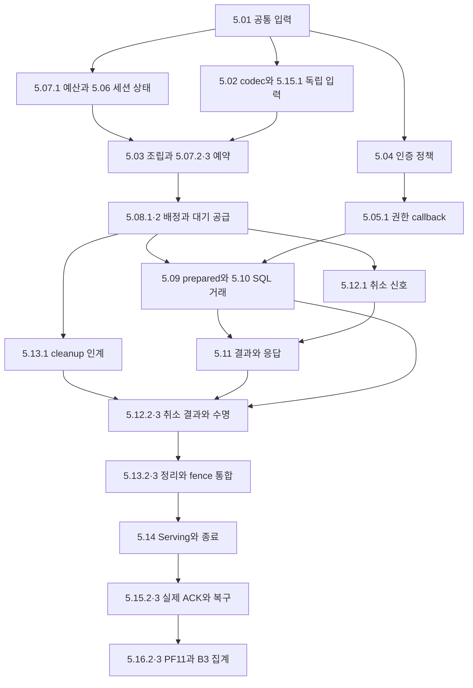

# DEV5 — 서버 개발 작업 분류와 공급·인수 계획

2026-10-22 · **D5-WORK-BREAKDOWN-001 D2 ACCEPTED / 16개 분류·44개 하위 작업 / 제품·B3·PF11 NOT_RUN**

[서버 소유 계약](../contracts/dev5-server-design.md) · [기존 구현·검증 계획](dev5-implementation-plan.md) · [ARIES·Oracle·로컬 DBMS 조사](../evidence/dev5-work-breakdown-research-20261022.md) · [DEV3 분해 방식](dev3-implementation-plan.md#remaining-work) · [완료 정본](stage-completion.json)

DEV3처럼 기능의 위치를 찾는 대분류와 실제 개발·검토·인계하는 하위 작업을 구분한다. 기존 D5-I01–I06의 큰 묶음을 5.01–5.16, 하위 44개 작업으로 나눈다. 번호는 실행 순서·진행률이 아니며 XADB-012/033·DEV5/B3의 범위와 DEV4/COMM 선행을 바꾸지 않는다. 각 행은 계획된 산출물이지 존재하는 API·runner·명령이 아니다. 개별 API·byte layout·모델 공간·자원 peak는 D5-F01–F05에서 해당 구현 전에 동결한다.

이번 요청은 **분류·조사·문서 commit**이다. 제품 개발·시험을 재개하지 않는다. 아래 인수 항목은 모두 PLANNED_NOT_RUN이며 독립 설계 검토가 실행 PASS를 대신하지 않는다. DEV3 최종 S5의 전수 재실행 예외를 DEV5로 확대하지 않는다. 시험 선택은 [사용자 지시](../../AGENTS.md)와 [이 문서의 증거 수신 규칙](#verification)을 따른다.

## 1. 16개 기능 분류

| ID·분류 | 책임·주요 산출물 | 기존 작업·동결 | 직접 인수 연결 |
| --- | --- | --- | --- |
| [5.01 공급 계약·개발 입력](#task-01) | 실제 Q1/C1/engine 공급표, 요청·소유·상태 경계 | I01–I06 공통, F01–F05 | SC03/KU14/PA08/PF11의 착수 입력 |
| [5.02 XSQ1 형식·codec](#task-02) | header/value·operation·terminal/metadata 표현 | I01, F01·D6-W01 | T01/02/06/10/13 |
| [5.03 요청 조립·COMM 연결](#task-03) | bounded fragment 수신·완결 요청 인계·실패 반환 | I01, F01/F03 | T02/05/08/09 |
| [5.04 peer 인증·정책 갱신](#task-04) | OS identity·Hello/Welcome·불변 policy/epoch | I02, F02 | T03/04/08 |
| [5.05 권한 검사·정리 예외](#task-05) | SQL class별 검사, revoke 선형화, 자기 cleanup 허용 | I02/I04, F02 | T04/07/10/12 |
| [5.06 세션·요청 정체성](#task-06) | session/handle scope·request generation·단일 terminal | I03, F03 | T05/07/09, M01 |
| [5.07 자원 예약·admission](#task-07) | 예산 회계·효과 전 credit·독립 cleanup 예약 | I03, F03 | T02/08/12, M02 |
| [5.08 worker·대기 진행](#task-08) | 직렬 배정·park/resume·wake/cancel 소유 | I03, F03 | T08/09/12, M01/02 |
| [5.09 prepared·binding·metadata](#task-09) | prepare/describe·원자 bind·stale/close 수명 | I04, F01/F02/F03 | T06/07, PA08 |
| [5.10 SQL·거래·DDL 결과](#task-10) | direct/execute·거래 모드·DDL 두 outcome·확실성 | I04, F01/F02/F03 | T04/10/11/13, KU14/PA08 |
| [5.11 result·fetch·응답 전송](#task-11) | snapshot과 요청 context 분리·owned batch·backpressure | I04/I05, F01/F03 | T02/05/06/07/08/09 |
| [5.12 취소·deadline·수명 만료](#task-12) | CancelAck·취소 결과·idle/transaction timer | I03/I05, F03 | T05/08/09/12, M01/02 |
| [5.13 세션 정리·fencing](#task-13) | cleanup 단일 소유·실제 undo·engine fence 전파 | I03/I05, F03/F04 | T04/08/09/12/13 |
| [5.14 서버 시작·종료](#task-14) | recovery 뒤 Serving·listener·quiesce/drain/supervisor | I05, F03/F04 | T03/12/13 |
| [5.15 독립 client·복구·동시성 인수](#task-15) | 독립 bytes/history·외부 ACK·fault/model·known-bad | XADB-033, I01–I05, F04 | T01–13, C01–08, M01/02, SC03/KU14/PA08 |
| [5.16 관측·성능·B3 종합](#task-16) | causal spans·PF11·증거 집계·DEV6 이관 | I06, F05 | T14/P01–04, PF11/B3 |

T/C/M/P/F는 기존 계획의 D5-T/C/M/P/F ID다. 새 테스트 번호로 기존 의무를 대체하지 않는다. 5.01·5.07·5.15.1·5.16.1은 각 소비 작업과 함께 진행하는 기반이며 마지막 통합 때 한꺼번에 추가하는 항목이 아니다. 서버의 WAL/undo/recovery 작업은 하위 engine 공급의 **수신·조립·외부 관측**이다. DEV3 알고리즘을 server에 다시 구현하지 않는다.

## 2. 공통 착수·완료 조건

| 기록 | 하위 작업에 필요한 내용 |
| --- | --- |
| 소유·변경 | 작업 ID, 실제 구현/계약/통합 담당·독립 검토자, 기준 commit/dirty digest, 실제 symbol·변경 파일. 계획 번호마다 crate나 파일을 강제하지 않음 |
| 선행 수신 | 아래 직접 선행의 좁은 산출물·실제 API·revision·원래 증거 범위. Q1/C1의 미공급 사항, mock/모델과 실제 Linux·SQL·disk 공급을 구분 |
| 동결 | 해당 F01 bytes/F02 auth/F03 상태·수명·자원/F04 oracle·fault/F05 측정 입력. 새 입력·fixture·oracle·harness는 기능 구현과 함께 작성 |
| 첫 효과 전 | 권한/class/expected_result 검사 위치, ownership 인계, completion/cleanup·최대 reply credit, 실패·취소·Drop의 반환 책임. effect/certainty/retry와 선형화점 명시 |
| 검증 선택 | 마지막 관련 검증 이후 실제 코드 diff→필수 case/인접 경계 대응. 변경 없는 완료 시험·전체 wrapper 재실행 금지. 독립 literal·known-bad와 실제 thread/I/O/reopen은 관련 변경에 적용 |
| 완료·미완료 | 공급 완료와 사용자 요청의 end-to-end 인수를 별도 기록. source/binary/fixture/log·실행 범위·실패와 잔여 의무 보존. 제한 검증으로 B3 승격 금지 |

실제 서버 조립에는 [기존 착수 gate](dev5-implementation-plan.md#entry)의 S1→Q1 및 C1 공급과 suspend/resume·peer/clock/cancel API가 필요하다. 선행이 없는 동안 wire vector·예산표·모델·mock adapter를 준비할 수 있지만 mock SQL 성공을 실제 서버 인수로 보고하지 않는다. 미래 작업 전체의 완료를 좁은 공급의 선행으로 삼지 않는다.

## 3. 하위 개발 단위

각 표의 선행은 **기능 구현에 필요한 최소 공급**이다. 실제 server 통합은 위 공통 gate를 추가로 만족해야 한다. 계약·fixture·오류 vector 준비는 해당 공급 전에도 가능하다. 동일 분류 안의 단위도 완료 경계를 구별한다.

### 5.01 공급 계약·개발 입력 — 2개

| ID·산출물 | 직접 선행 | 완료 조건·인수 경계 |
| --- | --- | --- |
| 5.01.1 하위 공급·부족분 목록 | DEV4/COMM/DEV3 소유 계약·기존 증거 | Q1/C1·writer lease/recovery·peer UID·SQL authorization/class·operation context·suspend/resume·cleanup의 실제 symbol/revision/증거를 수신하고 미공급 항목을 표시. 하위 owner 수정은 그 작업으로 배정. 조사만으로 gate 충족 금지 |
| 5.01.2 공통 상태·소유 표와 leaf 동결 배정 | 5.01.1의 계약 목록 | server/transport/SQL 상태, session/request/txn generation, I/O/worker/cleanup owner, terminal 선형화·lock order·Send 조건을 하나의 F03 입력으로 정리. F01–05 담당과 소비 leaf를 배정하고 미동결을 유지 |

### 5.02 XSQ1 형식·codec — 3개

| ID·산출물 | 직접 선행 | 완료 조건·인수 경계 |
| --- | --- | --- |
| 5.02.1 header·typed value 검산 | 5.01.2, F01의 해당 literal bytes | 40-byte header·big-endian·version/flags·checked length·UTF-8·NULL·Int64 경계·잔여 bytes 거절. allocation 전 검산과 T01의 독립 vector. AXF1 checksum/전송을 다시 구현하지 않음 |
| 5.02.2 요청 body·handle·capability | 5.02.1, F01·D6-W01 해당 입력 | Hello/Cancel과 ordinary timeout prefix 구분, operation별 exact field/order·statement/result handle·expected_result 표현. 1 MiB SQL/8 MiB body 등 기존 한도 유지; decode가 실행 권한을 부여하지 않음 |
| 5.02.3 Reply/Error·metadata·outcome | 5.02.1, F01·D6-W01·DEV4 결과 계약 | authoritative mode/txn/result state와 타입/nullability/bound/source/label/class, prior/ddl 두 outcome, effect/certainty/retry/cause 보존. 실제 없는 commit identity를 합성하지 않음. T01/06/10/13 |

### 5.03 요청 조립·COMM 연결 — 2개

| ID·산출물 | 직접 선행 | 완료 조건·인수 경계 |
| --- | --- | --- |
| 5.03.1 bounded assembler | 5.02.1/2, 5.07.1 | FIRST 예약·연속 offset·동일 kind/session/request/total·LAST·최대256조각·조립30초. 중복/누락/EOF/cancel 폐기와 capacity 반환, 완결 전 SQL 효과0. T02의 모델/메모리 포트 범위 |
| 5.03.2 실제 COMM 수신·실패 인계 | 5.03.1, 5.06.2, 5.07.2, 실제 C1 | RX lease를 bounded mailbox/owned body로 인계하고 I/O owner에서 SQL 실행 금지. FIN 뒤 미실행 RX admission 차단, partial frame/trickle·quota 거절 close, 1 MiB SQL+envelope와 큰 bind의 실제 socket 경계. T02/05/08/09 |

### 5.04 peer 인증·정책 갱신 — 3개

| ID·산출물 | 직접 선행 | 완료 조건·인수 경계 |
| --- | --- | --- |
| 5.04.1 peer port·policy load | 5.01.1, F02, 5.07.1 | accepted socket에서 실제 UID 수신·조회 실패 거절; 파일 owner/type/mode/symlink·64 KiB·64 principal·엄격 grammar/중복 검사. policy pool512 KiB 내 임시·공존 비용, 실패 시 허용 기본값 없음. T03/04 |
| 5.04.2 Hello/Welcome 인증 연결 | 5.04.1, 5.02.2/3, 5.06.1, 실제 C1 | UID/principal/DB allowlist·version/capability·5초 handshake, 실패 시 SQL/session handle 미생성. 같은 UID의 principal을 별개 OS 보안 주체로 주장하지 않음. fixture socket 검증과 실제 Serving 연결은 5.14.2에서 구분 |
| 5.04.3 policy reload·epoch | 5.04.1 | signal handler는 flag만 전달, 새 불변 map 검증 뒤 원자 교체. 실패/공존 pool 부족은 기존 정책 유지. 과거 snapshot 반환·bounded 진단과 T04 reload race; 요청별 권한 적용은 5.05 |

### 5.05 권한 검사·정리 예외 — 2개

| ID·산출물 | 직접 선행 | 완료 조건·인수 경계 |
| --- | --- | --- |
| 5.05.1 class별 authorization adapter | 5.04.1/3, F02의 DEV4 callback/class 공급 | read/write/ddl/connect·COMMIT 사용 권한 재확인, snapshot 획득의 권한 선형화점, DDL precommit 전후 호출 위치. SQL prefix/client class를 믿지 않음. 자기 cleanup의 session/handle 소유 검사와 일반 gate 예외를 callback vector로 검증 |
| 5.05.2 revoke·DDL·cleanup 통합 | 5.05.1, 5.09.3, 5.10.2, 5.13.1 | prepare 뒤 revoke·fetch/Describe 검사·write 철회 후 COMMIT 거절/Active 유지. parser가 판정한 자기 ROLLBACK/close/cancel은 새 권한 없이 정리, 위조 cleanup/교차 token 거절. prior commit 뒤 ddl 권한 거절의 두 outcome을 reopen까지 연결. T04/07/10/12 |

### 5.06 세션·요청 정체성 — 2개

| ID·산출물 | 직접 선행 | 완료 조건·인수 경계 |
| --- | --- | --- |
| 5.06.1 session registry·handle scope | 5.01.2, 5.07.1 | boot incarnation·재사용 없는 session ID·statement/result slot/generation·connection 소유. wrap/교차 scope 거절. Closing/Fenced/cleanup-pending도32 slot에 포함하고 성급한 재사용 금지. T05/07 |
| 5.06.2 request state·terminal primitive | 5.06.1, 5.02.1/2 | FIRST에서 ID 소비, 세션 ordinary1개, duplicate/pipeline/overflow 거절. assembling→queued→running/parked→reply-pending과 terminal 단일 확정·generation 검사. 새 fetch context와 상위 수명 신호를 구별. 실제 송신 장벽은5.11.2, 실제 취소는5.12 |

### 5.07 자원 예약·admission — 3개

| ID·산출물 | 직접 선행 | 완료 조건·인수 경계 |
| --- | --- | --- |
| 5.07.1 자원 ledger·최악 peak | 5.01.2, F03 자원 입력 | assembly32 MiB·reply16 MiB·control2 MiB와 SQL64/transport64/engine·stack/FD를 분리 합산. 복사·capacity·policy512 KiB·trace512 KiB·wait/cleanup 공존 peak, checked 산술과 반환 소유를 계산. RSS 보장으로 확대하지 않음 |
| 5.07.2 ordinary admission·completion/output credit | 5.07.1, 5.06.2, 5.03.1 | SQL 효과 전 completion/cleanup·최대 reply staging, mutation 전4 KiB terminal 확보. fetch는 output credit 전 cursor 진행0. 부족 시 기존 binding/result/거래 의미 보존. T02/08과 각 소비 기능의 실패 vector |
| 5.07.3 예약된 cleanup·control 진행 | 5.07.1, 5.06.2 | 내부 cleanup이 새 assembly·512 KiB staging·TX credit을 요구하지 않음. 기존 terminal 보존·고정 cleanup/runnable/CancelAck slot. 포화 상태의 예약/회수 primitive와 M02 입력; 실제 undo 인계는5.13 |

### 5.08 worker·대기 진행 — 3개

| ID·산출물 | 직접 선행 | 완료 조건·인수 경계 |
| --- | --- | --- |
| 5.08.1 세션 직렬 배정·completion 반환 | 5.06.2, 5.07.2/3 | worker4·round-robin·세션 단일 실행 owner, completion 뒤 worker 반환. I/O owner는 SQL/disk/undo/join 금지, TX 공간 대기로 worker 점유 금지. 모델/mock과 실제 SQL 연결을 구별 |
| 5.08.2 wait registration·park/resume | 5.08.1, F03의 실제 SQL/engine 중단·재개 공급 | 조건 검사/등록 원자화, unlock/cancel 경합·stale wake 격리, 같은 generation/statement/deadline/변경/예약을 유지하며 재개. latch·부분 pin·stack borrow 잔류 금지, thread 이동 가능성 검증. 일반 timeout이나 SQL 재실행으로 대체 금지 |
| 5.08.3 holder·DDL drain·cleanup 진행 통합 | 5.08.2, 5.10.1, 5.13.1 | A가 lock 보유·B–E가 대기한 실제4-worker에서 A의 COMMIT/ROLLBACK/close 진행. offline DDL drain/admission에도 적용. T08/12·M02, bounded model과 실제 thread 결과 분리. I/O의 무조건 시간 상한을 주장하지 않음 |

### 5.09 prepared·binding·metadata — 3개

| ID·산출물 | 직접 선행 | 완료 조건·인수 경계 |
| --- | --- | --- |
| 5.09.1 Prepare·Describe·handle 소유 | 5.02.2/3, 5.05.1, 5.08.1, 실제 DEV4 prepared 공급 | SELECT/DML prepare·typed hint/metadata, 권한·session·generation 검사, session64 statements/result1 한도. raw 주소·SQL 재파싱 우회 금지. T06, D6-W01 |
| 5.09.2 BindAll 원자 교체·Execute 연결 | 5.09.1, 5.03.2, 5.07.2, 5.08.2, 실제 Q1 | count/type/NULL/빈 text/binary와 caller buffer 해제·큰 bind. 실패 시 이전 binding 전부 보존, UTF-8 빈 값 정규화는 SQL에서 한 번. Execute expected_result를 첫 효과 전에 확인. 문자열 치환 mutant 거절. T02/06/10 |
| 5.09.3 stale·close·재실행 수명 | 5.09.1/2, DEV4 invalidation/cleanup 공급 | DROP/recreate·index/schema epoch·권한 변경·old catalog, CloseStatement/CloseResult와 invalid metadata 의미 유지. EOF/close/reexecute 확대10,000회용 fixture도 구현과 함께 작성. T07·누수/pin/bind 회계; 새 schema 의미 도입 없음 |

### 5.10 SQL·거래·DDL 결과 — 3개

| ID·산출물 | 직접 선행 | 완료 조건·인수 경계 |
| --- | --- | --- |
| 5.10.1 direct·거래 모드·SQL 실행 | 5.02.2/3, 5.05.1, 5.07.2, 5.08.2, 실제 Q1 | ExecuteDirect 하나로 BEGIN/COMMIT/ROLLBACK/SET 연결. parser/prepared class의 expected_result 검사를 거래 시작·DDL precommit보다 먼저 수행. 명시 거래 S2 실패 뒤 S1 보존·Active+SET 거절·열린 result의 COMMIT 거절 유지. T10/11 |
| 5.10.2 DDL precommit·DDL 결과 분리 | 5.10.1, DEV4 DDL callback·실제 engine 공급 | prior와 ddl의 identity/outcome/certainty 별도 전달. prior COMMIT 권한 거절은 Active, prior commit 뒤 ddl 거절은 prior=Committed/ddl=NotAttempted. C07의 두 cut 입력과 T04/10; DDL 실패 전체 재시도 금지 |
| 5.10.3 terminal 확실성·commit 장벽 | 5.10.1/2, 실제 engine commit/undo/fence 공급 | statement 성공≠COMMITTED, durable+publish 확인 뒤 commit terminal, 완료 undo만 ABORTED. UNKNOWN/NotCommittedRecoveryRequired/NoTransaction/NotAttempted 보존. client 수신 유실과 engine 불명 구별. T09/10/13·C02–07 |

### 5.11 result·fetch·응답 전송 — 2개

| ID·산출물 | 직접 선행 | 완료 조건·인수 경계 |
| --- | --- | --- |
| 5.11.1 fetch·snapshot·operation context | 5.09.2/3, 5.06.2, 5.07.2, 5.08.2 | Execute(N)의 종료 context와 살아 있는 result snapshot 분리. Fetch(N+1)은 새 context·같은 snapshot, park는 원래 deadline 유지. 1..128 rows/canonical256 KiB·wire512 KiB·RowBufferTooSmall 위치 보존, EOF/미완료 close 구분. T06/07/09 |
| 5.11.2 Reply fragmentation·TX 반환 | 5.11.1, 5.02.3, 5.12.1, 실제 C1 | owned reply만 전송, output 대기 중 worker 반환, Reply 조각 사이 CancelAck 삽입 금지. 전체 enqueue 뒤 ordinary admission, client는 terminal+자신의 Ack 모두 수신 후 다음 요청. RX 분류 전 완료 TX ticket 회수, local flush를 외부 ACK로 세지 않음. T02/05/08/09 |

### 5.12 취소·deadline·수명 만료 — 3개

| ID·산출물 | 직접 선행 | 완료 조건·인수 경계 |
| --- | --- | --- |
| 5.12.1 generation 취소 신호·CancelAck | 5.02.2/3, 5.06.2, 5.07.3, 5.08.1 | 같은 인증 연결의 현재 요청만 신호, Requested/NotActive·동일 target 합치기·다른 target flood 거절. terminal/cancel 선형화·이전 ID가 다음 fetch에 영향0. T05/09·M01 |
| 5.12.2 phase별 취소·disconnect 결과 | 5.12.1, 5.08.2, 5.10.3, 5.11.1, 5.13.1 | assembly/queued/running/parked/CommitAttempted/terminal/send별 기존 효과. statement undo와 전체 cleanup 구분, commit 시도 이후 결과 대기·확정 terminal 불변. 취소 신호만으로 abort 성공 금지. T09·C03/05/08 |
| 5.12.3 timer·idle·거래 수명 | 5.12.2, 공유 Clock·5.13.1 | handshake5/assembly30/ordinary1..30,000ms/output10/idle30·60/transaction300/grace30초의 각 시작·종료점 연결. running/parked idle 제외·trickle 미갱신·재개 deadline 불연장. 만료는 Closing·전체 undo 소유 인계, 이미 시도한 commit 보존. fake Clock 경계와 실제 timer·다음 요청 없는 cleanup. T09/12 |

### 5.13 세션 정리·fencing — 3개

| ID·산출물 | 직접 선행 | 완료 조건·인수 경계 |
| --- | --- | --- |
| 5.13.1 cleanup 소유 인계 primitive | 5.07.3, 5.08.2, F03의 실제 engine/SQL cleanup 공급 | result/statement/txn/continuation을 단일 cleanup owner에 인계, 예약 slot로 진행·완료 또는 recovery 인계 전 재사용 금지. Drop은 allocation/hidden commit/blocking join 없음. trigger별 실제 연결 전에 단독 실패·중복 인계 검증 |
| 5.13.2 close·FIN·revoke·만료 cleanup 통합 | 5.13.1, 5.05.2, 5.09.3, 5.10.3, 5.11.2, 5.12.2/3 | 자기 권한 철회 후 정리·새 업무 거절, output 포화에서도 전체 undo·기존 terminal 보존. 미완료 undo를 정상 ABORTED/slot 반환으로 표시하지 않음. 반복 disconnect와32 slot·T04/08/09/12·C08 |
| 5.13.3 engine fence·panic·복구 인계 | 5.13.1, 5.10.3, engine 실패 계약 | durable I/O UNKNOWN/poison을 모든 세션 admission에 반영, 새 연결로 우회 금지. client만 UNKNOWN인 응답 유실과 구별. recovery 소유 전 lease/undo 강제 해제 금지. T09/12/13의 fault 경로 |

### 5.14 서버 시작·종료 — 3개

| ID·산출물 | 직접 선행 | 완료 조건·인수 경계 |
| --- | --- | --- |
| 5.14.1 startup·lease·recovery 조립 | 5.01.1의 실제 S1/Q1/C1, 5.04.1, 5.07.1, 5.08.1 | config/profile/DB lease→현재 build recovery→자원/worker 확보의 실제 조립과 실패 역순 정리. listener를 아직 열지 않는 좁은 startup 시험, 두 server DB open 거절. T03/12 |
| 5.14.2 owned listener·Serving 공개 | 5.14.1, 5.03.2, 5.04.2, 5.05.2, 5.08.3, 5.11.2, 5.12.3, 5.13.2/3 | recovery와 필수 서비스 공급 후 Unix endpoint 0700/0600·배타 생성·소유 identity로 공개. symlink/기존 타인 endpoint 보존·TCP SQL Unsupported. Q1/C1 실제 공급 증거와 T03/12; fixture 서버와 B3 구분 |
| 5.14.3 quiesce·drain·supervisor | 5.14.2, 5.13.2/3, F03 supervisor 공급 | admission/listener 차단→실행/parked cleanup→최종 reply 전체 enqueue→COMM drain→join/engine close/자기 endpoint 제거. grace 초과는 Failed·프로세스 종료/다음 recovery로 연결하고 성공 위장 금지. T12·C08; 정상 close에 불필요한 checkpoint 추가 없음 |

### 5.15 독립 client·복구·동시성 인수 — 4개

| ID·산출물 | 직접 선행 | 완료 조건·인수 경계 |
| --- | --- | --- |
| 5.15.1 독립 byte·SQL/history oracle·known-bad | 5.01.2, 해당 F01/F04 의미 입력 | production encoder/SQL/replay와 독립 literal·decoder·상태/row/index/catalog 기대값, 외부 history 소유. auth 우회·부분 bind·sync 전 ACK·late cancel·undo 실패 ABORTED 등 해당 mutant 거절. T01–13에 필요한 fixture를 각 기능과 함께 제공 |
| 5.15.2 실제 protocol client·ACK 수신 | 5.15.1, 5.14.2, 실제 XADB-032 공급 | socket Reply/Error 완결 검증 후 server 밖 history에 기록. 빈/유실 history·잘못된 binary/decoder 거절, request/query/commit 성공 분리. T03–11/13·PA08; DEV6 driver 없이 실행 가능한 실제 recipe |
| 5.15.3 crash/reopen·재장애 연결 | 5.15.2, 5.13.2/3, 5.14.3, 실제 engine fault hook | C01–08 각 하위 cut 도달 receipt 뒤 해당 지점에서 kill/fault, 그때까지 외부 history에 실제 수신된 ACK만 기준으로 current-build reopen 두 번·독립 row/index/catalog 확인. C06만 대상의 완결 COMMITTED/ABORTED ACK 후 kill하며 ACK 전 cut에 수신을 선행 조건으로 붙이지 않음. ACK commit 보존·확정 abort 비가시·UNKNOWN 원자성·DDL 두 identity. process kill/I/O fault/전원 모델 구분, 증거 손상·미도달·runner timeout은 PASS 아님 |
| 5.15.4 상태 모델·진행·확대 사례 | 5.01.2/F03의 모델 입력; 실제 통합 부분은 관련5.03–14 공급 | M01/02의 축소 상태·전이·상한/완주, wake 유실·late cancel·worker holder·cleanup 포화 known-bad. 각 기능의 선택 가능한 property/thread/fuzz·반복 수명 사례 작성. 모델/실제 thread/소켓/복구의 결과 분리; 미실행 확대 의무는 남김 |

### 5.16 관측·성능·B3 종합 — 3개

| ID·산출물 | 직접 선행 | 완료 조건·인수 경계 |
| --- | --- | --- |
| 5.16.1 bounded 진단·causal 연결 | 5.01.2, 5.07.1; 각 계측 대상 구현 | session/request→queue/worker/SQL/WAL→enqueue/local flush/client 수신의 ID 연결.128 bytes×4,096 events ring을 control2 MiB에 포함, trace loss·공유 WAL 중복 귀속·시도/성공 TPS 구별·민감 본문 제외. 계측은 각 경로와 함께 추가하고 비용 측정은 후속 |
| 5.16.2 PF11 측정·원인·재현 | 5.16.1, 5.15.2/3의 실제 경로·정확성 증거, F05 | 기존 P01–04·off/상시/상세·10 paired blocks·비용 CI·독립 confirmation·새 세션 replay. queue/CPU/WAL/output 원인 분별, 정확성/환경/원시 sample 누락이면 미완료. 고객 SLA로 확대하지 않음 |
| 5.16.3 B3 증거 집계·DEV6 이관 | 위 작업의 해당 실행 증거와 잔여 의무 | SC03/KU14/PA08/PF11 및 T01–14/C01–08/M01–02 분모를 집계하고 미실행/FAIL/INCONCLUSIVE면 B3 미완료. D6-W01 codec/metadata/state·취소·capability·실제 recipe 이관. driver 구현·remote/TLS/객체 ACL/session resume를 완료로 세지 않음 |

## 4. 공급 순서와 작업 크기

그림은 주요 공급만 나타내며 각 표의 선행이 정본이다. 5.15.4 모델과 5.16.1 계측 입력은 초기에 준비한다. 5.14.1의 listener 없는 startup 검증은 Serving 전체를 기다리지 않는다. 5.13.1의 인계 primitive를 먼저 공급하므로 권한 철회/취소/실제 cleanup 사이 완료 순환을 피한다. 5.07.1은 자원 표현·회계이며 아직 없는 모든 소비 코드의 실측 완료를 요구하지 않는다. 소비자가 추가될 때 그 경로의 peak와 반환을 검증한다.

| 우선 묶음 | 착수 대상·목적 | 남길 경계 |
| --- | --- | --- |
| A · 입력과 독립 기준 | 5.01, 해당5.02, 5.07.1, 5.15.1/4·5.16.1 준비 | F01–F05 미동결 항목을 실제 공급과 대조. 새 wire 의미를 분류만으로 채택하지 않음 |
| B · 외부 입력과 소유 | 5.04, 5.06, 5.03, 5.07.2/3, 5.05.1, 5.08.1 | 인증/길이/ID/예약을 좁게 검증. mock 경로가 실제 SQL 인수 아님 |
| C · 대기와 SQL 연결 | 5.08.2, 5.13.1, 5.09/10, 5.12.1, 5.11 | 실제 Q1/C1·중단/재개 공급이 핵심 선행. cancel/commit/cleanup 불변식 없이 사용자 변경 API 완료 금지 |
| D · 수명과 실제 서버 | 5.05.2, 5.08.3, 5.12.2/3, 5.13.2/3, 5.14, 5.15.2 | 각 경로와 실제 thread/socket의 새 연결만 검증. 반복 수명·전체 fault 잔여를 명시 |
| E · 잔여 인수 종합 | 5.15.3/4 잔여, 5.16.2/3 | 원래 결과를 수신하고 미실행 확대/성능 의무를 닫음. 묶음 완료를 이유로 무변경 시험을 재실행하지 않음 |

묶음은 새로운 DEV 단계나 일괄 실행 명령이 아니다. 5.08·5.10·5.12·5.13·5.15는 상태/실제 I/O 연결 위험이 커서 하위 단위로 나누어 리뷰한다. 5.02는 codec family별로, 5.09는 prepare/bind/invalidation별로 더 좁게 변경할 수 있다. 예상 일수·작업 수만으로 진행률을 계산하지 않는다.

기본은 단일 구현 담당과 별도 검토자다. 미래 병렬 구현은 공통 상태/F01/F02를 먼저 통합하고 실제 소유 파일을 지정한 뒤 선택한다. session/scheduler/cancel/cleanup은 같은 상태 기계를 공유하므로 무조정 동시 수정하지 않는다. 독립 oracle는 production codec을 공유하지 않고 공유 Markdown/JSON/Cargo는 통합 담당이 순차 반영한다. 이번 분류 작성은 병렬 제품 개발 배정이 아니다.

## 5. 기존 동결·인수 의무의 담당

| 정본 의무 | 주 담당·함께 닫을 경계 |
| --- | --- |
| F01 / D6-W01 | 5.02·5.09/10/11, 독립 입력5.15.1; body bytes/metadata/expected_result는 구현 전 공동 동결 |
| F02 | 5.04/05, SQL class·DDL/cleanup 소비5.09/10/13 |
| F03 | 5.01.2·5.06/07/08/12/13/14, 모델5.15.4; 경로별 동결·자원표는 해당 effect 전 |
| F04 | 5.15.1–3, 실제 runner와 hook은5.10/13/14; Q1/C1 원래 evidence 수신 |
| F05 | 5.16.2, 계측/fixture는5.16.1·5.15; baseline 전 동결 |
| T01 / T02 | 5.02·5.15.1 / 5.03·5.07·5.09.2·5.11.2 |
| T03 / T04 | 5.04·5.14 / 5.04.3·5.05·5.10.2·5.13 |
| T05 / T06 / T07 | 5.06·5.11.2·5.12 / 5.02.3·5.09·5.11 / 5.05·5.09.3·5.11.1 |
| T08 / T09 | 5.07·5.08·5.11·5.13 / 5.06·5.10.3·5.11.1·5.12·5.13 |
| T10 / T11 | 5.10·5.09.2·5.15.2 / 5.10.1·5.08.3·5.15.2 |
| T12 / T13 / T14 | 5.13·5.14 / 5.15.1–3·5.10.3 / 5.16.1/2 |
| C01 / C02 / C03 | decode→admission5.03/07 / statement undo5.10/13 / commit 시도·sync5.10.3·5.12.2 |
| C04 / C05 / C06 | durable/publish5.10.3 / enqueue/부분 전송/flush5.11.2 / 외부 완결 ACK5.15.2 |
| C07 / C08 | DDL 두 commit5.10.2 / cleanup·CLR·반복 recovery5.13/14·5.15.3 |
| M01 / M02 | 5.15.4가 독립 모델 소유, 대상5.06/08/12/13 / 예약·worker·TX·cleanup 진행5.07/08/11/13 |
| P01–04 / SC03·KU14·PA08·PF11 / B3 | 측정5.16.2 / 해당 T/C/M 증거를5.16.3에서 집계. XADB-012 공급과 XADB-033 실제 client 인수는 서로 대체 불가 |

T11은 engine 격리를 새로 구현하는 작업이 아니라 실제 서버를 통한 같은 table/독립 table·UNIQUE NULL·scan/index·동시 schema 이력의 대조다. D4-V27 반복 statement 실패의 잔류 자원 charge는5.10.1·5.07·T10에서 수신한다. 큰 반복·부하 시험을 아직 실행하지 않았다는 사실을 작은 사례 PASS로 가리지 않는다.

## 6. 시험 시점·증거 수신·후속 범위

1. 기능 구현 때 해당 leaf의 정상·오류·취소·자원 경계를 검증하고, 확대 사례의 fixture/oracle/harness도 선택 실행 가능하게 작성한다. 새 구현·변경 코드의 필요한 시험은 DEV 번호와 무관하게 실행한다.
2. 마지막 관련 검증 이후 실제 코드 diff와 선택 case를 먼저 대응시킨다. 새 서버 연결 코드는 실제 socket/SQL/engine 경계를 검증하되 완료된 무변경 하위 시험을 함께 실행하는 wrapper는 쓰지 않는다.
3. B3는 기존 T/C/M/P 전체 의무의 충족을 요구한다. 이미 완료한 범위는 원래 source·명령·fixture·결과와 변경 영향 검토로 수신하고, 남은 미실행 확대 사례·수정/실패 경로를 선택한다. stage completion이나 source 전체 지문 변경만으로 원래 PASS를 반복하지 않는다. **DEV3 S5 전수 예외는 DEV5에 적용하지 않는다.**
4. 기존 FAIL·중단·INCONCLUSIVE를 보존한다. 현재-build 복구 의무는 새 서버 durability 연결/변경의 실제 reopen으로 확인하며 과거 volatile 결과로 대체하지 않는다. 계획·모델·mock·process kill·실제 I/O/thread·전원 장애 결과를 구분한다.
5. 문서 자동 검사는 [push gate](../policies/documentation-policy.md#push-gate)에서만 수행한다. 이번 분류는 제품 코드/시험/Clippy·자동 문서 검사·push를 실행하지 않는다.

후속 TCP SQL/TLS·password/SASL·다중 DB·객체 ACL·SQL GRANT·LOB·session resume·durable request lookup/multiplexing은 [기존 이관 의무](dev5-implementation-plan.md#handoff)에 남긴다. Oracle Transaction Guard/driver replay, PostgreSQL portal/pipeline, MariaDB 동적 worker 확대를 이 분류로 채택하지 않는다. Linux/Rust·DISK 엔진·초기 local Unix server·공통 buffer/quota라는 제품 방향을 유지한다.

## 7. D5-WORK-BREAKDOWN-001 결정·작업 기록

| 항목 | 기록 |
| --- | --- |
| 분류·상태·일자 | D2 · ACCEPTED · 2026-10-22. 기존 계약 안의 공급·인수 배정 구체화 |
| 권한·담당 | 사용자의 DEV3 방식 DEV5 세분화·ARIES/Oracle/로컬 DBMS 참고·완료 뒤1회 commit 요청. 작업/계약/통합 `/root`, 읽기 전용 독립 검토 `/root/dev5_breakdown_review` |
| 기준 | HEAD `def35fb1e274040eb55d78fa68948ba1610166c1`, `main`, 착수 worktree clean |
| 동시 변경 | 작업 중 별도 DEV3 계약·DEV4 분류/조사 및 공용 색인 변경을 관측. DEV5 기존9개 파일의 범위 diff를 `/tmp/xadb-dev5-breakdown-0g4jv2dj/existing-files.patch`에 보존하고 새 DEV5 문서2개와 함께 별도 검토·commit 대상으로 제한. 다른 작업의 수정은 보존 |
| 대안·선택 | 기존6개 묶음만으로는 request/worker/cleanup·wire/SQL/durable 결과가 같은 완료 단위에 섞임.16개 책임·44개 좁은 작업을 선택하고 기존 I/F/T/C/M/P와 연결.44개 API/파일 강제나 대분류 번호순 실행은 채택하지 않음 |
| 적용·대체 | 이 문서가 세부 작업 순서·배정 정본. 기존 구현계획의 I01–06은 상위 묶음, owner contract와 F01–05·B3/시험 수치·후속 의무는 유지. 새 제품 의미/bytes/dependency·품질 기준 결정 없음 |
| 조사 | ARIES 원 논문, Oracle19c 공식4문서, 로컬5checkout/8파일의 선택 범위·origin/HEAD/hash를 [별도 기록](../evidence/dev5-work-breakdown-research-20261022.md)에 보존. 외부 코드 도입/checkout 수정 없음 |
| 검토 | `/root/dev5_breakdown_review`가11개 파일의 DEV5 범위·소유 계약·44개 선행과 인수 대응·원문/소스 identity를 독립 대조.5.15.3의 ACK 선행 오해 지적을 cut별 장애 주입·C06만 대상 완결 ACK 후 kill로 수정하고 재확인. 최종 채택 가능·잔여 필수 수정 없음. `/root` 계약/통합 담당 반영 확인. DEV3/DEV4 동시 변경은 검토·commit 범위 제외 |
| 실행·범위 | 계획/조사·관련 색인/JSON 참조만 변경. 제품·모델·복구·성능·자동 문서 검사·push 미실행. 원래 구현/실행 상태·증거 identity 유지 |
| 재검토 | 공급 순환·인수 미배정, 하위 API가 소유/대기/cleanup을 지원하지 못함, wire/권한/자원 한도 변경, 실제 제품 diff와 계획 불일치 |
