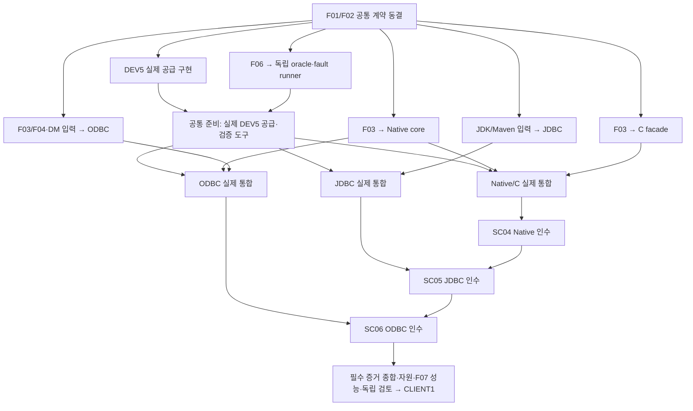

# DEV6 — 클라이언트 구현·검증 계획

2026-10-19 · **DEV6-DESIGN-001 및 REVIEW-002 보완 대응 / 모든 구현·SC04/05/06·CLIENT1 NOT_RUN**

[상세 설계](../contracts/dev6-client-design.md) · [조사·검토](../evidence/dev6-source-research.md) · [단계](development-stages.json) · [완료 계약](stage-completion.json) · [DEV5 공급](dev5-implementation-plan.md)

2026-10-22 [18개 분류·55개 하위 작업](dev6-work-breakdown.md#catalogue)으로 I01–I05의 공급·완료 경계와 우선순위를 전개했다. [ARIES·Oracle·로컬 6개 DBMS 조사](../evidence/dev6-work-breakdown-research-20261022.md)를 연결하며 F01–F07 동결·실제 구현·인수 상태는 변경하지 않는다. 기존 전수·하위 회귀 문구의 실행 선택은 [현재 사용자 제한](dev6-work-breakdown.md#entry-exit)이 우선하며 DEV3 S5의 전수 예외를 DEV6에 확대하지 않는다.

후속 [D6-WORK-BREAKDOWN-002](dev6-work-breakdown.md#decision-002)는 기존 55개 묶음의 큰 항목을 추가 완료 단위로 나누고 ODBC 직접 선행·[공통/구현 책임](dev6-work-breakdown.md#ownership)·[작은 실제 연결 우선순위](dev6-work-breakdown.md#priority)를 구체화한다. [재검토 근거](../evidence/dev6-work-breakdown-review-20261022.md)와 아래 [실행 선택·예산](#execution-budget)을 함께 적용하며 기존 제품 의미·필수 인수 기준은 유지한다.

추가 [배정 재점검](../evidence/dev6-work-breakdown-review-20261022-r2.md)은 기존 의미 안에서 C ABI·JDBC·ODBC의 큰 항목을 나눠 최하위 배정 단위를72개에서80개로 전개한다. [DB capability·type-info 결과·직접 실행의 인수 연결](dev6-work-breakdown.md#handoffs)과 실제 성능 호출 경계를 명시하며 F01–07·API 의미·SC 순서·실행 상태는 유지한다.

## 1. 설계·구현·인수 진입

| 작업 | 필요한 입력 | 현재 상태 |
| --- | --- | --- |
| 설계·독립 vector·상태 모델 준비 | DEV4/5·COMM 계약, Oracle/로컬 소스 실제 조사 | 이 문서의 범위; 실행 아님 |
| 순수 codec·local API 모듈 | D6-F01/F02 동결, 실제 COMM/foundation 공급 및 해당 회귀 | fixture peer로 모듈 시험 가능; CLIENT1 PASS 불가 |
| FFI·Java·DM adapter | F03/F04/F05의 signature·unsafe/ABI·runtime·build/manifest 동결 | OPEN_NOT_IMPLEMENTED |
| 실제 native SC04 | 현재 source의 DEV5 B3·Q1·S1·C1 및 하위 회귀, D6-W01 공급·F01–F06 | 기존 dirty 코드·설계 채택만으로 충족하지 않음 |
| JDBC SC05 / ODBC SC06 | 각각 SC04 / SC05의 실제 선행 인수와 자기 runtime/ABI의 전체 지원표 | 다른 driver PASS를 승계하지 않음 |
| CLIENT1 완료 | 세 driver 필수 inventory·정확성/실제 disk recovery/자원/성능/하위 회귀·독립 검토 | NOT_RUN |

XADB-034→035→036은 **실제 단계 인수 순서**다. [병렬 개발 표](#parallel)의 선행 계약을 충족한 독립 모듈 개발은 겹쳐 진행할 수 있다. DEV5 선행은 유지하며 하위 미구현 기능을 stub으로 PASS시키거나 mock SQL·echo ACK를 durable 검증으로 사용하지 않는다. 개발 build는 fresh fixture이며 과거 사내 client 호환은 NOT_REQUIRED_INTERNAL_FRESH_BUILD, current-build ACK/reopen/recrash는 필수다. stable baseline이 생기면 VERSION_RELEASE가 별도로 적용된다.

## 2. 구현 전에 동결할 leaf

다음은 설계 채택 뒤에도 **OPEN_NOT_IMPLEMENTED**다. 실제 signature·숫자 ID·literal fixture·runner가 없이 실행 완료로 표시하지 않는다. 모델 크기/환경/toolchain/통계 profile의 축소는 실행 전 D2 결정으로만 가능하다.

| ID | 소유·동결 내용 | 필요한 산출·시점 |
| --- | --- | --- |
| D6-F01 | DEV5/client 공동 D6-W01: expected_result 효과 전 판정, mode/transaction/result state, metadata, 전체 body field/enum·profile ID·capability | D5-F01와 같은 wire 정본·독립 정상/손상 bytes, Rust/Java/독립 decoder 세 방향 corpus. local 실패/송신 admission별 연속 request ID; Java sender도 동일 예약/소비 의미. codec 구현 전 |
| D6-F02 | client API·전체 lower error→SQLSTATE/numeric code·JDK21 method overload·ODBC function/attr support inventory | 각 항목 Supported/Conditional/Unsupported/LocalNoOp, side effect·조건·case·기대 outcome. 복합 API guard/cancel/deadline, close 뒤 mode 분기, cached result 무효화·결과 소진, raw SQL·권한/DDL 조합. adapter 구현 전 |
| D6-F03 | native Rust signatures·C ABI·새 FFI package 및 OS 조립 DAG·unsafe 범위·registry·소유권·panic/Drop·allocation peak | C11 header·sizeof/align/offset/symbol probe, invalid handle/alias/length/FFI smoke, allocation failure 목록, package별 lint. FFI 구현 전 |
| D6-F04 | unixODBC function/attr/info/descriptor·ANSI/W length·input/output conversion·diagnostic vendor fields | DM/header/config ABI matrix, scalar input/output 모든 지원 조합·미지원 조합, bound/unbound/truncation/NULL vectors, 가변 길이 probe와 고정 C type·NULL pointer 구별. ODBC 구현 전 |
| D6-F05 | 실제 JDK21 vendor/patch·Maven distribution/plugin lock·unixODBC version/build·Rust/compiler·OS/CPU/libc·release profile | 실행 manifest, JAR/shared library/header 설치 recipe, source/dirty/binary/tool/profile hash, clients root 포함 clean export. 빌드/설치 인수 전 |
| D6-F06 | 실제 client/controller ACK ledger·독립 oracle·partial send/read·WAL/reopen/recrash hook | 각 D6-C cut reachability, wrong driver/mutant/self-test, 실제 B3/Q1/C1 source identity. runner 구현 전 |
| D6-F07 | 성능·계측 mode·fixture/seed/order·metric 의미·수치 guardrail·원시 bundle | 아래 profile의 실제 명령·통계 계산·재현 entrypoint. 첫 baseline 실행 전 |

필수 signature/operation/오류/환경 조합을 빠짐없이 leaf 목록으로 전개한 뒤에만 stage-completion의 `detail_expansion_required`를 닫는다. 현재 seed T01–T18을 전체 overloaded API 전수 inventory라고 부르지 않는다.

## 3. 구현 작업과 파일 소유

| 작업 | 구현 책임 | 완료 후 공급 |
| --- | --- | --- |
| D6-I01 | DEV5 F01 수신·독립 bytes와 상태 모델, native codec/진행 owner/control slot | F01/F02·T01–T05/T16 |
| D6-I02 | native owned value/metadata/binding/result·C facade/FFI·close·진단 | F03·T06–T12/T15; 실제 B3 후 SC04 |
| D6-I03 | 순수 Java driver/URL·service registration·JDBC method table/거래 조립 | F02/F05·T06–T14/T17; 실제 Java 프로세스로 SC05 |
| D6-I04 | ODBC registry/descriptor·C 변환/partial buffer/diagnostic/DM 설치 | F04/F05·T06–T15/T17; 실제 DM client로 SC06 |
| D6-I05 | 세 driver ACK fault/reopen·quota/stress·계측/비교/replay·하위 회귀 | F06/F07·T16–T18, 독립 검토 뒤 CLIENT1 |

세부 배정은 [6.01–6.18](dev6-work-breakdown.md#catalogue)을 따른다. I01은 주로 6.01–04, I02는 6.05–10, I03은 6.11/12, I04는 6.13/14, I05는 6.15–18에 연결된다. 공통 의미·자원·독립 oracle·빌드 준비는 해당 소비 leaf에 먼저 공급한다. [우선 공급과 합류](dev6-work-breakdown.md#sequence)는 전체 분류 완료가 아닌 좁은 하위 산출물을 선행으로 사용한다.

기존 계획 package를 사용하고 실제 코드가 생길 때만 경로·dependency·빌드 입력을 등록한다. native core·Java·ODBC는 각 소유 상태를 분리하지만 공통 wire·오류 의미를 따로 발명하지 않는다. protocol oracle가 production codec을 import하지 않는 의존 검사를 추가한다.

### 병렬 개발 가능 항목·선행 조건·합류 지점

**조건부 병렬**은 아래 계약 동결 뒤 서로 다른 소유 파일에서 구현할 수 있다는 뜻이다. 현재 F01–F07은 미동결이며 실제 병렬 구현·담당 배정·제품 실행을 완료했다는 표시가 아니다. I01–I05 전체를 일괄 순차 개발할 필요는 없지만 내부 의존과 SC04→SC05→SC06 인수 순서는 유지한다.

| 병렬 구분·작업 | 착수 선행 조건 | 함께 진행할 수 있는 범위·파일 소유 | 실제 합류·인수 조건 |
| --- | --- | --- | --- |
| D6-PAR01 · 공통 계약은 **직렬**, DEV5 공급 구현은 **조건부 병렬** | D5-F01/D6-F01·F02를 DEV5/client 담당이 같은 기준으로 동결 | 동결 후 DEV5 server의 D6-W01 공급 구현은 PAR02/03/04와 병렬 가능. server 소유 범위만 수정하고 wire 정본은 한 담당이 반영 | 실제 B3·Q1·S1·C1 및 D6-W01을 먼저 인수한 뒤 세 driver 서버 통합 |
| D6-PAR02 · Native Rust/C, I01/I02 · **조건부 병렬** | F01/F02, F03의 native signatures·소유권·platform 조립 경계. C 구현은 전체 F03 동결 필요 | `crates/client`의 codec/요청 상태/owned value와 C facade를 한 작업 계열로 소유. PAR03/04/05와 병렬 가능. C facade는 동결된 native API를 소비하고 실제 연결은 native 공급 후 통합 | native core→C facade/실제 C harness 순으로 합류, 실제 DEV5 공급·F06 뒤 SC04 |
| D6-PAR03 · 순수 Java/JDBC, I03 · **조건부 병렬** | F01/F02, F05의 JDK/Maven 구현 입력 동결 | `clients/jdbc`의 codec·API·metadata·거래 조립·local unit. Rust/C 구현 완료를 기다리지 않고 PAR02/04/05와 병렬 가능 | 독립 corpus 일치·실제 Java↔DEV5 통합. 단계 SC05 인수는 SC04 완료 뒤 |
| D6-PAR04 · ODBC, I04 · **조건부 병렬** | F01/F02/F03/F04, F05의 DM/header/compiler 구현 입력 동결 | `crates/odbc`의 descriptor·변환·diagnostic·API/DM module. PAR02/03/05와 병렬 가능. native core 공급 전에는 동결 API의 local 모듈 시험만 수행 | native core·실제 DM/DEV5와 결합. C facade 완료를 별도 필수로 만들지 않으며, 단계 SC06 인수는 SC05 완료 뒤 |
| D6-PAR05 · 독립 oracle·모델·fault runner, I01/I05 · **조건부 병렬** | 의미 반례·모델 전이 초안은 지금 작성 가능. literal bytes는 F01/F02, runner는 F06·관련 모델 leaf 동결 후 구현 | driver production 경로와 분리된 XADBTest 소유 파일·literal corpus·외부 ledger·known-bad. PAR01–04와 병렬 준비하며 기대값을 production codec에서 생성하지 않음 | 합쳐진 실제 source/binary로 T01–T16 및 C01–C08 도달·negative self-test. fixture peer 성공은 제품 인수 아님 |
| D6-PAR06 · 빌드·설치·성능 준비, I05 · **준비 병렬 / 최종 측정 직렬** | F05 환경 조사·F07 workload/통계 설계는 지금 병렬 준비 가능. runner 구현은 F06/F07 동결 후 | package별 recipe·manifest 입력·독립 정답·측정 도구는 PAR02–05와 병렬 준비. 공유 build/lock/export 등록은 통합 담당만 반영 | 실제 package 합류 뒤 clean export·설치 T17. correctness 통과·F07 동결 뒤 동일 source/binary/환경의 T18; 성능 측정 중 경쟁 build/stress 금지 |

F03(native/C)과 F04(ODBC)의 표 작성은 F01/F02 위에서 나눌 수 있지만 F04가 소비하는 native signature·수명은 F03 동결본 하나를 따른다. F05는 런타임별 조사/lock 준비를 나눌 수 있으며 최종 환경 manifest는 합친다. F06/F07은 시험·측정 도구 준비를 나눌 수 있지만 fault 의미·정답·통계 기준 변경은 담당 간 합의와 D2 검토 뒤 소비자가 갱신한다. leaf 일부만 동결한 경우 사용 가능한 범위와 나머지 OPEN 항목을 명시하고 전체 F-ID 완료로 승격하지 않는다.

각 driver의 준비가 끝나는 대로 실제 통합 검사를 수행하되 단계 인수 증거는 위 순서로 모은다. SC04는 Native/C와 공통 공급을 받으면 시작할 수 있으며 JDBC/ODBC의 구현 완료를 기다리지 않는다.

[병렬 개발 정책](../policies/parallel-development-policy.md#section-2)에 따라 실제 착수 때 작업별 담당·통합 담당, 기준 commit/dirty digest, 좁은 `owned_paths`, 공통 의미 중복, `shared_edits`, 병합 순서와 검증을 기록한다. 위 package/역할은 배치 후보이며 새 경로를 미리 등록하지 않는다. C facade의 실제 package와 XADBTest의 세부 파일은 F03/F06 착수 계약에서 확정한다. 현재 설계 통합 담당은 `/root`이고 미래 구현 담당은 미배정이다.

공유 `Cargo.toml`/`Cargo.lock`, `lib.rs`/`mod.rs`, wire 정본, build/fingerprint/export 목록, 문서 JSON/README는 통합 담당만 수정하거나 사전 기록한 순차 patch로 반영한다. 원문 계약→소유 모듈→조립·합친 source의 실제 검증→생성물 순으로 합류한다. 한 작업의 API/format 변경은 영향을 받는 소비 범위를 멈추고 계약을 먼저 갱신하며, 무관한 소유 모듈은 계속 진행할 수 있다. 별도 worktree도 의미 충돌 검토를 생략할 근거가 아니다. 이번 표는 병렬 가능성 표시이며 실제 개발 시작이나 개발 방식 pilot의 성과 기록이 아니다.

## 4. 필수 인수군과 독립 기대값

각 해당 client에서 정상·최소/최대±1·실패·정리·두 번 재사용·교차 handle을 실행한다. source와 실제 binary/feature가 일치해야 하며 unimplemented/timeout/hook 미도달/UNKNOWN을 PASS로 바꾸지 않는다.

| ID | 필수 입력·조건 | 판정·연결 |
| --- | --- | --- |
| D6-T01 | version/capability/profile 불일치·잘린 header/body·length overflow·UTF-8·duplicate/out-of-order fragments·unknown enum·metadata count | 효과0 또는 정확한 Unknown, allocation 전 bound, 접속/업무 성공 위장0. SC04–06 |
| D6-T02 | endpoint 없음·wrong principal/database·인증 실패·peer 종료·connect timeout·32연결/서버32slot 경쟁 | fresh session만 공개, 유실·재접속 handle reuse0, 실패 FD/heap 회수. SC04–06 |
| D6-T03 | Reply→CancelAck 및 역순, old Cancel(N) 뒤 Fetch(N+1), cancel/finish/free 경합, 송신 정지 | terminal/Ack 모두 전 다음 ordinary0, 완료 outcome 불변, 오래된 cancel 영향0. SC04–06 |
| D6-T04 | 각 execute/fetch deadline 직전/동일/직후, 같은 호출 재개, idle/거래300초·permission revoke·server shutdown | 이전 호출 deadline 재사용0, timeout≠rollback 증명, cleanup/fence 유지. SC04–06 |
| D6-T05 | 결과 종류 불일치: executeQuery의 UPDATE/DDL/COMMIT, executeUpdate의 SELECT; raw SQL SET/BEGIN/DDL | 종류 오류 효과0·DDL precommit0. 완결 reply의 mode/state 동기화. SC04–06 |
| D6-T06 | 지원4타입×NULL/값, Int64 min/max/overflow, multibyte/emoji/고립 surrogate/NUL/빈 text/binary, 변환 조합 | literal type/value/byte length와 일치. SQL 빈 text→typed NULL, native-origin 빈 text 조회는 non-NULL. SC04–06 |
| D6-T07 | N=0/256/257, missing/wrong type/count·rebind 실패·caller buffer 변경, `? IS NULL` hints, 값 안 SQL 구문 | 원자 BindAll·미바인딩 Execute0·문자열 SQL 합성0. JDBC 복사/ODBC execute시 값 읽기 각각 검증. SC04–06 |
| D6-T08 | 같은/다른 statement active result, EOF 마지막 batch, prefix 뒤 실패/조기 close, 10,000 execute/close·stale generation | ordered/multiset literal rows·query complete 구별, descriptor bounded, pin/FD/heap 회수. SC04–06 |
| D6-T09 | prepare 뒤 DROP/recreate/index 변경·metadata duplicate labels·권한 철회·closed getter | StalePlan 첫 효과0·자동 reprepare0, 원래 descriptor·ordinal·권한 보존. SC04–06 |
| D6-T10 | auto ON/OFF/같은 mode/Active·Idle·open cursor, raw BEGIN, API commit/rollback/close/disconnect | native와 JDBC/ODBC 차이를 선언표대로 검사. close hidden commit0; API 조립 각 하위 outcome 보존. SC04–06 |
| D6-T11 | S1 성공→S2 UNIQUE 실패→COMMIT, 행 충돌 전체 abort, statement undo 실패·engine fence, DDL precommit 성공 뒤 오류 | S1만 보존 또는 정확한 전체 abort/fence, DDL 두 outcome·SC04/05/06 mapping 동일. actual disk reopen |
| D6-T12 | 모든 lower error·API local error·ODBC multi-record·JDBC nextException·diagnostic 반복·quota 중 오류 | stable code/state/certainty/transaction effect 유실0, 읽기 진단은 불변, Unknown을HYT00/40001로 낮추는 mutant 거절 |
| D6-T13 | JDBC21 전체 interface reflection manifest·각 overload·service loader·DataSource·wasNull·getMoreResults·abort executor 거절 | 지원표100% 도달, 미지원 명시0A000, 가짜 빈 catalog/성공0. 실제 Java 실행; SC05 |
| D6-T14 | ODBC input/output 유형·length/indicator·bound truncation·SQLGetData 여러 chunk·buffer0/음수/UTF 경계 |01004/22002/22003/07006/HY090·offset·terminator·SQL_NO_DATA 정확, guard bytes 보존. 실제 DM; SC06 |
| D6-T15 | C ABI sizes/symbol·wrong parent/stale/free/rebind·retained pointer·panic·allocation failure·cancel/free | 외부 유효 포인터 전제 안에서 메모리 오류0. unsafe boundary 단위+실제 C harness·ASan/적용 가능한 Miri·native ABI 독립 확인. SC04/06 |
| D6-T16 | D6-C01–C08의 client/server/process/socket/WAL fault·reopen·known-bad | 실제 ACK 보존·복구·no replay, oracle가 잘못된 driver/불완전 history·미도달 cut 거절. SC04–06 |
| D6-T17 | 깨끗한 export에서 Rust/C/JAR/ODBC 빌드·별도 prefix 설치·driver manager 로드·source hash 누락 mutant | clients·FFI·headers·generator/lock 입력 포함, 실제 지원 조합만 성공. stale binary/잘못된 DM 실패 |
| D6-T18 | F07 4 workloads·세 driver·off/상시/상세·slow consumer/quota·정답/replay | 비용/회귀/유효성 별도 판정, JVM warmup/GC·copy/retained bytes 표시; 근거 없는 고성능 주장0 |

### 고정 의미 vector

DEV4 D4-V01–V28의 적용 가능한 SQL/native/literal case를 보존하며 아래 client 전용 반례를 추가한다. 이는 실행된 결과가 아니다.

| vector | 독립 기대 |
| --- | --- |
| ODBC BindParameter Int64 pointer=1 등록→Execute→같은 pointer=2→Execute | 서버에는1,2. bind 등록 시 값 snapshot을 고정하는 mutant 거절 |
| JDBC byte[] `[0,255]` setter→caller `[9,9]`로 변경→Execute | 서버에는`00FF`. caller array alias mutant 거절 |
| SELECT 결과 UTF-8 `가😀`(7bytes)·NULL·빈 Binary; GetData CHAR capacity4/5 | 첫 chunk `가`+NUL/indicator7·01004, 둘째 `😀`+NUL/indicator4·SUCCESS, 다음NO_DATA. NULL은-1, empty binary는0·SUCCESS 뒤NO_DATA |
| OFF→UPDATE 성공→JDBC setAutoCommit(true)의 COMMIT ACK 후 SET reply 유실 | UPDATE durable 보존·commit=Committed, setting unknown·연결Broken, 원래 UPDATE/COMMIT 자동 재송신0 |
| Reply(COMMITTED,N) 수신→CancelAck 유실 | commit known·연결Broken;08007로 이미 알려진 commit을 덮지 않음 |
| Execute SELECT(N) 완료→N deadline 경과→Fetch(N+1), old cancel(N) | 살아 있는 result/snapshot에서 정상 fetch; session/거래 만료가 없다면 과거 deadline 영향0 |
| executeQuery(`CREATE TABLE ...`)을 Active DML 뒤 호출 | expected_result mismatch가 precommit보다 먼저 거절되어 기존 DML Active·미commit |
| `SELECT id AS "A", k AS "a"` 결과 id=1/k=10에서 JDBC getLong("a") | case-insensitive 첫 ordinal의1. exact 우선으로10을 반환하는 mutant 거절 |
| ODBC column3 bound 후 SQLGetData(1), unbound2 읽은 뒤 GetData(1) | 각각07009·row/offset 유지. SQL_GETDATA_EXTENSIONS=0과 동일 |
| ODBC BindCol→Fetch→SQLCloseCursor/SQL_CLOSE→재Execute→Fetch | 기존 column binding 유지·동일 caller buffer 갱신. SQL_UNBIND 뒤에는 쓰지 않음; parameter는 SQL_RESET_PARAMS 전까지 유지 |
| ODBC auto ON→raw BEGIN→UPDATE→SQLDisconnect |25000·연결/Active 거래 유지·hidden rollback0. SQLEndTran은 no-op, raw ROLLBACK 후 Disconnect 성공. 별도 raw COMMIT case는 ACK/reopen 보존 |
| next가3행 prefix 반환한 뒤 disconnect | 전체 query 실패/incomplete. prefix를 완료된3행 결과로 인수하지 않음 |

### REVIEW-002 추가 고정 vector

아래 R2-V01–V06은 기존 T군의 필수 변형이며 새 기능·실행 PASS가 아니다. [보완 결정](../contracts/dev6-client-design.md#review-002)의 반례를 독립 literal 기대값과 실제 driver 호출로 인수한다.

| vector·연결 | 독립 기대 |
| --- | --- |
| R2-V01 · T01/03: 정상 request1→local 잘못된 bind/encode quota 실패/송신 전 cancel→다음 정상 호출; FIRST enqueue Backpressured 뒤 재개 | peer가 보는 다음 ID는2. local operation generation은 별도 증가 가능. enqueue 수락 뒤 송신 실패는 연결 폐기·자동 재송신0; 미수락마다 새 ID를 소비하는 mutant 거절 |
| R2-V02 · T03/04/07: Prepared execute의 BindAll ACK 직후 cancel·경쟁 setter/Execute/close; queryTimeout=1초 중 BindAll이900ms 소비 | API guard는 하위 단계 사이에도 유지, 경쟁 호출 Busy. cancel이 Execute admission보다 먼저면 Execute 미송신·SQL 효과0·완료 binding 보존. 남은 Execute 예산≤100ms, timeout 재시작0. wire 요청 사이 cancel을 잃는 mutant 거절 |
| R2-V03 · T08/10: auto ON implicit SELECT 미완료→setAutoCommit(false), OFF SELECT→true, ON raw BEGIN+SELECT→false; 각 close 실패 | implicit SELECT close 후 Idle이면 SET OFF만, 빈 COMMIT0. OFF close 후 Active이면 COMMIT→SET ON. raw BEGIN은 close 후에도 Active: JDBC COMMIT→SET OFF, ODBC25000·DML/mode 유지·close outcome 보존. close 실패 뒤 COMMIT/SET0 |
| R2-V04 · T08/10: OFF SELECT의 마지막2행+EOF batch 수신·1행만 소비→rollback/commit; auto ON 정상 EOF 및 JDBC commit/rollback·ODBC SQLEndTran | 실제 rollback/commit 뒤 남은 cached row·GetData offset 무효, 새 next/getter로 재노출0. ON 정상 EOF·JDBC25000 진입 거절·ODBC no-op은 남은 행/offset 보존. commit 전 close 완료 뒤 commit 실패는 이미 닫은 결과를 되살리지 않음. cached result와 server active cursor를 동일 flag로 두는 mutant 거절 |
| R2-V05 · T13: UPDATE count=1→getMoreResults()와 CLOSE_CURRENT_RESULT overload; SELECT 결과의 getMoreResults·close 실패 | 정상 소진은 false·getUpdateCount/getLargeUpdateCount=-1·getResultSet=null, 반복에도 유지. SELECT는 먼저 close, close 실패는 SQLException. 기존 count를 남기는 mutant 거절 |
| R2-V06 · T14/15: SQLGetData SQL_C_SBIGINT·유효8byte buffer·BufferLength0/1; CHAR/BINARY 길이0; NULL TargetValuePtr; native-origin 빈 text | 고정 C type은8byte 복사·indicator8·다음NO_DATA. 가변 미소진 non-NULL은 길이 조회·offset 유지, 남은 bytes/terminator가 있으면01004; NULL/빈 Binary의 첫 완료는 별도. 빈 CHAR는 길이0에서01004·미소진, 이어1에서NUL·SUCCESS 뒤NO_DATA; 빈 WCHAR는0/1에서01004·미소진, 이어2에서UTF-16 NUL·SUCCESS 뒤NO_DATA. NULL pointer는HY009·쓰기0·offset 유지. 양쪽 guard bytes 및 음수HY090 확인 |

## 5. 실제 fault cut·상태 모델

| cut | 위치·필수 관측 |
| --- | --- |
| D6-C01 | local encode 전/일부 TX/완결 TX, server admission 전후. NotAttempted와 보수적Unknown 구분, 요청 재송신0 |
| D6-C02 | BindAll ACK 전후·Execute 송신 전후 및 두 request 사이 cancel/deadline·경쟁 호출. binding 성공은 SQL 실행 성공 아님, 미시도 Execute/완료 binding 구분, 유실 뒤 이전값 실행0 |
| D6-C03 | DEV5 D5-C03/C04 commit attempt/sync/publish, partial terminal·CRC 손상·client decode 후 API 반환 전후 |
| D6-C04 | client process 밖 ledger에 완결 COMMITTED 기록 뒤 server kill/reopen/recrash. 모든 ACK 보존 |
| D6-C05 | DDL prior commit 뒤/DDL durable 뒤/각 reply 유실. 이전 DML과 DDL 두 durable outcome 분리 |
| D6-C06 | JDBC/ODBC mode 조립의 result close/COMMIT/SET 각 경계와 revoke·cancel·timeout. commit 성공 뒤 mode 실패 보존 |
| D6-C07 | Fetch partial body/완결 batch/EOF flag/caller copy 중, client allocation 실패·slow consumer·server idle/transaction cleanup |
| D6-C08 | cancel 신호/terminal/Ack/free·server undo/CLR/recovery 중 재장애. ABORTED는 실제 cleanup 완료 때만 |

외부 ACK ledger는 client가 완결 검증한 terminal과 application 관측 경계를 별도로 저장하고 controller가 수신한 ledger의 receipt를 확인한 후 candidate를 종료한다. client buffer/FlushedLocally/server log를 외부 ACK로 쓰지 않는다. client 자체가 ACK 기록 전에 죽었으면 unknown 관측이며 durable commit이 존재할 수 있다. XADBTest native history 기반을 사용하되 driver 오류 mapping을 독립 oracle로 재사용하지 않는다. 현재 build의 실제 disk I/O·reopen은 필수이며 process kill을 device power-loss 검증으로 표현하지 않는다.

bounded 모델은 D6-M01(request/CancelAck 순서), M02(handle/free/취소 generation), M03(API mode 조립·부분 outcome)이다. 각각 actor3, request generation2, result/statement slot2, state cap1,000,000·transition cap10,000,000·depth24로 선언한 축소 공간의 전이를 전수 탐색한다. bound 초과는 모델 미완료이며 PASS가 아니다. M01 terminal-before-Ack/Ack-before-terminal·close, M02 재사용/늦은 cancel, M03 commit 성공/실패/unknown와 SET 유실/권한 철회가 필수 도달 witness다. 실제 구현 전 전이표·정규화·state/action inventory를 동결한다. 모델 밖 수치 경계는 고정 vector로 보완한다.

REVIEW-002는 같은 모델의 필수 상태에 다음을 추가한다. M01은 ID reserved/accepted와 local 미송신 실패, M02는 public operation generation과 하위 wire generation 및 request 없는 구간의 cancel latch, M03은 result close 전후 Idle/Active와 local cached rows를 구별한다. R2-V01–V04 witness를 반드시 도달하고, 기존 bound 안에서 완주하지 못하면 미완료로 남겨 D2로 범위를 재동결한다. request ID 숫자를 증가시키는 시험만으로 API 전체 직렬화·취소 도달을 대신하지 않는다.

V2는 관련 property suite당64 seeds×최대128 ops, V3는256×최대1024 ops·영향 동시성30분·각 codec target30분 fuzz·비결정 fault cell3회 새 fixture를 DP03대로 적용한다. 선언한 유한 모델 완주·literal corpus·실제 thread/DM/Java·disk 복구를 random seeds로 대체하지 않는다. 모듈 검사와 단계 전체 inventory 인수를 구분한다.

## 6. 성능·자원 profile

초기 설계 한도는 측정된 SLA가 아니다. F07은 source/binary·JVM heap/GC/warmup·driver/DM·server fixture·계측 모드·order/seeds·실제 entrypoint를 고정한다. 같은 server/fixture에서 baseline/candidate를 paired 비교하고 driver 간 절대 우열은 JVM/FFI 조건과 분리한다.

| profile | 부하·독립 정답 |
| --- | --- |
| D6-P01 | connection1/8/32, prepared point SELECT1행·literal key/value, 매번 direct와 prepare 재사용 비용 분리 |
| D6-P02 | 10,000행 순차 fetch, fetch rows1/32/128, 평균32bytes 및 최대64KiB value·4배 client batch보다 큰 결과; ordered key/value hash와 EOF |
| D6-P03 | 거래당1/16행 INSERT/UPDATE, autocommit/explicit·같은/다른 table 경쟁, commit ACK/reopen와 성공TPS·시도TPS/충돌률 |
| D6-P04 | slow consumer·retained batch·32 connections·10,000 prepare/execute/close·cancel storm·output 정지, bounded memory/FD/control 진행 |

기본 각 cell은 warmup30초+측정60초, baseline/candidate20 paired runs, 교대 순서를 사전 고정한다. JVM은 추가 warmup 수렴 조건/GC 로그를 F07에서 정하며 수렴 실패를 조용히 제외하지 않는다. 모든 성공 workload는 독립 정답을 통과해야 한다. 상시/off sample-p99 ratio≤1.10·successful throughput ratio≥0.95, 상세/off p99≤1.30·throughput≥0.80을 초기 계측 비용 guardrail로 둔다. candidate 개선은 주 지표 및 DP07 회귀 한도를 실행 전에 별도로 고정한다. ratio·paired95% interval·원시 latency·실패/누락 run을 보고하고 불확실하면 인수 미완료다. 낮은 sample count에서 p99 신뢰를 주장하지 않는다.

driver 소유 quota·control reserve·FD/handle 상한 위반0, close 완료 뒤 live resource0, lost mandatory history0을 요구한다. Java RSS/GC heap과 native allocator 보유 공간을 logical live bytes와 구별한다. parameter 원문 trace 없이 copy/encoding·queue/송수신·server wait를 구분하고 새 세션에서 manifest+recipe+literal oracle+raw sample로 replay한다. 기존 K0/PF11 PASS나 FAIL을 DEV6 측정으로 승계하지 않는다.

### 실행 선택·분모·기계 시간 예산

6.18.1/F07은 실제 cell inventory와 실행 예산을 측정 전에 준비한다. T/C/M/P의 요구군 수는 실행 횟수가 아니다. 각 구현 담당은 정상·오류·정리의 필수 사례와 새 확대 사례의 fixture/oracle/harness를 해당 기능 구현과 함께 작성하고 각각 선택 가능하게 둔다. 실행 카드는 다음 내용을 갖는다.

| 항목 | 기록할 내용 |
| --- | --- |
| 적용 분모 | driver/API signature·type/변환·상태·fault cut·runtime/ABI·계측 mode·baseline/candidate 조합, 각 cell의 독립 기대값·주 담당·연결 T/C/M/P/R2 |
| 선택 이유 | 마지막 관련 검증 source와 실제 diff, 이번에 새로 구현·변경한 경로 또는 아직 채우지 못한 새 구현의 필수 의무. 이전 결과/source·범위와 연결하고 무변경 완료 사례는 반복하지 않음 |
| 구현 중 필수 | local 경계·오류·정리·실제 I/O/thread/ABI 등 해당 변경의 필수 사례. 특정 단계라는 이유로 필요한 시험을 미루지 않음 |
| 확대 검증 | 구현과 함께 준비한 장시간 fuzz/thread/압력·대규모 fixture·fault 조합·P01–04. 해당 driver의 정확성/도구/환경 공급 뒤 미실행 의무를 선택. 마지막 집계에서 전체 wrapper 재실행 금지 |
| 시간·자원 | cell 수·반복 수·warmup/측정/fixture/복구 시간·JVM 추가 warmup, CPU/메모리/디스크·독점 측정 host와 예상 점유 시간. 아직 모르는 비용은 미산정으로 표시 |
| 실행 묶음 | driver/profile/cut별 독립 bundle·entrypoint·순서·seed·source/binary/environment identity. 중단·FAIL·미도달·불확실성 보존; 다른 bundle 성공으로 대체 불가 |
| 증거 재사용 | 완료한 공통 도구 시험과 각 driver의 실제 증거를 구별. 필요한 비교·재현 의무의 기존 결과를 연결하고 새 fingerprint·SC 완료라는 이유로 다시 실행하지 않음 |

`driver3종`은 Native/C·JDBC·ODBC의 인수 계열 수다. 실제 F07 cell은 **Rust 공개 API / C facade / JDBC / ODBC DM 중 어느 호출 경계를 측정하는지** 별도로 기록한다. Rust core만 측정하고 C 복사/FFI 비용까지 검증됐다고 하지 않으며, ODBC 직접 library 호출과 DM 경유도 구별한다. 이는 모든 workload를 네 경계에 무조건 곱하라는 새 시험 기준이 아니다. 기존 T18/P01–04 의무에서 선택한 경계·공통 core 증거의 적용 한계·남은 adapter 측정 의무를 명시해 실제 cell 수와 예산을 계산한다.

기본 성능 cell 하나를 **실제 호출 경계 하나·계측 mode 하나·workload 설정 하나**에 대한 baseline/candidate 비교로 잡으면 `20쌍 × 2실행 × (warmup30초 + 측정60초) = 3,600초`, 즉 **1시간**이다. fixture 구성·reopen·추가 JVM warmup·분석/재현 비용은 별도다. 서로 다른 workload 설정을 같은 cell이라고 합치거나 통계의 반복 수와 driver 수를 섞지 않는다.

예산 계산 예로 P01을 연결3종×direct/prepare2종=6cell, P02를 fetch3종×크기2종=6cell로 모두 전개하고 각각 driver3종(계열마다 호출 경계 하나 가정)·계측mode3종의 baseline/candidate 비교를 수행하면 `(6+6)×3×3×1시간 = 108시간`이다. 이는 **조합 전개를 가정한 예시**이며 확정 inventory·실행 결과·최소 전체 기간이 아니다. P03/P04·복구·추가 warmup·재현은 포함하지 않는다. F07에서는 실제 비교 쌍과 재사용 가능한 기존 증거를 명시하여 중복 계산·중복 실행을 방지한다.

예산이 크면 독립 bundle의 실행 일정과 준비 작업을 나누고 측정 host의 경쟁 부하를 통제한다. 이번 보완으로 기존 20 paired runs·DP03 profile·필수 cut/model/성능 guardrail을 축소하지 않는다. 수치나 필수 조합을 바꿔야 하면 실행 전 기존 D2 절차와 동등한 검출 근거를 적용하며 실패 뒤 임의 축소하지 않는다. DEV3 최종 S5 예외를 DEV6 최종 전수 실행의 근거로 사용하지 않는다.

SC04·05·06은 각 driver의 필요한 bundle 증거를 받으며 전체 세 driver 완료까지 설치·fault·측정을 일괄 미루지 않는다. 재검증은 최종 실행 이후에도 관련 diff·실패 사례와 미충족 의무로 선택하고 원래 결과를 보존한다.

## 7. 이번 설계 작업과 남은 인수

작업·client 계약·통합 담당은 `/root`다. 사용자 요청과 DP01 D2 위임 안에서 설계3문서, DEV5 수신 경계, 단계/완료 계약·작성 목록·색인을 수정했다. 추가 요청에 따라 PAR01–06의 병렬 가능 여부·선행 계약·파일 소유·합류·직렬 인수 순서를 표시했다. 진행 중인 engine/transport 코드·DEV3/4 설계·실행 보고서는 다른 작업 소유로 보존했다. 공유 문서는 최신 원문의 해당 DEV6 절만 반영했다. source checkout은 읽기만 했으며 코드/이력·외부 dependency를 가져오지 않았다.

`/root/dev6_design_review`의 기본 설계·병렬 계획 독립 검토와 지적 수정 확인을 [조사 기록](../evidence/dev6-source-research.md#review)에 남기고 D2 설계를 채택했다. 실제 F01–F07 동결·모델·Rust/Java/C/ODBC 구현·B3 연동·성능·하위 회귀·CLIENT1은 모두 남아 있다. 문서 자동 검사는 repository pre-push gate에서 적용한다.

후속 [DEV6-REVIEW-002](../contracts/dev6-client-design.md#review-002)는 사용자 리뷰·즉시 수정 요청에 따른 별도 보완이다. 현재 계획의 R2-V01–V06과 F01/F02/F04·C02·M01–M03 변경은 [새 조사·검토 기록](../evidence/dev6-source-research.md#review-002)에 귀속하며 최초 설계 검토 결과로 승인됐다고 간주하지 않는다. 제품 실행 상태는 계속 NOT_RUN이다.
