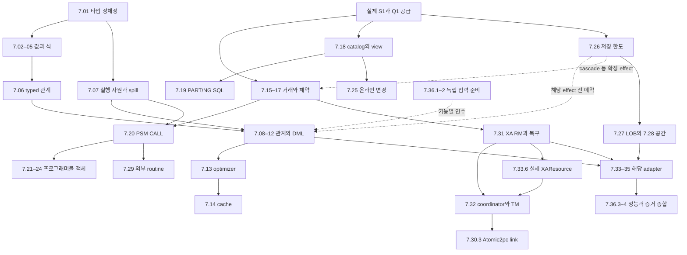

# DEV7 — 36개 세부 작업 분류와 공급·인수 연결

2026-10-22 · **36개 분류·135개 하위 작업 / D7-WBS-002 채택·독립 정적 검토 PASS / 상세 동결·제품 구현·실행 NOT_RUN**

[개발 문서](../README.md) · [기존 구현·검증 계획](dev7-implementation-plan.md) · [설계 정본](../contracts/dev7-sql-extensions-design.md) · [ARIES·Oracle·로컬 소스 조사](../evidence/dev7-work-breakdown-research.md)

## 1. 분류 범위와 읽는 방법

DEV3의 [공급·완료 경계](dev3-implementation-plan.md#remaining-work)처럼 DEV7의 큰 구현 묶음을 **36개 분류(7.01–7.36)·135개 하위 작업**으로 나눈다. 하위 작업 수에는 logging의 보류 추적 7.35.3 한 항목을 포함한다. 기능 위치를 찾는 대분류와 실제 배정할 하위 작업을 구분한다. DEV7의 범위가 더 넓으므로 DEV3의 16개에 개수를 맞추지 않는다. 번호는 실행 순서·같은 작업량·진행률이 아니다. 작업마다 기존 산출물·선행 공급·완료 조건·인수 책임을 연결하며 새로운 SQL 의미·API·byte·수치 한도를 채택하지 않는다.

[분배 검토와 보완](../evidence/dev7-work-breakdown-review-20261022.md#applied)에 따라 초기115개 중 큰 책임을 추가 분해했다. 기존 상위 ID·64개 요구·필수 범위는 유지하며 변경한 하위 ID의 이동은 [대응표](#leaf-handoffs)에 기록한다. 초기115개 분류의 조사 기록은 당시 증거로 보존한다.

XADB-037–041, SC07–SC11, D7-I01–I07, F01–F10, T01–T32, C01–C10, P01–P05의 ID는 유지한다. 아래에서 F/T/C/P 접두어를 생략한 숫자도 모두 기존 `D7-` ID다. **7.xx는 개발 작업, Txx는 인수 묶음**이며 같은 번호끼리 대응하지 않는다. [64개 요구 배정표](dev7-implementation-plan.md#coverage)에 작업 번호를 추가하여 원래 요구를 보존한다.

| 기존 묶음·상위 task | 세부 작업 | 경계 |
| --- | --- | --- |
| I01 / XADB-037·SC07 | 7.01–7.05 | 값·타입·함수·공통 codec |
| I02 / XADB-038·SC08 | 7.06–7.14 | 관계 의미·실행 자원·optimizer·cache |
| I03 / XADB-038·SC08 | 7.15–7.19, 7.26의 거래 공급 | engine 거래·제약·catalog·PART/NG 소비 |
| I04 / XADB-039·SC09 | 7.20–7.25 | PSM·객체별 효과·온라인 변경 |
| I05 / XADB-040·SC10 | 7.26–7.28 | 저장 한도 공급·LOB·공간 |
| I06 / XADB-041·SC11 | 7.29–7.32, 7.35 | 외부 효과·XA·교환 adapter; logging 보류 유지 |
| I07 / 각 기능의 client 및 종합 인수 | 7.33–7.34, 7.36 | 실제 client/runtime 연결·증거 종합 |

상위 task의 의존성과 DEV7 진입 DEV4는 [단계 JSON](development-stages.json)·[완료 계약](stage-completion.json)이 소유한다. 아래의 좁은 공급을 미리 준비할 수 있어도 상위 task의 인수 선행을 삭제하지 않는다. server 기능은 실제 B3/C1, client 기능은 CLIENT1의 해당 API, partition은 PART/NG의 해당 공급을 추가 수신한다. 현재 DEV2 부분 구현·DEV3 미완료 상태를 영속 공급 완료로 해석하지 않는다.

## 2. 모든 작업의 착수·완료 기록

| 항목 | 기록할 내용 |
| --- | --- |
| 작업 소유 | 7.xx.y, 실제 담당/계약 담당/통합 담당·필요한 독립 검토자, 기준 commit·dirty digest, 실제 변경 경로·symbol. 계획만으로 빈 crate·runner를 만들지 않음 |
| 선행 수신 | 해당 행에 적힌 기능의 실제 API·revision·증거 범위. 대분류 전체 완료 대신 소비하는 좁은 공급을 명시하고 아직 없는 공급은 미완료로 남김 |
| 구현 전 동결 | 해당 F01–F10의 operation/type/overload·입출력·오류·상태·byte·자원·fault 입력. 분류표가 F 동결을 대신하지 않으며 `detail_expansion_required=true` 유지 |
| 구현과 함께 추가 | 독립 expected·fixture·oracle·known-bad·실제 API/harness·fault witness를 새 경로와 함께 작성. native·SQL·server/client 증거를 각각 구별 |
| 자원·복구 | 첫 effect 전에 해당 F03/F06/F07/F09의 예약/소비/반환·공존 peak·rollback/재장애 입력을 고정. 7.26이나 7.36이 뒤 번호라는 이유로 이를 뒤로 미루지 않음 |
| 완료 | 아래 산출물과 관련 정상·경계·오류·I/O/thread/reopen·검토 결과. 공급 완료와 사용자 경로 통합 완료를 구분하고 미실행·FAIL·중단의 원본 상태 보존 |

실제 배정은 `7.xx.y + 해당 type/operation/adapter variant`로 고정한다. 각 leaf에 **직접 공급 ID·소비 API/계약·산출물·공급 완료 사례·소비 경로 통합 사례·해당 F 입력·공유 파일 소유자**를 기록한다. Txx 전체를 각 하위 작업의 종료 조건으로 복제하지 않고 관련 사례를 선택한다. 아래 인계표의 공통 선행은 해당 대분류 행에서 상속하며, 한 family/adapter 완료가 다른 family/adapter 전체를 막지 않는다. 세부 byte/함수 목록은 해당 F 동결에서 정하고 모든 F의 일괄 완료를 착수 장벽으로 만들지 않는다.

시험 실행은 [현재 사용자 지시](../../AGENTS.md)를 따른다. 마지막 관련 검증 이후 실제 코드 diff를 먼저 case와 연결하고 **새로 작성·수정한 코드의 필수 시험만 선택**한다. 새 연결 코드에는 그 통합 경로의 시험을 추가한다. 변경 없는 하위 코드·완료 시험·전체 workspace/leaf/회귀 wrapper는 반복하지 않는다. DEV3 S5의 전수 실행 예외를 DEV7에 확대하지 않는다. 모든 필수 의무의 결과를 확보하는 것과 이미 끝난 시험을 다시 실행하는 것을 구분한다. 아래 표는 앞으로 만들고 인수할 책임이며 이번 실행 명령이 아니다.

## 3. 값·타입·식: 7.01–7.05

소유 정본은 [SC07 값·타입·식](../contracts/dev7-sql-extensions-design.md#types), 동결은 F01이며 F08/F09의 실제 소비·독립 입력을 연결한다. 값 family 하나를 추가할 때 그 family의 저장/index/spill/wire까지 추적하며 다른 family 전체를 기다리지 않는다.

| ID·소유 | 실제 배정 단위와 산출물 | 직접 선행 | 완료 조건·인수 |
| --- | --- | --- | --- |
| 7.01 타입 정체성·codec / foundation·engine·SQL·server/client | 7.01.1 TypeDescriptor·ComparisonDescriptor; 7.01.2 family별 canonical value/key/hash; 7.01.3 engine row/index/WAL 매핑; 7.01.4 SQL temp/spill 매핑; 7.01.5 metadata·wire 매핑 인계 | DEV1 의미·DEV4 typed 값, 저장 소비는 S1 | 공유 값 의미의 소유자는 하나, 물리 envelope는 각 소비 계층 소유. 비교 문맥·NULL 동등성과 byte version을 독립 vector로 연결. 각 family의 7.02–05 및 7.33과 통합; T01–04/28/31 |
| 7.02 수치 / foundation·SQL | 7.02.1 정수 범위; 7.02.2 decimal/NUMBER/FLOAT와 산술·rounding/cast; 7.02.3 binary float·NaN/-0 | 7.01.1의 해당 descriptor | 유리수/decimal 독립 정답, overflow·음수 scale·중간 rounding과 metadata 일치; T01 |
| 7.03 문자·binary·bit / foundation·SQL | 7.03.1 길이·padding·빈 값; 7.03.2 Unicode/collation·비교 정규화; 7.03.3 byte/bit codec | 7.01.1, Unicode 의존 선택 F01 | CHAR/VARCHAR 삼항 반례·부정 UTF-8·padding bit·index/scan 동등성. 전역 equality 추론 금지 경계를 7.08/13에 인계; T02 |
| 7.04 날짜·시간·interval / foundation·SQL | 7.04.1 local/instant/calendar 표현; 7.04.2 interval 산술·precision; 7.04.3 timezone·format/parse | 7.01.1, F01의 달력/tzdb 지원표 | DST gap/overlap·월말·경계의 고정 기대값, OS locale 비의존·driver 정밀도; T03 |
| 7.05 식·함수 / SQL | 7.05.1 cast/overload·NULL·lazy 조건식; 7.05.2 수치/문자/시간 함수; 7.05.3 regex 지원·종료/의존 검토; 7.05.4 hash 함수; 7.05.5 암호 API·key/nonce·인증 실패/의존 검토 | 7.02–04의 해당 값, DEV4 expression | 전체 함수·overload inventory, 오류/volatility·선택하지 않은 branch 미실행, regex 종료·crypto 부정 vector·secret 비노출; T04 |

## 4. 관계 실행·계획: 7.06–7.14

정본은 [관계 실행](../contracts/dev7-sql-extensions-design.md#relational)·[optimizer](../contracts/dev7-sql-extensions-design.md#optimizer)·[자원](../contracts/dev7-sql-extensions-design.md#resources), 동결은 F02/F09다. 7.07의 공통 수명 공급을 각 operator의 의미와 분리하며 모든 operator 완료를 spill 구현의 선행으로 요구하지 않는다.

| ID·소유 | 실제 배정 단위와 산출물 | 직접 선행 | 완료 조건·인수 |
| --- | --- | --- | --- |
| 7.06 문법·typed 관계 계획 / SQL | 7.06.1 grammar/이름·상관 scope; 7.06.2 output/NULL/order/dependency·volatility; 7.06.3 기능별 logical node | DEV4 Q1의 parser/binder, 7.01/05의 해당 표현 | 잘못된 scope/type·unsupported variant의 effect 전 오류, 독립 bag 입력 인계. 문법 수락만으로 실행 완료 판정 금지; T05–09/31 |
| 7.07 실행 수명·sort/spill / SQL | 7.07.1 open/next/close·snapshot/workspace 소유; 7.07.2 sort/spool·temp codec; 7.07.3 quota·FD·취소·cleanup/계측 | DEV4 실행·S1 scan/snapshot, 7.01 codec·F09 | query 합산 한도·전환 공존 peak·부분 I/O·삭제 실패 charge 유지. skew fallback은 미공개 partition만 전환; T30, C09, P01 |
| 7.08 join·subquery·lateral / SQL | 7.08.1 nested/correlated 기준선; 7.08.2 hash join·skew/spill; 7.08.3 semi/anti·decorrelation·각 경로 합류; 7.08.4 merge join; 7.08.5 index join | 7.06, 7.07의 해당 공급, 7.03 비교; index는 S1 해당 key | 0/1/N·NULL·중복 곱·outer ON/WHERE·scalar cardinality, 문맥별 hash/merge/index와 독립 bag 대조; T05/30, C09 |
| 7.09 집계·grouping / SQL | 7.09.1 sort aggregate·DISTINCT; 7.09.2 grouping sets/rollup/cube; 7.09.3 bounded hash/skew/spill | 7.06/07, 해당 수치·비교 | 빈 전체/grouped·all-NULL·GROUPING bit·overflow·bag multiplicity; T06/30, C09 |
| 7.10 window / SQL | 7.10.1 partition/order·peer; 7.10.2 함수와 ROWS/RANGE/GROUPS/EXCLUDE; 7.10.3 큰 partition spool·취소 | 7.06/07, 해당 7.05/09 함수 | 기본 frame·ties·NULL order·경계·incomplete prefix. total order 없는 결과의 허용 집합을 oracle에 명시; T07/30, C09 |
| 7.11 set·재귀·pivot / SQL | 7.11.1 ALL/DISTINCT·정렬/부분 결과; 7.11.2 recursive frontier/visited/path·SEARCH/CYCLE; 7.11.3 pivot/unpivot | 7.06/07, pivot은 해당 7.09 | 중복 수·NULL set 동등·diamond/cycle·깊이/행 한도 초과 오류·빈 cell/type. 세 하위 기능은 독립 배정; T08/30, C09 |
| 7.12 확장 DML / SQL·engine | 7.12.1 INSERT SELECT·target spool; 7.12.2 MERGE/upsert·중복 target; 7.12.3 RETURNING·최종 제약·rollback 연결 | 해당 7.06–11, DEV4 DML·S1 observation/undo; 새 제약/trigger 사용 시 7.17/22 | Halloween·동일 target 다중 source·동시 갱신·실패 후 반환0. 큰 거래는 7.26 공급 후; T09/12, C01 |
| 7.13 optimizer·통계 / SQL | 7.13.1 규칙별 전제·known-bad; 7.13.2 ANALYZE·sample/stats epoch; 7.13.3 bounded 탐색·비용·index 선택 | 해당 7.06–12의 기준 실행, 7.01 비교·S1 index | rule off/on과 독립 oracle, stale/skew에도 정답·quota 유지. 혼합 비교 추이성 mutant 거절; T10/31, P01/02 |
| 7.14 prepared cache·재최적화 / SQL·server | 7.14.1 immutable key/dependency·pin/eviction; 7.14.2 execute 권한/metadata 재검사; 7.14.3 generic/custom 후보·계측 | DEV4 기본 prepare·DEV5 해당 권한, 7.13의 해당 plan | schema/search path/권한 변경 race, metadata 변경 ReprepareRequired, 결과 중간 재시작0·cache full uncached 경로; T10/28/30, P02 |

## 5. 거래·제약·객체: 7.15–7.19

정본은 [제약·격리·savepoint](../contracts/dev7-sql-extensions-design.md#constraints)와 [catalog·DDL·partition](../contracts/dev7-sql-extensions-design.md#objects), 동결은 F03/F04다. native 공급을 먼저 닫고 SQL 노출을 별도 인수한다.

| ID·소유 | 실제 배정 단위와 산출물 | 직접 선행 | 완료 조건·인수 |
| --- | --- | --- | --- |
| 7.15 격리·명시 잠금 / engine·SQL | 7.15.1 RC/RR/Serializable history·관측 재검증; 7.15.2 row/range/table·NOWAIT/WAIT/cancel; 7.15.3 SQL/session mode | S1 snapshot/lock/validation·Q1 거래 | RC 문장/RR 거래 snapshot·RR write skew 구분, phantom 보호·deadlock full abort, Prepared victim 제외는 7.31 합류; T11, M01 |
| 7.16 savepoint·실패 경계 / engine·SQL | 7.16.1 marker/generation·재지정/release; 7.16.2 native undo/CLR·복원 경계 공급; 7.16.3 호출 frame marker 인계 | S1 statement/full undo·recovery, DEV4 오류 | read dependency/거래 lock과 누적 WAL 보존, 반복 rollback·재장애. deferred ledger의 실제 복원 합류는 7.17.3, LOB/queue는 해당 소비 구현 때 인수; T12, C01, M01 |
| 7.17 CHECK·FK·deferred / engine·SQL | 7.17.1 row CHECK·기존 PK/UNIQUE 연결; 7.17.2 parent/child 보호 probe·cascade; 7.17.3 deferred ledger·commit 검사 | S1 key/index/commit, 7.05의 허용 식, 해당 7.15/16 | 부모 삭제/자식 삽입·self/cycle·동적 역순 lock, 최종 제약·실패 rollback. snapshot SELECT를 보호 probe로 대신하지 않음; T11/12, C01 |
| 7.18 catalog·DDL·view/refresh / catalog·SQL | 7.18.1 dependency·metadata/DDL·index lifecycle; 7.18.2 view·간접 이름; 7.18.3 물리화·full refresh; 7.18.4 incremental 지원 질의·변경분 계약/공급 구현; 7.18.5 incremental 적용·진척/재시작 인수 | S1 catalog/commit·Q1 DDL, 해당 관계/DML·7.17; 증분 적용은 7.18.4의 실제 공급 | DDL 전 commit과 DDL 결과 구별, refresh 실패 old generation 유지·plan 무효화·reopen. 증분은 중복/누락·동시 DML·재시작 후 원질의/full 대조. full 성공으로 대신하지 않으며 F04 동결·D-LOGGING 보류 유지. online은 7.25; T13, C04 |
| 7.19 PART/NG SQL / SQL·storage | 7.19.1 분할 정의·pruning; 7.19.2 행 이동·local/global index; 7.19.3 lifecycle·관측 | 실제 P1/H2/H3의 해당 API, 7.18·관련 extended type/DML | prune/no-prune 대조·추가/삭제/분할/병합/교환·stale plan. core 미공급을 SQL 성공으로 숨기지 않음; T14 |

## 6. 프로그래머블 객체: 7.20–7.25

정본은 [PSM](../contracts/dev7-sql-extensions-design.md#psm)·[온라인 객체](../contracts/dev7-sql-extensions-design.md#objects), 동결은 F05와 해당 F04/F08이다. PSM 전체를 모든 기초 공급의 선행으로 삼지 않고 거래/sequence/queue의 native 공급과 소비를 구분한다.

| ID·소유 | 실제 배정 단위와 산출물 | 직접 선행 | 완료 조건·인수 |
| --- | --- | --- | --- |
| 7.20 PSM·CALL / SQL·server | 7.20.1 구문/이름/overload; 7.20.2 cursor 수명; 7.20.3 atomic CALL·OUT/result spool; 7.20.4 frame·제어 실행; 7.20.5 예외·unwind; 7.20.6 record/array/typeset; 7.20.7 dynamic SQL·권한 | 해당 SC08/7.05/06/07/16·catalog, B3 권한 | 직접/중첩/동적/trigger의 거래 제어 차단·호출자 marker 보호, 실패 시 OUT/row0·unwind·instruction/depth 합산. REF CURSOR는 7.33 연결; T15/28/30, C01 |
| 7.21 package·autonomous / SQL·server·engine | 7.21.1 package state/의존·generation; 7.21.2 자식 transaction·독립 outcome; 7.21.3 pool reset·취소 | 7.20의 frame, 7.15/16, B3 세션·S1 commit | 세션 격리·부모 rollback 뒤 자식 commit 보존·self-lock deadlock·child UNKNOWN, 일반 중첩 CALL과 구분; T16/28 |
| 7.22 trigger / SQL·engine | 7.22.1 등록·실행 순서·OLD/NEW; 7.22.2 cascade/재귀·mutating table; 7.22.3 statement-final 제약/rollback 합류 | 7.20의 호출 기반, S1/DEV4 DML, 7.17/18 | 동적 lock closure·최종 UNIQUE/FK·trigger 오류와 RETURNING 비공개. 7.12의 확장 DML 합류는 후속이며 상호 전체 완료를 요구하지 않음; T09/15/17, C01 |
| 7.23 sequence / catalog·engine·SQL | 7.23.1 범위 예약·WAL; 7.23.2 NEXTVAL/CURRVAL·cache/session; 7.23.3 lifecycle·재시작 | S1 catalog/WAL/복구, F05의 발급 계약 | non-cycle 확정 발급 재사용0·gap 허용·불명 sync 뒤 재발급 금지. 일반 row rollback과 효과 구분; T17, C02 |
| 7.24 queue·scheduler·built-in package / engine·server·SQL | 7.24.1 transactional enqueue/claim/ack; 7.24.2 lease/fencing·scheduler/cancel; 7.24.3 관리/통신 ACL·effect API | queue는 S1·7.16, job은 해당 7.20/B3 권한·worker | rollback 재소비·stale worker·중복 전달·clock jump·dead-letter, 외부 효과 certainty 분리. 세 하위 단위별 인수; T18, C03, M05 |
| 7.25 온라인 객체 변경 / catalog·storage·server | 7.25.1 build/delta capture; 7.25.2 catch-up/writer fence/switch; 7.25.3 abort/old 회수·복구 | 7.18의 lifecycle·S1 commit/회수, 해당 index/PART 공급 | 각 상태 cut·delta overflow·old/new reader·switch 후 취소·재장애. Prepared와 충돌 시 resolve 차단 없이 자기 작업 Busy; T19, C04/07 |

## 7. 저장 한도·LOB·공간: 7.26–7.28

정본은 [저장 확장](../contracts/dev7-sql-extensions-design.md#storage-extension), 동결은 F03/F06이다. 공통 7.01과 실제 XADB-029 공급을 수신한다.

| ID·소유 | 실제 배정 단위와 산출물 | 직접 선행 | 완료 조건·인수 |
| --- | --- | --- | --- |
| 7.26 D7-STORAGE·큰 거래 / engine | 7.26.1 opcode별 forward/undo/CLR·공존 peak 산식; 7.26.2 admission·profile/format; 7.26.3 실제 rollback/복구 공급 | 실제 S1·XADB-029, 해당 소비자의 고정 opcode 입력 | 기본 S1 한도·과거 증거와 구분, 큰 DML/LOB를 숨은 여러 commit으로 나누지 않음. 7.12/17/22/24/27의 관련 효과를 각각 계산; T12/20/30/31, C01 |
| 7.27 LOB / engine·SQL·client | 7.27.1 chunk/descriptor·undo·회수; 7.27.2 read/write/append/truncate·Unicode offset; 7.27.3 locator/pin·stream/cancel | 해당 7.26, 7.01, S1 snapshot·allocator; stream은 B3/CLIENT1 | NULL/empty·chunk 누락/중복·snapshot aging·stale locator·ENOSPC·recrash, 7.16 rollback 합류; T20/28/30, C01/08, M03 |
| 7.28 geometry·공간 index·파일 / engine·SQL·adapter | 7.28.1 subtype/SRID·내부/WKT/WKB codec; 7.28.2 topology 검증·exact 관계 predicate; 7.28.3 bbox 후보+exact 검사; 7.28.4 shapefile 교환; 7.28.5 거리 연산; 7.28.6 buffer/union/intersection 등 geometry 생성 | 7.01/07·S1 index, F06의 기하 의존/지원표; 큰 값은 해당 7.26 | invalid/empty·SRID/차원 거절·경계·false negative0·독립 geometry fixture·부분 파일·무손실 교환. 지원 연산군별로 인수; T21/22/28/30 |

## 8. 외부 효과·XA: 7.29–7.32

정본은 [외부 효과](../contracts/dev7-sql-extensions-design.md#external)·[XA](../contracts/dev7-sql-extensions-design.md#xa), 동결은 F07/F08이다. RM은 engine의 영속 거래, coordinator는 server의 분산 결정 소유이며 한 작업으로 합치지 않는다.

| ID·소유 | 실제 배정 단위와 산출물 | 직접 선행 | 완료 조건·인수 |
| --- | --- | --- | --- |
| 7.29 외부 C/C++ routine / server·adapter | 7.29.1 등록/digest·bounded ABI; 7.29.2 별도 worker·권한/격리; 7.29.3 timeout/cancel·certainty | XADB-039/036의 해당 공급·B3/C1, 7.20 호출·7.01 값 | 실제 ABI·crash/oversize·old worker·dangling result·외부 effect UNKNOWN. engine/server 직접 library load 없음; T23, C08 |
| 7.30 DB link / SQL·server·adapter | 7.30.1 ReadOnly와 type mapping/pushdown; 7.30.2 IndependentRemote; 7.30.3 Atomic2pc·격리 capability | 해당 관계/외부 연결·XADB-039/036; atomic은 7.31/32 | 단절/중복 reply·무손실 또는 오류, 비2PC peer·미지원 전역 격리를 effect 전 거절. 2PC 성공을 전역 Serializable로 확대하지 않음; T24/26, C08 |
| 7.31 XA RM·prepared 복구 / engine·server | 7.31.1 XID/flags·active/end; 7.31.2 prepare WAL/잠금/예약·session 분리; 7.31.3 checkpoint/reopen·reserved resolve; 7.31.4 decision/CLR·정상 retirement; 7.31.5 heuristic/recover/forget | S1 commit/undo/checkpoint/recovery·7.15/16/17, F07; API 노출은 B3/7.33.6 | native에서 먼저 prepared를 loser와 구별·admission 전 보호 복원. close/만료/DDL/backup·Prepared32 압력에도 해소 진행. StandardXa 추가 ACK 없는 정상 회수와 heuristic 영속 보존 구별; T25/30/31, C05/07, M04 |
| 7.32 coordinator·실제 TM / server·client | 7.32.1 participant/vote·durable journal; 7.32.2 decision sync/재전달·재시작; 7.32.3 StandardXa 실제 두 RM/TM; 7.32.4 DecisionReceiptAck1 확장 | F07·XADB-039/036·실제 transport; 7.32.3은 7.31 native·7.33.6의 실제 XA 연결 | YES/decision/ACK 유실·손상과 decision 부재 구별·결정 불변, NOTA로 성공 합성0. 전역 cycle·read-only vote와 확장 ACK/frontier 구멍 별도 인수; T26, C06/07, M04, P04 |

7.31의 native 준비를 coordinator 완성까지 미루지 않는다. 7.32 journal/독립 모델 준비도 실제 RM 전체 구현과 구분한다. 다만 SQL_EXT1의 외부 transaction 인수에는 실제 두 RM/TM·client 연결이 필요하다. 일반 undo·WAL/CLR 공급은 DEV3 정본을 확장하여 소비하며 두 번째 복구 엔진을 만드는 분류가 아니다.

## 9. Client·교환·종합: 7.33–7.36

정본은 [client](../contracts/dev7-sql-extensions-design.md#clients)·[외부 교환](../contracts/dev7-sql-extensions-design.md#external)·[인수](dev7-implementation-plan.md#acceptance), 동결은 F08–F10이다. API 계약은 해당 feature와 함께 준비하고 실제 adapter는 소비 공급이 생길 때 연결한다.

| ID·소유 | 실제 배정 단위와 산출물 | 직접 선행 | 완료 조건·인수 |
| --- | --- | --- | --- |
| 7.33 protocol·native/C/JDBC/ODBC / server·client | 7.33.1 capability/type/result schema; 7.33.2 Callable/OUT/multi-result; 7.33.3 LOB; 7.33.4 cancel/pool reset; 7.33.5 spatial 매핑; 7.33.6 XAResource; 7.33.7 batch/array; 7.33.8 generated keys | 실제 DEV5/6 해당 API, 7.01.5 및 소비 feature의 공급 | 기능×실제 adapter별 metadata/partial buffer·CALL 실패 공개0·REF CURSOR/LOB pin·Prepared 세션 인계. schema 동결과 각 adapter 실행을 구분; T28, C08 |
| 7.34 embedded SQL·언어·framework / client·도구 | 7.34.1 host/indicator/array·생성/빌드; 7.34.2 PDO; 7.34.3 framework 업무; 7.34.4 .NET; 7.34.5 원격 TCP/TLS/auth 공급 수신·연결 | 7.33 해당 API·실제 언어 runtime·DEV5/COMM 원격 공급 | runtime/framework별 clean build·실제 업무·thread/connection·metadata/인증 실패. 원격 구현 소유는 DEV5/COMM, 이 작업은 실제 연결 인수. 예제·local-only 대체 금지; T29 |
| 7.35 이종/분산 교환·logging 예약 / adapter | 7.35.1 Oracle/JDBC mapping/binding/batch·certainty; 7.35.2 HDFS bulk/file/stream; 7.35.3 R10-03 내부·R10-05 보류 추적; 7.35.4 Hive 교환 | F08·실제 peer/runtime, 해당 7.01/30/33 | 외부 완결/부분 실패·type/encoding, 로컬 fixture와 원격 업무 구별; T27, C10. 7.35.3은 **DEFERRED_BY_USER / D-LOGGING**, 상세 설계·시험 작성/실행 재개 아님 |
| 7.36 독립 검증·자원·성능·전체 의무 / testing·통합 | 7.36.1 64요구→operation/variant/case와 known-bad; 7.36.2 M01–05·fault/복구 history; 7.36.3 합산 자원·P01–05·재현; 7.36.4 SC07–11/SQL_EXT1 증거 취합 | F09/F10·각 실제 공급. oracle/fixture 준비는 처음부터 | T01–32·C01–10·P01–05 적용 의무의 누락/오인수 방지, source/binary/expected/원시 결과 연결. 미해결 logging·선행·실패가 있으면 전체 미완료; T30–32 |

7.36은 모든 테스트를 마지막에 만드는 작업이 아니다. 각 기능과 함께 만든 oracle·harness·fixture의 책임을 종합한다. 이전 결과는 원래 source와 실행 범위로 보존하며 누락/중단을 새 PASS로 채우지 않는다. DEV7 checker·worker는 아직 없고 `run_entrypoint=null`, 모든 제품 인수는 `NOT_RUN`이다.

## 9.1 하위 작업의 공급·통합 경계

아래는 분량이 크거나 상호 전체 완료로 오인하기 쉬운 연결을 하위 ID로 고정한 배정표다. 위 대분류의 해당 F·실제 하위 공급을 함께 수신한다. `공급 완료`는 그 산출물의 필수 사례를 갖췄다는 뜻이며 소비자 통합이나 상위 기능 완료를 대신하지 않는다. 각 행의 사례는 앞으로 구현과 함께 작성할 의무다.

| leaf | 직접 수신·산출물 | 공급 완료 → 소비 통합 인수 |
| --- | --- | --- |
| 7.01.1 | DEV1/DEV4 의미·F01 → descriptor/비교 문맥 | 타입/비교 독립 vector → 해당 family |
| 7.01.2 | 7.01.1·해당 7.02–04 값 의미 → canonical payload/key/hash | 정규화·동등/hash vector → 7.01.3/4. 값 의미 구현은 이 물리 소비를 기다리지 않음 |
| 7.01.3 | 7.01.2·S1 → engine row/index/WAL 수용 | 손상/경계·scan/key 일치 → 해당 저장/reopen 경로 |
| 7.01.4 | 7.01.2·DEV4 temp 공급 → SQL spill 수용 | length/checksum·부정 입력 → 7.07.2와 operator |
| 7.01.5 | 7.01.1·해당 family·F08 → metadata/wire 매핑 계약 | 손실/정밀도·지원표 → 7.33.1의 실제 transport/driver |
| 7.05.3/4/5 | 7.05.1의 등록/호출·해당 값·F01 → 각각 regex/hash/암호 | 종료 한도/독립 digest/인증 실패·secret 비노출을 각각 인수. 세 작업은 서로 전체 완료를 요구하지 않음 |
| 7.07.1/2/3 | DEV4 실행 → 수명; codec/7.07.1 → sort/spool; ledger/cleanup 계약 → 자원 제한 | 수명·codec·자원 계약을 먼저 공유하고 각 실제 경로가 .3의 quota/cleanup 인수에 합류. 자원 안전성을 마지막으로 미루지 않음 |
| 7.08.1 | 7.06·7.07.1·비교 → nested/correlated 기준 실행 | bag/NULL/cardinality → 후속 알고리즘의 기준 사례 |
| 7.08.2 | 7.08.1·7.07의 temp/ledger → hash/skew/spill | 중복/outer flag·한도/실패 → T05/C09 해당 경로 |
| 7.08.4 | 7.08.1·7.07.2·정렬 문맥 → merge | 동일 key 다중 match·NULL order → T05/C09 해당 경로 |
| 7.08.5 | 7.08.1·S1 index·비교/key 호환 → index join | index/full-scan 일치 → T05 해당 경로 |
| 7.08.3 | 7.08.1·F02 전제 → semi/anti·decorrelation | NULL/cardinality known-bad → 실제 채택한 .2/.4/.5 경로별 합류. 모두 완료까지 기본 경로를 막지 않음 |
| 7.16.1/2/3 | .1 marker → .2 native rollback/CLR → .3 invocation marker 수신 계약 | native rollback/재장애는 deferred 구현과 독립. .3 공급 뒤 7.20 frame/호출 합류 |
| 7.17.3 | 7.17의 제약 식/보호 probe·7.16.1/2 → deferred ledger/commit 검사 | fix/commit fail·marker 복원 → T11/T12/C01. 이 합류가 7.16 native 공급을 소급 차단하지 않음 |
| 7.18.3 | 7.18.1/2·해당 관계 실행·S1 shadow/switch → full refresh | 실패 old 유지·원질의 대조·reopen → T13/C04 |
| 7.18.4 | F04·7.18 dependency·해당 관계 의미 → 증분 지원표/변경분 계약 동결 뒤 선택 방식의 실제 공급 구현 | 지원 질의·적용 cut·중복/누락·보존/진척·동시 DML 기대값 고정, 실제 변경분 생성/보존·rollback/재시작의 독립 공급 인수 → .5 구현. 구체 byte/API는 해당 D2 동결 전 미확정; 보류 기능을 필요로 하면 차단 유지 |
| 7.18.5 | 7.18.4의 실제 변경분 공급·S1 원자 적용/복구·7.18.3 대조 경로 → 증분 적용 | 중복/누락·rollback·동시 변경·재시작 후 원질의/full 대조 → T13/C04. full 결과 diff만으로 증분 공급을 인증하지 않음 |
| 7.20.1/6 | 해당 값·catalog·F05 → 이름/overload; .1+값 → record/array/typeset | scope/모호성·복합 값 경계 → 해당 실행 frame |
| 7.20.4 | 7.20.1·7.05·7.16.3 → frame/제어·atomic 문맥 전달 | instruction/depth·marker 소유·거래 제어 거절 → .2/.5/.7 및 CALL |
| 7.20.5 | 7.20.4·7.16.2 → handler/unwind | statement 복원과 full-abort/Fenced 구분 → .3 CALL 실패 인수 |
| 7.20.2 | 7.20.4·7.07·해당 관계 실행 → cursor 수명 | close/취소·snapshot/spool 소유 → .3 REF CURSOR 합류 |
| 7.20.7 | 7.20.4/5·일반 binder·B3 권한 → dynamic SQL | definer/호출자 권한·직접/동적 같은 거래 차단 → .3 및 trigger 경로 |
| 7.20.3 | 7.20.4/5·7.07.2·7.16; cursor/복합 값/동적 SQL은 해당 .2/.6/.7 → atomic CALL | 실패 OUT/row0·성공 spool/handle 수명 → 7.33.2. 각 지원 variant를 추가할 때 관련 합류 사례 추가 |
| 7.26.1/2/3 | 실제 S1·XADB-029·소비 opcode → .1 공존 peak; .1 → .2 admission/profile; .2 → .3 rollback/복구 | 실제 effect 전 .1/.2 수신, 큰 거래/LOB 공개 전 .3 인수. 소비별 .1 입력 작성은 관계/PSM 전체 완료와 독립 |
| 7.28.1/2 | 7.01·F06 → geometry codec; .1+기하 dependency → topology/predicate | invalid/empty/SRID·경계 fixture → index/각 연산 |
| 7.28.3/4/5/6 | .3은 .1/.2+S1 index; .4는 .1+실제 파일 adapter; .5/.6은 .1/.2+F06 지원표/자원 | 각각 false-negative0/무손실 파일/독립 거리/생성 geometry fixture와 한도·취소. 서로 불필요한 전체 완료 장벽 없음 |
| 7.31.1/2/3/4/5 | .1 상태 → .2 native prepare; .2 → .3 재구성/예약 control 수신; .2/.3 → .4 결정/해소·회수; 상태·복구·해소 공급 → .5 heuristic/recover/forget | .3의 예약 경로 공급과 .4/.5의 실제 resolve를 연결해 압력 중 진행을 인수. 복구/해소 미완료 상태로 외부 prepare를 공개하지 않음. .3은 인증된 server 제어 경계를 수신하며 7.33 전체를 요구하지 않음; T25/C05/C07 |
| 7.32.1/2 | F07·실제 journal effect → participant/vote; .1 → 결정/재전달 | journal 손상/부재·결정 불변 독립 모델/실제 I/O → 실제 RM 합류 |
| 7.33.1 | 7.01.5·DEV5/6·F08 → capability/schema 실제 연결 | 타입별 독립 vector 왕복·부정 capability → 해당 기능 adapter |
| 7.33.2/3/5 | .2는 7.20.3; .3은 7.27; .5는 7.28의 값/해당 연산; 모두 .1 수신 | Callable 공개/LOB pin·취소/spatial 무손실 → 실제 native/C/JDBC/ODBC 지원 셀별 T28 |
| 7.33.6 | 7.31 native·7.33.1·B3 resolve·F07/F08 → 실제 XAResource | state/flags·회복 scan·session 분리 → 7.32.3. LOB/spatial 및 coordinator 전체를 선행으로 요구하지 않음 |
| 7.32.3/4 | .3은 7.32.1/2·7.31·7.33.6·실제 두 RM/TM; .4는 별도 확장 profile과 양쪽 구현 | 표준 실제 T26/C06/C07/P04 → 협상 ACK/frontier 인수. 확장 성공으로 표준 인수 대체 금지 |
| 7.33.7/8 | .7은 .1·해당 DML/배열 값·F08 batch 의미; .8은 .1·해당 DML/키 공급 | 모드별 partial count/원자성·키/행 대응 → 지원 driver별 T28 |
| 7.33.4 | DEV5/6 기본 reset·해당 .2/.3/.6·package 공급 → 확장 reset/cancel | 실제 지원 상태별 정리/폐기·Prepared 인계 → pool 반복. 미구현 상태를 지원한 것으로 표시하지 않음 |
| 7.34.1/2/4 | 각각 embedded 생성·PDO·.NET의 실제 runtime와 해당 7.33 API | 각 clean build/host·indicator·연결 업무 → T29 해당 runtime |
| 7.34.3/5 | .3은 선택 framework+해당 실제 driver; .5는 DEV5/COMM TCP/TLS/auth+driver | framework metadata/업무와 원격 정상/인증·단절 오류를 구별. 원격 업무에는 .5 인수 추가 |
| 7.35.1/2/4 | 실제 Oracle/JDBC·HDFS·Hive runtime와 해당 값/연결; 선택 Hive 경로가 HDFS를 쓰면 .2 추가 | 각 원격 완결/부분 실패·certainty·type → T27/C10. fixture는 end-to-end logging 인수가 아님 |
| 7.36.1/2/3/4 | .1 요구/expected·.2 모델/fault 준비는 초기; .3은 기능별 자원/성능 공급; .4는 원래 결과 취합 | 관련 diff 사례·독립 검토까지 기록, 기존 무변경 시험 반복 없음 |

증분 refresh의 변경분 방식은 F04에서 선택한다. D-LOGGING의 상세 추출·구독 설계/시험은 보류한다. 선택한 방식이 그 보류 공급을 필요로 하면 .4/.5의 차단으로 기록하고, 필요하지 않은 방식까지 자동으로 보류하지 않는다.

초기115개에서 책임을 이동한 대응은 다음과 같다. 초기 실행 증거가 없으므로 과거 시험 identity 변경은 없으며, 초기 조사 문서는 당시 번호로 보존한다.

| 초기 하위 ID | 현재 배정 |
| --- | --- |
| 7.01.2 / 7.01.3 | canonical·engine·spill은 7.01.2/3/4, metadata/wire는 7.01.5 |
| 7.05.3 | regex 7.05.3, hash 7.05.4, 암호 7.05.5 |
| 7.08.2 | hash 7.08.2, merge 7.08.4, index 7.08.5 |
| 7.16.2 | native 공급은 유지, deferred 실제 복원 합류는 7.17.3 |
| 7.18.4 | 지원/변경분 계약·실제 공급 구현 7.18.4, 실제 적용/인수 7.18.5 |
| 7.20.1 / 7.20.2 | 구문 7.20.1·frame 7.20.4·예외 7.20.5 / cursor 7.20.2·복합 값 7.20.6·dynamic SQL 7.20.7 |
| 7.28.2 | topology/predicate 7.28.2, 거리 7.28.5, geometry 생성 7.28.6 |
| 7.33.2 / 7.33.3 | CALL 7.33.2·batch 7.33.7·keys 7.33.8 / LOB 7.33.3·spatial 7.33.5·XA 7.33.6 |
| 7.34.2 / 7.34.3 | PDO 7.34.2·.NET 7.34.4 / framework 7.34.3·원격 연결 7.34.5 |
| 7.35.2 | HDFS 7.35.2, Hive 7.35.4 |

## 10. 공급 흐름과 선택 순서

그림은 주요 인계의 요약이다. 전체 선행은 위 표·기존 F 동결·상위 task 계약을 함께 읽는다. 화살표는 해당 좁은 공급이며 앞 대분류 전체 완료 장벽이 아니다.

| 선택 순서 | 우선 공급 | 함께 준비할 입력 |
| --- | --- | --- |
| 0 | 해당 leaf의 F 입력·7.36.1/2·7.26.1 소비 opcode 산식, 7.31 준비/복구/해소 계약 | library·실제 runtime/peer/TM 지원표와 준비 경로. 모든 F 전체 동결이 아닌 관련 위험의 선행 해소 |
| 1 | 7.01.1과 필요한 family → 해당 codec, 7.06/07 최소 공급·관련 7.15–17 native·7.18 dependency | 독립 vector·bag/history, F08 metadata·최소 type 왕복. 큰 효과 전 7.26.1/2 수신 |
| 2 | 7.08–12 기준선·7.18.3 full refresh·해당 driver 연결, 필요한 7.26.3 | 기준 실행 후 해당 7.13/14 최적화. cache 권한/metadata 안전성과 성능 선택을 구별 |
| 3 | 해당 SC08 공급에서 7.20–24, 7.27/28, 실제 선행을 갖춘 7.31 native | CALL/LOB 결과 수명·예약 resolve 진행. 관계/PSM 전체를 XA 설계 준비의 장벽으로 삼지 않으며 상위 인수 선행은 유지 |
| 4 | 7.25·7.18.5·PART/NG 해당 leaf, 7.31→7.33.6→7.32 실제 두 RM/TM·Atomic2pc, 7.34/35 adapter | 환경 준비는 초기부터, 실제 연결은 공급 후. 기본 ReadOnly link/독립 routine 등 준비된 leaf는 이 전체를 기다리지 않음 |
| 5 | 7.36의 남은 자원·성능·증거 통합 | 각 case의 원래 결과와 관련 diff 검증. 미해결 보류·미공급을 완료로 표시하지 않음 |

작업량은 한도·상태 전이·fault·공유 API 변경 범위로 설명한다. [영역별 분량 평가](../evidence/dev7-work-breakdown-review-20261022.md#allocation)를 참고하되 실측 인일로 읽지 않는다. 정수 범위 한 leaf와 PSM/XA/언어 runtime 한 leaf를 같은 가중치로 세지 않는다. 실제 배정은 구현뿐 아니라 fixture/oracle·fault·실제 runtime 설치·검토/통합 부담을 포함하고, 지원표가 큰 leaf는 operation/adapter variant로 더 나눈다. 보류 7.35.3은 구현 완료율로 환산하지 않는다.

공유 descriptor·transaction·wire 계약의 동결/통합은 한 소유자가 조정하며 기능별 구현 담당은 필요한 공급을 받은 단위를 인수까지 닫는다. 분류 수·파일 수를 맞추는 분할이나 진행 중 작업 수 자체의 확대를 목표로 삼지 않는다. 실제 병렬 작업을 시작할 경우 기존 [소유 정책](../policies/parallel-development-policy.md)을 적용한다. 이번에는 제품 구현 담당을 배치하거나 제품 개발을 재개하지 않았다.

## 11. 이번 분류의 상태

초기115개 분류의 작업·통합 담당은 `/root`였으며 D0 문서 배정이었다. 후속 사용자 요청에 따른 **D7-WBS-002**는 135개 하위 작업·공급 인계·위험 우선 준비·인수 구체화를 보완하며 D2로 독립 검토한다. 기존 DESIGN-001/002의 제품 의미·상위 DAG·한도·보류를 바꾸지 않는다. [결정·소유·검토 기록](../evidence/dev7-work-breakdown-review-20261022.md#applied)을 따르며 새로운 API/형식/의미를 구체화할 후속 leaf의 D1/D2 검토는 별도다.

36개 분류와 64개 요구의 연결을 작성했으며 F01–F10 상세 동결·구현·제품 인수는 미완료다. [이번 조사 기록](../evidence/dev7-work-breakdown-research.md)은 실제 열람 revision·위치·적용/비채택 이유를 남긴다. 제품 코드·테스트·빌드·DBMS 실행 비교를 수행하지 않았고 문서 자동 검사는 push gate에 남긴다. 이 분류만으로 DEV3 개발 재개나 DEV7 실행을 승인한 것으로 해석하지 않는다.
